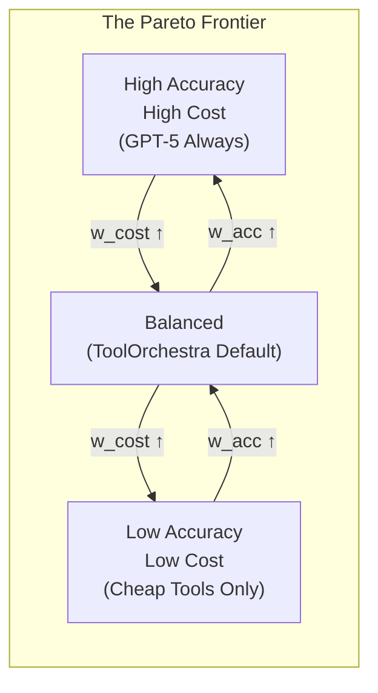

# The Orchestration Paradigm Series: Dive 3
# Multi-Objective Scalarization

> [!NOTE]
> **System Auditor's Log:** In ML engineering, "Reward Design" is where the business requirement meets the mathematical optimizer. The paper claims to balance Accuracy, Latency, and Cost. Mathematically, this is impossible to simplify into a single number without making strong assumptions about the "exchange rate" between dollars and seconds. This post audits those assumptions.

When we train an orchestrator, we ultimately need a single scalar value ($R$) to update the gradients. But the business goal is multi-dimensional. We want the answer to be correct ($O$), cheap ($C$), and fast ($L$).

This is a **Pareto Optimization** problem. There is no single "best" orchestrator. There is an orchestrator that is fast but expensive, and one that is cheap but slow. To train a model using RL, we must perform **Scalarization**, collapsing these vectors into a single number.

## The Objective Functions

ToolOrchestra defines three distinct reward components:

### 1. The Outcome Reward ($R_{outcome}$)
This is binary or continuous based on correctness.
*   Did the model answer the question? (+1)
*   Did it fail? (0)
*   For intermediate steps, there is usually *no reward* (sparse reward problem), forcing the model to look only at the final result.

### 2. The Efficiency Reward ($R_{efficiency}$)
This captures the resource consumption.
$$ R_{efficiency} = - (w_{cost} \cdot \text{NormalizedCost} + w_{lat} \cdot \text{NormalizedLatency}) $$
Note the negative sign. This is a penalty. The model is "taxed" for every token it consumes and every second it waits.

### 3. The Preference Alignment ($R_{pref}$)
This is the dynamic component. It re-weights the efficiency penalty based on the user's stated needs.

## Batch Normalization of Rewards

A major engineering challenge here is **Scale Mismatch**.
*   Accuracy is usually $[0, 1]$.
*   Latency might be $[0.5, 10.0]$ seconds.
*   Cost might be $[0.0001, 0.05]$ dollars.

If you simply sum these ($1 + 5.0 + 0.02$), the Latency term dominates the gradient. The model will learn to be fast above all else, ignoring cost and accuracy.

To fix this, ToolOrchestra uses **Batch Normalization** on the rewards. It tracks the moving average and variance of cost and latency, and normalizes them to a standard normal distribution ($\mu=0, \sigma=1$) before calculating the reward.

```python
# Scalarization Logic with Normalization
# This ensures no single metric dominates the gradient simply due to unit scale.

def calculate_reward(trajectory, preferences, batch_stats):
    # 1. Raw Metrics
    cost_raw = trajectory.total_cost
    lat_raw = trajectory.total_lat
    
    # 2. Normalize (Z-Score)
    # Using tracking stats from the training batch
    cost_norm = (cost_raw - batch_stats.cost_mean) / batch_stats.cost_std
    lat_norm = (lat_raw - batch_stats.lat_mean) / batch_stats.lat_std
    
    # 3. Apply Preferences (The "Exchange Rate")
    # user_prefs maps to [cost_sensitivity, latency_sensitivity]
    penalty = (preferences.w_cost * cost_norm) + (preferences.w_lat * lat_norm)
    
    # 4. Final Scalar
    # Outcome is usually heavily weighted to prevent "fast failure"
    # being preferred over "slow success".
    return outcome_reward - penalty
```

## The Pareto Frontier

This scalarization forces the model to learn an implicit **exchange rate**.
If $w_{cost} = 0.5$ and $w_{lat} = 0.5$, the model learns that 1 standard deviation of cost is "equal" to 1 standard deviation of latency.



**Reading the Frontier:**
- Moving **right** (increasing $w_{cost}$) slides toward cheaper, lower-accuracy configurations
- Moving **left** (increasing $w_{acc}$) slides toward expensive, higher-accuracy configurations
- There is no "up and right" (high accuracy AND low cost) because that would dominate all other points

**The Scalarization Choice:** ToolOrchestra uses **linear scalarization** ($R = w_{acc} \cdot Acc - w_{cost} \cdot Cost$). This draws a line through the Pareto frontier and picks the tangent point. Linear scalarization cannot find points on non-convex regions of the frontier. This is a known limitation traded for computational simplicity.

The danger in this design is **Mode Collapse**. The model might find a local optimum where it simply refuses to use expensive tools at all (driving cost to zero), effectively becoming a standard dumb model.

To prevent this, the training data must force the model into situations where *only* expensive tools can solve the problem. If the tasks are too easy, the "Efficiency Reward" will cannibalize the "Outcome Reward," and the orchestrator will learn to be a miser rather than a manager.

This reliance on **Task Difficulty Distribution** is a hidden dependency. The reward function only works if the training set contains a sufficient number of "impossible to solve cheaply" problems.

---

## Annotated Bibliography

1.  **Roijers et al. (2013)** - *A Survey of Multi-Objective Sequential Decision-Making*: The foundational text on scalarization techniques (Linear vs. Chebyshev) for turning vector rewards into scalar signals.
2.  **Deb et al. (2002)** - *NSGA-II*: A standard algorithm for finding Pareto-optimal fronts. ToolOrchestra simplifies this into a linear scalarization for computational efficiency, accepting the risk of non-convexity.
3.  **Safe RL (Amodei et al., 2016)** - *Concrete Problems in AI Safety*: specifically the section on "Reward Hacking" (Wireheading), which is the primary risk when using efficiency penalties in reward functions.
