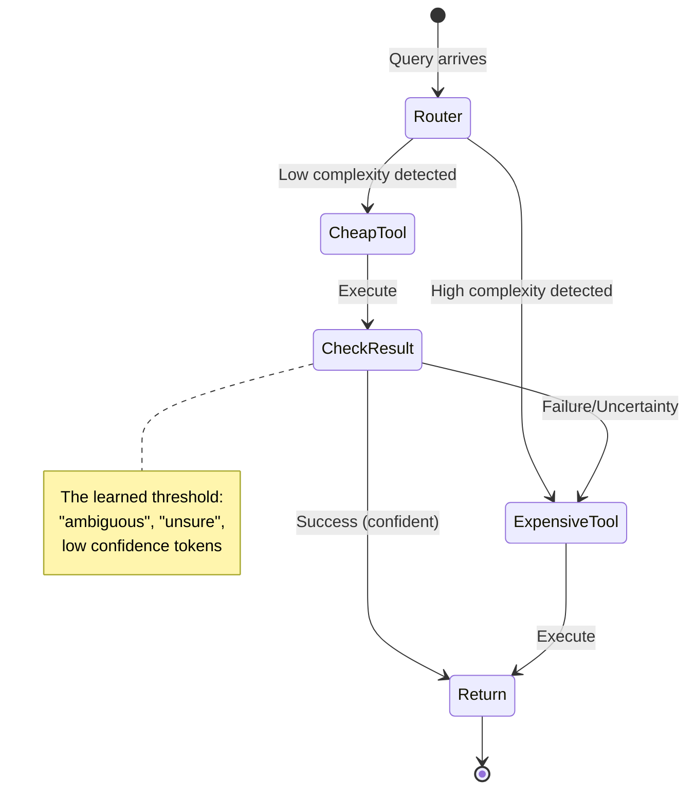

# The Orchestration Paradigm Series: Dive 7
# Implicit State Machines

> **Issue 3: The Behavior** | Parts 07, 08, 09
> This bundle covers emergent state machines, preference conditioning, and generalization failure modes.

> [!NOTE]
> **System Auditor's Log:** We often anthropomorphize agents, saying they "decided to verify" or "chose to escalate." In reality, the orchestrator is simply traversing a probabilistic state graph. The "strategies" observed in the paper, like the "Escalation Ladder", are emergent properties of the reward landscape, not conscious decisions. They are the path of least resistance on the loss surface.

The paper identifies three primary coordination patterns. As engineers, we can map these to standard software design patterns.

## 1. The Escalation Ladder (Try-Catch-Retry)
*   **Pattern:** The model tries a cheap tool (e.g., standard search). If the output contains specific failure tokens (e.g., "ambiguous", "unsure"), it calls an expensive tool (e.g., GPT-5).
*   **The Audit:** This is essentially a learned `try/catch` block.
    ```python
    # What the model effectively learns:
    result = tool_cheap(query)
    if logic.detect_uncertainty(result):
        result = tool_expensive(query)
    ```
    The "intelligence" here is entirely in the `detect_uncertainty` threshold. The RL training pushed the weights to recognize that *ignoring* uncertainty leads to a negative Outcome Reward, while *acting* on it incurs a small Efficiency Penalty that is outweighed by the final success.



## 2. Parallel Consultation (Map-Reduce)
*   **Pattern:** The model calls three different tools (e.g., Search, Python, KB) simultaneously or in quick succession without waiting for deep feedback.
*   **The Audit:** This mirrors the `Map-Reduce` pattern. It happens when the initial query has high entropy (ambiguous intent). The model learns that "spraying" the query reduces the risk of a zero-reward outcome.

## 3. Iterative Refinement (Do-While Loop)
*   **Pattern:** The model generates code, gets an error, fixes the code, and retries.
*   **The Audit:** This is a `while` loop bounded by the context window.
    *   *Constraint:* The model performs this well only because the *error messages* from the Python tool are distinct and informative. If the tool returned a generic `Error 500`, this behavior would collapse. The "intelligence" is largely provided by the tool's verbose error handling, which leaks the solution into the context.

## The Context Window Tax

These strategies differ from hard-coded scripts in one key way: **State Accumulation.**

In a hard-coded script, a loop doesn't necessarily grow the memory footprint.
In an LLM orchestrator, every "step" in the state machine is appended to the context.

$$ \text{Cost}(Step_{N}) \propto \text{Length}(History_{0..N-1}) $$

An "Iterative Refinement" strategy that takes 10 turns is exponentially more expensive than one that takes 2 turns, due to the quadratic attention cost (or linear-but-high cost in standard attention).

This creates a **Death Spiral Risk**.
If the model gets confused, it generates more tokens (trying to fix it).
More tokens = more noise in the context = more confusion.
The orchestrator drives itself into a state of "Context Saturation" where it can no longer attend to the original instruction.

The RL training must specifically penalize *long* trajectories to prevent this. A model that doesn't know when to "Give Up" (Stop Token) is a liability.

---

## Annotated Bibliography

1.  **Lewis et al. (2020)** - *Retrieval-Augmented Generation for Knowledge-Intensive NLP Tasks*: The progenitor of the "Escalation" pattern (retrieving only when needed).
2.  **Shinn et al. (2023)** - *Reflexion: Language Agents with Verbal Reinforcement Learning*: Formalizes the "Do-While" loop of self-correction. ToolOrchestra effectively learns a "Reflexion" policy via RL rather than prompting.
3.  **Liu et al. (2023)** - *Lost in the Middle: How Language Models Use Long Contexts*: Demonstrates the "Death Spiral Risk", as context grows, reasoning capability degrades disproportionately.
