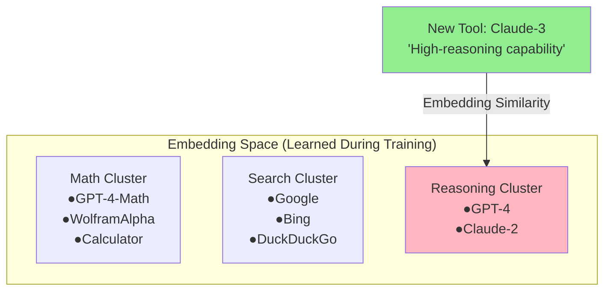

# The Orchestration Paradigm Series: Dive 9
# The Embeddings Trap (Generalization)

> [!NOTE]
> **System Auditor's Log:** The "Generalization" claim, that the orchestrator works on tools it hasn't seen, is the most dangerous claim in the paper. It implies a robustness that contradicts how Transformers work. The model does not "understand" the new tool; it simply matches the **embedding vector** of the new tool's description to the clusters it learned during training.

ToolOrchestra claims it can route to `Claude-3` even if it was only trained on `GPT-4`.
This works via **Description-Based Matching**.

## The Mechanism

The orchestrator inputs the *description* of the tool: "A high-reasoning capability model..."
During training, it learned that embedding vectors close to "high-reasoning" correlate with optimal rewards for hard tasks.

If `Claude-3` has a description that maps to the same embedding cluster, the routing works.

**How It Works:** The new tool's description is embedded into vector space. Cosine similarity finds the nearest cluster. The orchestrator routes based on cluster membership, not verified performance.

**Why this breaks:**

1.  **Semantics vs. Performance:** A tool description says *what it does*, not *how well it does it*.
    *   Tool A: "Solves math problems." (Actually gets 10% accuracy).
    *   Tool B: "Solves math problems." (Actually gets 99% accuracy).
    
    To the orchestrator, these look identical (same description). It will route to Tool A with the same confidence as Tool B. It has no signal for **Ground Truth Quality** of unseen tools.

2.  **Adversarial Descriptions (SEO for Agents):**
    Tool providers will inevitably learn to "game" these descriptions.
    If the orchestrator prefers tools described as "Precise" and "Robust," every tool provider will add those keywords to their docstrings, destroying the orchestrator's ability to discriminate.

## The Pricing Generalization Fallacy

The paper claims the model generalizes to new prices because it learns "Relative Ordering."
(i.e., It learns "Choose the cheaper option," not "Choose the option under $0.05").

This assumes that the **Relationship between Price and Quality** remains constant.
In the training set, Expensive = Good.
What happens if a new, *cheap* model is released that is also *good* (e.g., Llama-3-70B)?

The orchestrator has learned the heuristic: "If task is hard, pay more."
It might **refuse** to use the cheap, capable model because its training bias associates "Low Cost" with "Low Capability."
This is **Inverse Generalization**. The learned heuristic actively prevents optimization in a shifting market.

## The Hidden Dependency

The system's generalization is entirely dependent on the **Accuracy and Honesty of the Tool Context**.
It pushes the complexity from the "Model" to the "Service Discovery Layer." You now need a separate system just to verify that tool descriptions match reality.

---

## Annotated Bibliography

1.  **Patil et al. (2023)** - *Gorilla: Large Language Model Connected with Massive APIs*: The first rigorous study on "Retrieval-Aware" tool use. Proved that fine-tuning on API descriptions creates a dependency on the quality of those descriptions.
2.  **Reimers & Gurevych (2019)** - *Sentence-BERT: Sentence Embeddings using Siamese BERT-Networks*: Explains the mechanics of the "Embedding Matching" used to pair tasks with tool descriptions.
3.  **Shi et al. (2024)** - *Trustworthy LLMs: A Survey*: Covers the "Inverse Generalization" problem where models learn valid heuristics on training data (e.g., expensive=good) that fail on test data.
