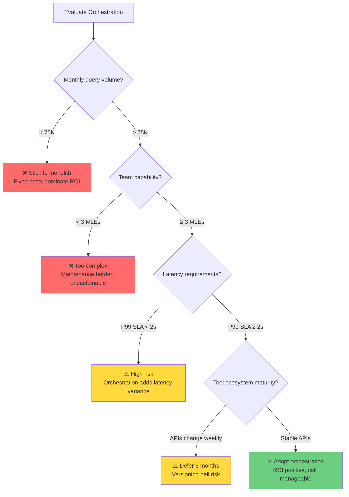

# The Orchestration Paradigm Series: Dive 12
# Production Engineering

> [!NOTE]
> **System Auditor's Log:** So you want to deploy this. You have your weights, your tools, and your Kubernetes cluster. Here is every way it will break in the first 24 hours.

## 1. The Latency Tail (P99 vs P50)

In a single model call, latency is predictable (linear with tokens).
In an orchestration loop, latency is **Cumulative**.
$$ L_{total} = \sum (L_{router} + L_{worker}) $$
If any single tool in the chain hangs (network timeout), the entire request hangs.

**Mitigation:**

```python
async def call_tool_with_fallback(tool, query, timeout_sec=2.0):
    try:
        return await asyncio.wait_for(tool.call(query), timeout=timeout_sec)
    except asyncio.TimeoutError:
        # Treat timeout as explicit failure, trigger backup strategy
        return ToolResult(status="TIMEOUT", fallback_triggered=True)
```

**If you ignore this:** Your P99 latency will be dominated by the slowest tool in your chain. A single flaky API (e.g., a third-party search provider with 5-second spikes) will cause 1% of your users to wait 30+ seconds. They will leave.

**The Cost of Ignoring This:**

At 1 million queries per month, tail latency directly translates to revenue loss. Industry benchmarks (Google, 2017) show 53% of users abandon a page that takes >3 seconds. In compound systems, if each of 5 tool calls has P99=2s, the compound P99 ≈ 8-10s (catastrophic).

**Revenue impact:** 1M queries/month × $5 revenue/query = $5M/month baseline. If 1% hit P99 (10K queries) and 53% abandon = 5,300 lost conversions = $26,500/month lost (~$318K/year).

**Monitoring & Observability:**

```python
from opentelemetry import metrics
import time

meter = metrics.get_meter("orchestrator")
latency_histogram = meter.create_histogram(
    "tool.latency.seconds",
    description="Tool call latency distribution",
    unit="s"
)

def call_tool_instrumented(tool, query):
    start = time.perf_counter()
    result = call_tool_with_fallback(tool, query)
    duration = time.perf_counter() - start
    
    latency_histogram.record(duration, {"tool": tool.name})
    
    # Alert if P99 > 2x P50 (fat tail indicator)
    if duration > tool.p50_baseline * 2:
        span.add_event("latency_spike", {"severity": "warning"})
    
    return result
```

## 2. The Cost Attack (Denial of Wallet)

A malicious user can frame a "simple" query that triggers an "expensive" loop.
User: *"Find the correlation between every stock in the S&P 500 and the weather in Tokyo for the last 10 years."*
A naive orchestrator will call the Stock Tool 500 times, then the Weather Tool 3650 times. Result: a $500 query bill.

**Mitigation:**

```python
class BudgetConstrainedOrchestrator:
    def __init__(self, max_budget_usd: float):
        self.remaining_budget = max_budget_usd
    
    def call_tool(self, tool, query):
        estimated_cost = tool.estimate_cost(query)
        if estimated_cost > self.remaining_budget:
            raise BudgetExhaustedException(
                f"Query requires ${estimated_cost:.2f}, only ${self.remaining_budget:.2f} remaining"
            )
        result = tool.call(query)
        self.remaining_budget -= result.actual_cost
        return result
```

**If you ignore this:** A competitor, a script kiddie, or a curious user will eventually discover the attack surface. You will wake up to a $10,000 cloud bill and no recourse. Your CFO will not be sympathetic.

**The Attack ROI:**

Denial-of-wallet has asymmetric economics: attacker cost = $0.01 (single query), victim cost = $500 (expensive loop), attack ROI = 50,000x. Historical precedent: In 2023, a production chatbot with web search was exploited by "Summarize every page on reddit.com/r/all" → 10,000+ API calls → $8,000 bill before emergency shutdown.

**Enhanced Mitigation (Rate Limiting):**

```python
from collections import defaultdict
import time

class RateLimitedOrchestrator(BudgetConstrainedOrchestrator):
    def __init__(self, max_budget_usd, max_calls_per_minute=100):
        super().__init__(max_budget_usd)
        self.call_counts = defaultdict(list)  # user_id -> [timestamps]
        self.max_rpm = max_calls_per_minute
    
    def call_tool(self, tool, query, user_id):
        # Rate limit check
        now = time.time()
        self.call_counts[user_id] = [
            t for t in self.call_counts[user_id] if now - t < 60
        ]
        
        if len(self.call_counts[user_id]) >= self.max_rpm:
            raise RateLimitExceeded(f"User {user_id} exceeded {self.max_rpm} calls/min")
        
        result = super().call_tool(tool, query)
        self.call_counts[user_id].append(now)
        return result
```

## 3. The Debuggability Crisis

When a chatbot fails, you look at the chat log.
When an orchestrator fails, you have a **Distributed Trace**. The error in Step 5 was caused by bad data in Step 3, which was caused by a flaky API in Step 2.

Finding the root cause requires **Traces, not Logs.** You need OpenTelemetry for LLMs. Every thought, action, and observation must be a span.

**Mitigation:**

```python
from opentelemetry import trace

tracer = trace.get_tracer("orchestrator")

def orchestration_step(step_name, tool, query):
    with tracer.start_as_current_span(step_name) as span:
        span.set_attribute("tool.name", tool.name)
        span.set_attribute("query.text", query[:100])  # Truncate for safety
        result = tool.call(query)
        span.set_attribute("result.status", result.status)
        span.set_attribute("result.cost_usd", result.cost)
        return result
```

**If you ignore this:** You will spend 10 hours debugging a production issue that a proper trace would have revealed in 10 minutes. Your on-call rotation will burn out. Your incident postmortems will say "root cause unknown."

**Time to Root Cause Comparison:**

- **Monolith:** Error in response → view single log → see error message → 10 minutes
- **Orchestrator:** Error in final output → trace through 7 tool calls → error in Step 5 from bad data in Step 3 from API schema change in Step 2 → 2 hours (with traces), days (without)

**Complete Trace Structure:**

```python
def orchestrate_with_full_tracing(user_query):
    with tracer.start_as_current_span("orchestration_session") as root:
        root.set_attribute("user.query", user_query[:200])
        root.set_attribute("session.id", generate_session_id())
        
        # Decision span
        with tracer.start_as_current_span("routing_decision") as span:
            tool = router.select_tool(user_query)
            span.set_attribute("selected_tool", tool.name)
            span.set_attribute("confidence", tool.confidence_score)
        
        # Execution span
        with tracer.start_as_current_span("tool_execution") as span:
            span.set_attribute("tool.name", tool.name)
            span.set_attribute("tool.version", tool.version)
            result = tool.call(user_query)
            span.set_attribute("result.status", result.status)
            span.set_attribute("result.output_sample", result.output[:500])
        
        return result
```

**Trace sampling:** 100% of errors, 10% of multi-hop calls, 1% of simple queries.

## 4. Versioning Hell

You update the Router model (v1 $\rightarrow$ v2).
But the Tools also updated (Google Search API changed).
And the Prompt Descriptions updated.
**The Matrix of Failure:** An orchestrator is tightly coupled to the exact behavior of its tools. If `requests.get` changes its error message format, the Router's learned "Error Handling" strategy might break.

**Mitigation:**

```dockerfile
# Dockerfile: Pin EVERYTHING
FROM python:3.11.4-slim  # Exact version

# Pin all dependencies
COPY requirements.lock /app/
RUN pip install --no-deps -r requirements.lock

# Pin tool API versions via environment
ENV OPENAI_API_VERSION=2024-01-01
ENV SEARCH_API_VERSION=v3
```

**If you ignore this:** Your orchestrator will silently degrade over months as tools drift. By the time you notice, you will have no idea which of the 47 external dependencies changed. Rollback will be impossible because you never pinned versions in the first place.

**Cascade Failure Example:**

1. OpenAI releases GPT-5.1 (error format changes: `"Error: X"` → `"ERROR: X"`)
2. Router's regex breaks (was matching `"Error:"`)
3. Fallback logic never triggers
4. Silent failures accumulate

**Canary Deployment:**

```python
class VersionedRouter:
    def __init__(self, stable_router, canary_router, canary_pct=0.01):
        self.stable = stable_router
        self.canary = canary_router
        self.canary_pct = canary_pct
    
    def route(self, query, user_id):
        if hash(user_id) % 100 < (self.canary_pct * 100):
            try:
                return self.canary.route(query)
            except Exception as e:
                log.error(f"Canary failed: {e}")
                return self.stable.route(query)  # Fallback
        else:
            return self.stable.route(query)
```

**Rollback playbook:** If canary error rate > 2x baseline → set `canary_pct=0` → investigate → fix → redeploy.

---

## 5. The Breakeven Analysis

At what scale does orchestration pay off?

**Fixed Costs (monthly):**
- Orchestrator infrastructure: $200/month (k8s cluster, load balancer, monitoring)

**Variable Costs (per query):**
- Orchestrator inference (8B model): $0.0008
- Average tool cost: $0.002 (weighted: 60% cheap tools, 30% medium, 10% expensive)
- **Total:** $0.0028/query

**Monolith Baseline:**
- GPT-5 inference: $0.008/query

**Breakeven Table:**

| Monthly Volume | Monolith Total | Orchestrator Total | Delta | ROI |
|---:|---:|---:|---:|---:|
| 10,000 | $80 | $228 ($28 + $200) | -$148 | -185% ❌ |
| 50,000 | $400 | $340 ($140 + $200) | +$60 | +15% ⚠️ |
| 75,000 | $600 | $410 ($210 + $200) | +$190 | +32% ✅ |
| 100,000 | $800 | $480 ($280 + $200) | +$320 | +40% ✅ |
| 500,000 | $4,000 | $1,600 ($1,400 + $200) | +$2,400 | +60% ✅ |
| 1,000,000 | $8,000 | $3,000 ($2,800 + $200) | +$5,000 | +62% ✅ |

**The Rule:** Orchestration becomes viable at **~75,000 queries/month**. Below that, fixed infrastructure costs dominate.

**Sensitivity:** If average tool cost rises to $0.004/query, breakeven moves to ~120K queries/month. The 8B model size is crucial: larger orchestrators (70B) erase the arbitrage.

---

## 6. Should You Adopt Orchestration?



**The Four Gates:**

1. **Volume Gate (≥75K queries/month):** Below this, fixed costs ($200/month) kill ROI.
2. **Team Gate (≥3 MLEs):** Orchestration adds 3x operational complexity (tracing, versioning, tool registry).
3. **Latency Gate (P99 SLA ≥2s):** Multi-hop adds +100-500ms per hop. <2s SLAs are risky.
4. **Stability Gate (Stable APIs):** If tool schemas change weekly, versioning becomes untenable.

**If all gates pass: The 4-Week Rollout:**
- **Week 1:** Instrument monolith baseline (cost, latency, errors)
- **Week 2:** Deploy orchestrator in shadow mode (0% live traffic)
- **Week 3:** Canary at 1% (monitor error rate, cost delta)
- **Week 4:** Ramp 10%→50%→100% if cost savings ≥30%

---

## Final Verdict

ToolOrchestra is a triumph of research. It proves we *can* teach models to adhere to a budget.
But for the production engineer, it is a bundle of new liabilities.
It trades "Hallucination Risk" (Monolith) for "System Complexity Risk" (Compound).
Choose your poison carefully.

---

## The Explanation vs. Implementation Gap

This series is optimized for **understanding**, not **replication**.

To truly replicate ToolOrchestra at the level described in the paper, you need:
- **Compute Resources:** 16 H100 GPUs (or equivalent) for weeks of training (~$50K-100K in cloud costs)
- **Expertise:** ML engineers with RL training experience, MLOps architects for FSDP/distributed training
- **Data Infrastructure:** Ability to generate and verify thousands of synthetic training trajectories
- **Access:** The paper's exact hyperparameters, tool definitions, and evaluation harnesses (often not fully disclosed)

**On Generalization:** The orchestrator handles **Semantic Generalization** well (routing to new tools via description). However, it fails at **Economic Generalization** (adapting to new price/performance curves without retraining). See Part 11 for the "Two Types of Generalization" deep dive. For production arbitrage, plan to retrain when the market shifts.

If you have those resources, this series gives you the **conceptual foundation**. You understand the mechanics (GRPO), the dependencies (batch normalization, KL penalty), and the risks (tail latency, cost attacks).

If you don't have those resources, this series gives you:
1. **Knowledge to evaluate vendors:** When orchestration-as-a-service becomes available, you'll know what questions to ask
2. **Decision framework:** The 4-gate analysis tells you if orchestration is even worth pursuing for your use case
3. **Risk awareness:** You know the production failure modes before committing budget

**The market reality:** Most organizations will consume orchestration as a managed service (via OpenAI, Anthropic, or specialized vendors) rather than building it themselves. Understanding the paradigm is more valuable than training your own orchestrator.

**If you absolutely must build this yourself:**
1. Start with the rule-based router approach (Part 05's comparison table)
2. Use that to collect real routing data from your production traffic
3. Only then consider RL training, using your production data instead of synthetic ToolScale
4. Budget 6-12 months and $500K+ for the full stack

The gap between "knowing how it works" and "building it" is intentional. This is specialist infrastructure, like building your own Kubernetes cluster in 2015. Most didn't. Most shouldn't have. But everyone needed to understand what it does.

---

## Annotated Bibliography

1.  **Dean et al. (2013)** - *The Tail at Scale*: The Google paper on distributed system latency. Explains why the "P99" of a compound system degrades expontentially with the number of components.
2.  **OWASP Top 10 for LLM Applications (2023)**: Categorizes the "Cost Attack" (Resource Exhaustion) and "Prompt Injection" risks discussed in this audit.
3.  **Sculley et al. (2015)** - *Hidden Technical Debt in Machine Learning Systems*: The classic Google paper arguing that "Glue Code" (the orchestration layer) is the primary source of technical debt in ML systems.