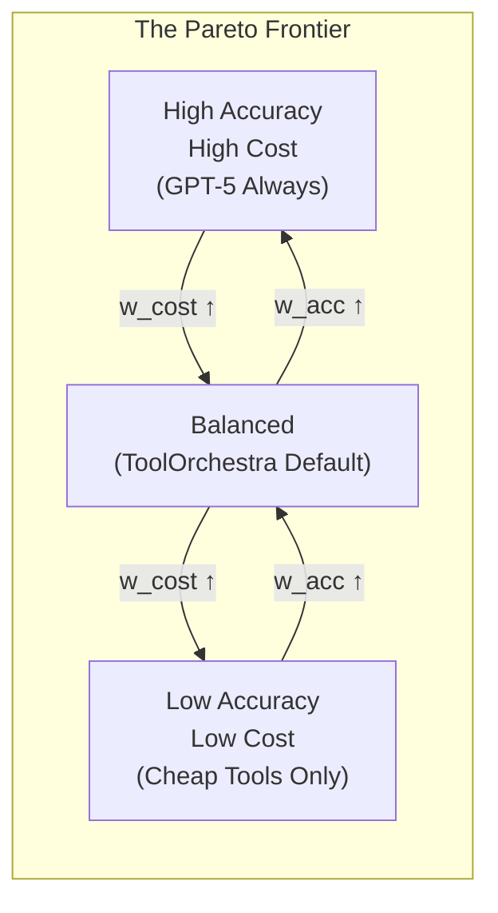

# The Orchestration Paradigm: Issue 1 - The Algorithm
# Why we need RL, and how GRPO works.

> **Issue 1: The Algorithm** | Parts 00, 01, 02, 03
> This bundle covers the economic thesis, the calibration paradox, the RL formulation, and the reward scalarization problem.

**TL;DR:** In this first issue, we dissect the economic and mathematical foundations of ToolOrchestra. We explore why "prompting harder" fails due to calibration limits, how an 8B model uses **Reinforcement Learning (GRPO)** to learn decision-making policies without a critic, and how to design multi-objective reward functions that balance accuracy, cost, and latency. This is the theory layer.

---

## Dive 0: The Router-Worker Architecture


> [!NOTE]
> **System Auditor's Log:** The "ToolOrchestra" system is effectively a specialized distributed system design. It separates the **control plane** (routing logic) from the **data plane** (task execution). This series reverse-engineers the paper to understand how this separation is trained, optimized, and deployed.

The fundamental economic premise of modern AI is arbitrage. If a difficult task costs $0.05 to solve on a frontier model (like GPT-5), but can be solved for $0.005 by a smaller model using the right tool, then the system that effectively routes between them captures that value.

That is the engineering definition of "Orchestration." It is not about "agents" or "reasoning" in the anthropomorphic sense. It is about training a localized policy to optimize a global cost-reward function across a heterogeneous network of compute providers.

This series dissects **ToolOrchestra**, a system that demonstrates this principle. Unlike monolithic approaches that try to bake every capability into a single checkpoint, ToolOrchestra uses an 8-billion parameter "Router" to dispatch tasks to specialized "Workers", including code interpreters, search engines, and massive generic models like GPT-4.

### The Architectural Thesis

The central claim is that **Routing is a distinct capability from Generation.**

In a standard monolithic setup, the same weights responsible for generating a Shakespearean sonnet are also responsible for deciding whether to use a calculator for `23 * 491`. This is inefficient. It wastes high-entropy compute (creative generation) on low-entropy decisions (tool selection).

ToolOrchestra decouples this. It trains a dedicated policy network (the 8B Orchestrator) solely to manage the state machine of the problem solving process.

```python
# The Economic Thesis of ToolOrchestra
class SystemAudit:
    def optimize_request(self, task):
        # The Arbitrage Condition
        # If the cost of routing + specialized execution is less than 
        # the cost of naive generation, the system is strictly superior.
        
        monolith_cost = FrontierModel.estimate_cost(task) # High fixed cost
        
        router_cost = LogicModel_8B.inference_cost # Low fixed cost
        worker_cost = self.router.predict_worker(task).cost
        
        if (router_cost + worker_cost) < monolith_cost:
            return self.orchestrate(task)
        else:
            return FrontierModel.generate(task)
```

The paper demonstrates that this decoupled architecture, when trained with Reinforcement Learning (RL), outperforms the monolith on its own benchmarks. The 8B router effectively learns a lookup table of "Task Complexity vs. Tool Capability," allowing it to solve PhD-level physics problems (via delegation) that it could never solve natively.

### The Engineering Stack

Building this requires solving four distinct engineering problems, which form the tiers of our analysis.

**1. The Control Theory (RL)**
You cannot train this system with Supervised Fine-Tuning (SFT) alone. SFT teaches the model *syntax* (how to format a JSON tool call), but it cannot teach *strategy* (when to call a tool). There is no "ground truth" for the optimal sequence of calls. We examine how **Group Relative Policy Optimization (GRPO)** solves this by treating tool use as a gradient-free environment.

**2. The Scalarization Problem (Rewards)**
The system must optimize for three conflicting variables: Accuracy, Latency, and Cost. A router that is 100% accurate but costs $50 per query is useless. We look at how **Multi-Objective Reward modeling** creates a scalar signal that forces the model to "internalize" the cost of its own actions.

**3. The Supply Chain (Data)**
Where do you get the training data? You cannot scrape "reasoning traces" from the web because they don't exist. We scrutinize the **ToolScale** pipeline, a synthetic data factory that generates verifiable state-transitions to bootstrap the learner.

**4. The Production Reality**
Finally, we audit the deployment. Routing logic that works in a controlled benchmark often fails under the distributional shift of production. We analyze the **generalization mechanics**, how the model handles tool descriptions it has never seen before, and the fragility of relying on prompt-based tool definitions.

### The Road Ahead

This is not a celebration of the paper; it is an audit. We are looking for the mechanics that make the system work and the dependencies that make it break.

We begin in Dive 1 by defining the problem: why can't we just prompt GPT-4 to do this?

### Annotated Bibliography

1.  **Su et al. (2025)** - *ToolOrchestra: Elevating Intelligence via Efficient Model and Tool Orchestration*: The primary paper analyzed in this series. Introduces the 8B orchestrator concept.
2.  **Zaharia et al. (2024)** - *The Shift from Models to Compound AI Systems*: The theoretical foundation for why monolithic scaling is hitting diminishing returns, favoring modular architectures.
3.  **Schick et al. (2023)** - *Toolformer: Language Models Can Teach Themselves to Use Tools*: The precursor to ToolOrchestra, demonstrating self-supervised tool injection. ToolOrchestra expands this to multi-tool and multi-objective settings.

---

## Dive 1: The Fundamental Problem
### The Paradox of Capability vs. Routing

> [!NOTE]
> **System Auditor's Log:** A common objection to orchestration frameworks is: "Why train a small model? Why not just prompt the big model to use tools?" The answer lies in **calibration**. High-capability generators are often poorly calibrated routers, suffering from "Instrumental Convergence" on their own weights.

The fundamental problem ToolOrchestra addresses is not a lack of intelligence, but a misallocation of it.

Large Language Models (LLMs) are trained to predict the next token. They maximize the likelihood of the training corpus. They are *not* inherently trained to minimize the computational cost of their answers, nor are they trained to admit ignorance.

When you ask a frontier model a question like "What is the square root of 4913?", its training objective drives it to generate the tokens that represent the answer. It relies on its internal weights. If those weights contain the answer, it succeeds. If they don't, it hallucinates.

The "Orchestrator" exists to interrupt this process. It inserts a decision node before generation: *Should I use my weights, or should I borrow external compute?*

### The Failure of "Prompting Harder"

One might assume that prompt engineering could solve this. "You are a helpful assistant who uses tools."

In practice, this fails due to **Self-Enhancement Bias**. Models tend to over-trust their internal parametric knowledge. A model that has "read" the entire internet often believes it knows current stock prices or obscure mathematical constants, simply because those patterns exist somewhere in its weight matrices.

Conversely, aggressive prompting ("ALWAYS verify with tools") leads to **Other-Enhancement Bias**, where the model wastes money calling search APIs for trivial queries like "Who is the president of the US?"

This is a calibration failure. The model’s confidence score ($P(token)$) is not correlated with its factual accuracy in a way that maps cleanly to a "Tool Use Threshold."

```python
# The Calibration Gap
# Ideally, we want a linear relationship:
# High Confidence -> High Probability of Correctness
# Low Confidence  -> Low Probability of Correctness

def should_route(model, query):
    internal_confidence = model.get_perplexity(query)
    
    # The problem: Frontier models are uncalibrated for self-judgment.
    # They often have high confidence even when wrong (hallucination).
    # This makes 'internal_confidence' a noisy signal for routing.
    
    if internal_confidence < THRESHOLD:
         return True # Route to tool
    return False
```

Because the confidence signal is noisy, we cannot write a simple heuristic rule. We must *train* a policy to detect the subtle semantic features that indicate a need for external help.

### Sequential Decision Processes

From an engineering perspective, orchestration changes the problem from "Generation" to "Sequential Decision Making."

A standard LLM call is a single inference pass (or a stream of passes). An orchestration episode is a **trajectory** through a state space.

$S_0$: User Query
$A_0$: Decision (e.g., Call Python)
$S_1$: Tool Output (e.g., `Error: Division by zero`)
$A_1$: Decision (e.g., Retry with corrected code)
$S_2$: Tool Output (e.g., `42`)
$A_2$: Final Answer

The critical insight from the paper is that **Standard Supervised Learning (SFT) is insufficient for this.** SFT minimizes the KL divergence between the model's output and a reference dataset. But in orchestration, there are many valid paths to the destination. You could search Google, or you could use WolframAlpha. Both are valid.

If the SFT dataset only contains Google searches, the model is penalized for using WolframAlpha, even if it works. This "behavior cloning" forces the model to memorize specific paths rather than learning the generalized strategy of "finding the answer."

### The Bias-Variance Tradeoff in Routing

This creates an optimization problem. We need a system that:
1.  **Explores** the tool space to find novel solutions (reducing bias).
2.  **Converges** on the most efficient solution (reducing variance).

This is why the architecture shifts to Reinforcement Learning. We don't want to tell the model *what to do* (SFT). We want to tell the model *what happened* (RL) and let it figure out the optimal path.

By moving the "Routing Logic" out of the prompt and into a trained value function, ToolOrchestra attempts to solve the calibration paradox. The 8B model doesn't need to *know* the answer; it only needs to know *that it doesn't know.* That is a much easier function to learn.

### Annotated Bibliography

1.  **Kadavath et al. (2022)** - *Language Models (Mostly) Know What They Know*: Investigates the calibration of LLMs. Key finding: calibration drifts significantly on out-of-distribution tasks, making "confidence" a poor router.
2.  **Wei et al. (2022)** - *Chain-of-Thought Prompting Elicits Reasoning*: Established that intermediate reasoning steps improve performance, but also inadvertently increases hallucination rates on factual retrieval tasks (the "reasoning hallucination" paradox).
3.  **Mialon et al. (2023)** - *Augmented Language Models: A Survey*: Comprehensive overview of the "Self-Enhancement" vs "Other-Enhancement" biases in tool-augmented systems.

---

## Dive 2: RL Foundations
### Policy Gradients in Discrete Spaces

> [!NOTE]
> **System Auditor's Log:** Reinforcement Learning (RL) in language models is often misunderstood. It is not "teaching the model to think." It is **re-weighting the probability distribution** of token sequences based on a scalar reward. In the context of orchestration, this is complicated by the "API Boundary", the fact that tool execution happens outside the model's computational graph.

To understand why ToolOrchestra uses **Group Relative Policy Optimization (GRPO)**, we must first look at the physics of backpropagation.

In a standard neural network, gradients flow backward from the loss function to the weights. This requires every operation in the chain to be differentiable.

$$ \text{Loss} \rightarrow \text{Output} \rightarrow \text{Layer}_N \rightarrow \dots \rightarrow \text{Layer}_0 $$

Tool use breaks this chain.

When the model generates a tool call (e.g., `requests.get("https://api.weather.com")`), that text is parsed and executed by an external Python interpreter. The interpreter returns a string (e.g., "72°F").

The Python interpreter is **non-differentiable**. You cannot calculate the gradient of a "requests.get" function with respect to the neural network weights. The chain is broken. The model takes an action, the world changes, and the model sees a new state. The only signal linking the action to the result is the final outcome.

### The Policy Gradient Solution

This is the classic Reinforcement Learning setup. Since we cannot backpropagate through the tool, we treat the tool call as an **Action ($A$)** taken by a **Policy ($\pi_\theta$)** in an Environment.

The objective is to maximize the expected reward:

$$ J(\theta) = E_{\tau \sim \pi_\theta}[R(\tau)] $$

where $\tau$ is the trajectory (sequence of thoughts, tool calls, and outputs).

Using the **REINFORCE** trick (or Policy Gradient Theorem), we can estimate the gradient effectively by saying: *If a trajectory led to a high reward, increase the probability of all actions taken in that trajectory.*

### Why GRPO?

Standard PPO (Proximal Policy Optimization) requires training a separate "Critic" model to estimate the value function $V(s)$. This Critic predicts how much reward the model expects to get from the current state.

Training a Critic is expensive. It effectively doubles the memory requirement (you need to hold the Policy model and the Critic model). For Large Language Models, which are already memory-constrained, this is a heavy tax.

**GRPO (Group Relative Policy Optimization)** removes the Critic.

Instead of comparing the reward to a learned baseline (the Critic's guess), GRPO compares the reward to the **group average**.

```python
# The Mechanics of GRPO
# 1. Generate a group of G outputs for the same prompt.
# 2. Score them all.
# 3. Use the group average as the baseline.

def grpo_loss(prompt, model, reward_fn, group_size=4):
    # Step 1: Rollout
    # Generate multiple distinct trajectories from the same start state
    trajectories = model.generate(prompt, num_return_sequences=group_size)
    
    # Step 2: Reward
    # Calculate scalar reward for each trajectory
    rewards = [reward_fn(t) for t in trajectories]
    
    # Step 3: Advantage Calculation
    # Normalize rewards within the group
    mean_reward = np.mean(rewards)
    std_reward = np.std(rewards)
    advantages = (rewards - mean_reward) / (std_reward + epsilon)
    
    # Step 4: Policy Update
    # Push explicitly for the trajectories that beat the group average.
    # The 'Critic' is essentially replaced by the other samples in the batch.
    return compute_policy_gradient(trajectories, advantages)
```

### The "KL Penalty" Safety Rail

The danger with RL is **Reward Hacking**. If the reward function is imperfect (it almost always is), the model will exploit it. It might learn to ignore the tool and just guess, or it might output gibberish that somehow triggers a "correct" regex match.

To prevent this, we enforce a **KL Divergence Penalty**. We compare the RL-trained model ($\pi_\theta$) to the original reference model ($\pi_{ref}$). If the RL model's probability distribution diverges too far from the reference (i.e., it starts speaking a different language or losing coherence), we subtract a penalty from the reward.

$$ R_{total} = R_{task} - \beta \cdot D_{KL}(\pi_\theta || \pi_{ref}) $$

This forces the model to stay "close" to its original training (grammatically correct, logical) while optimizing the specific orchestration objective.

In ToolOrchestra, this mechanism is what allows the 8B model to learn *strategies* like "Double Check" or "Give Up" without explicitly being told to do so. It simply tries thousands of variations, and GRPO amplifies the ones that minimize cost while maintaining accuracy.

### Annotated Bibliography

1.  **Schulman et al. (2017)** - *Proximal Policy Optimization Algorithms*: The baseline PPO paper. Defined the clipping objective that prevents destructive policy updates.
2.  **Shao et al. (2024)** - *DeepSeekMath: Pushing the Limits of Mathematical Reasoning*: Introduced GRPO (Group Relative Policy Optimization) to eliminate the Critic model, saving ~50% VRAM during training.
3.  **Ouyang et al. (2022)** - *Training Language Models to Follow Instructions with Human Feedback*: The canonical RLHF paper. Established the KL-divergence penalty pattern for preventing mode collapse in language models.

---

## Dive 3: Reward Design
### Multi-Objective Scalarization

> [!NOTE]
> **System Auditor's Log:** In ML engineering, "Reward Design" is where the business requirement meets the mathematical optimizer. The paper claims to balance Accuracy, Latency, and Cost. Mathematically, this is impossible to simplify into a single number without making strong assumptions about the "exchange rate" between dollars and seconds. This post audits those assumptions.

When we train an orchestrator, we ultimately need a single scalar value ($R$) to update the gradients. But the business goal is multi-dimensional. We want the answer to be correct ($O$), cheap ($C$), and fast ($L$).

This is a **Pareto Optimization** problem. There is no single "best" orchestrator. There is an orchestrator that is fast but expensive, and one that is cheap but slow. To train a model using RL, we must perform **Scalarization**, collapsing these vectors into a single number.

### The Objective Functions

ToolOrchestra defines three distinct reward components:

#### 1. The Outcome Reward ($R_{outcome}$)
This is binary or continuous based on correctness.
*   Did the model answer the question? (+1)
*   Did it fail? (0)
*   For intermediate steps, there is usually *no reward* (sparse reward problem), forcing the model to look only at the final result.

#### 2. The Efficiency Reward ($R_{efficiency}$)
This captures the resource consumption.
$$ R_{efficiency} = - (w_{cost} \cdot \text{NormalizedCost} + w_{lat} \cdot \text{NormalizedLatency}) $$
Note the negative sign. This is a penalty. The model is "taxed" for every token it consumes and every second it waits.

#### 3. The Preference Alignment ($R_{pref}$)
This is the dynamic component. It re-weights the efficiency penalty based on the user's stated needs.

### Batch Normalization of Rewards

A major engineering challenge here is **Scale Mismatch**.
*   Accuracy is usually $[0, 1]$.
*   Latency might be $[0.5, 10.0]$ seconds.
*   Cost might be $[0.0001, 0.05]$ dollars.

If you simply sum these ($1 + 5.0 + 0.02$), the Latency term dominates the gradient. The model will learn to be fast above all else, ignoring cost and accuracy.

To fix this, ToolOrchestra uses **Batch Normalization** on the rewards. It tracks the moving average and variance of cost and latency, and normalizes them to a standard normal distribution ($\mu=0, \sigma=1$) before calculating the reward.

```python
# Scalarization Logic with Normalization
# This ensures no single metric dominates the gradient simply due to unit scale.

def calculate_reward(trajectory, preferences, batch_stats):
    # 1. Raw Metrics
    cost_raw = trajectory.total_cost
    lat_raw = trajectory.total_lat
    
    # 2. Normalize (Z-Score)
    # Using tracking stats from the training batch
    cost_norm = (cost_raw - batch_stats.cost_mean) / batch_stats.cost_std
    lat_norm = (lat_raw - batch_stats.lat_mean) / batch_stats.lat_std
    
    # 3. Apply Preferences (The "Exchange Rate")
    # user_prefs maps to [cost_sensitivity, latency_sensitivity]
    penalty = (preferences.w_cost * cost_norm) + (preferences.w_lat * lat_norm)
    
    # 4. Final Scalar
    # Outcome is usually heavily weighted to prevent "fast failure"
    # being preferred over "slow success".
    return outcome_reward - penalty
```

### The Pareto Frontier

This scalarization forces the model to learn an implicit **exchange rate**.
If $w_{cost} = 0.5$ and $w_{lat} = 0.5$, the model learns that 1 standard deviation of cost is "equal" to 1 standard deviation of latency.



**Reading the Frontier:**
- Moving **right** (increasing $w_{cost}$) slides toward cheaper, lower-accuracy configurations
- Moving **left** (increasing $w_{acc}$) slides toward expensive, higher-accuracy configurations
- There is no "up and right" (high accuracy AND low cost) because that would dominate all other points

**The Scalarization Choice:** ToolOrchestra uses **linear scalarization** ($R = w_{acc} \cdot Acc - w_{cost} \cdot Cost$). This draws a line through the Pareto frontier and picks the tangent point. Linear scalarization cannot find points on non-convex regions of the frontier. This is a known limitation traded for computational simplicity.

The danger in this design is **Mode Collapse**. The model might find a local optimum where it simply refuses to use expensive tools at all (driving cost to zero), effectively becoming a standard dumb model.

To prevent this, the training data must force the model into situations where *only* expensive tools can solve the problem. If the tasks are too easy, the "Efficiency Reward" will cannibalize the "Outcome Reward," and the orchestrator will learn to be a miser rather than a manager.

This reliance on **Task Difficulty Distribution** is a hidden dependency. The reward function only works if the training set contains a sufficient number of "impossible to solve cheaply" problems.

### Annotated Bibliography

1.  **Roijers et al. (2013)** - *A Survey of Multi-Objective Sequential Decision-Making*: The foundational text on scalarization techniques (Linear vs. Chebyshev) for turning vector rewards into scalar signals.
2.  **Deb et al. (2002)** - *NSGA-II*: A standard algorithm for finding Pareto-optimal fronts. ToolOrchestra simplifies this into a linear scalarization for computational efficiency, accepting the risk of non-convexity.
3.  **Safe RL (Amodei et al., 2016)** - *Concrete Problems in AI Safety*: specifically the section on "Reward Hacking" (Wireheading), which is the primary risk when using efficiency penalties in reward functions.

---

## Appendices

### Appendix: MDP Foundations (Optional)

> This appendix is for readers who want a primer on the Markov Decision Process formalism. Skip if you are already familiar with RL fundamentals.

#### The Building Blocks

**States** describe where the agent is. For ToolOrchestra, a state is the entire conversation history: the original task, every tool call the orchestrator has made, and every response those tools have returned.

**Actions** describe what the agent can do. For ToolOrchestra, an action is any tool call the orchestrator might make: search the web, call GPT-5 with a subproblem, execute code, or output a final answer. The action space is vast.

**Transitions** describe how the environment responds to actions. In ToolOrchestra, transitions are mostly deterministic: if you call a calculator, you get the calculation result.

**Rewards** describe how good the outcome was. ToolOrchestra combines multiple objectives: accuracy, cost, latency, and preference alignment.

#### The Markov Property

The "Markov" in Markov Decision Process means: the future depends only on the present state, not on how we got there.

In ToolOrchestra, this property is satisfied by design. The state *is* the entire conversation history, so it contains all relevant information. The arrival path is encoded in the history itself.

#### Policies

A **policy** is a strategy for choosing actions in states. Formally, it is a function that takes a state and produces a distribution over possible actions.

In ToolOrchestra, the policy is the orchestrator model itself. Given the conversation history (state), the model produces tokens specifying which tool to call (action). Training the orchestrator means adjusting the policy parameters (the billions of weights) so that high-reward actions become more likely.

### Appendix: RL Methods Evolution (Optional)

> This appendix traces the lineage of policy optimization methods leading to GRPO. It is for readers familiar with RL basics who want context on why specific algorithmic choices were made.

#### The Problem: Training LLMs with RL

Standard supervised learning requires ground-truth labels. But for orchestration, there is no single "correct" tool sequence. Multiple paths can solve the same problem. We need a method that:
1. Works with sparse, delayed rewards (only know if we succeeded at the end)
2. Doesn't require a separate value network (VRAM is precious)
3. Stays close to the pretrained distribution (don't forget language)

#### The Evolution

| Method | Year | Key Innovation | Variance | Memory | Best For |
|:---|:---|:---|:---|:---|:---|
| **REINFORCE** | 1992 | Policy gradients via log-prob weighting | Very High | 1x | Toy problems, proofs-of-concept |
| **PPO** | 2017 | Clipped objective + learned Critic baseline | Low | **2x** | Standard RL (robotics, games) |
| **RLHF** | 2022 | PPO applied to LLM alignment | Low | **2x** | Instruction-following, safety |
| **GRPO** | 2024 | Group-average baseline, no Critic | Medium | **1x** | **LLMs with limited VRAM** |

#### Why GRPO for ToolOrchestra

**The memory constraint:** An 8B orchestrator requires ~16GB in bf16. PPO's Critic is another 8B model. On 16 H100s (80GB each), fitting Policy + Critic leaves minimal room for batch size. Small batches = high gradient variance = unstable training.

**GRPO's trade-off:** Replace the learned Critic with the empirical group average. For each prompt, generate G=4-8 trajectories, compute mean reward, subtract from each trajectory's reward. This is noisier than a trained Critic but requires **zero additional parameters**.

**The variance tax:** GRPO needs ~2-4x larger batch sizes than PPO to achieve similar gradient signal-to-noise. This is why ToolOrchestra requires 16 H100s (not 4): the extra GPUs buy batch size to compensate for the noisier baseline.

#### The Practical Implication

If you have unlimited VRAM (e.g., 8x H100s for a 1B model), PPO with a Critic is cleaner. If you're VRAM-constrained (8B+ models), GRPO is the only viable path without model parallelism for the Critic.

ToolOrchestra chose GRPO because the alternative was either (a) a smaller orchestrator or (b) 2x the GPU budget. Neither was acceptable.
