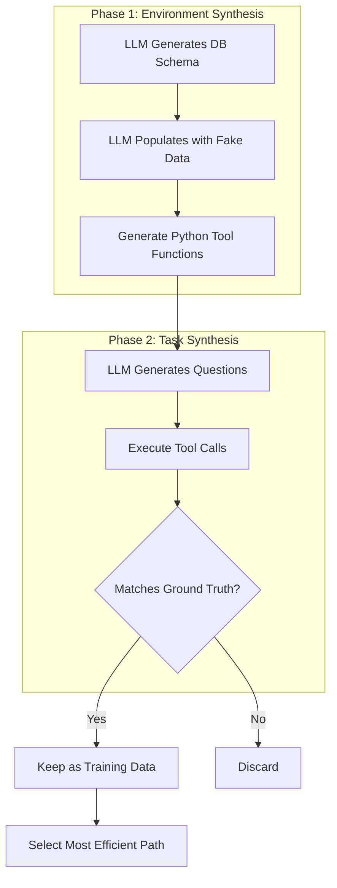

# The Orchestration Paradigm: Issue 2 - The Factory
# The hidden cost of Data, Evals, and H100s.

> **Issue 2: The Factory** | Parts 04, 05, 06
> This bundle covers the synthetic data pipeline, benchmark physics, and training infrastructure.

**TL;DR:** In this second issue, we leave the theoretical blackboard and enter the factory floor. We analyze the **ToolScale** synthetic data pipeline that manufactures the training signal, audit the "physics" of benchmarking agents (where "Goodhart's Law" reigns supreme), and dissect the massive infrastructure requirements—specifically why training stable RL policies requires **16 H100s** and specialized gradient accumulation techniques.

---

## Dive 4: The ToolScale Dataset
### The Ground Truth Bottleneck


> [!NOTE]
> **System Auditor's Log:** In GenAI, data is the new code. The biggest bottleneck for training agents is not compute; it's the lack of **verifiable trajectory data**. We have petabytes of text (CommonCrawl), but almost zero logs of "optimal" tool use sequences. Humans don't write down their thought processes when they use Google.

This Dive dissects **ToolScale**, the synthetic data pipeline used to train ToolOrchestra. It attempts to solve the "Ground Truth Bottleneck", the fact that we don't know the optimal way to solve most problems.

### The Synthetic Pipeline

The authors cannot rely on human labelling (too expensive, too slow) or wild data (too noisy). They must manufacture data.

The pipeline operates in two phases, creating a closed loop of generation and verification.

#### Phase 1: Environment Synthesis
First, they generate the "world."
Instead of letting the agent interact with the live internet (unpredictable), they generate thousands of virtual APIs and databases.
*   **Schema Generation:** An LLM creates a SQL database schema (e.g., "Library Management System").
*   **Content Population:** An LLM fills that database with fake, consistent rows.
*   **Tool Definition:** Python functions are generated to query this database.

#### Phase 2: Task Synthesis
Then, they generate the "problems."
*   **Forward Generation:** An LLM looks at the database and asks a question: "Who borrowed 'The Great Gatsby'?"
*   **Backward Verification:** Because the database was synthesized, the system *knows* the answer. It can execute the SQL query to get the ground truth.

This creates a labeled dataset: `(Question, Tool_Call, Correct_Answer)`.



**The Closed Loop:** Because the environment is synthetic, the system *knows* the ground truth. This enables automatic verification at scale without human labelers.

### The "Pass@K" Proxy

The critical innovation, and the potential flaw, is in how they define "success."

In standard supervised learning, we measure **Exact Match**: did the model output the exact string we expected?
In tool use, this is too rigid. There are many ways to query a database (`SELECT *` vs `SELECT name`).

ToolOrchestra uses a **Pass@8** filtering criteria during data generation. They generate 8 different solution paths for a single problem using a strong teacher model (e.g., GPT-4).
*   If 0 paths lead to the correct answer $\rightarrow$ Discard the problem (it's unsolvable or broken).
*   If 8 paths lead to the correct answer $\rightarrow$ Keep the most efficient one.
*   If some paths fail $\rightarrow$ Keep the successful ones as positive reinforcement samples.

```python
# The Data Filtering Logic
# We are optimizing for 'Process Fidelity' not just 'Outcome Accuracy'.

def filter_training_data(problem, candidate_trajectories):
    valid_trajectories = []
    
    target_answer = problem.ground_truth
    
    for traj in candidate_trajectories:
        result = execute_trajectory(traj)
        
        # Verification: The weak link.
        # We assume strict string matching or simple numeric equality
        # is sufficient to verify the "reasoning".
        if verify(result, target_answer):
            valid_trajectories.append(traj)
            
    # Selection Bias Risk:
    # We are selectively training on problems that GPT-4 is GOOD at.
    # If GPT-4 has a systematic blindspot, our orchestrator inherits it.
    if len(valid_trajectories) > 0:
        return select_most_efficient(valid_trajectories)
    return None
```

### The Verification Gap

From an auditing perspective, this pipeline introduces **Synthetic Bias**.

1.  **Teacher Bias:** The orchestrator can never exceed the *reasoning* capabilities of the teacher model (GPT-4) that generated the trajectories. It can only become more efficient at executing them.
2.  **Triviality Bias:** It is easier to generate verifiable questions about "lookups" (What is the capital of X?) than about "reasoning" (Why did the Roman Empire fall?). This pushes the dataset towards factual retrieval, potentially under-training the "complex reasoning" circuits.

The "verifiable ground truth" is a gold standard, but it constrains the domain to problems with singular, verifiable answers. Ambiguous, open-ended tasks, which are often the most valuable, are systematically filtered out.

### Annotated Bibliography

1.  **Chen et al. (2021)** - *Evaluating Large Language Models Trained on Code (Codex)*: Introduced the "Pass@k" metric. ToolOrchestra adapts this from "Code Generation" to "Tool Trajectory Generation."
2.  **Wang et al. (2022)** - *Self-Instruct: Aligning Language Model with Self Generated Instructions*: The blueprint for the "Teacher-Student" synthetic data pipeline. ToolScale is essentially "Self-Instruct" applied to API calls.
3.  **Gudibande et al. (2023)** - *The False Promise of Imitation Learning*: A critical paper ("The Imitation Game") arguing that training on synthetic data from stronger models helps with *style* but not actual *reasoning capability*.

---

## Dive 5: Benchmarks and Evaluation
### Metric Gaming and Benchmark Physics

> [!NOTE]
> **System Auditor's Log:** Goodhart’s Law states: "When a measure becomes a target, it ceases to be a good measure." In agentic AI, benchmarks like MMLU or GSM8K are now effectively part of the training set. ToolOrchestra introduces new benchmarks to prove its worth, but we must scrutinize what exactly is being measured. Is it intelligence, or is it just efficient retrieval?

Evaluating an orchestrator is harder than evaluating a chatbot. A chatbot is judged on text quality. An orchestrator is judged on **state transitions**.

ToolOrchestra is tested on three primary datasets: **Humanity's Last Exam (HLE)**, **FRAMES**, and **$\tau^2$-Bench**. Each targets a different failure mode.

### 1. HLE: The Reasoning Ceiling
**Humanity's Last Exam** consists of PhD-level questions.
*   *The Audit:* Most LLMs fail these not because they can't write, but because they lack specific domain computations.
*   *The Orchestrator's Trick:* The benchmark measures **Tool Identification**. The orchestrator doesn't solve the physics equation; it correctly identifies that `WolframAlpha` can solve it.
*   *Caveat:* This measures the quality of the *tools* available as much as the orchestrator. If the tool suite lacks a physics engine, the orchestrator fails regardless of its "intelligence."

### 2. FRAMES: The Factuality Trap
**FRAMES** tests multi-hop factual reasoning (e.g., "What is the population difference between the cities where Author A and Author B were born?").
*   *The Audit:* This tests **context window management**. The system must retrieve A, retrieve B, hold both in memory, and perform arithmetic.
*   *Failure Mode:* "Distractor Injection." When retrieving information about Author A, the tool might return 5000 tokens of noise. The benchmark implicitly measures the orchestrator's ability to filter noise (or the robustness of its attention mechanism).

### 3. $\tau^2$-Bench: The User Proxy
This dataset simulates user interactions with varying preferences.
*   *The Audit:* This is the only benchmark that tests the **Utility Function**. It checks if the model actually respects the "Cost vs. Accuracy" tradeoff.
*   *The Metric:* **Utility Score ($u$)**.
    $$ u = \alpha \cdot \mathbb{I}(correct) - (1-\alpha) \cdot \text{cost} $$
    This formula explicitly defines the "exchange rate" between accuracy and dollars.

### The Problem with "Accuracy per Dollar"

The authors present **Accuracy per Dollar** as a key metric. This is potentially misleading.

In many production systems, the value of accuracy is non-linear.
*   99% accuracy on a medical diagnosis task is worth \$1M.
*   90% accuracy is worth \$0 (or negative, due to liability).

A linear "Accuracy per Dollar" metric favors systems that are "cheap and mediocre" over systems that are "expensive and perfect."

```python
# The Metric Trap
# Optimizing for linear utility can lead to dangerous "cheap" behavior.

def utility_linear(accuracy, cost):
    return (10 * accuracy) - cost

def utility_critical(accuracy, cost):
    # Log-barrier or threshold utility
    if accuracy < 0.99:
        return -1000 # Unacceptable failure
    return 100 - cost

# ToolOrchestra optimizes 'utility_linear'.
# In a high-stakes environment ('utility_critical'), 
# its sophisticated cost-saving strategies might be a liability.
```

### Internal vs. External Validity

The benchmarks show that ToolOrchestra beats GPT-4 *on these datasets*.
However, these datasets are static. They do not simulate:
1.  **Tool Drift:** APIs changing their schema.
2.  **Adversarial Tools:** Search engines returning SEO spam.
3.  **Infinite Loops:** The benchmark harness strictly cuts off execution after $N$ turns.

In production, there is no harness. A model that enters a loop creates a \$10,000 bill. The benchmarks measure "Peak Capability," not "Production Reliability."

### Orchestration in Context: Comparing Approaches

To understand where ToolOrchestra sits in the solution space, consider the alternatives:

| Approach | Implementation Complexity | Cost Profile | Reliability | Best For |
|:---|:---|:---|:---|:---|
| **Monolith (GPT-5 only)** | Low (single API call) | High (fixed $0.80/query) | High (99%+ uptime) | Low volume, high stakes, simple deployment |
| **RL-Trained Orchestrator** | Very High (ToolOrchestra) | Low ($0.30/query) | Medium (compound system fragility) | High volume (\u003e75K/month), cost-sensitive, mature ML teams |
| **RAG + Prompted Routing** | Medium (vector DB + prompts) | Medium ($0.40/query) | Medium (calibration drift) | Factual retrieval, known tool sets, rapid iteration |
| **Rule-Based Router Tree** | Medium (decision tree code) | Low ($0.25/query) | High (deterministic) | Stable task distribution, interpretability required |
| **Human-in-Loop** | Low (UI + approval flow) | Variable | Highest | Safety-critical, low volume, regulatory compliance |

**Key Insights:**
- ToolOrchestra's learned routing trades **operational complexity** for **cost efficiency**
- Rule-based routers achieve similar cost savings without RL training, but lack adaptability
- RAG+Prompting is the "middle ground" for teams without ML infrastructure
- Monoliths remain optimal when reliability matters more than cost

The benchmarks prove ToolOrchestra *can* work. This table shows when it *should* work.

### Annotated Bibliography

1.  **Hendrycks et al. (2021)** - *Measuring Massive Multitask Language Understanding (MMLU)*: The gold standard for knowledge. HLE (Humanity's Last Exam) is designed as a direct response to MMLU saturation.
2.  **Goodhart (1975)** - *Problems of Monetary Management*: The origin of Goodhart's Law ("When a measure becomes a target..."). Essential reading for understanding why every AI benchmark eventually collapses.
3.  **Zheng et al. (2023)** - *Judging LLM-as-a-Judge*: Discusses the biases inherent in using GPT-4 to grade other models. ToolOrchestra relies on this for the $\tau^2$-Bench evaluation.

---

## Dive 6: Training Infrastructure
### The Stability/Plasticity Dilemma

> [!NOTE]
> **System Auditor's Log:** Training an 8B parameters model with Reinforcement Learning is notoriously unstable. The model often experiences "catastrophic forgetting" or "reward hacking," where it maximizes the reward metric by degenerating into gibberish. The "infrastructure" described in the paper is not just about speed; it's about forcing convergence on a chaotic loss landscape.

The paper mentions using **16 H100 GPUs**. This is not just a flex; it is a mathematical necessity for **Variance Reduction**.

### The Variance Problem

In Policy Gradient methods (like GRPO), the gradient estimate is noisy.
$$ \nabla J \approx \frac{1}{N} \sum (R_i - b) \nabla \log \pi(a_i|s_i) $$

If the batch size ($N$) is small, the variance of this estimate is high. One "lucky" random rollout where the model guesses the right answer can trigger a massive weight update, pushing the model into a region of the parameter space that ruins its general capabilities.

To stabilize this, you need a massive batch size. You need to average over hundreds of trajectories to find the "true" direction of improvement.
*   **16 H100s** allow for a global batch size that is statistically significant.
*   **Gradient Accumulation** further virtually increases this batch size.

### Context Packing: The Silent Efficiency Hack

One specific engineering detail mentioned is **Sequence Packing** (or "packing with attention masking").

Orchestration data is " jagged."
*   Trajectory A: 500 tokens (simple lookup).
*   Trajectory B: 12,000 tokens (complex debugging).

If you pad everything to 12k tokens, you are computing attention over 95% padding tokens for Trajectory A. This wastes massive amounts of compute.

**Packing** concatenates multiple short sequences into a single 12k context window.
`[Traj A] [Traj C] [Traj D] ...`
Crucially, the **Attention Mask** must be block-diagonal. Tokens in Traj A must not "attend" to tokens in Traj C.

```python
# The Concept of Attention Masking for Packed Sequences
# Without this, the model gets confused by cross-contamination between unrelated tasks.

def create_packed_mask(sequences):
    # Create a 2D mask where 1 = attend, 0 = ignore
    
    total_len = sum(len(s) for s in sequences)
    mask = torch.zeros((total_len, total_len))
    
    current_idx = 0
    for seq in sequences:
        end_idx = current_idx + len(seq)
        
        # Block diagonal: Allow attention only within the local sequence
        mask[current_idx:end_idx, current_idx:end_idx] = 1 
        
        current_idx = end_idx
        
    return mask
```

If this mask implementation has a bug (e.g., off-by-one error), the model effectively learns to hallucinate based on unrelated data.

### The Update Ratio

Another key hyperparameter is the **Update Ratio** between the Policy Model and the Reference Model.
The Reference Model (the frozen copy) must be kept in VRAM to compute the KL divergence penalty. This effectively halves the available memory for training.

This forces a trade-off:
1.  **Offload Reference Model:** Save VRAM, but kill throughput (PCIe bottleneck).
2.  **Keep in VRAM:** Fast training, but limits batch size (increasing variance).

ToolOrchestra chooses **FSDP (Fully Sharded Data Parallel)** to shard *both* models across the 16 GPUs. This implies that the network interconnect (NVLink) is the hard bottleneck of the entire training run. If NVLink is saturated, those H100s sit idle.

### Annotated Bibliography

1.  **Zhao et al. (2023)** - *PyTorch FSDP: Experiences on Scaling Llama 2 Training*: Technical deep dive into Sharded Data Parallelism. Essential for understanding why the 16-GPU cluster is a hard requirement, not just a speedup.
2.  **Dao (2023)** - *FlashAttention-2*: The algorithm that makes long-context training (like Trajectory Packing) mathematically feasible by reducing memory complexity from $O(N^2)$ to linear.
3.  **Ding et al. (2024)** - *The Efficiency of Packing*: Analyzing the "block-diagonal masking" technique for sequence packing, highlighting the implementation risks of mask leakage.

---

## Appendices
### Infrastructure Glossary

| Term | What It Means | Why It Matters for ToolOrchestra |
|:---|:---|:---|
| **FSDP** | Fully Sharded Data Parallel. Splits model weights across GPUs, each GPU holds 1/N of the model. | Enables training 8B orchestrator without needing 80GB on a single GPU. |
| **NVLink** | High-speed GPU interconnect (600 GB/s vs 64 GB/s PCIe). | Gradient synchronization bottleneck. If NVLink saturates, GPUs idle waiting for sync. |
| **Gradient Accumulation** | Run multiple forward passes, accumulate gradients, then do one weight update. | Virtually increases batch size without proportional VRAM cost. Critical for GRPO variance reduction. |
| **Sequence Packing** | Concatenate multiple short sequences into one long context with block-diagonal attention mask. | Avoids wasting compute on padding tokens. Trajectories vary from 500 to 12K tokens. |
| **KL Penalty** | Regularization term that penalizes divergence from the original pretrained model. | Prevents "reward hacking" where model forgets language to maximize reward. |
| **Reference Model** | Frozen copy of the model before RL training. Used to compute KL penalty. | Consumes VRAM but ensures the orchestrator stays coherent. |
