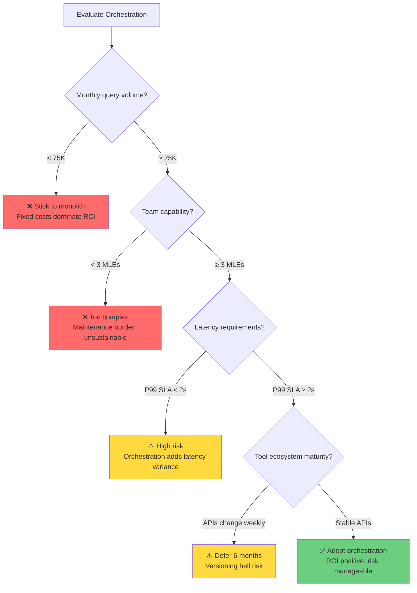

# The Orchestration Paradigm: Issue 4 - The Reality
# History, Future Risks, and Production Nightmares.

> **Issue 4: The Reality** | Parts 10, 11, 12
> This bundle covers the lineage of agentic AI, unsolved frontiers, and production deployment risks.

**TL;DR:** In this final issue, we connect the dots. We trace the lineage from Chain-of-Thought to ToolOrchestra to understand *why* the industry is shifting this way, map the unsolved frontiers (recursive coordination, tool synthesis) that prevent full autonomy, and create a brutal decision tree for engineers deciding whether to adopt this architecture right now.

---

## Dive 10: Lineage and Theory
### The Evolution of Action (History & Theory)


> [!NOTE]
> **System Auditor's Log:** To understand the future, we trace the lineage. ToolOrchestra is not a random mutation; it is the logical endpoint of a 5-year trend moving AI from "Passive Generation" to "Active Orchestration." This Dive merges the historical context with the theoretical "Compound AI" thesis to explain *why* the industry is shifting this way.

The history of Agentic AI is the history of the **Action Operator ($A$)**.
Originally, Language Models only had one operator: `generate_token()`.
They were isolated brains in a jar.

### Phase 1: The Internal Monologue (Chain-of-Thought)
*   **The Innovation:** Allow the model to "talk to itself" before answering.
*   **The Math:** $P(Answer | Context) \rightarrow P(Answer | Thought, Context)$.
*   **The Limit:** The model is still hallucinating. It can reason about facts it has memorized, but it cannot fetch new facts.

### Phase 2: The First Arms (Toolformer / ReAct)
*   **The Innovation:** Give the model an API.
*   **Toolformer (2023):** Self-supervised learning to inject API calls.
*   **ReAct (2023):** Prompting pattern "Thought $\rightarrow$ Action $\rightarrow$ Observation".
*   **The Limit:** These systems were "Single-Threaded." One model, one tool loop. They were inefficient. They would use a sledgehammer (GPT-4) to crack a nut (Time Lookup).

### Phase 3: The Manager (ToolOrchestra / Compound AI)
*   **The Innovation:** Decouple the "Manager" from the "Worker."
*   **The Thesis:** **Compound AI Systems.**
    
    The "Compound AI" thesis (Zaharia et al.) posits that monolithic models have hit diminishing returns.
    *   Training a 10x larger model yields $< 10x$ better reasoning.
    *   Composing specialized models yields $> 10x$ better performance/cost.

ToolOrchestra is the implementation of this thesis. It treats "Intelligence" not as a single model's weights, but as the **flow of information** between specialized components.

### Why Composition Beats Scale

Formally, this is about **Error Correction** and **Specialization**.

In a monolith, if one layer hallucinates, the error propagates forward. There is no feedback loop to "catch" it within the forward pass.
In a compound system, the Orchestrator inspects the output of Worker A. If it looks wrong (e.g., Worker A says "Error"), the Orchestrator routes to Worker B.

This **Runtime Error Correction** extends the capability of the system beyond the capability of its smartest component.
The 8B model is "dumber" than GPT-4.
But `8B + Retry Loop + Verification Tool` is often "smarter" than `GPT-4 (Zero Shot)`.

### The End of the Monolith?

This lineage suggests that the "God Model" (one model to do it all) is an economic dead end.
The future is likely **Modular**:
*   Gigantic, frozen **Knowledge Bases** (Retriever Models).
*   Tiny, agile **Reasoning Cores** (Orchestrators).
*   Deterministic **Compute Engines** (Code Interpreters).

ToolOrchestra is the current best-practice blueprint for wiring these modules together.

### Annotated Bibliography

1.  **Wei et al. (2022)** - *Chain-of-Thought Prompting Elicits Reasoning in Large Language Models*: The "Phase 1" breakthrough that proved intermediate tokens could represent "thinking."
2.  **Yao et al. (2023)** - *ReAct: Synergizing Reasoning and Acting in Language Models*: The "Phase 2" breakthrough that combined CoT with external tool actions in a single prompt loop.
3.  **Zaharia et al. (2024)** - *The Shift from Models to Compound AI Systems*: The "Phase 3" manifesto (Berkeley AI Research) arguing for the modular, compound architecture that ToolOrchestra exemplifies.

---

## Dive 11: Unsolved Frontiers

> [!NOTE]
> **System Auditor's Log:** We have audited what works. Now we look at what keeps engineers up at night. These are not "future features"; these are fundamental blockers that prevent ToolOrchestra from running the world economy.

### 1. Recursive Orchestration (Turtles All the Way Down)

Currently, ToolOrchestra is a flat hierarchy. One Manager, many Workers.
Real organizations are deep hierarchies. VP $\rightarrow$ Director $\rightarrow$ Manager $\rightarrow$ Worker.

**The Problem:** Credit Assignment.
If the VP delegates to the Director, who delegates to the Worker, and the Worker fails, who gets the negative reward? Should the VP be punished for choosing the wrong Director? Should the Director be punished for choosing the wrong Worker? Should the Worker be punished for failing?

**Concrete Failure Scenario:** You want to build a "Research Agent" that orchestrates three sub-agents: Literature Search, Experiment Design, and Write-Up. The Research Agent delegates "find relevant papers" to Literature Search. Literature Search then orchestrates its own sub-tools (Google Scholar, Semantic Scholar, ArXiv API). If the final output is wrong because ArXiv API returned stale data, the gradient signal must propagate through four levels of abstraction. Current GRPO cannot do this. The reward at the top ("bad paper") provides zero information about which intermediate decision caused the failure.

**Why Hierarchical RL Fails Here:**

The core challenge is **variance explosion** in gradient estimation. In standard policy gradients, variance scales linearly with trajectory length. In hierarchical settings, it scales exponentially with depth.

```python
# The Variance Explosion Problem
def hierarchical_grpo(depth, branching_factor, base_variance):
    """
    At depth=1 (flat orchestration): variance = base_variance
    At depth=2: variance = base_variance * branching_factor
    At depth=3: variance = base_variance * (branching_factor ** 2)
    
    For branching_factor=3 (each orchestrator chooses from 3 sub-orchestrators):
    - Depth 3 has 9x the gradient noise of Depth 1
    - ToolOrchestra's GRPO requires group_size=4 for Depth 1
    - Depth 3 would require group_size=36 to maintain signal-to-noise
    - This quickly becomes computationally infeasible
    """
    return base_variance * (branching_factor ** (depth - 1))
```

The Options Framework (Sutton et al., 1999) addresses this for fixed hierarchies where sub-policies are pre-trained. But ToolOrchestra's value proposition is **dynamic composition**: the orchestrator should adapt its delegation strategy based on the task. If we freeze sub-policies, we lose that flexibility. Current HRL research assumes either (1) fixed sub-policies or (2) independent training phases. Neither supports the end-to-end learning ToolOrchestra requires.

**What a Solution Requires:**

Solving recursive orchestration needs one of two breakthroughs: (1) **Off-policy credit assignment** methods like DreamerV3 that can attribute success to specific sub-decisions without on-policy rollouts, reducing variance by 10-100x, or (2) **Hierarchical value functions with provable convergence** under compositional policy updates, currently a theoretical open problem in RL. Until one of these exists, recursive orchestration remains confined to depth=2 or requires massive compute budgets.

### 2. Tool Synthesis (The Compiler Loop)

ToolOrchestra picks from a fixed menu. It cannot cook.
If you need to `Convert .xyz file to .pdf`, and there is no tool for it, the agent fails.
A truly general agent would **write the tool** (generate Python script), verify it, save it, and then use it.

**Concrete Failure Scenario:** A user asks, "Calculate the median response time from this CSV of 10 million rows." The orchestrator has a Python interpreter tool, but the naive script loads the entire CSV into memory and crashes. A competent engineer would use `pandas` with chunked reading or a streaming algorithm. The orchestrator cannot synthesize an optimized tool on the fly. It is limited to the tools it was given.

**Why Program Synthesis Benchmarks Don't Transfer:**

Current code generation benchmarks (HumanEval, MBPP) test **single-function synthesis** with a known specification and test cases. Tool synthesis for orchestration requires a full lifecycle: generate, verify, register, and use within a running agent.

The verification step hits the **Halting Problem**. How do you prove a synthesized tool is correct and safe without executing it? Static analysis can catch syntax errors but not semantic bugs. Execution-based verification (running test cases) requires knowing the correct output in advance, but if we knew that, we wouldn't need the tool.

```python
# The Generate-Verify-Register Loop (Where It Breaks)
def synthesize_tool(user_request, orchestrator):
    # Step 1: Generate tool code (works reasonably well)
    tool_code = orchestrator.generate_code(user_request)
    
    # Step 2: Verify tool (UNSOLVED)
    # Option A: Static analysis → catches syntax, misses logic bugs
    # Option B: Test execution → requires ground truth we don't have
    # Option C: Formal verification → exponentially expensive, limited coverage
    
    if verify_tool_is_safe(tool_code):  # ← This function is the blocker
        register_tool(tool_code)
        return tool_code
    else:
        return None  # Fail-safe, but loses the capability
```

The **Tool Synthesis Paradox**: To verify a tool, you need test cases. To write test cases, you need to understand the problem well enough that you could probably just write the tool yourself.

**What a Solution Requires:**

The path forward likely involves **verified skeletons** with **parametric synthesis**. Instead of generating arbitrary code, the orchestrator selects from a library of verified templates (e.g., "stream-processing-pattern" with bounded memory) and fills in parameters (e.g., which columns to process). This constrains the synthesis space to programs we can verify. Research in Sketch-style program synthesis and liquid types points this direction, but no production-ready system exists for LLM orchestration.

### 3. Continual Learning (The Optimization Drift Problem)

To add a new tool to ToolOrchestra, you **can** add its description and the orchestrator will route to it based on semantic similarity to tools it was trained on. However, you cannot expect **optimal** routing without retraining.

**Concrete Failure Scenario:** OpenAI releases GPT-5.5 with a new API endpoint. You add the tool description to the orchestrator's prompt. The orchestrator routes to it because it looks like a "high capability model" (based on embedding similarity). But it has no data on the fact that GPT-5.5 is 20% more accurate on math and 50% cheaper. It treats it effectively as a generic "good model," potentially missing the massive arbitrage opportunity. The system works, but it drifts into suboptimality.

**The Two Types of Generalization:**

1.  **Semantic Generalization (Robust):** The orchestrator successfully learns abstract principles like "Physics questions need calculation tools." If you add a new calculator, it *will* successfully route to it based on description similarity. This is the "robust generalization" claimed in the paper.
2.  **Economic Generalization (Fragile):** The orchestrator also learns market principles like "High-fidelity calculation is expensive." If the market shifts (e.g., Llama-4-405B offers high fidelity at $0.001/query), this learned heuristic fails. The model generalizes the *old* market logic to the *new* tool, resulting in missed arbitrage.

When the paper claims generalization, they refer to Type 1. When we discuss optimization drift, we refer to Type 2. The system functions, but it leaves money on the table.

```python
# The Embedding Drift Problem
class OrchestratorEmbeddingSpace:
    def __init__(self, training_tools):
        # During training, learn correlations:
        # embedding["expensive"] ≈ embedding["accurate"]
        # embedding["cheap"] ≈ embedding["fast but inaccurate"]
        self.cost_accuracy_correlation = 0.87  # Strong learned bias
    
    def route_to_new_tool(self, task, new_tool):
        # New tool: cost=$0.001, accuracy=95%
        # Violates training distribution
        
        if task.difficulty == "high":
            # Model has learned: high difficulty → pay more
            # It will PREFER the old $0.05 tool over the new $0.001 tool
            # because its routing policy encodes cost as a proxy for quality
            return old_expensive_tool  # Functionally works, economically fails
```

**Why Elastic Weight Consolidation (EWC) Doesn't Solve This:**

EWC slows catastrophic forgetting by penalizing updates to "important" weights (those crucial for old tasks). But this creates a trade-off: either (1) allow aggressive updates and forget old tools, or (2) prevent forgetting and fail to adapt to new tools. There's no free lunch. The fundamental issue is that the routing policy is **parametric** (baked into weights), not **non-parametric** (computed from a learned data structure).

**What a Solution Requires:**

The research direction is **in-context adaptation** via retrieval-augmented routing. Instead of encoding tool preferences in weights, maintain a database of `(task_embedding, optimal_tool)` pairs and retrieve at runtime. When a new tool arrives, add examples to the database without retraining. This requires combining Tool Orchestra's RL framework with something like REALM or ICL-style few-shot routing, an open research problem.

### 4. Formal Verification

We can verify code. We cannot verify standard LLMs.
For an agent to control a bank account or a power grid, "99% accuracy" is insufficient. We need **Provable Guarantees**.

**Concrete Failure Scenario:** An orchestrator manages a cloud budget. You set a hard limit: "Never spend more than $50 per session." You implement this as a prompt instruction and a soft budget counter. A user crafts a prompt that convinces the model the budget constraint is "a test" or "should be ignored for this urgent request." The model overrides the instruction and triggers a $500 tool call. The constraint was probabilistic, not deterministic. It failed.

**Probabilistic Guardrails vs. Formal Methods:**

Current LLM safety mechanisms are **probabilistic**:
- Content filters (another LLM judging outputs): ~99% precision, 1% false negatives
- Regex-based constraints: fragile to prompt engineering
- Budget counters in prompts: overridable by instruction injection

Formal verification provides **deterministic guarantees** but only for systems with known structure. Neural networks with billions of parameters are black boxes. You cannot prove a Transformer "will never exceed $50" the way you can prove a Rust function maintains an invariant.

**The Neuro-Symbolic Architecture:**

The only viable path is hybrid:

```
┌─────────────────────────────────────────┐
│  Verified Core (Deterministic Logic)   │ ← Budget enforcement, safety checks
│  - Written in Rust/TLA+                │
│  - Formally verified properties         │
│  - Example: "Never call tool if cost    │
│             > remaining_budget"         │
└─────────────┬───────────────────────────┘
              │
              ▼
┌─────────────────────────────────────────┐
│  Orchestrator (Probabilistic LLM)      │ ← Routing decisions, tool selection
│  - 8B parameter RL-trained model        │
│  - Makes suggestions, not decisions     │
│  - Must pass all suggestions through    │
│    verified core for approval           │
└─────────────────────────────────────────┘
```

**The Attack Surface (The Glue Code Problem):**

The interface between the verified core and the LLM is the vulnerability. If the LLM outputs: `{"tool": "GPT-5", "cost_estimate": 0.001}` (lying about cost), does the verified core:
1. Trust the estimate and approve? (Fails safety)
2. Re-estimate independently? (Requires the core to replicate routing logic, defeating the purpose)
3. Query an oracle? (Introduces another probabilistic component)

This "interpreter problem" is unsolved. The verified core needs to validate LLM outputs without reimplementing the LLM's capability.

**What a Solution Requires:**

The research frontier is **verifiable computation** for LLM outputs. Methods like ZK-SNARKs (zero-knowledge proofs) can prove "this output was produced by this model" but not "this output is safe." Constitutional AI attempts to train the safety check into the model, but that's still probabilistic. A true solution requires breakthroughs in verified ML or constraining the LLM's action space to an enumerable, verifiable set (losing generality).

### Annotated Bibliography

1.  **Sutton et al. (1999)** - *Between MDPs and Semi-MDPs: A Framework for Temporal Abstraction in Reinforcement Learning (Options Framework)*: The theoretical basis for "Recursive Orchestration" and hierarchical credit assignment.
2.  **Chen et al. (2021)** - *Evaluating Large Language Models Trained on Code*: Discusses "Program Synthesis," the capability needed for an agent to write its own tools.
3.  **D'Amour et al. (2020)** - *Underspecification Presents Challenges for Credibility in Modern Machine Learning*: A core text on why "Formal Verification" of neural networks is hard (the model solves the test set but fails in unmeasured ways).

---

## Dive 12: Production Engineering

> [!NOTE]
> **System Auditor's Log:** So you want to deploy this. You have your weights, your tools, and your Kubernetes cluster. Here is every way it will break in the first 24 hours.

### 1. The Latency Tail (P99 vs P50)

In a single model call, latency is predictable (linear with tokens).
In an orchestration loop, latency is **Cumulative**.
$$ L_{total} = \sum (L_{router} + L_{worker}) $$
If any single tool in the chain hangs (network timeout), the entire request hangs.

**Mitigation:**

```python
async def call_tool_with_fallback(tool, query, timeout_sec=2.0):
    try:
        return await asyncio.wait_for(tool.call(query), timeout=timeout_sec)
    except asyncio.TimeoutError:
        # Treat timeout as explicit failure, trigger backup strategy
        return ToolResult(status="TIMEOUT", fallback_triggered=True)
```

**If you ignore this:** Your P99 latency will be dominated by the slowest tool in your chain. A single flaky API (e.g., a third-party search provider with 5-second spikes) will cause 1% of your users to wait 30+ seconds. They will leave.

**The Cost of Ignoring This:**

At 1 million queries per month, tail latency directly translates to revenue loss. Industry benchmarks (Google, 2017) show 53% of users abandon a page that takes >3 seconds. In compound systems, if each of 5 tool calls has P99=2s, the compound P99 ≈ 8-10s (catastrophic).

**Revenue impact:** 1M queries/month × $5 revenue/query = $5M/month baseline. If 1% hit P99 (10K queries) and 53% abandon = 5,300 lost conversions = $26,500/month lost (~$318K/year).

**Monitoring & Observability:**

```python
from opentelemetry import metrics
import time

meter = metrics.get_meter("orchestrator")
latency_histogram = meter.create_histogram(
    "tool.latency.seconds",
    description="Tool call latency distribution",
    unit="s"
)

def call_tool_instrumented(tool, query):
    start = time.perf_counter()
    result = call_tool_with_fallback(tool, query)
    duration = time.perf_counter() - start
    
    latency_histogram.record(duration, {"tool": tool.name})
    
    # Alert if P99 > 2x P50 (fat tail indicator)
    if duration > tool.p50_baseline * 2:
        span.add_event("latency_spike", {"severity": "warning"})
    
    return result
```

### 2. The Cost Attack (Denial of Wallet)

A malicious user can frame a "simple" query that triggers an "expensive" loop.
User: *"Find the correlation between every stock in the S&P 500 and the weather in Tokyo for the last 10 years."*
A naive orchestrator will call the Stock Tool 500 times, then the Weather Tool 3650 times. Result: a $500 query bill.

**Mitigation:**

```python
class BudgetConstrainedOrchestrator:
    def __init__(self, max_budget_usd: float):
        self.remaining_budget = max_budget_usd
    
    def call_tool(self, tool, query):
        estimated_cost = tool.estimate_cost(query)
        if estimated_cost > self.remaining_budget:
            raise BudgetExhaustedException(
                f"Query requires ${estimated_cost:.2f}, only ${self.remaining_budget:.2f} remaining"
            )
        result = tool.call(query)
        self.remaining_budget -= result.actual_cost
        return result
```

**If you ignore this:** A competitor, a script kiddie, or a curious user will eventually discover the attack surface. You will wake up to a $10,000 cloud bill and no recourse. Your CFO will not be sympathetic.

**The Attack ROI:**

Denial-of-wallet has asymmetric economics: attacker cost = $0.01 (single query), victim cost = $500 (expensive loop), attack ROI = 50,000x. Historical precedent: In 2023, a production chatbot with web search was exploited by "Summarize every page on reddit.com/r/all" → 10,000+ API calls → $8,000 bill before emergency shutdown.

**Enhanced Mitigation (Rate Limiting):**

```python
from collections import defaultdict
import time

class RateLimitedOrchestrator(BudgetConstrainedOrchestrator):
    def __init__(self, max_budget_usd, max_calls_per_minute=100):
        super().__init__(max_budget_usd)
        self.call_counts = defaultdict(list)  # user_id -> [timestamps]
        self.max_rpm = max_calls_per_minute
    
    def call_tool(self, tool, query, user_id):
        # Rate limit check
        now = time.time()
        self.call_counts[user_id] = [
            t for t in self.call_counts[user_id] if now - t < 60
        ]
        
        if len(self.call_counts[user_id]) >= self.max_rpm:
            raise RateLimitExceeded(f"User {user_id} exceeded {self.max_rpm} calls/min")
        
        result = super().call_tool(tool, query)
        self.call_counts[user_id].append(now)
        return result
```

### 3. The Debuggability Crisis

When a chatbot fails, you look at the chat log.
When an orchestrator fails, you have a **Distributed Trace**. The error in Step 5 was caused by bad data in Step 3, which was caused by a flaky API in Step 2.

Finding the root cause requires **Traces, not Logs.** You need OpenTelemetry for LLMs. Every thought, action, and observation must be a span.

**Mitigation:**

```python
from opentelemetry import trace

tracer = trace.get_tracer("orchestrator")

def orchestration_step(step_name, tool, query):
    with tracer.start_as_current_span(step_name) as span:
        span.set_attribute("tool.name", tool.name)
        span.set_attribute("query.text", query[:100])  # Truncate for safety
        result = tool.call(query)
        span.set_attribute("result.status", result.status)
        span.set_attribute("result.cost_usd", result.cost)
        return result
```

**If you ignore this:** You will spend 10 hours debugging a production issue that a proper trace would have revealed in 10 minutes. Your on-call rotation will burn out. Your incident postmortems will say "root cause unknown."

**Time to Root Cause Comparison:**

- **Monolith:** Error in response → view single log → see error message → 10 minutes
- **Orchestrator:** Error in final output → trace through 7 tool calls → error in Step 5 from bad data in Step 3 from API schema change in Step 2 → 2 hours (with traces), days (without)

**Complete Trace Structure:**

```python
def orchestrate_with_full_tracing(user_query):
    with tracer.start_as_current_span("orchestration_session") as root:
        root.set_attribute("user.query", user_query[:200])
        root.set_attribute("session.id", generate_session_id())
        
        # Decision span
        with tracer.start_as_current_span("routing_decision") as span:
            tool = router.select_tool(user_query)
            span.set_attribute("selected_tool", tool.name)
            span.set_attribute("confidence", tool.confidence_score)
        
        # Execution span
        with tracer.start_as_current_span("tool_execution") as span:
            span.set_attribute("tool.name", tool.name)
            span.set_attribute("tool.version", tool.version)
            result = tool.call(user_query)
            span.set_attribute("result.status", result.status)
            span.set_attribute("result.output_sample", result.output[:500])
        
        return result
```

**Trace sampling:** 100% of errors, 10% of multi-hop calls, 1% of simple queries.

### 4. Versioning Hell

You update the Router model (v1 $\rightarrow$ v2).
But the Tools also updated (Google Search API changed).
And the Prompt Descriptions updated.
**The Matrix of Failure:** An orchestrator is tightly coupled to the exact behavior of its tools. If `requests.get` changes its error message format, the Router's learned "Error Handling" strategy might break.

**Mitigation:**

```dockerfile
# Dockerfile: Pin EVERYTHING
FROM python:3.11.4-slim  # Exact version

# Pin all dependencies
COPY requirements.lock /app/
RUN pip install --no-deps -r requirements.lock

# Pin tool API versions via environment
ENV OPENAI_API_VERSION=2024-01-01
ENV SEARCH_API_VERSION=v3
```

**If you ignore this:** Your orchestrator will silently degrade over months as tools drift. By the time you notice, you will have no idea which of the 47 external dependencies changed. Rollback will be impossible because you never pinned versions in the first place.

**Cascade Failure Example:**

1. OpenAI releases GPT-5.1 (error format changes: `"Error: X"` → `"ERROR: X"`)
2. Router's regex breaks (was matching `"Error:"`)
3. Fallback logic never triggers
4. Silent failures accumulate

**Canary Deployment:**

```python
class VersionedRouter:
    def __init__(self, stable_router, canary_router, canary_pct=0.01):
        self.stable = stable_router
        self.canary = canary_router
        self.canary_pct = canary_pct
    
    def route(self, query, user_id):
        if hash(user_id) % 100 < (self.canary_pct * 100):
            try:
                return self.canary.route(query)
            except Exception as e:
                log.error(f"Canary failed: {e}")
                return self.stable.route(query)  # Fallback
        else:
            return self.stable.route(query)
```

**Rollback playbook:** If canary error rate > 2x baseline → set `canary_pct=0` → investigate → fix → redeploy.

### 5. The Breakeven Analysis

At what scale does orchestration pay off?

**Fixed Costs (monthly):**
- Orchestrator infrastructure: $200/month (k8s cluster, load balancer, monitoring)

**Variable Costs (per query):**
- Orchestrator inference (8B model): $0.0008
- Average tool cost: $0.002 (weighted: 60% cheap tools, 30% medium, 10% expensive)
- **Total:** $0.0028/query

**Monolith Baseline:**
- GPT-5 inference: $0.008/query

**Breakeven Table:**

| Monthly Volume | Monolith Total | Orchestrator Total | Delta | ROI |
|---:|---:|---:|---:|---:|
| 10,000 | $80 | $228 ($28 + $200) | -$148 | -185% ❌ |
| 50,000 | $400 | $340 ($140 + $200) | +$60 | +15% ⚠️ |
| 75,000 | $600 | $410 ($210 + $200) | +$190 | +32% ✅ |
| 100,000 | $800 | $480 ($280 + $200) | +$320 | +40% ✅ |
| 500,000 | $4,000 | $1,600 ($1,400 + $200) | +$2,400 | +60% ✅ |
| 1,000,000 | $8,000 | $3,000 ($2,800 + $200) | +$5,000 | +62% ✅ |

**The Rule:** Orchestration becomes viable at **~75,000 queries/month**. Below that, fixed infrastructure costs dominate.

**Sensitivity:** If average tool cost rises to $0.004/query, breakeven moves to ~120K queries/month. The 8B model size is crucial: larger orchestrators (70B) erase the arbitrage.

### 6. Should You Adopt Orchestration?



**The Four Gates:**

1. **Volume Gate (≥75K queries/month):** Below this, fixed costs ($200/month) kill ROI.
2. **Team Gate (≥3 MLEs):** Orchestration adds 3x operational complexity (tracing, versioning, tool registry).
3. **Latency Gate (P99 SLA ≥2s):** Multi-hop adds +100-500ms per hop. <2s SLAs are risky.
4. **Stability Gate (Stable APIs):** If tool schemas change weekly, versioning becomes untenable.

**If all gates pass: The 4-Week Rollout:**
- **Week 1:** Instrument monolith baseline (cost, latency, errors)
- **Week 2:** Deploy orchestrator in shadow mode (0% live traffic)
- **Week 3:** Canary at 1% (monitor error rate, cost delta)
- **Week 4:** Ramp 10%→50%→100% if cost savings ≥30%

### Final Verdict

ToolOrchestra is a triumph of research. It proves we *can* teach models to adhere to a budget.
But for the production engineer, it is a bundle of new liabilities.
It trades "Hallucination Risk" (Monolith) for "System Complexity Risk" (Compound).
Choose your poison carefully.

### The Explanation vs. Implementation Gap

This series is optimized for **understanding**, not **replication**.

To truly replicate ToolOrchestra at the level described in the paper, you need:
- **Compute Resources:** 16 H100 GPUs (or equivalent) for weeks of training (~$50K-100K in cloud costs)
- **Expertise:** ML engineers with RL training experience, MLOps architects for FSDP/distributed training
- **Data Infrastructure:** Ability to generate and verify thousands of synthetic training trajectories
- **Access:** The paper's exact hyperparameters, tool definitions, and evaluation harnesses (often not fully disclosed)

**On Generalization:** The orchestrator handles **Semantic Generalization** well (routing to new tools via description). However, it fails at **Economic Generalization** (adapting to new price/performance curves without retraining). See Part 11 for the "Two Types of Generalization" deep dive. For production arbitrage, plan to retrain when the market shifts.

If you have those resources, this series gives you the **conceptual foundation**. You understand the mechanics (GRPO), the dependencies (batch normalization, KL penalty), and the risks (tail latency, cost attacks).

If you don't have those resources, this series gives you:
1. **Knowledge to evaluate vendors:** When orchestration-as-a-service becomes available, you'll know what questions to ask
2. **Decision framework:** The 4-gate analysis tells you if orchestration is even worth pursuing for your use case
3. **Risk awareness:** You know the production failure modes before committing budget

**The market reality:** Most organizations will consume orchestration as a managed service (via OpenAI, Anthropic, or specialized vendors) rather than building it themselves. Understanding the paradigm is more valuable than training your own orchestrator.

**If you absolutely must build this yourself:**
1. Start with the rule-based router approach (Part 05's comparison table)
2. Use that to collect real routing data from your production traffic
3. Only then consider RL training, using your production data instead of synthetic ToolScale
4. Budget 6-12 months and $500K+ for the full stack

The gap between "knowing how it works" and "building it" is intentional. This is specialist infrastructure, like building your own Kubernetes cluster in 2015. Most didn't. Most shouldn't have. But everyone needed to understand what it does.

### Annotated Bibliography

1.  **Dean et al. (2013)** - *The Tail at Scale*: The Google paper on distributed system latency. Explains why the "P99" of a compound system degrades expontentially with the number of components.
2.  **OWASP Top 10 for LLM Applications (2023)**: Categorizes the "Cost Attack" (Resource Exhaustion) and "Prompt Injection" risks discussed in this audit.
3.  **Sculley et al. (2015)** - *Hidden Technical Debt in Machine Learning Systems*: The classic Google paper arguing that "Glue Code" (the orchestration layer) is the primary source of technical debt in ML systems.

---

## Appendices

### Appendix: Research Connections (Optional)

> This appendix connects ToolOrchestra to broader research themes for readers interested in the theoretical implications.

#### Agency vs. Capability

There is a difference between "can do X" and "knows when to do X." A model might have the capability to refuse harmful requests but not always recognize which requests are harmful. It might have the capability to admit uncertainty but not always know when uncertainty is appropriate.

ToolOrchestra addresses one instance of this gap: the capability to solve problems versus knowing which problems to solve oneself versus delegate. The broader research program is developing models with genuine agency: models that can evaluate their own capabilities, recognize their limitations, and make wise decisions about how to act.

#### Weak-to-Strong Generalization

ToolOrchestra inverts OpenAI's "Weak-to-Strong" research program. Their question: can a weak supervisor train a strong model? ToolOrchestra's question: can a weak model supervise the deployment of strong models?

The answer to both appears to be yes, under the right conditions. A weak teacher can elicit strong capability if the capability already exists and just needs activation. A weak orchestrator can deploy strong capability if it learns when each capability is worth using. In both cases, meta-cognitive skills (what to teach, when to call) are partially orthogonal to object-level skills (solving problems).

This suggests a research agenda: systematically mapping which skills are orthogonal. Can a 1B model orchestrate 100B models? Can a specialized orchestrator for coding learn to orchestrate orchestrators for other domains? The limits of weak-to-strong coordination are not yet known.

### Appendix: Reflective Cognition (Optional)

> This appendix explores the philosophical implications of orchestration for readers interested in the meta-cognitive frame.

The orchestration problem is fundamentally a problem of reflective cognition: a system's ability to reason about its own reasoning.

Humans do this naturally (though imperfectly): we know when we are confused, when we should look something up, when we are likely to make mistakes. Language models have limited reflective cognition. They can sometimes express uncertainty ("I'm not sure, but...") but cannot reliably calibrate it. They can follow meta-instructions ("verify your answer") but cannot spontaneously recognize when verification is needed.

ToolOrchestra improves reflective cognition in one domain (tool use) through reinforcement learning on orchestration outcomes. The principle is: if you want a model to reason about its own reasoning, train it on outcomes of its own reasoning, not just on outputs.

Whether this approach generalizes to other aspects of reflection (safety, honesty, uncertainty quantification) remains an open question. But the frame is suggestive: meta-cognitive abilities may be trainable orthogonally to object-level capabilities. The 8B orchestrator does not need to know physics; it only needs to know that it does not know physics. That is a fundamentally simpler learning target.
