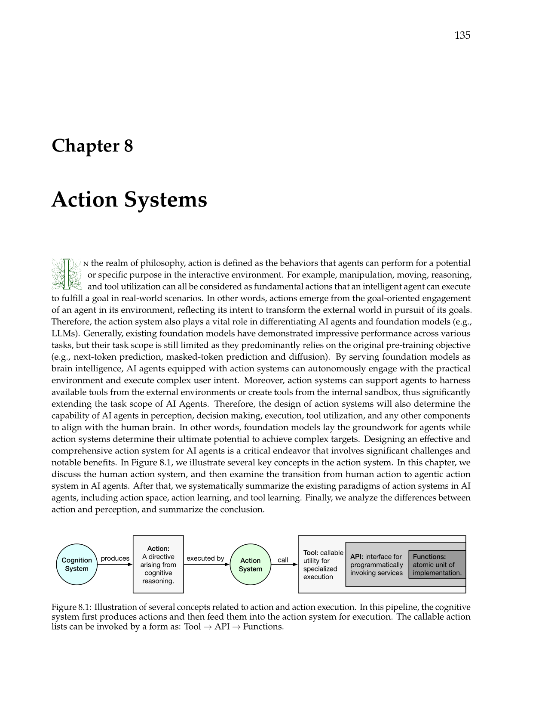
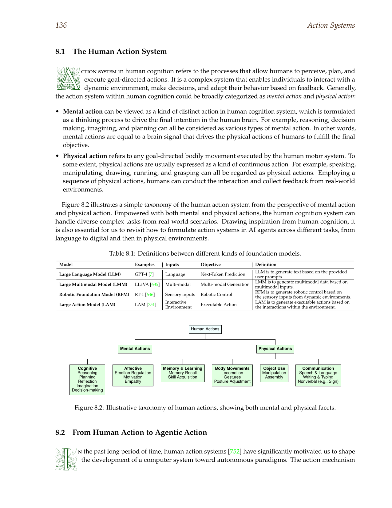
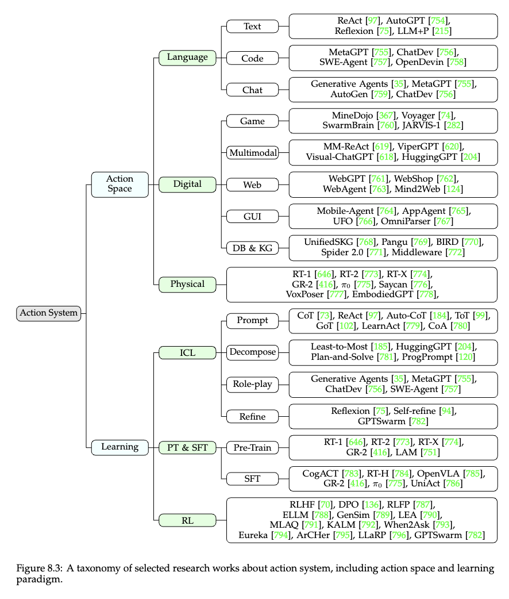
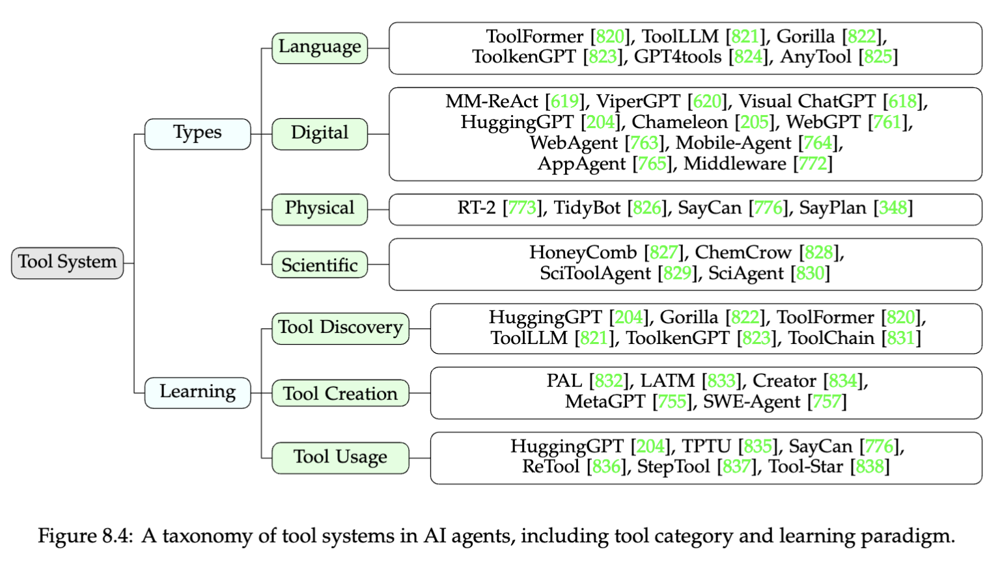
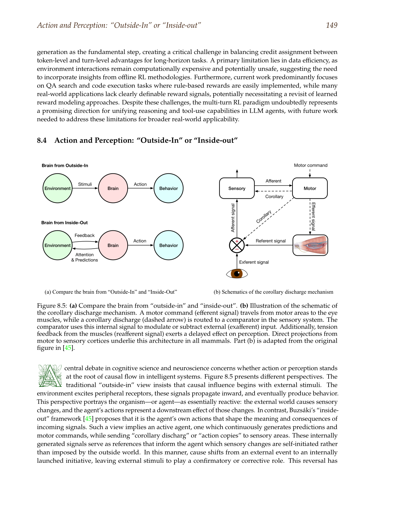

# Action Companion

The main action chapter established the narrow practical center: an agent becomes operational when language starts changing state through bounded software interfaces. This companion broadens that picture. It is about the parts of the action literature that matter once the basic lesson is clear: why different action surfaces produce different standards of reliability, how tool systems become a retrieval and contract problem, why browser and GUI agents deserve separate expectations, and how to read the frontier without confusing reach with maturity.

## The Action Surface Is The First Design Choice

One reason action papers can feel more impressive than they are is that the field often starts by talking about capabilities rather than surfaces. A paper says an agent can shop, browse, code, operate a desktop, or invoke a tool, and the reader is invited to focus on the outcome. Builders have to reverse that order. Before asking whether a workflow can succeed, they need to ask what sort of interface the workflow is actually using. The practical difference between an API call, a database query, a shell command, a browser step, and a GUI click is not cosmetic. Each one changes what can be validated before execution, what can be observed afterward, how failure gets localized, and whether a reviewer can replay the event.

Figure 8.1 from the booklet is useful because it frames action as a small pipeline rather than as a theatrical jump from prompt to world. The cognition system produces an action, the action system routes it to callable utilities, and the environment answers through a specific surface. That is exactly the builder’s view. Action is not one monolithic faculty. It is a chain of interfaces that either preserve structure or dissolve it. The main essay concentrated on typed tools, code, data interfaces, browsers, and GUI layers because those are the surfaces that matter most in software. The broader literature matters because it shows why those surfaces should not be treated as interchangeable.

Figure 8.2 can seem abstract at first, but it helps explain why agent action research keeps splitting between internal action, external action, and tool-mediated action. Human action includes mental operations, bodily operations, and planned interaction with an environment that already has its own affordances. Modern software agents inherit only parts of that picture. They are unusually strong at symbolic mediation and unusually weak at direct embodied feedback. That is why the cleanest action systems in practice tend to be the ones that operate over symbolic interfaces designed for machines. As the surface becomes more human-facing, the action loop needs more reconstruction, more guardrails, and more patience.

The engineering consequence is straightforward. If a task can be expressed through a typed API, an explicit code runtime, or a constrained data interface, that should usually be the starting point. Those surfaces were already designed to carry machine-usable state. Browser action belongs in the next tier because the environment exposes a usable interface but not a cooperative one. GUI action belongs further out because the structure has collapsed into pixels and timing. Teams that treat all five surfaces as different skins over the same ability tend to make the wrong comparison. The right comparison is not whether the task finished. It is whether the interface preserved enough structure to make the finish trustworthy.

## Tool Systems Are Retrieval Problems Before They Are Autonomy Problems

The phrase "tool use" often suggests that the hard part begins once the agent has decided to act. In practice, many action failures are decided earlier, when the system has to find the right callable object, recover its specification, and fit the task into a contract that software will accept. This is why the tool literature matters more than it first appears. It shifted the field away from vague claims about model competence and toward the stricter question of whether the system can discriminate among interfaces that are similar in purpose but different in schema, side effect, or privilege.

Figure 8.3 is useful because it widens the map beyond the public chapter’s deployable center. The taxonomy separates action-space work from action-learning work and tool-based action from more general system design. That distinction matters when reading papers. Some work is about the representation of actions. Some is about the learning procedure that lets the agent choose or refine them. Some is about a tool layer that already exists and needs better selection and argument construction. Builders should not read these as substitutes. A workflow with weak schemas does not become reliable because the model learned a better action prior. A workflow with poor recovery logic does not become dependable because it uses a stronger tool-augmented prompting method.

Figure 8.4 makes the tool-system taxonomy more concrete by separating categories of tools and the learning or invocation paradigms that sit around them. This is the right frame for understanding why tool catalogs become infrastructure. Once the system has dozens or hundreds of callable options, action becomes part retrieval problem, part interface problem, and part safety problem. The agent has to know that a weather question should hit a live API rather than answer from memory, that a customer-record update is a write path rather than a search path, and that a low-risk documentation lookup should not be confused with a tool that can submit irreversible changes.

This is where a lot of production action work becomes unexpectedly ordinary in the best sense. The glamorous question is whether the model can call tools. The practical question is whether the catalog is organized well enough that the model can find the correct one, fill the correct fields, and recognize the difference between a success state, a queued state, and a refusal. Tool discovery, schema retrieval, argument templates, result normalization, and permission scoping often decide more than the model family does. That is why the best action systems frequently look less like autonomous improvisation and more like careful interface engineering wrapped around a model that can choose among bounded options.

The tool-creation part of the literature belongs here as well, but it should be read with caution. There are tasks where a workflow repeatedly encounters missing affordances and genuinely benefits from synthesizing a helper function, a wrapper, or a small script. There are many more tasks where automatic tool creation merely hides weak baseline interface design. If the environment already exposes a serviceable action surface, tool creation is not the first escalation. It becomes interesting later, when repeated failure analysis shows that the missing capability is local, low-risk, and stable enough to justify promotion into the tool layer.

## Browser And GUI Work Need Different Expectations

Browser agents and desktop agents are often grouped together under the broad banner of computer use. That grouping is convenient for marketing and misleading for design. Browsers usually preserve more structure than desktops do. The page may still expose a DOM, stable selectors, forms, URLs, and network-observable state transitions. GUI systems often expose only pixels, ambiguous controls, and timing-sensitive state that was built for human eyes. Treating both as versions of the same problem makes browser work look easier than it is and desktop work look more mature than it is.

Figure 8.5 helps here because it reframes action from two directions. The outside-in view starts with the environment and asks what interfaces it provides. The inside-out view starts with the agent and asks what control and causal structure it needs in order to act coherently. Browser and GUI work fail at the point where those views stop matching. The environment presents human-oriented state, while the agent needs machine-readable commitments. A web flow might still provide enough intermediate structure to bridge that gap. A legacy desktop often does not.

This is why browser work should usually be read as escalation literature, not as the new default for production agents. WebAgent and Mind2Web matter because they show what is required once typed interfaces are unavailable. They do not imply that the browser is a better target than an API. The browser becomes relevant when the system of record is web-native, when the usable API is absent or politically unavailable, and when the remaining ambiguity can still be bounded well enough to measure. The same logic holds more strongly for GUI action. AppAgent and OmniParser are valuable because they make progress on the perception bottleneck, not because they eliminate it.

The quiet lesson in this part of the literature is that more general reach usually comes with weaker contracts. A system that operates over pixels may solve tasks a typed API cannot reach, but it pays for that reach through fragility, weaker observability, and more expensive recovery. The right reading habit is therefore comparative. When a browser or GUI paper looks impressive, ask which cleaner interface was unavailable, what observation structure replaced it, how completion was detected, and how the authors separated perception mistakes from policy mistakes. Without those questions, the frontier can teach the wrong lesson.

## Approval, Recovery, And Observation Make Action Auditable

A mature action system is not defined only by what it can call. It is defined by how it handles consequence. Approval, recovery, and observation are part of the action boundary itself. They should not be added at the end as a governance patch. The reason is simple. The action layer is where language stops being a description engine and starts interacting with software that has cost, permissions, and durable effects. If the system cannot represent approval points, retry states, partial completion, and normalized observations, then even correct action selection can turn into brittle operation.

The public chapter made this point in a narrow way through the action trace. The broader literature lets us say it more explicitly. An action boundary should answer at least four questions. What exact interface is being called. What authority is being exercised. What did the environment return. What should happen next if the environment returns something weaker than clean success. Those questions are easier to satisfy on typed surfaces, but they matter on every surface. A browser step needs an explicit notion of completion just as much as an API call needs an explicit schema. A code action needs bounded execution just as much as a database write needs scoped credentials.

Recovery logic is especially important because many action demos treat error handling as a conversational style problem. A system apologizes, retries, and continues. That is not recovery. Recovery means the failure itself becomes machine-readable state: invalid argument, unavailable tool, stale selector, permission refusal, ambiguous completion, partial success, or exhausted retry budget. Once the failure is represented this way, the workflow can branch rationally. It can escalate to a fallback route, request approval, ask for fresh state, or stop. Without that structure, the system is still speaking about action more than operating through it.

Approval belongs in the same frame. The goal is not to interrupt every meaningful task with a human click. The goal is to place review where the downside of silent automation exceeds the cost of inspection. Typed tools, reversible operations, and read-only paths can support more autonomy. Destructive writes, financial changes, and policy-sensitive actions need stricter checkpoints. The field sometimes talks as though approval reduces agency. In practice it often preserves the ability to widen autonomy later, because it lets teams deploy bounded action without pretending the whole space is equally safe.

## Reading The Frontier Without Copying The Demo

The action literature now spans several different ambitions at once. Some papers want better tool invocation. Some want stronger controller patterns. Some want agents that can operate across browsers, apps, and developer environments. Some want broader claims about software that is legible to machines. These are related ambitions, but they do not mature at the same rate. Builders need a reading discipline that separates what should change the default architecture from what should change only the outer edge of experimentation.

The best place to start is still conservative. Read the tool and controller papers first. Understand why typed invocation, schema quality, result normalization, and bounded execution improve reliability. Then read browser and GUI work as escalation layers that become relevant when the environment denies better interfaces. Then read software and data papers as examples of action surfaces where feedback is naturally harsher and more useful. Finally, read tool-creation and computer-use work as signals about where the field is pushing next, not as evidence that the practical center has moved.

This is also the right way to interpret the larger booklet from which the chapter blueprints were distilled. Its strength is not that it proves every action mode is equally ready. Its strength is that it shows how all these modes fit inside one larger landscape of action systems, tool systems, learning paradigms, and interface design. The companion exists to make that map readable without losing the main essay’s discipline. The point is not to become impressed by every new surface. The point is to learn which surface gives a workflow the narrowest, clearest, and most reviewable path to the required state change.

## Analytical References

### Toolformer

[Toolformer](https://github.com/petroslamb/content/blob/main/autonomous-agent-blueprint/reference/papers/toolformer.md) matters because it treats tool invocation as part of the model’s operating pattern rather than as a wrapper layered around text generation from the outside. That shift was important at the time because the field still treated tool use as a clever integration trick. Toolformer helped make the deeper point that there are tasks where the right next token is not another sentence but a call to something external. It also showed that tool use could be learned in a way that changed behavior selection, not just output formatting.

For builders, Toolformer is worth reading when the question is conceptual rather than infrastructural. It clarifies why tool use belongs inside the architecture discussion at all. It is less useful as a direct production recipe, because modern systems still need explicit catalogs, permissions, retrieval, and result handling that the paper does not fully solve. Read it to understand why action is a genuine behavioral shift. Do not read it as evidence that learned invocation removes the need for strict interface design.

### Gorilla

[Gorilla](https://github.com/petroslamb/content/blob/main/autonomous-agent-blueprint/reference/papers/gorilla.md) is one of the cleanest papers for understanding tool use as an API problem. Its contribution is not broad autonomy rhetoric. It is the narrower and more useful claim that many real failures happen because the model chooses the wrong interface or constructs the wrong arguments. That framing moved the field closer to software reality. API-heavy environments punish approximation, and Gorilla made that visible in a way generic tool-use demos had not.

Builders should read Gorilla when designing tool catalogs, schemas, and retrieval layers. It sharpens the part of the action problem that lives between recognizing tool need and obtaining a valid call. It is less helpful on approval, recovery, or operational boundaries after execution. In other words, Gorilla helps explain why interface discrimination matters, but it should be paired with stronger system-design sources before anyone claims to have a complete action stack.

### HuggingGPT

[HuggingGPT](https://github.com/petroslamb/content/blob/main/autonomous-agent-blueprint/reference/papers/hugginggpt.md) is best read as a controller paper. It treats the language model as a coordinator over specialist capabilities rather than as a single node that must solve every subproblem itself. That matters because the action literature often collapses action and orchestration into one story. HuggingGPT separates them. The central lesson is that reliable action sometimes comes from routing work to narrower systems whose interfaces are better matched to the subtask.

This paper is useful when a workflow already has meaningful specialist tools and needs an orchestration perspective. It is not the right paper for the very first action boundary, because most teams should get one clean typed action loop working before they start composing many capabilities. Read HuggingGPT when one node is clearly overloaded and tool routing becomes part of the design. Do not read it as a reason to build a many-tool controller before the basic interface discipline exists.

### WebAgent And Mind2Web

[WebAgent](https://github.com/petroslamb/content/blob/main/autonomous-agent-blueprint/reference/papers/webagent.md) and [Mind2Web](https://github.com/petroslamb/content/blob/main/autonomous-agent-blueprint/reference/papers/mind2web.md) belong together because they frame browser action as a serious systems problem rather than as simple clicking. They deal with state tracking, planning over pages, selector or DOM grounding, and task completion in an environment that was not built to expose clean machine contracts. Their importance is historical and practical. They mark the point where web action became legible as an architectural domain rather than as an ad hoc demo style.

Builders should read these papers when a workflow must operate through the browser because cleaner interfaces are missing. They help set expectations about what browser automation really involves and what kinds of evaluation signals are still available. They should not be used to justify browser-first design when typed interfaces exist. The main value here is comparative: these papers teach what extra burden appears once the environment stops cooperating with machine-readable action.

### AppAgent And OmniParser

[AppAgent](https://github.com/petroslamb/content/blob/main/autonomous-agent-blueprint/reference/papers/appagent.md) and [OmniParser](https://github.com/petroslamb/content/blob/main/autonomous-agent-blueprint/reference/papers/omniparser.md) are useful together because desktop and GUI action is really a perception-and-control problem. AppAgent shows the ambition of operating across app surfaces that do not expose good APIs. OmniParser isolates the perception side by reconstructing usable structure from screenshots. Read together, they explain why GUI action is both attractive and expensive. It reaches closed systems, but it does so by rebuilding structure that other surfaces provide naturally.

These are worth reading when the system of record is trapped behind legacy interfaces, mobile apps, or desktop software with no acceptable programmatic access. They help a builder understand what must be added before pixels become actionable state. They should not be overclaimed as evidence that general computer use is a practical default. Their real contribution is to show how much extra architecture is required when the environment gives the agent almost nothing.

### SWE-agent

[SWE-agent](https://github.com/petroslamb/content/blob/main/autonomous-agent-blueprint/reference/papers/swe_agent.md) is one of the strongest practical action papers because software engineering environments produce unusually crisp feedback. File edits succeed or fail. Tests pass or fail. Commands return structured errors. That makes the repository and terminal a serious action surface rather than a special case. The paper matters because it demonstrates how much easier action becomes when the environment itself helps localize mistakes and expose recovery paths.

Builders should read SWE-agent when they want to understand action on a surface that is neither a toy API nor a browser. It is especially useful for seeing how bounded tool access, explicit observation, and test feedback combine into a replayable action loop. The paper should not be read as proof that all code agents are mature. It should be read as proof that some surfaces are more cooperative than others, and that action quality rises when the environment answers clearly.

### Spider 2.0 And BIRD

[Spider 2.0](https://github.com/petroslamb/content/blob/main/autonomous-agent-blueprint/reference/papers/spider_2_0.md) and [BIRD](https://github.com/petroslamb/content/blob/main/autonomous-agent-blueprint/reference/papers/bird.md) matter because they keep reminding the field that a large share of valuable action in enterprise settings is actually structured-data work. Text-to-SQL and data-agent problems are easy to underestimate because they look less theatrical than browsers and desktops. In practice they often sit closer to the system of record, carry clearer semantics, and expose stronger evaluation signals. These benchmarks move the conversation away from toy database questions and toward realistic complexity.

Read these when deciding whether a workflow should live on a data surface instead of a more general one. They sharpen the boundary between asking a model to act over business data and asking it to narrate what business data might imply. They should not be overclaimed as full enterprise automation solutions, because benchmark settings still simplify governance and approval. Their real use is to show that structured data is often one of the strongest action surfaces available.
