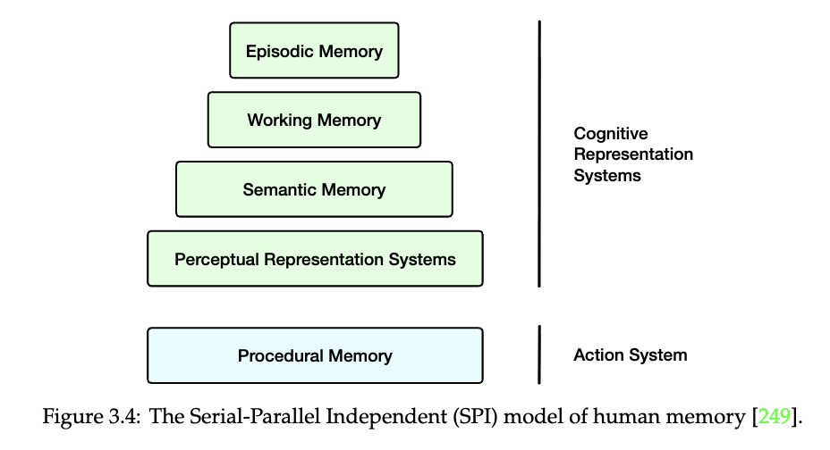
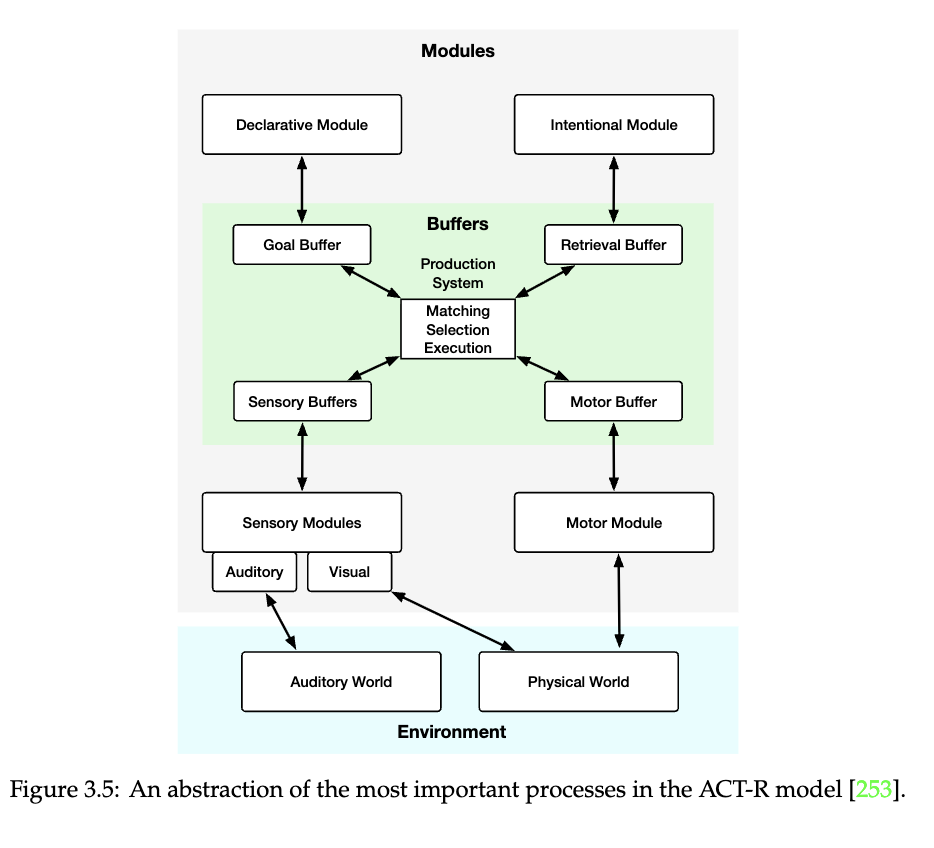
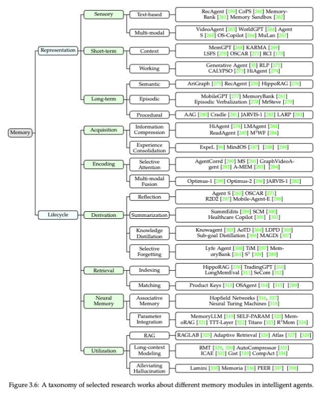
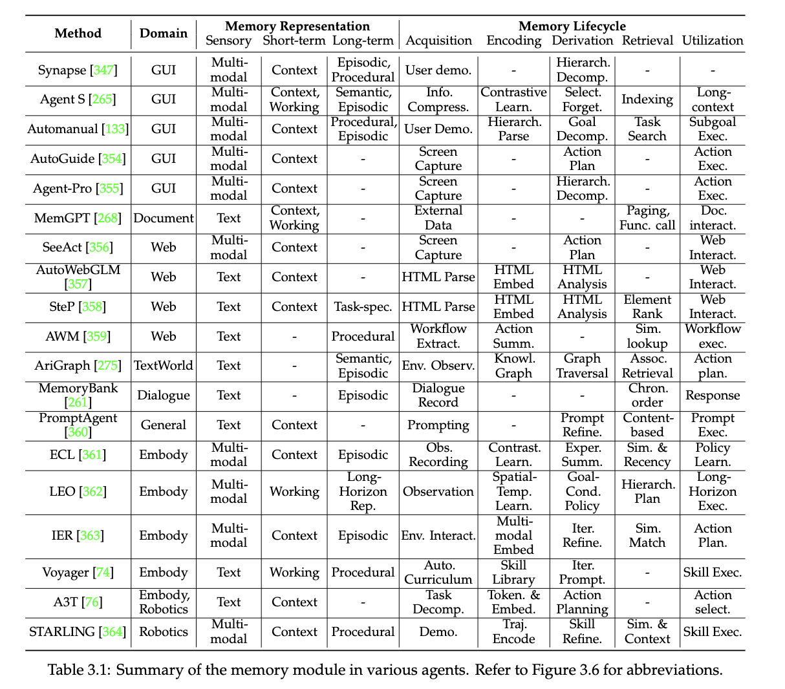
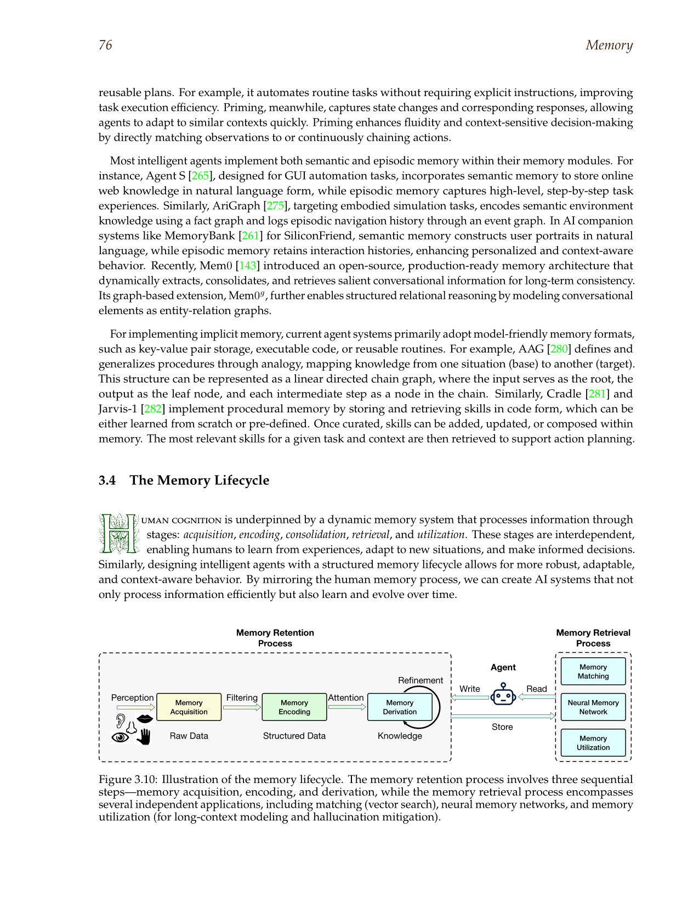

# Memory Companion

The main memory chapter argued that the real problem is not storing more past state but governing what deserves authority over time. This companion widens that argument. It brings in the cognitive models that still help, the lifecycle figures that clarify why memory is more than a store, the retrieval escalations that only make sense after governance is in place, and the reference papers that teach different parts of the memory problem rather than one generic feature called long-term memory.

## Cognitive Memory Models Still Help If You Use Them Carefully

The memory literature becomes easier to read once you stop asking whether AI systems should imitate human memory in a literal sense. That question is too broad to be useful. The better question is which cognitive distinctions still clarify engineering choices. In practice, a few of them do. They are not valuable because they make agents more human-like. They are valuable because they separate kinds of retained state that otherwise get mixed together in one generic memory layer.

The SPI model in Figure 3.4 is a good example. It separates perceptual representation, semantic memory, episodic memory, and procedural memory, then places the action system beside them rather than inside them. That is still a useful way to think. It reminds the builder that factual knowledge, lived experience, and reusable routines are not interchangeable. A system that stores all three as undifferentiated embeddings may still retrieve something relevant, but it will struggle to decide what kind of authority that object should carry. A factual policy excerpt should not behave like a prior case trace. A prior case trace should not behave like a reusable routine. The model matters because it keeps those categories apart.

ACT-R, shown in Figure 3.5, helps in a different way. It emphasizes buffers, module boundaries, and the movement between perception, retrieval, goals, and motor execution. For AI agents, the specific cognitive claim matters less than the architectural discipline it suggests. Working state is scarce. Retrieval has to compete for attention. Action should consume a bounded summary of the past rather than an undifferentiated archive. That is exactly the practical lesson most memory systems need. The goal is not to reproduce ACT-R. The goal is to keep active context small enough that current work remains legible and to force durable state through explicit interfaces instead of letting it flood the prompt.

Used this way, cognitive memory models serve as design constraints rather than metaphors. They help explain why typed memory still beats giant transcript retention. They also explain why a memory chapter belongs early in a course about agents. Once the task lasts longer than one prompt, the system needs a policy for what survives, what gets compressed, what gets promoted, and what should disappear. Human memory taxonomies are useful precisely because they expose how many distinct questions are hiding inside the single word "memory."

## Typed Memory Is A Governance Problem Before It Is A Retrieval Problem

The public chapter focused on four memory types because that split is the simplest one that survives contact with real workflows. Working memory holds the live task state. Semantic memory stores durable facts, documents, and records. Episodic memory stores what happened in prior runs. Procedural memory stores routines that have become reusable. The point of the split is not elegance. It is that each memory type answers a different question and therefore needs a different write threshold, retrieval path, and retirement rule.

Figure 3.6 is one of the most useful figures in the booklet because it shows how recent agent systems distribute emphasis across memory modules instead of pretending to solve memory in one move. Some systems are mainly about semantic retrieval. Some turn prior trajectories into episodic guidance. Some treat successful routines as procedural knowledge. When builders read this taxonomy carefully, the field stops looking like a contest over whose long-term memory is largest. It starts looking like a collection of different answers to the question of what should be retained at all.

Table 3.1 makes the same point from the other direction. It shows that actual systems mix memory modules unevenly because workloads do not demand the same kind of continuity. A research assistant may benefit from strong semantic and episodic memory with almost no procedural promotion. A coding agent may need procedural memory sooner because repeated tool sequences and reusable repair routines appear quickly. A customer-support workflow may need semantic freshness rules more than long episodic traces. The design lesson is that typed memory is not an academic nicety. It is how a team avoids building one large store that silently carries conflicting authority relationships.

That is why memory architecture should begin with governance questions before retrieval questions. What class of information is being stored. Why is it worth keeping. How will it be retrieved later. What will make it stale. When should it be summarized, refreshed, promoted, or deleted. Retrieval quality matters, but retrieval is downstream from these choices. If write policy is weak, better retrieval only gives the system faster access to clutter. Many teams reach for more advanced indexing before they have answered the simpler question of whether the stored object deserved to exist in the first place.

## The Lifecycle Matters More Than The Store

Memory systems are often described through storage components: vector databases, document stores, graph stores, scratchpads, or message histories. Those components matter, but they are not the main architecture. The main architecture is the lifecycle. Memory exists because some piece of current experience is acquired, encoded, transformed, and later used. If that chain is weak, the sophistication of the backend will not rescue it.

Figure 3.10 is the most useful memory diagram for builders because it makes the missing middle visible. Between acquisition and later retrieval, something has to happen. Raw observations become candidate memory objects. Some are filtered out. Some are encoded in a better representation. Some are derived into summaries, lessons, or structured facts. That derivation step is what separates a working memory system from a logging system. A long terminal transcript is rarely the right durable object. A well-formed summary of the failure mode, the corrected command, and the condition under which it applies often is.

This is also where admission policy belongs. Teams often talk about retrieval precision while allowing extremely loose writes. That causal order is backward. If every conversation, every correction, and every one-off success enters durable storage, future retrieval has to sort signal from preventable debris. Strong memory systems are strict at the write boundary and selective at the promotion boundary. A fact might require checked extraction before it enters semantic memory. A lesson from failure might stay local to one episode until it repeats. A successful routine might need repeated wins before it earns procedural status. These decisions are not secondary details. They are the reason memory remains trustworthy after the first month of operation.

Forgetting belongs inside the same lifecycle. It is easy to talk about decay as though it were a concession. In practice, retirement is part of accuracy. A stale reimbursement policy is not neutral information. It is a live risk if it can still be retrieved during action. An outdated coding routine is not harmless history if the system treats it as a current best practice. Mature memory design therefore needs expiry, refresh, versioning, and demotion. The system should know not only how to store and retrieve, but also how to stop trusting.

## Retrieval Should Follow Structure, Not Fashion

Once governance and lifecycle policy are in place, retrieval design becomes more interesting and more honest. This is the point where vector search, graph-aware retrieval, episodic lookup, and procedural selection deserve comparison. The mistake is to compare them as though they solved the same problem. They do not. Semantic retrieval is mostly about recovering durable reference knowledge. Episodic retrieval is about finding prior cases that may change the current approach. Procedural retrieval is about selecting a known routine. Graph-aware retrieval is about preserving relations that flat similarity tends to miss.

The memory literature sometimes creates the impression that richer retrieval is always a sign of progress. It is better to think of it as escalation. If a workflow mostly needs factual snippets and policy excerpts, semantic retrieval with freshness and provenance rules may be enough. If prior failures and corrections matter, episodic retrieval becomes more important. If the same task class repeats, procedural lookup may outperform retrieving long histories. If the system repeatedly misses because the relevant facts are connected through entities, roles, or dependency chains, then graph-heavy approaches like HippoRAG start to make sense.

This comparison also clarifies why retrieval scores should not be mistaken for trust scores. A memory item can be close in embedding space and still be stale, mis-scoped, or simply of the wrong type. A high-similarity episode does not become policy because it happened to resemble the current case. A retrieved routine does not become safe because it once worked elsewhere. Retrieval is therefore only one part of memory use. After retrieval, the system still needs type awareness, freshness checks, provenance, and often verification against current state. That is especially important once memory outputs begin to influence action rather than only answer questions.

The practical reading order follows from this. Start with the simpler retrieval layer that matches the information type. Add richer structure only when failure analysis shows the current retrieval mode is losing information the task genuinely needs. This keeps memory from becoming another place where systems overfit to architectural fashion instead of operational need.

## Experience Becomes Capability Only Through Promotion

The most interesting part of the memory literature is the transition from experience to reusable capability. A system that merely records history has continuity. A system that turns repeated success into a callable routine has started to acquire something closer to operational skill. That is the real significance of procedural memory. It is not a larger archive. It is a narrower library of patterns that have earned reuse.

This promotion step deserves far more severity than it usually gets. A one-off success is not yet a routine. A prompt that happened to work once is not yet a reusable instruction. A shell sequence that passed once on a particular repository is not yet stable know-how. Promotion should require recurrence, legible success conditions, and enough abstraction that the stored routine remains meaningful when retrieved later. Otherwise procedural memory becomes a junk drawer of lucky improvisations.

The same idea changes how to think about reflection papers. Their value is not only that the system can criticize itself. Their value is that failures can become better future objects: lessons, heuristics, warnings, and revised plans. In other words, the real gain comes when the next attempt is shaped by a distilled trace of what mattered rather than by a verbatim replay of everything that happened. That is how episodic memory starts feeding procedural memory. The field often presents these as separate features. They are more usefully read as stages in a promotion pipeline.

For builders, this is where memory becomes more than continuity support. It becomes a way to reduce relearning cost across repeated work. The key is discipline. Promote slowly, retire aggressively, and keep the route from episode to procedure explicit enough that a reviewer can still understand why a routine exists. Memory earns trust the same way any other system component does: by proving that its retained objects still deserve to shape current decisions.

## Analytical References

### MemGPT

[MemGPT](https://github.com/petroslamb/content/blob/main/autonomous-agent-blueprint/reference/papers/memgpt.md) is the clearest paper for turning memory from a vague feature into a control problem. Its key insight is that active context should be treated as scarce fast memory and external stores as slower tiers that need explicit movement. That framing mattered because a lot of early agent work implicitly treated long prompts as memory. MemGPT forced the field to think about paging, selective recall, and policy around what belongs in the working set at all.

Builders should read MemGPT when the task is running longer than the context window or when session continuity has started to feel expensive and unprincipled. It is especially good for clarifying the split between active task state and durable external memory. It should not be overclaimed as a complete memory architecture, because it says less about admission thresholds, derivation quality, and retirement policy than about the tiering model itself. Read it for the control abstraction, then add stricter lifecycle rules.

### Generative Agents

[Generative Agents](https://github.com/petroslamb/content/blob/main/autonomous-agent-blueprint/reference/papers/generative_agents.md) remains one of the strongest papers on why raw logs are poor memory objects. Its contribution is the reflection layer: observations become higher-level inferences that later behavior can use. That mattered because it demonstrated a path from chronology to abstraction. The agent does not only remember that events happened. It synthesizes a better account of what those events mean.

This paper is worth reading when episodic memory is starting to matter and the team wants a concrete example of derivation rather than retention. It is especially helpful for understanding why unprocessed histories often fail to change later behavior in the right way. At the same time, it should not be overread as a blueprint for production memory by itself. The social-simulation setting is narrower than most operational workflows, and the governance burden remains on the builder.

### MemoryBank

[MemoryBank](https://github.com/petroslamb/content/blob/main/autonomous-agent-blueprint/reference/papers/memorybank.md) is the paper to read when forgetting needs to stop sounding optional. Its Ebbinghaus-inspired framing is less important than the operational lesson behind it: retained items should weaken, refresh, or disappear depending on later use. That is a direct answer to memory sprawl. The paper matters because it treats retention policy as part of performance rather than as cleanup after the interesting work is done.

Builders should read MemoryBank when a store is getting larger and retrieval quality is beginning to decay under stale or low-value items. It helps sharpen the retirement question and puts refresh logic back inside the design conversation. It should not be used as a license to apply generic decay everywhere. The real lesson is selective forgetting tied to memory type and task value, not blind time-based deletion.

### Reflexion

[Reflexion](https://github.com/petroslamb/content/blob/main/autonomous-agent-blueprint/reference/papers/reflexion.md) is often filed under reasoning, but it is equally important as a memory paper because it shows how failure can become durable verbal guidance for later attempts. Its contribution is not simply self-critique. It is the persistence of that critique across runs. That turns isolated failure into an episodic asset and creates a route from error analysis toward better future behavior.

This is the right paper to read when a workflow repeats and the environment supplies a meaningful success or failure signal. It clarifies how lessons from prior attempts can be stored more usefully than raw transcripts. It should not be overclaimed as a general memory solution, because the quality of stored reflections depends heavily on evaluation quality. Weak feedback produces weak lessons. Strong feedback can make Reflexion a powerful bridge between episodic retention and later procedural improvement.

### Mem0

[Mem0](https://github.com/petroslamb/content/blob/main/autonomous-agent-blueprint/reference/papers/mem0.md) matters because it is unusually explicit about extracting and consolidating salient information instead of storing everything. That makes it one of the more production-facing memory papers in the set. The paper helps shift the conversation from memory quantity toward memory object quality: what should become a stored fact, what should become a preference or summary, and what should be discarded as interaction noise.

Builders should read Mem0 when designing the write path for a real assistant or agent that interacts frequently and risks accumulating a great deal of unhelpful residue. It is useful for thinking about consolidation and durable representations. It should not be mistaken for a complete answer to retrieval or trust, because extracted memories still need freshness, provenance, and deletion policy. Its value is strongest at the admission boundary.

### HippoRAG

[HippoRAG](https://github.com/petroslamb/content/blob/main/autonomous-agent-blueprint/reference/papers/hipporag.md) is the paper to reach for when flat chunk retrieval keeps losing the structure that the task actually depends on. Its importance lies in relational retrieval. Some facts matter only because of how they connect to other entities, events, or attributes. HippoRAG makes that explicit and shows why graph-aware retrieval can outperform purely similarity-based lookup when the knowledge problem is multi-hop or dependency-rich.

Read HippoRAG when failure analysis shows that the system is not merely missing relevant text but missing the relations among relevant pieces of text. It helps decide when graph structure is worth the extra complexity. It should not be used to justify graph-heavy retrieval as a default. If the memory problem is still weak admission policy or stale facts, better relational retrieval only makes those problems easier to retrieve.

### Voyager

[Voyager](https://github.com/petroslamb/content/blob/main/autonomous-agent-blueprint/reference/papers/voyager.md) is the clearest procedural-memory paper in the set because it makes skill accumulation visible in a setting where repeated routines matter. The embodied environment is not the main lesson. The main lesson is that successful behaviors can be stored as reusable procedures rather than rediscovered from scratch. That gives the paper outsized value for understanding promotion into procedural memory.

Builders should read Voyager when a workflow has started to exhibit repeatable task classes with reusable subroutines. It helps answer what procedural promotion should look like and why a skill library can be more valuable than repeated free-form reasoning. It should not be overclaimed as a reason to promote every local success into a procedure. The real takeaway is selective promotion under repeatability, not indiscriminate accumulation.
