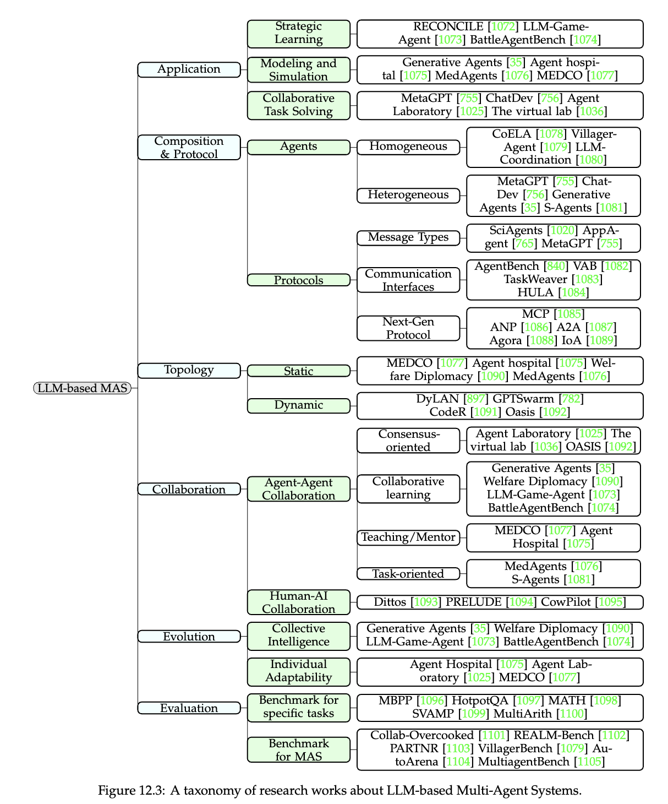
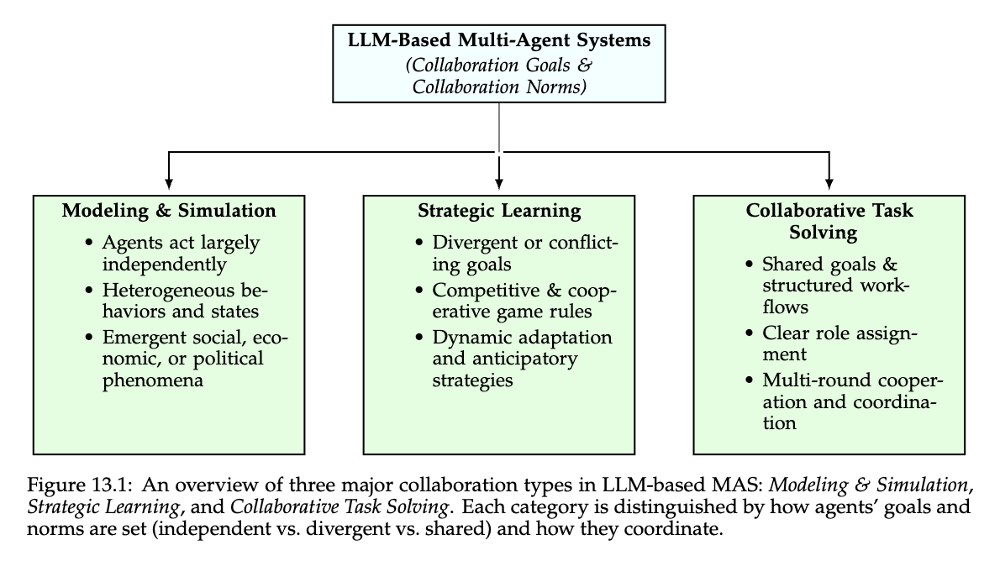
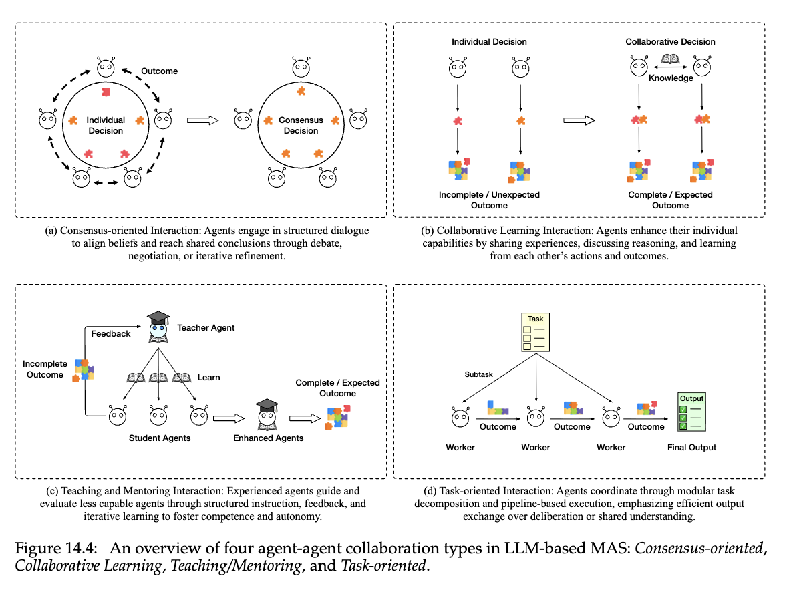
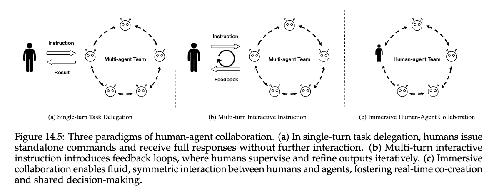
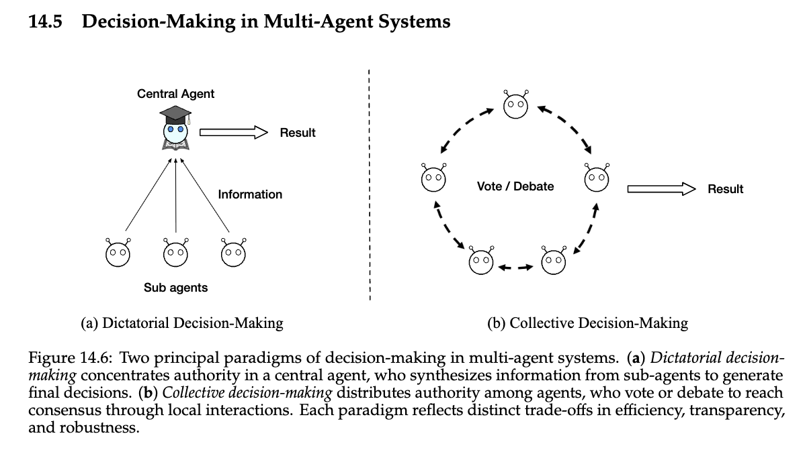
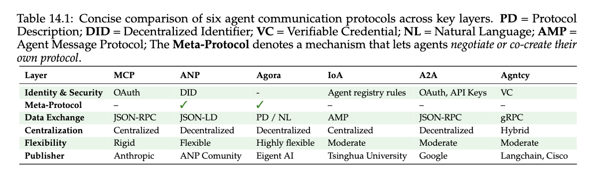
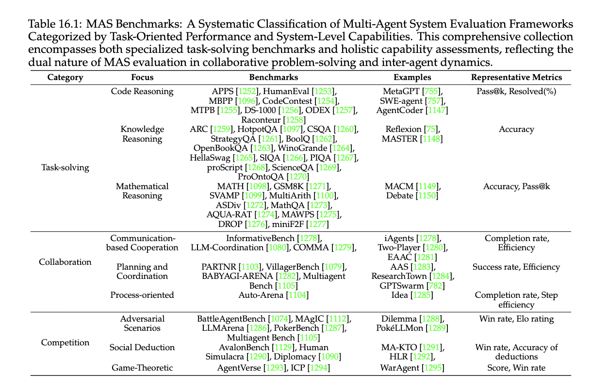

# Multi-Agent Companion

The main multi-agent chapter kept a conservative line: most teams should begin with one strong workflow, and extra agents need real boundaries to justify themselves. This companion broadens that line into a fuller map of the field. It looks at the booklet’s taxonomies, collaboration types, human participation patterns, decision structures, protocol choices, and evaluation frameworks so the reader can distinguish between multi-agent systems that clarify work and those that merely redistribute ambiguity.

## Multi-Agent Work Solves Several Problems Under One Label

One reason the multi-agent field can be hard to read is that the phrase "multi-agent system" covers several different design motives. Sometimes the goal is role separation. Sometimes it is critique or independent review. Sometimes it is staged artifact production. Sometimes it is simulation or modeling of interacting parties. Those motives produce very different architectures, yet the literature often presents them inside the same visual language of agents exchanging messages.

Figure 12.3 is the best high-level map for separating these motives. It shows how research clusters around different forms of multi-agent collaboration instead of progressing along one simple ladder from one agent to many. This is important for builders because it prevents a common reading mistake. A debate paper is not automatically evidence for role-based decomposition. A simulation paper is not automatically evidence for production orchestration. A software-team pipeline is not automatically evidence for consensus mechanisms. The taxonomy matters because it keeps these lines of work from being treated as substitutes.

Figure 13.1 sharpens that point by separating collaboration goals. Modeling and simulation, strategic interaction, and collaborative task solving may all use multiple agents, but they do so for different reasons. A builder reading the field should therefore start by asking what problem the additional agents are intended to solve. If the answer is only "more intelligence," the topology is probably weak. If the answer is "different roles, different permissions, different artifacts, or independent review," the design is starting to look real.

The classification framework in Table 13.2 is useful because it forces the question into several dimensions at once. Role heterogeneity, topology, interaction type, human participation, and communication structure all matter. The practical lesson is that agent count is one of the least informative properties of a multi-agent system. Two agents can be pointless if they share the same tools, the same permissions, and the same output contract. Five agents can be justified if each one carries a distinct responsibility that improves control and reviewability.

## Collaboration Type Should Follow The Artifact

Once the field is sorted by motive, the next useful question is what is actually handed from one agent to another. Mature multi-agent systems are usually stronger when the answer is not "conversation." Typed artifacts, specifications, code patches, plans, test reports, reviews, or decisions create clearer boundaries than free-form chat. The reason is simple. Artifacts can be inspected, versioned, evaluated, and rejected. Conversation often blurs whether a handoff was ever complete.

Figure 14.4 helps because it distinguishes several collaboration types rather than presenting all coordination as one generic exchange. Consensus-oriented structures, debate structures, teaching or mentoring patterns, and task-oriented collaboration solve different problems. Task-oriented collaboration is usually the most practical for production work because it can be tied to artifacts and workflow stages. Consensus and debate patterns are more appropriate when disagreement itself is informative. Mentoring structures can help when a planner, critic, or senior role is explicitly needed. The field looks more orderly once these differences are stated plainly.

This is where artifact discipline becomes decisive. A planner handing a structured plan to an executor is a different system from two agents chatting until one seems persuaded. A reviewer returning explicit findings is a different system from a second model vaguely restating the first one’s output. Many flashy multi-agent demos degrade because the handoff object is not well defined. The system performs coordination theater instead of workflow decomposition. The extra agent exists, but its contribution cannot be isolated.

Role-based papers such as MetaGPT and ChatDev matter precisely because they force this issue. Their strongest idea is not that many agents are exciting. It is that roles can be made legible through deliverables and operating procedures. That lesson survives beyond software. If a multi-agent workflow does not improve the clarity of the work product or the inspectability of the handoff, the topology is probably adding conversational overhead rather than reducing ambiguity.

Permissions and stop conditions belong in the same conversation. A specialist that can approve, execute, and review its own work is usually not a meaningful specialist at all. Real boundaries tend to show up as differences in authority, evaluation criteria, or completion conditions. That is another reason artifact handoffs matter. They create a point where one role can stop and another can begin under a different standard.

## Human Participation Is Part Of The Topology

Multi-agent papers can make human involvement look like a separate governance question layered above the system. It is better to see humans as explicit participants in the topology. In many practical workflows the human is not only approving at the end. The human is scoping, delegating, clarifying, adjudicating, or reviewing at specific points where machine-only coordination would be underdetermined or too risky.

Figure 14.5 is useful because it separates different paradigms of human-agent collaboration. A single-turn delegation pattern is not the same as an iterative co-workflow, and neither is the same as a review or arbitration pattern. This distinction matters because teams often say they are using a multi-agent system when the real topology is one agent plus a human supervisor. There is nothing wrong with that. In fact, it is often the better design. The mistake is failing to model the human role explicitly and then wondering why the workflow depends on invisible judgment.

This perspective also helps explain when to stop decomposing. If several machine agents still require a human to resolve ambiguous instructions, evaluate intermediate outputs, and interpret the final result, the human is already the strongest coordinator in the loop. Adding more agents may reduce legibility instead of improving it. By contrast, when the human role is well scoped, such as approving a final action, resolving a policy edge case, or inspecting an artifact, the rest of the topology can remain clearer and cheaper.

The broader literature is helpful here because it shows that human-agent interaction is not a concession. It is part of the design space. Strong systems do not hide it. They place it where judgment, accountability, or interpretation are genuinely needed. The practical standard is not automation purity. It is whether each participant in the topology has a role that improves the workflow more than it obscures it.

This is also where many real systems quietly revert to a simpler architecture. Once the human role is stated honestly, the team often discovers that a single orchestrator plus one reviewer or one executor already covers the real need. The companion literature is useful because it gives names to richer topologies while also making clear that those richer forms are not mandatory just because they exist.

## Decision Structure And Communication Are Separate Choices

Another field-wide confusion is the assumption that if a topology is chosen, the decision-making process is already implied. It is not. A centralized orchestrator can still solicit critique from specialists. A decentralized group can still rely on a designated arbiter for final choice. A hierarchical team can still exchange typed artifacts or free-form messages. Decision structure and communication protocol are separate design decisions, and the literature is clearer when they are read that way.

Figure 14.6 makes the decision point explicit by contrasting different paradigms of collective choice. This matters because some multi-agent systems fail not at generation but at reconciliation. Several agents produce reasonable outputs, yet the system has no disciplined way to combine, rank, or reject them. That is one reason debate and consensus papers deserve to be read separately from role-based orchestration papers. They are solving the decision problem more than the decomposition problem.

Table 14.1 complements that picture by showing that communication protocols also vary along meaningful axes. Message structure, discoverability, invocation semantics, and protocol layering change what coordination can be inspected and controlled. This is especially relevant now that protocol talk can outrun practical need. A team does not need next-generation inter-agent infrastructure to justify two well-bounded specialists with typed handoffs. Protocol richness becomes interesting when the system really contains independently operating components that benefit from shared standards of exchange.

The practical lesson is conservative. Start by specifying the handoff artifact and the decision rule. Only then ask what message format or protocol best supports them. If the design begins with "agents talking to one another" and only later decides what is being decided or exchanged, the coordination layer is already backward.

It is worth adding one more constraint here. Protocol sophistication should rise only when the agents are independent enough to benefit from it. Many small teams of tightly coordinated specialists can operate perfectly well with very simple structured exchanges. A protocol becomes a real design object when discoverability, interoperability, or long-lived delegation across components starts to matter.

## Evaluation Has To Beat The Single-Agent Baseline

The strongest antidote to multi-agent enthusiasm is evaluation. A multi-agent design should not be judged by whether it looks collaborative. It should be judged by whether it improves task quality, failure localization, or governance relative to the best simpler baseline. If the best single-agent workflow with clear tools and verification already performs well, a more complex topology needs measurable justification.

Table 16.1 is useful because it shows how varied multi-agent evaluation has become. Benchmarks differ in whether they study coordination, debate, role specialization, simulation, or collaborative task completion. This variety is valuable, but it also creates a reading hazard. Gains on one kind of benchmark do not automatically imply that a topology should be adopted for another kind of work. A debate system that improves difficult judgment tasks does not prove that a document pipeline needs more agents. A collaborative coding benchmark does not prove that ordinary service workflows need role proliferation.

Builders should therefore ask three questions during evaluation. Did the topology improve the end task over the best single-agent baseline. Did it make failure easier to localize. Did it reduce risk or improve reviewability enough to justify the added coordination cost. Those questions are harsher than most demo narratives, but they are the ones that keep multi-agent design tied to workflow reality. The point of a second-pass chapter on this topic is not to make the field feel larger. It is to make its distinctions more usable.

There is also a timing question that good evaluation can answer. A topology may look impressive on the first pass and still fail operationally once latency, coordination cost, or supervision burden are included. Multi-agent systems should therefore be measured over the whole workflow, not only over the local quality of one agent’s contribution. If the architecture cannot beat a strong simpler baseline on the full run, the right conclusion is usually not that the team needs more agents. It is that the decomposition was weak.

## Analytical References

### MetaGPT

[MetaGPT](../../reference/papers/metagpt.md) is one of the strongest papers for understanding role-based multi-agent design as artifact production rather than conversation. Its core contribution is not just role naming. It is the insistence that different agents exchange structured deliverables under explicit operating procedures. That makes the system more inspectable and helps explain why some multi-agent workflows feel coherent while others collapse into idle chatter.

Builders should read MetaGPT when the task naturally decomposes into specialist stages with meaningful outputs, such as requirements, designs, code changes, or reviews. It helps answer when extra agents create real boundaries. It should not be overclaimed as evidence that large agent teams are generally desirable. The paper’s lesson is strongest when role separation is authentic. Without that, the structure becomes overhead.

### ChatDev

[ChatDev](../../reference/papers/chatdev.md) matters because it offers a slightly different route to role-based collaboration, using a staged software-team metaphor to organize work. Its value lies in showing how roles, deliverables, and review points can be chained into a pipeline without requiring every agent to behave like a generalist. It is one of the clearest examples of multi-agent design as workflow decomposition.

This paper is worth reading when the question is how to stage work across distinct responsibilities rather than how to create disagreement. It helps builders see what a role-based pipeline looks like when the handoffs are explicit. It should not be overread as a reason to reproduce an entire software organization inside every agent system. The practical takeaway is the structure of the handoff, not the size of the simulated team.

### AutoGen

[AutoGen](../../reference/papers/autogen.md) is important because it made programmable multi-agent conversation reusable. That flexibility mattered for the field, since it lowered the barrier to experimenting with several roles and interaction patterns in one system. At the same time, the paper also reveals the main risk of flexible conversation-first systems: it becomes easy to overbuild topologies before the reason for the split is clear.

Builders should read AutoGen when they need to understand conversation as a coordination fabric and when a workflow genuinely benefits from multiple interactive roles. It is especially useful for prototyping. It should not be treated as a default architecture by itself. The missing piece is still boundary justification. AutoGen gives you a coordination substrate, not the argument for why a given topology is the right one.

### MAD

[MAD](../../reference/papers/mad.md) is best understood as a reliability paper rather than a general multi-agent blueprint. Its central idea is that disagreement can surface errors and improve difficult judgments. That makes it valuable for tasks where independent critique adds information. It does not, by itself, justify a broad move to many-agent systems for routine work.

Builders should read MAD when the design question is whether adversarial comparison helps on hard reasoning or judgment tasks. It clarifies when disagreement is informative enough to justify extra cost. It should not be overclaimed as proof that debate is generally superior to simpler verification. On many workflows, a critic or verifier is cheaper and clearer than a full debate topology.

### RECONCILE

[RECONCILE](../../reference/papers/reconcile.md) matters because it treats consensus as a structured decision problem rather than as informal averaging. Its contribution is to show how multiple agents can disagree productively and still converge through an explicit reconciliation procedure. That makes it especially useful for understanding the distinction between generation diversity and decision policy.

This paper is worth reading when a workflow genuinely benefits from several perspectives but needs a disciplined way to combine them. It helps clarify when consensus architecture is more appropriate than a simple reviewer overlay. It should not be overused. If the task does not gain from substantive disagreement, reconciliation machinery becomes elaborate ceremony.

### Booklet Taxonomies On Collaboration, Decision, And Protocols

The multi-agent sections of the [foundation agents booklet](../../advances-and-challenges-in-foundation-agents.md) deserve to be treated as a reference family because they do something individual papers often do not: they map the field without collapsing its motives. Figures 12.3, 13.1, 14.4, 14.5, and 14.6, along with Tables 13.2, 14.1, and 16.1, give a coherent picture of collaboration goals, topology choices, decision structures, protocol layers, and benchmark categories. Their value is organizational as much as empirical.

Builders should return to these taxonomy sections after reading one or two concrete papers. They help place a paper in the larger map and prevent design decisions from being made by analogy to the wrong research line. These sections should not be read as direct implementation recipes. Their purpose is to improve classification, not to replace the narrower blueprint that decides what a deployable workflow should start with.

### Evaluation Frameworks And MAS Benchmarks

The evaluation side of the field, represented in part by the MAS benchmark taxonomy in [Table 16.1](../../core/practical-chapter-blueprints/extracted-figures/multi-agent/multi-agent-table-16.1-mas-benchmarks-classification.png), matters because it forces a stricter question than "did the agents collaborate." Different benchmarks test different skills: coordination, simulation, negotiation, collaborative problem solving, or review. Without that separation, it becomes too easy to import a result from one regime into another.

Builders should use this literature when deciding whether a multi-agent topology has actually earned its complexity. It helps clarify which gains are benchmark-specific and which may transfer to real workflows. It should not be used as a substitute for comparing against a strong single-agent baseline on the actual target task. The core practical standard remains local improvement under local constraints.
