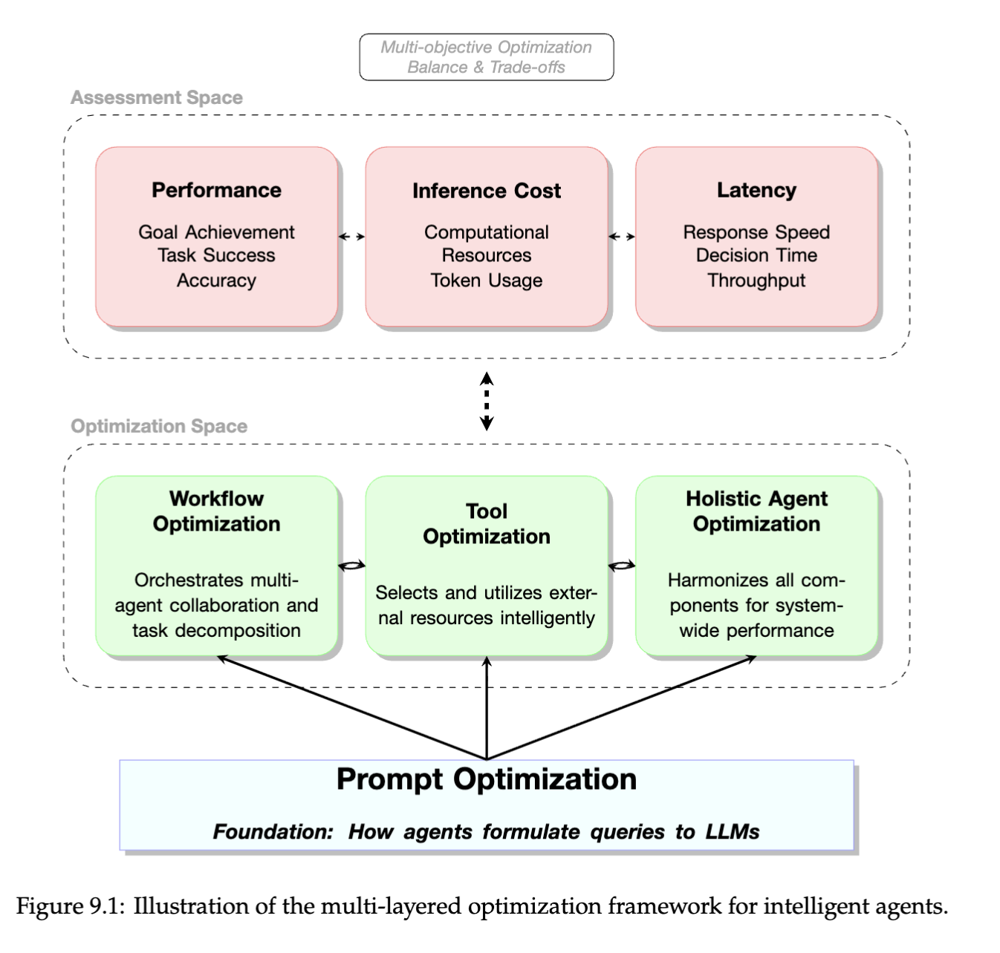
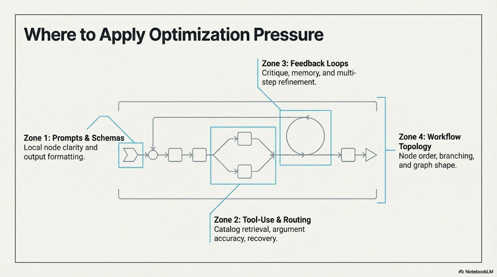
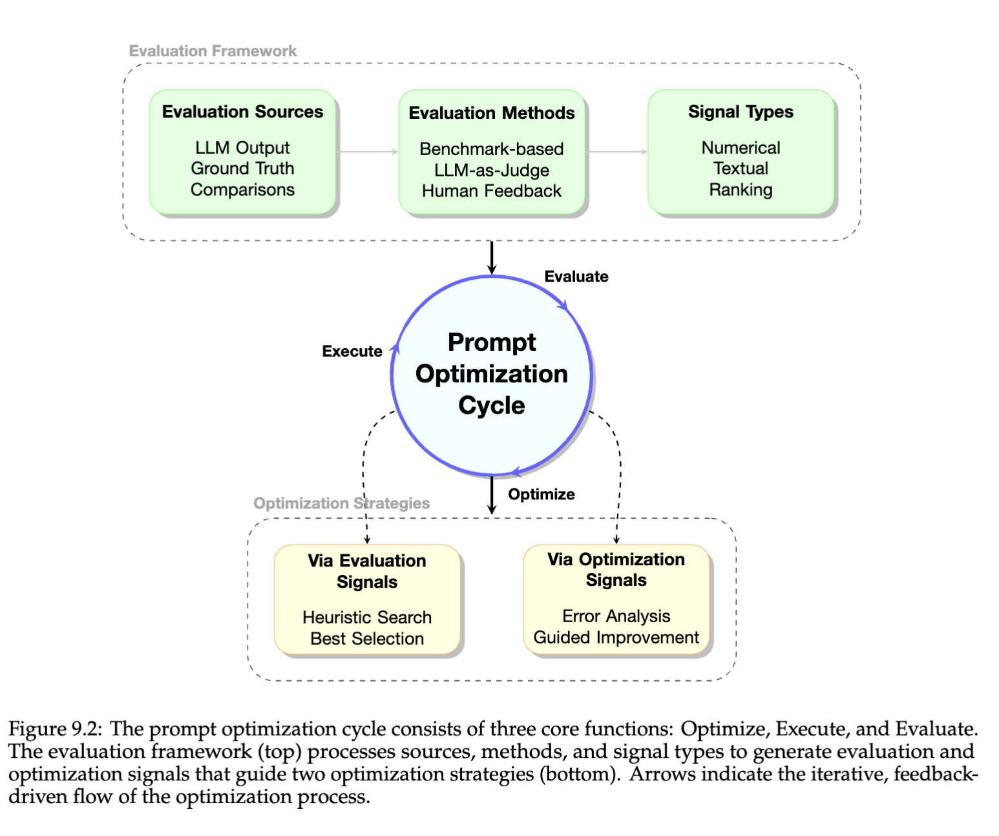
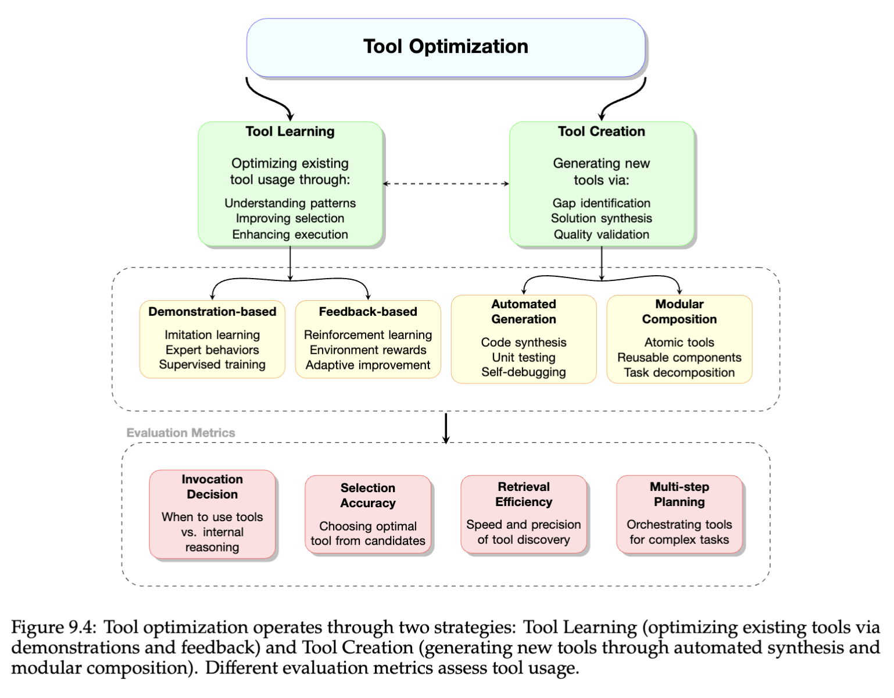
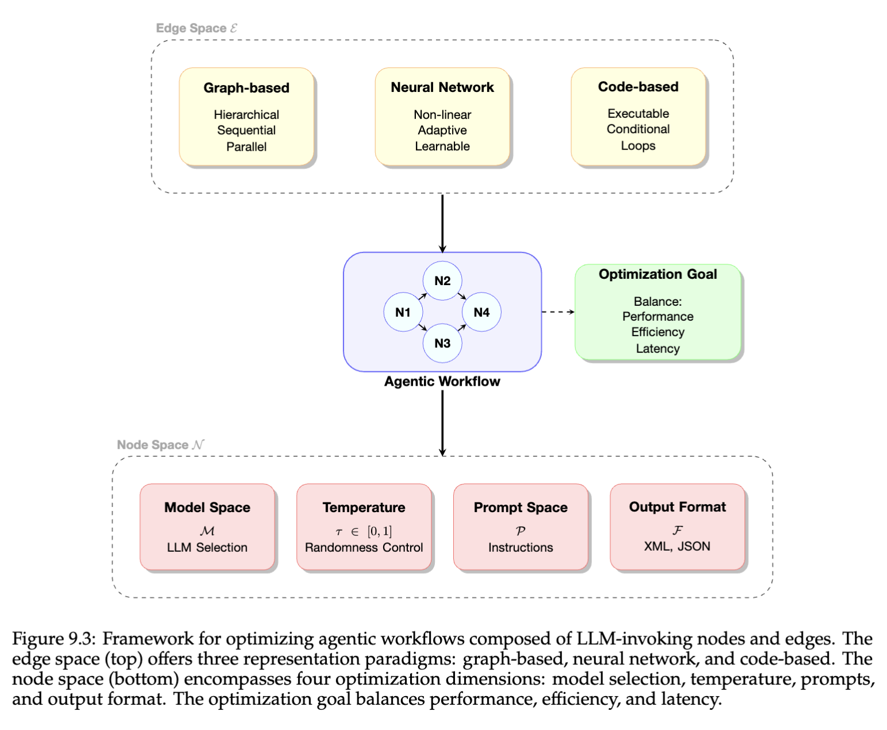
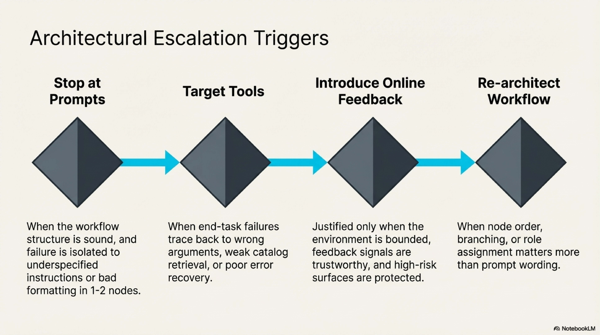

# Optimization Companion

The main optimization chapter argued that the workflow is the real object of improvement. This companion widens that claim across the broader literature. It explains why optimization pressure falls on different layers, how prompt tuning, critique loops, tool optimization, evaluation support, and topology search relate to one another, and why bounded self-improvement should be read as controlled workflow engineering rather than as a promise of autonomous system redesign.

## Optimization Starts By Deciding What Layer Is Actually Failing

One reason optimization work can become wasteful quickly is that teams often start from whatever surface is easiest to change. That is usually the prompt. Prompts matter, but the booklet’s optimization chapter is valuable because it insists on a layered view. The system can fail at the instruction layer, the critique layer, the tool and routing layer, the workflow-topology layer, or the evaluation layer. Each one demands a different kind of optimization, and changing the wrong layer can create activity without improvement.

Figure 9.1 is the essential map here. It shows that optimization is not a single loop running over a single object. It is a family of loops operating on different parts of an agent system. That matters because the field often talks as though all gains can be compared on one axis. A better prompt, a more stable tool schema, a refined critique loop, and a new workflow topology do not have the same cost, the same blast radius, or the same evaluation burden. The figure helps restore proportion. Prompt optimization is cheap and local. Workflow search is expensive and structural. Tool optimization sits in between, often with more direct effect on end-task reliability than people expect.

The course slide on optimization pressure is a useful companion to the booklet figure because it makes the layers feel closer to operational review. Prompts and schemas govern local node clarity. Feedback loops govern critique and refinement. Tool optimization governs selection, arguments, and recovery. Workflow optimization governs order, branching, and role allocation. Read together, the two visuals help answer the first optimization question a builder should ask: which layer is actually causing the observed failures. Without that answer, optimization becomes random movement across surfaces with different risk profiles.

This layered framing also protects against a familiar trap in agent work. A team sees unstable results, assumes the model needs smarter prompting, and keeps editing instructions while the real problem sits in tool routing, missing evaluation cases, or a brittle step order. The right starting habit is diagnostic. Freeze a small evaluation set, inspect failures, and decide whether the defect is local, relational, or structural. Only then choose the optimization surface.

This also makes optimization easier to explain to collaborators. Once failures are named by layer, proposed changes become easier to justify and review. A prompt revision, a schema change, a tool-routing fix, and a topology rewrite no longer compete as vague improvements. They become different classes of intervention with different evidence requirements.

## Prompt And Critique Loops Are Local, But Not Trivial

Prompt optimization receives a lot of attention because it is the cheapest way to move the system. That visibility can make it seem superficial. It is not superficial. It is simply local. A prompt, output schema, or node instruction can decide whether a capable workflow stays legible and whether downstream systems receive something stable enough to work with. The challenge is to optimize that layer without pretending it controls everything.

Figure 9.2 is helpful because it frames prompt optimization as a closed cycle of propose, execute, and evaluate. That loop matters more than the specific prompt-search method. The field changed when optimization stopped meaning "edit the wording until it sounds better" and started meaning "make proposals against a stable objective and keep the score." OPRO is the anchor paper here because it formalized that intuition. Once prompts become optimization targets, the surrounding evaluation loop becomes the real source of trust.

Critique loops such as Self-Refine, Reflexion, and text-based gradient methods belong near this layer because they also operate locally at first. They try to improve outputs or nodes through feedback rather than architecture change. That makes them attractive, but it also imposes a discipline. Feedback only helps when it is tied to a real defect signal. A critique loop with vague evaluation pressure can drift the system just as easily as it improves it. This is why the main chapter stayed conservative about when to add reflection or self-improvement. Local feedback is powerful, but it is not free.

The practical use of this literature is therefore narrow and strong. Use prompt and critique optimization when the workflow shape is basically sound and failures are concentrated in one or two weak steps. Do not use local tuning as a substitute for fixing schema quality, tool definitions, or topology when those are the real bottlenecks. The layer is valuable precisely because it is limited.

Multi-objective tradeoffs also become visible at this layer. A prompt change can improve quality while worsening latency or increasing downstream tool calls. A critique loop can raise pass rate while doubling cost. Good optimization practice therefore needs objective selection before iteration begins. The best prompt is not the one with the prettiest local score. It is the one that improves the workflow under the real operating budget.

## Tool Optimization Often Beats Workflow Search

Once the local node instructions are stable, the next important optimization layer is often the tool path. This receives less public attention than prompt tuning or topology generation, but in many real systems tool selection, argument construction, result normalization, and recovery logic explain more failures than prompt phrasing does. Optimizing the tool layer can therefore create large end-task gains without the risk of rewriting the whole workflow.

Figure 9.4 is useful because it breaks tool optimization into several concrete levers: improving how existing tools are used, refining selection and invocation, and creating or adapting tools when recurring gaps justify it. This is the right reading frame for action-heavy systems. A workflow may look as though it needs a new topology when the real defect is that the agent keeps calling the wrong tool, filling the wrong arguments, or failing to recover from weak outputs. The tool layer is where optimization meets interface engineering.

This part of the literature also clarifies why action and optimization chapters belong close together. A stable action surface enables meaningful optimization because the environment answers in measurable ways. Tool success rates, argument accuracy, recovery rates, and downstream task completion become observable. Without that observability, optimization remains too dependent on final-answer aesthetics. With it, the system can improve a real control layer instead of merely producing more persuasive explanations.

The right reading habit is comparative. If failures cluster around wrong interfaces, wrong arguments, weak recovery, or inconsistent tool observations, optimize the tool layer first. Only escalate to topology search after those issues are controlled. Many teams reverse this order because topology work feels more ambitious. In practice it often hides more basic defects.

There is a wider lesson here about leverage. Tool optimization can look narrow, yet it often shifts end-task reliability more than broad architectural search because it acts directly on the interfaces where the workflow meets the world. A system that selects the right tool, fills the right fields, and recovers from weak outputs is frequently closer to production quality than a more elaborate graph with the same weak interfaces.

## Evaluation Support Is Part Of The Optimization Stack

Optimization is only as serious as the evaluation layer beneath it. A system cannot be improved in a disciplined way if its targets are unstable, its metrics are vague, or its judges are uncalibrated. This is where evaluation support work, including LLM-as-judge literature and benchmark design, becomes part of the architecture rather than part of the reporting layer.

Figure 9.3 matters because it makes workflow optimization inseparable from evaluation. The workflow graph is being optimized, but only through repeated execution and scoring. That scoring may involve humans, deterministic checks, task metrics, or judge models. The optimization loop becomes credible only when the scoring side is stable enough to detect real gains and regressions. This is why the chapter’s recommendation to lock an evaluation set early is more than process hygiene. It is the precondition for trusting any later improvement claim.

The course slide on escalation triggers adds a practical summary. Stop at prompts when the workflow structure is sound and local instructions are weak. Target tools when end-task failures trace back to tool selection or recovery. Introduce feedback loops only when the environment gives trustworthy signals. Re-architect the workflow only when node order, branching, or role assignment clearly dominate prompt quality. That sequence is really an evaluation sequence. It says that optimization should become more structural only as the evidence for local fixes becomes weaker.

Judge models deserve cautious respect in this layer. MT-Bench and Chatbot Arena helped normalize model-based comparative evaluation, but they also made calibration a central concern. A judge is useful when it scales comparisons that humans cannot perform for every iteration. It is dangerous when it becomes the only source of truth. Builders should therefore treat judge systems as support infrastructure that needs spot checks, task-specific calibration, and bounded authority. Optimization without that discipline becomes drift with a score attached.

The evaluation layer also decides whether optimization remains reversible. If every change is tested against stable tasks with recorded metrics, rollback becomes possible and structural search becomes safer. If evaluation is loose, even sensible changes accumulate into uncertainty. This is one reason the chapter keeps sounding procedural. Optimization is only as bold as the rollback path behind it.

## Bounded Self-Improvement Means Controlled Workflow Engineering

The outer edge of the optimization literature includes methods that search over workflow graphs, modify prompts automatically, adapt tools, or accumulate reusable skills. This can sound like the beginning of unrestricted self-improvement. The more useful reading is calmer. These methods are forms of controlled workflow engineering. They are valuable only when the search space is bounded, the evaluation signal is trustworthy, and high-risk surfaces are protected from silent mutation.

That is why papers such as AFLOW, GPTSwarm, Voyager, and TextGrad should be read as different approaches to improving specific parts of the workflow under explicit feedback. AFLOW and GPTSwarm treat workflow topology itself as a searchable object. Voyager turns repeated success into a skill library. TextGrad makes textual optimization look more systematic by borrowing the language of gradients while still depending on evaluation signals that exist outside the method itself. None of these papers abolishes the need for locked test cases, regression checks, or approval boundaries.

The practical implication is strict sequencing. First stabilize the baseline. Then improve local instructions and schemas. Then optimize the tool layer. Then add critique or reflective loops where repeated failure supports them. Only after the simpler surfaces are stable should the system search over graph shape or adopt stronger self-improvement routines. This order is not timid. It is what keeps optimization from mutating the least understood part of the system first.

Read this frontier with the same composure the main chapter tried to maintain. The interesting question is not whether a workflow can in principle improve itself. The interesting question is which part of the workflow is being improved, under what metric, with what rollback path, and under what safety boundary. Once those questions are asked, the literature becomes much easier to use.

That composure is especially important because optimization papers often report gains on carefully defined tasks where objective quality is easy to score. Production systems rarely enjoy that simplicity. Real optimization work therefore has to preserve a difference between research signals and deployment standards. A method can be promising in the literature and still require much tighter evaluation before it deserves a place in a live workflow.

## Analytical References

### OPRO

[OPRO](https://github.com/petroslamb/content/blob/main/autonomous-agent-blueprint/reference/papers/opro.md) matters because it formalized prompt improvement as an optimization problem rather than a craft exercise. The paper’s contribution is not simply that language models can generate alternate prompts. It is that prompt proposals can be evaluated, scored, and fed back into a loop that treats wording as a search target. That helped move prompt work from intuition toward measurable iteration.

Builders should read OPRO when the workflow shape is sound and they need a disciplined way to improve local node instructions against a stable task objective. It is especially useful as a conceptual anchor for prompt optimization loops. It should not be overclaimed as a general agent-improvement framework. Without a reliable evaluation set, OPRO-style search is still just organized guessing.

### TextGrad

[TextGrad](https://github.com/petroslamb/content/blob/main/autonomous-agent-blueprint/reference/papers/textgrad.md) is useful because it tries to make textual optimization more systematic by treating feedback as something like a gradient signal over prompts or textual artifacts. Its importance lies less in the metaphor itself and more in the ambition to convert diffuse quality judgments into iterative improvement steps that can be reused across tasks.

This paper is worth reading when a team wants to understand the emerging language of optimization over text objects and when feedback signals are available but not yet being used coherently. It should not be read as proof that text optimization has achieved the rigor of ordinary gradient descent. The quality of the optimization still depends on evaluation and feedback design.

### Self-Refine And Reflexion

[Self-Refine](https://github.com/petroslamb/content/blob/main/autonomous-agent-blueprint/reference/papers/self_refine.md) and [Reflexion](https://github.com/petroslamb/content/blob/main/autonomous-agent-blueprint/reference/papers/reflexion.md) belong together because both show how feedback loops can improve performance without immediately changing the larger workflow graph. Self-Refine operates within an iteration on one answer or artifact. Reflexion stretches the loop across attempts and stores lessons from failure. Together they define a useful middle layer between prompt tuning and structural redesign.

Builders should read these when repeated failure modes are visible and the system has signals strong enough to support critique or reflection. They help clarify when local feedback is the right optimization lever. They should not be overused. Without meaningful evaluation pressure, these loops can create polished drift instead of real improvement.

### Voyager

[Voyager](https://github.com/petroslamb/content/blob/main/autonomous-agent-blueprint/reference/papers/voyager.md) matters in the optimization chapter because it makes skill accumulation visible as a form of workflow improvement. The paper shows how repeated success can be promoted into reusable procedures, reducing relearning cost over time. Its deeper contribution is not the embodied setting. It is the idea that experience can change the future workflow by altering what the system already knows how to do.

Builders should read Voyager when repeated tasks are appearing and procedural reuse may be a better optimization path than repeated prompt edits. It clarifies when promotion into a skill library counts as real improvement. It should not be treated as permission to save every local success. The real lesson is selective procedural accumulation under clear success conditions.

### MT-Bench And Chatbot Arena

[MT-Bench and Chatbot Arena](https://github.com/petroslamb/content/blob/main/autonomous-agent-blueprint/reference/papers/mt_bench_chatbot_arena.md) matter because they normalized the use of model-based and pairwise comparative judging at scale. Their contribution to the optimization discussion is indirect but important. They helped make the evaluation layer itself a design object, especially in settings where human review cannot cover every iteration.

Builders should read this reference when deciding how judge systems can support optimization without silently replacing stronger task metrics. It clarifies the promise and the risk of LLM-as-judge approaches. It should not be overclaimed as a general evaluation solution. Judge systems need calibration, spot checking, and task-aware boundaries if they are going to support optimization responsibly.

### AFLOW And GPTSwarm

[AFLOW](https://github.com/petroslamb/content/blob/main/autonomous-agent-blueprint/reference/papers/aflow.md) and [GPTSwarm](https://github.com/petroslamb/content/blob/main/autonomous-agent-blueprint/reference/papers/gptswarm.md) belong together because both move optimization up to the topology layer. Instead of improving a single prompt or tool call, they search over workflow structure, node arrangement, and graph composition. Their value lies in showing that topology can itself be optimized, but only under a regime where evaluation is strong enough to distinguish better structures from noisier ones.

Builders should read these papers when the evidence really suggests that branching, ordering, or role allocation is the main bottleneck. They help answer when graph search becomes justified. They should not be read as a reason to skip simpler layers. If the baseline still has weak schemas or brittle tool use, topology search is likely to amplify confusion rather than solve it.

### The Booklet Optimization Chapter

The [optimization sections of the foundation agents booklet](https://github.com/petroslamb/content/blob/main/autonomous-agent-blueprint/advances-and-challenges-in-foundation-agents.md) are worth treating as a reference family because they provide the layered map that keeps the rest of the literature in proportion. Figures 9.1 through 9.4 do not only summarize methods. They separate prompt optimization, workflow optimization, and tool optimization in a way that immediately changes build order and evaluation discipline.

Builders should revisit those sections after reading one or two of the named papers above. The booklet helps place each method at the right layer of the stack and prevents optimization from collapsing into prompt craft or grand claims about self-improvement. It should not replace concrete paper reading, but it is one of the best guides for understanding what kind of object each method is actually trying to improve.
