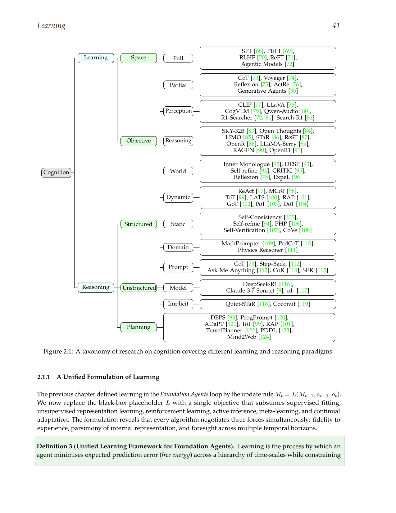
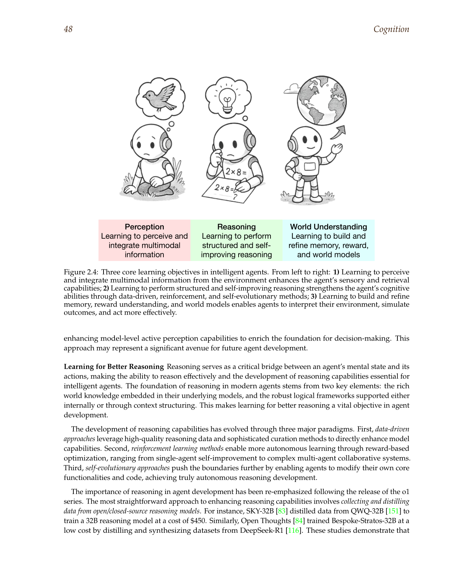
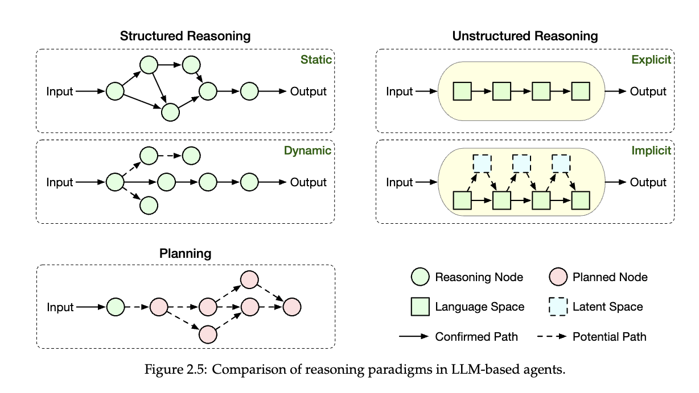
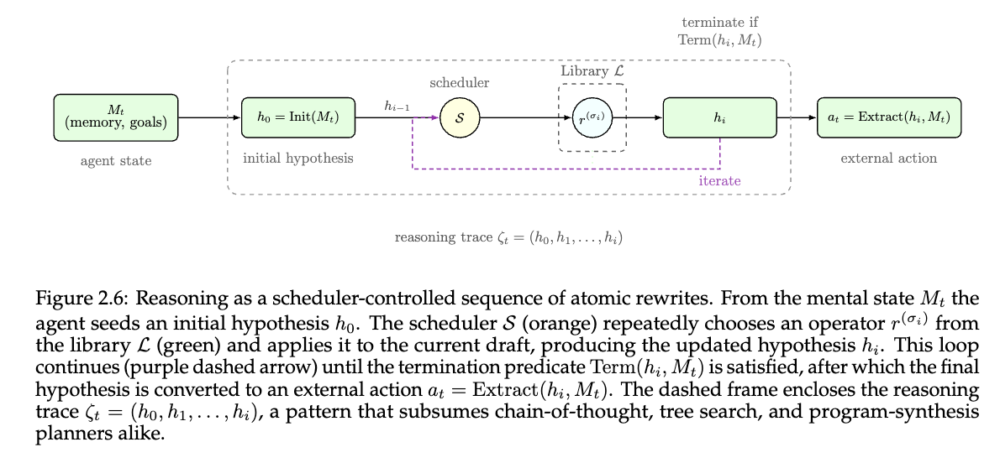
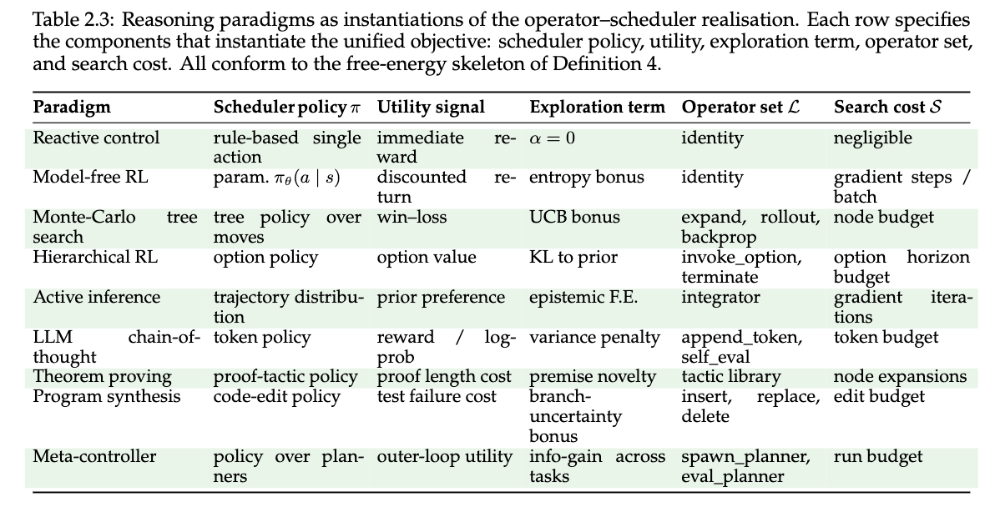

# Reasoning Companion

The main reasoning chapter stayed close to the production center: decomposition, ReAct, verification, and cautious escalation toward heavier search. This companion broadens the field around that core. It explains how the booklet’s larger taxonomy fits together, why decomposition and abstraction solve different classes of failure, how critique differs from verification, when search should stop looking elegant and start looking expensive, and why formal planning still matters in a field that often tries to solve every problem with prompt structure alone.

## A Taxonomy Only Helps If It Changes Control

The reasoning literature is full of named methods, and the names can make the field look more fragmented than it is. The useful question is not how many paradigms exist. It is what kind of control problem each one is trying to solve. Some methods restructure the order in which the model thinks through a problem. Some force the model to ground itself in external state. Some improve reliability through critique or verification. Some turn reasoning into a branching search over alternatives. The taxonomy matters only when it helps a builder choose the cheapest control structure that matches the failure mode.

Figure 2.1 from the booklet is useful because it places reasoning inside a larger cognitive landscape rather than treating it as the whole story. Reasoning sits beside learning, planning, and perception as a way of transforming the agent’s internal state. That matters because many apparent reasoning failures are really failures of some neighboring component. A plan collapses because the action surface is weak. A chain of thought wanders because working memory is overloaded. A critique loop becomes unhelpful because there is no reliable external signal. The figure is a reminder that reasoning should be read relationally, not as an isolated prompt technique.

Figure 2.4 is even broader, but it still helps because it shows three different kinds of pressure that intelligent systems face: learning to perceive, to reason, and to act. Modern agent work often compresses those pressures into reasoning tokens. That produces the familiar mistake of trying to solve a perception or action defect with more verbal thought. The reason the public essay was strict about reasoning scaffolds is that they only work when the underlying task is actually a reasoning problem. This companion widens that lesson. Taxonomy is useful when it tells you what not to ask reasoning to compensate for.

Once the field is read this way, the named methods become easier to sort. Decomposition methods help when the problem is structurally large but conceptually clear. Abstraction methods help when the model gets trapped in local detail and misses the governing idea. Grounded loops help when the next step depends on live state. Verification helps when correctness cannot be trusted on the strength of a single generation. Search helps when the task truly contains alternate paths and dead ends. That is a simpler map than the paper list suggests, and it is a better starting point for builders.

## Decomposition And Abstraction Solve Different Failures

One reason reasoning papers are easy to misuse is that decomposition and abstraction can sound like versions of the same impulse: break the problem into something easier. In practice they push in opposite directions. Decomposition lowers the level of difficulty by splitting the task into smaller explicit steps. Abstraction raises the level of representation by asking what larger principle should guide the task before any local steps are attempted. A workflow that needs one often gets worse when given the other.

Least-to-Most prompting matters because many tasks fail not from conceptual confusion but from poor sequencing. The model tries to solve the whole problem in one pass, loses track of intermediate commitments, and compounds error. Decomposition is the right answer there. It is cheap, legible, and usually easy to inspect. That is why it belongs so close to the practical center. It makes the task smaller without adding much architecture.

Step-Back prompting matters for the opposite reason. Some tasks fail because the model fixates on local details before deciding what kind of problem it is solving. Abstraction creates a temporary distance from the particulars so the model can identify a higher-level frame, then return to the local problem with better guidance. This is especially useful when the immediate surface of the task is noisy or when a specific question is really an instance of a more general rule. The method is powerful precisely because it does not ask for more detail. It asks for a better conceptual handle.

Builders should therefore treat these as different first responses to failure. If the output is close but misses intermediate structure, add decomposition. If the output feels overfit to surface details or misses the general principle, add abstraction. If both fail, the task may not be a pure reasoning problem anymore. It may need grounding, tools, or a planner. The point is to keep the control move tied to the observed weakness rather than accumulating reasoning methods because they all sound helpful.

## ReAct Is The Bridge From Reasoning To Planning

The public chapter treated ReAct as the default control loop because it is the simplest pattern that grounds reasoning in external state. This companion can say more about why that matters. ReAct is important not merely because it interleaves thoughts and actions. It is important because it changes the meaning of a reasoning trace. A thought is no longer a private internal chain that must carry the whole task. It becomes a local control move that exists in dialogue with an environment.

Figure 2.5 is one of the clearest visuals in the reasoning chapter because it shows several paradigms side by side. Plain structured reasoning, unstructured free-form reasoning, and action-grounded loops are not just stylistic choices. They produce different operating conditions. Once observations from the environment can update the state, reasoning no longer has to pretend it already knows everything it needs. This is why ReAct sits at the practical center for modern agents. It is the point where the reasoning chapter starts touching the action chapter without collapsing into it.

Figure 2.6 deepens the point by treating reasoning as a scheduler-controlled sequence of atomic rewrites. This is more formal than most builders need day to day, but it helps explain why reasoning scaffolds are not magic. Each method is really a policy over which operator fires next, on what state, and under what stopping condition. Once you see the field this way, the methods stop looking like personality traits of the model. They become explicit control policies. That is a stronger way to reason about escalation, because it asks what scheduling choice the task actually needs.

Table 2.3 turns that formal view into a usable comparison. Different paradigms instantiate different scheduler rules, utilities, and stopping policies. The table is helpful because it shows how much of the reasoning literature can be understood as variations on when to generate, when to inspect, when to branch, and when to stop. Builders do not need to memorize the formalism. They do need to appreciate the practical lesson: reasoning quality often depends more on the control structure wrapped around the model than on the surface eloquence of the trace itself.

## Verification, Critique, And Search Should Not Be Confused

Another common reading mistake is to treat self-refinement, verification, self-consistency, and search as interchangeable forms of "more reasoning." They are not. Verification asks whether a candidate answer survives checking. Critique asks whether a candidate answer can be improved through targeted feedback. Self-consistency asks whether multiple traces converge on a stable result. Search asks whether several alternative reasoning paths should be explored before committing. Each one can help. Each one introduces different costs and different failure modes.

Self-Refine is the lightest of these additions. It assumes the first answer is often close enough that structured criticism can improve it. That works surprisingly well for explanations, structured outputs, and multi-step answers that have a recognizable near-miss shape. Chain-of-Verification solves a different problem. It is for cases where the main risk is not polish but unsupported factual or logical claims. The method splits generation from checking so the system has to inspect its own commitments rather than simply restating them more elegantly.

Self-Consistency sits elsewhere again. It buys reliability by sampling multiple reasoning paths and looking for agreement. That makes sense only when multiple traces can genuinely improve the outcome and the latency budget can tolerate the extra cost. Search methods like Tree of Thoughts and LATS are heavier still. They assume the task contains real branching difficulty and that a single path may get trapped in a dead end. When that assumption is true, branching can be justified. When it is false, search produces expensive theater.

The practical rule is to match the overlay to the failure. Use critique when the answer is usually near the target but structurally weak. Use verification when unsupported claims are the danger. Use self-consistency when the task is brittle under single-trace sampling and the cost budget can support redundancy. Use search only when simpler methods keep failing because the task genuinely has alternate viable paths. This is the same conservative logic as the main essay, now stated across a wider portion of the literature.

## Formal Planning Still Has A Place

Large language models made it easy for the field to treat planning as just one more style of verbal reasoning. Sometimes that is enough. A short task with a few steps can be decomposed and executed with a ReAct loop. Some planning problems are different. They have explicit constraints, admissible transitions, resource considerations, or long-horizon dependencies that are better handled by a planner than by improvised language generation. This is where papers like LLM+P still matter.

The point of planner handoff is not that language models cannot reason. It is that natural language is a poor substitute for explicit search or constraint satisfaction when the task already has a formal structure. In those cases the model is better used upstream and downstream of the planner: translating task descriptions into a planning representation, choosing abstractions, interpreting outcomes, and managing exceptions at the interface. The planner itself handles the part of the problem it is designed for.

This also sharpens search stop rules. Builders should not escalate from decomposition to tree search simply because the task feels difficult. They should escalate when failure analysis shows that the task contains branching choices whose quality cannot be resolved cheaply by local reasoning, critique, or verification. If the task also lives in a formally structured environment, a dedicated planner may be the cleaner escalation. This is one reason the wider reasoning literature still matters. It keeps the chapter from collapsing into prompt craft and reminds the reader that some control problems are better served by explicit planning tools than by more elaborate traces.

It also gives ordinary teams a stopping discipline. If decomposition, grounding, and verification already solve the task reliably enough for the operating budget, the burden of proof shifts to the heavier method. Search and planner handoff are not markers of seriousness by themselves. They are justified only when the cheaper controller has left a specific class of value unrecovered.

## Analytical References

### Least-to-Most Prompting

[Least-to-Most Prompting](https://github.com/petroslamb/content/blob/main/autonomous-agent-blueprint/reference/papers/least_to_most_prompting.md) matters because it provides the cleanest case for decomposition as a first-class control move. The paper’s contribution is not just better results on complex tasks. It shows that many reasoning failures come from forcing the model to solve a large problem before stabilizing the smaller commitments that the larger problem depends on. That insight is simple and durable.

Builders should read this paper when a task is multi-step, mostly deterministic, and failing because the model keeps skipping necessary intermediate structure. It helps answer when decomposition should be the first escalation. It should not be overclaimed as a universal reasoning solution. If the task depends on live state, tool interaction, or verification against the world, decomposition alone will not be enough.

### Step-Back Prompting

[Step-Back Prompting](https://github.com/petroslamb/content/blob/main/autonomous-agent-blueprint/reference/papers/step_back_prompting.md) is valuable because it clarifies that some reasoning failures are failures of representation rather than sequence. The model is not necessarily missing a step. It may be operating at the wrong level of abstraction. The method helps by forcing a temporary move away from particulars so the broader governing principle becomes easier to identify.

This is the right paper to read when outputs feel trapped in surface detail or when the local question is really an instance of a more general structure. It clarifies when abstraction can outperform finer-grained decomposition. It should not be overused. If the task already has a clean explicit structure, adding abstraction can make the process less direct instead of more reliable.

### ReAct

[ReAct](https://github.com/petroslamb/content/blob/main/autonomous-agent-blueprint/reference/papers/react.md) remains the anchor paper for grounded reasoning because it joins reasoning, action, and observation into one loop. Its significance is larger than the original benchmarks. It supplied the control pattern that now underlies a great deal of practical agent work: think enough to choose an action, observe what the environment returns, and reason again from updated state.

Builders should read ReAct when the task touches tools, search, code, or any other live interface. It explains why grounded loops often outperform pure chain-of-thought reasoning in agent settings. It should not be treated as a complete solution, because the loop still depends on verification, interface quality, and safe execution boundaries. ReAct gives the control structure. The rest of the architecture still matters.

### Self-Refine

[Self-Refine](https://github.com/petroslamb/content/blob/main/autonomous-agent-blueprint/reference/papers/self_refine.md) matters because it demonstrates a practical draft-critique-revise loop that is lighter than full search and easier to add than planner integration. The paper is useful precisely because it is modest. It does not claim to solve all reasoning defects. It focuses on improving candidate outputs that are already close enough to benefit from structured feedback.

Read Self-Refine when the first answer is often near the target but inconsistent, unclear, or incomplete. It helps answer whether a cheap critique overlay is worth the extra pass. Do not overclaim it as a truth mechanism. It can polish a bad answer into a cleaner bad answer when the underlying issue is lack of grounding or lack of verification.

### Chain-of-Verification

[Chain-of-Verification](https://github.com/petroslamb/content/blob/main/autonomous-agent-blueprint/reference/papers/chain_of_verification.md) is the most useful reasoning paper for separating critique from checking. Its contribution is to force explicit verification steps instead of trusting the original answer to remain self-consistent. That matters because many factual and logical failures survive ordinary refinement loops. The answer becomes clearer without becoming truer.

Builders should read this paper when the output will inform decisions or actions and the main concern is unsupported claims. It clarifies when verification should be a distinct stage in the workflow. It should not be oversold as a full safety layer. Verification reduces unchecked error, but it still depends on the availability of good checking strategies and, often, external evidence.

### Self-Consistency

[Self-Consistency](https://github.com/petroslamb/content/blob/main/autonomous-agent-blueprint/reference/papers/self_consistency.md) matters because it reframes reliability as a sampling problem. Some tasks are brittle under a single chain of thought but stable when multiple independent traces converge. The contribution is conceptually simple but practically important: one pass may not reveal the model’s best reachable answer.

This is worth reading when the workflow can afford extra cost and the task is known to benefit from redundant reasoning. It sharpens the question of whether agreement among traces is a useful signal. It should not become a default overlay. If the latency budget is tight or the task primarily needs grounding, self-consistency can be expensive without solving the real problem.

### Tree Of Thoughts And LATS

[Tree of Thoughts](https://github.com/petroslamb/content/blob/main/autonomous-agent-blueprint/reference/papers/tree_of_thoughts.md) and [LATS](https://github.com/petroslamb/content/blob/main/autonomous-agent-blueprint/reference/papers/lats.md) belong together because both treat reasoning as a search problem over alternative trajectories. Their value is that they make explicit what simpler methods often hide: some tasks have branching difficulty, dead ends, and alternative plans that deserve systematic exploration rather than a single forward pass.

Builders should read these papers when simpler scaffolds have failed and the task really does involve meaningful alternative paths. They help clarify when search is justified and what new control burden it introduces. They should not be used to justify search as a general mark of sophistication. On many everyday tasks, search adds cost and complexity without improving the outcome.

### LLM+P

[LLM+P](https://github.com/petroslamb/content/blob/main/autonomous-agent-blueprint/reference/papers/llm_plus_p.md) matters because it draws a cleaner line between verbal reasoning and explicit planning. The paper shows that when a task already has a formal planning structure, language models do not need to solve that structure alone. They can work with a planner, translating into it and out of it while leaving the core search or constraint handling to the more suitable system.

Builders should read this when tasks have explicit rules, action preconditions, or long-horizon dependencies that natural-language reasoning keeps mishandling. It helps answer when to hand work off to a planner instead of extending the prompt stack. It should not be overclaimed as a replacement for ordinary reasoning scaffolds. Many tasks never need formal planning. The point is to know when some tasks clearly do.
