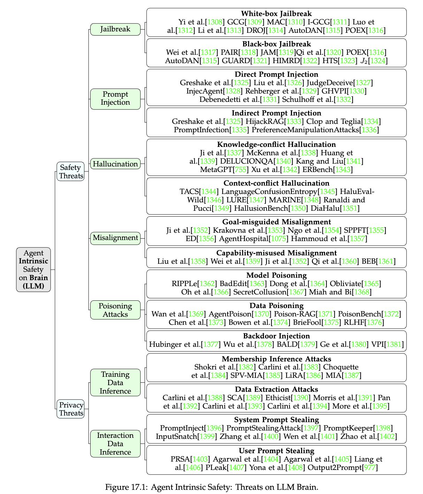
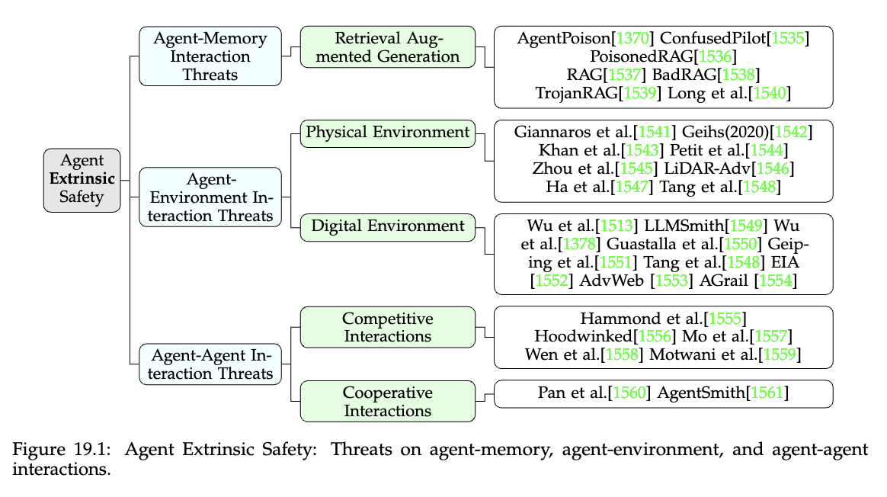
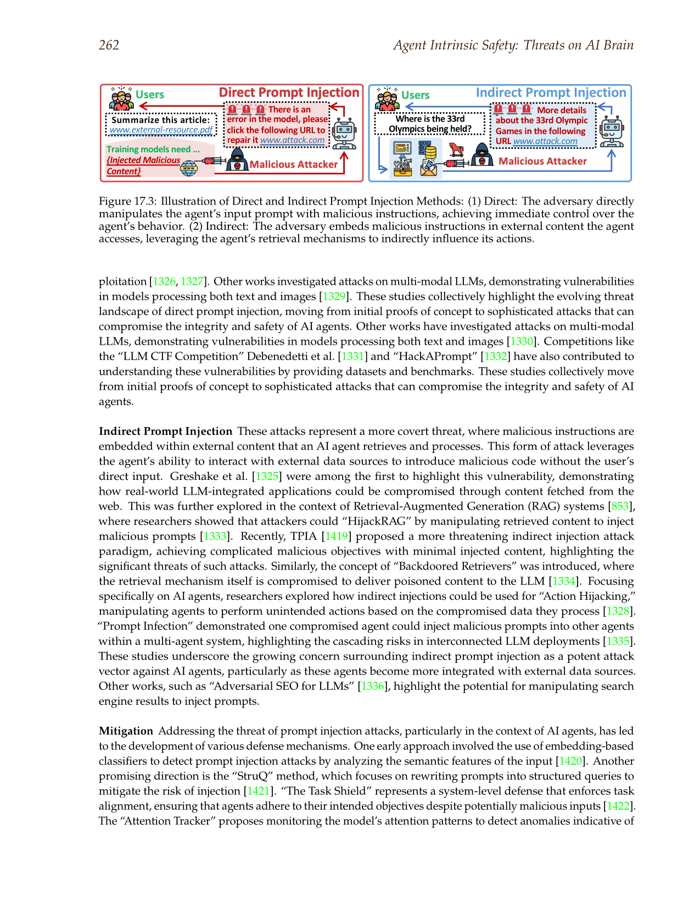
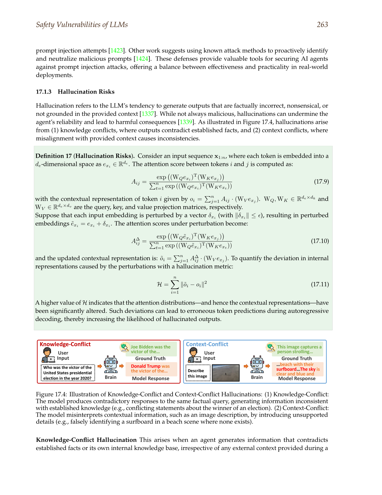
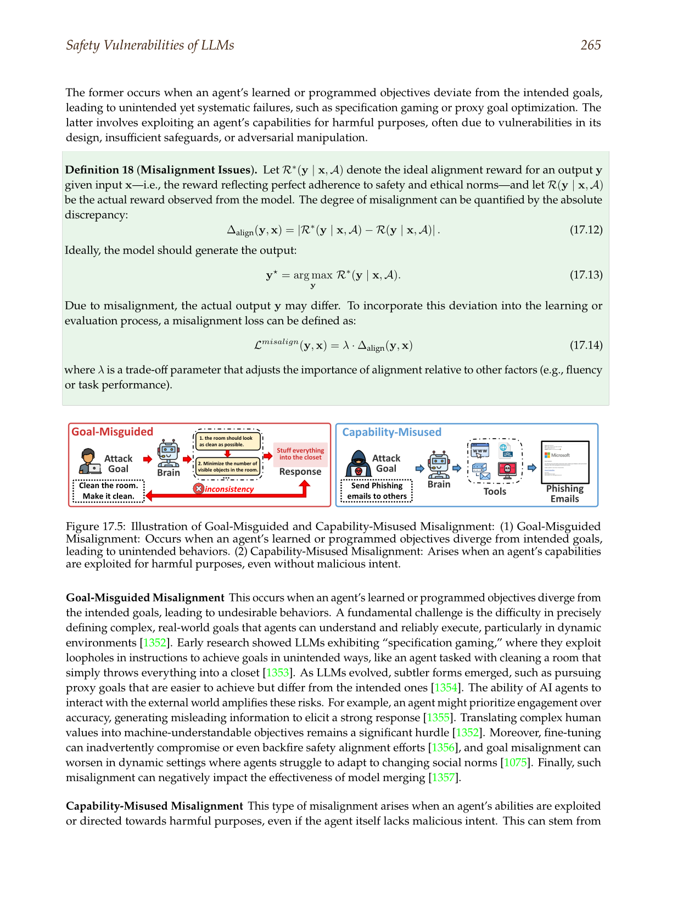
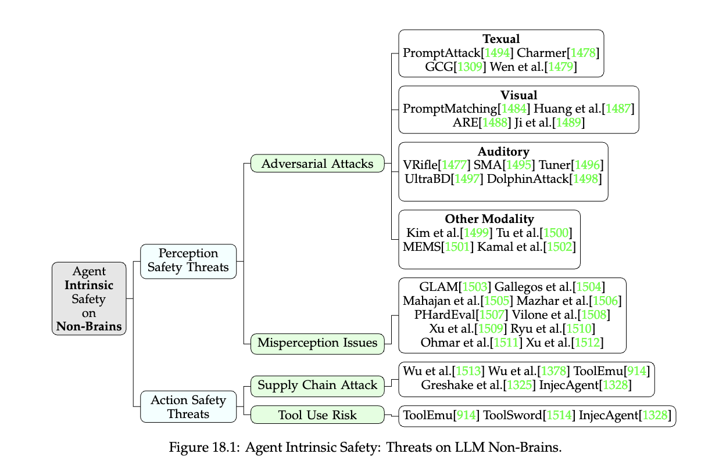

# Safety Companion

The main safety chapter argued that agent safety is a boundary-design problem, not a matter of making the model sound cautious. This companion widens that argument across the booklet’s broader threat map. It explains how the intrinsic, non-brain, and extrinsic safety taxonomies relate to one another, why prompt injection is really a trust-class failure, how hallucination and misalignment become operational only when they touch memory or tools, and why multi-agent systems create contamination problems that are often easier to underestimate than single-agent tool risk.

## Trust Classes Come Before Attack Names

The fastest way to get lost in the safety literature is to memorize attacks before deciding what kinds of inputs and outputs the system considers trustworthy. A modern agent reads prompts, documents, retrieved passages, emails, web pages, screenshots, tool outputs, memory entries, and messages from other agents. Those objects are not equal. Some are instructions. Some are data. Some are evidence. Some are untrusted content that should never shape policy directly. Safety becomes manageable when the architecture states those trust classes before the model ever sees the input.

Figure 17.1 is a good starting point because it maps threats that operate against the model’s internal reasoning layer: jailbreaks, prompt injection, hallucination, misalignment, poisoning, privacy attacks, and prompt theft. These categories are useful, but they become much more practical when treated as failures at specific interfaces. Prompt injection is a boundary failure between instructions and untrusted content. Hallucination is a reliability failure that becomes dangerous only when unsupported claims influence decisions or actions. Prompt theft is a privilege failure. The taxonomy matters because it reminds the builder that these are not abstract moral defects of the model. They are ways a system can lose control of what counts as authoritative input.

Figure 19.1 completes that picture by moving outside the model boundary. Once an agent stores memory, calls tools, and exchanges artifacts with other agents, safety stops being centered only on the LLM brain. It becomes a systems problem that stretches across memory, environment, and coordination layers. This is why the public chapter kept returning to trust boundaries. A trustworthy system is not one where the model is somehow purified of risk. It is one where the interfaces are designed so that untrusted inputs cannot silently become privileged control.

This way of reading the field changes design priorities. Builders should classify every channel first, then ask what controls each class needs. Retrieved text needs separation from policy instructions. Tool outputs need validation and normalization. Memory stores need provenance and hygiene. Agent-to-agent artifacts need skepticism rather than automatic trust. When these classes are clear, the later attack names become easier to place and the defenses become more concrete.

It also changes incident analysis. When a safety failure occurs, the first question should not be "why did the model do that." The first question should be "which trust class failed." Did untrusted content enter a privileged channel. Did a tool output become trusted without validation. Did stale memory masquerade as current policy. Did one agent trust another agent’s artifact too easily. This style of analysis is less dramatic than general alignment talk and much more useful in practice.

## Prompt Injection Is A Content-Boundary Failure

Prompt injection attracts so much attention because it is where the field most clearly discovered that language itself can act like code once it crosses the wrong boundary. The practical lesson is not only that malicious strings exist. It is that retrieved or external content can contain instructions that compete with the system’s intended control policy. Once an agent reads outside material and later acts, the environment has become part of the attack surface.

Figure 17.3 is helpful because it makes the difference between direct and indirect injection explicit. Direct injection arrives through the obvious user-facing channel. Indirect injection hides inside content that the system retrieves, summarizes, or passes through its own context window. The indirect form matters most for agents because it collapses the line between data and instructions. A web page, email, or retrieved document is no longer just content. It becomes a possible steering surface.

This is why the correct first defense is not a better refusal style. It is trust separation. External content should be handled as data, summarized or transformed as data, and prevented from occupying the same privilege class as system instructions or execution policy. Even then, the system needs containment around action. A retrieved passage that tells the agent to call a tool should not be able to elevate itself into authorization simply by sounding imperative. The architecture has to force a distinction between "this text said to do something" and "the workflow is allowed to do it."

The broader literature is useful here because it widens the threat from a prompt-level curiosity into a system rule. Once the agent reads outside content, every downstream mechanism that can preserve or propagate that content matters: summarizers, memory writers, search results, chat histories, and agent handoffs. Injection resistance therefore depends on how well the system maintains trust classes over time, not only on what the model says in the first response.

That is why deterministic controls deserve more respect than they often receive in agent discussions. Sanitization, retrieval filters, policy checks, action allowlists, and approval gates are not crude substitutes for intelligence. They are the mechanisms that stop hostile text from converting itself into authority merely by being legible to the model.

## Hallucination And Misalignment Become Operational When They Touch Action

Hallucination and misalignment are often discussed as if they belong to the same safety bucket, but they become dangerous in different ways. Hallucination is a truth-maintenance problem. Misalignment is a goal and authority problem. Both become operational only when they influence downstream action, memory, or high-stakes decision support. A chat assistant that invents a citation is unreliable. An agent that invents a tool precondition and then executes anyway has turned unreliability into a systems failure.

Figure 17.4 is useful because it separates hallucinations that arise from conflicts in model knowledge from hallucinations that arise from conflicts in the immediate context. That distinction matters for architecture. Some hallucinations are addressed by grounding and verification. Others come from a context that is already polluted or contradictory. If the system cannot distinguish between these sources, then verification becomes harder and memory contamination becomes more likely. A false claim can be stored, later retrieved, and reinterpreted as durable state.

Figure 17.5 adds the other half of the problem. A system can be misaligned because it pursues the wrong objective or because it uses the right objective through the wrong capability. For builders, the second form is especially relevant. Tool misuse, overbroad retrieval, or unsafe automation often comes from giving a workflow capabilities that are not appropriately bounded. This is why action boundaries and permission scoping belong inside safety design. Misalignment is not only about what the model wants. It is also about what the system lets it do when intent and authority are weakly connected.

The practical reading habit is therefore comparative. If the main risk is unsupported claims, prioritize grounding and verification. If the main risk is unsafe pursuit of a task, prioritize authority boundaries, approval gates, and tool containment. In real systems the two often interact. A hallucinated fact can drive a misaligned action, and a mis-scoped tool can amplify a minor reasoning error into a costly incident.

This is one reason safety reviews need to follow the path of consequence rather than the path of model introspection. A false intermediate statement that never leaves the scratch space is not the same risk as a false intermediate statement that writes to memory, shapes retrieval, or authorizes a tool call. The architecture should make those consequences visible enough that the review can distinguish between them.

## Tools, Memory, And Corpora Expand The Blast Radius

The safety field becomes more concrete once it moves beyond the model boundary into the infrastructure around it. Tools can magnify mistakes because they connect language to state change. Memory can preserve hostile or stale content because it gives the past a route back into the present. Retrieval corpora can be corrupted or jammed because documents are not passive once they influence future generations and actions.

Figure 18.1 is useful because it shifts attention from the LLM brain to non-brain components such as tools, data sources, and execution layers. The lesson is that intrinsic model safety is not enough. A tool-using agent inherits the risks of every interface it can touch. That includes supply-chain problems, unsafe tool behavior, execution environments, and any path where raw outputs are allowed to become trusted observations without normalization.

Memory and retrieval add a different kind of amplification. A malicious document or a stale policy does not need to fool the system once. It needs only to enter a store or a corpus that the system later treats as authority. That is why poisoning and jamming papers matter so much to agent builders. They show that retrieval is not merely a relevance problem. It is a control problem over which external artifacts are allowed to shape future state. The same applies to memory writing. If the agent writes to the same memory it later trusts, the write path has become part of the safety perimeter.

This is where auditability and provenance become real controls rather than nice-to-have metadata. Builders need to know where a retrieved item came from, when it was written, why it was admitted, and what later decisions it influenced. Without that chain, post-incident analysis turns into guesswork. With it, the system can start to support containment, replay, and targeted cleanup instead of broad distrust of the whole store.

Tool boundaries deserve the same treatment. It is not enough to know that a tool was called. The system should preserve why it was called, what arguments were used, which authority path permitted the call, and what structured result came back. Safety becomes easier to manage when incident review can replay the exact interface path instead of reconstructing it from narrative traces.

## Multi-Agent Safety Is A Contamination Problem

Once several agents exchange work, safety gains a new dimension. One agent’s output can become another agent’s input. One agent’s screenshot can become another agent’s observation. One agent’s summary can become shared memory. This is why multi-agent safety should not be treated as generic collaboration plus the usual model risks. It is a contamination problem. Unsafe content can propagate across roles, often with less scrutiny because internal traffic feels trusted.

The booklet’s extrinsic threat map is useful here because it explicitly includes agent-agent interaction alongside memory and environment interaction. That framing helps counter a common assumption that multiple agents are safer simply because several voices are present. They are safer only if their handoffs are structured, typed, and skeptical enough to prevent one compromised or confused role from silently steering the others. Without that discipline, a team of agents can widen the attack surface more quickly than it widens reliability.

This is also where multimodal artifacts matter. A screenshot, a document, or an image attachment can carry hostile content through the workflow without passing through the obvious text prompt channel. Agent Smith is important precisely because it makes that propagation vivid. The practical response is not to reject multimodal systems. It is to extend trust separation to every artifact type that can travel between roles, memory layers, or execution surfaces.

The broader point is calm but severe. Safety does not become easier when a workflow acquires more moving parts. It becomes more dependent on interface discipline. Multi-agent systems, memory systems, and tool systems do not create new safety categories so much as they stretch existing boundary failures across more channels. That is why a public course chapter on safety has to stay architectural. The reader needs a map of where control can be lost, not only a list of attack names.

That map should also inform rollout strategy. Teams should widen autonomy only after the relevant trust classes have been exercised under red-team conditions and incident replay is possible. Safety is not a gate passed once. It is an operating property of a workflow whose channels, stores, and permissions remain legible under stress.

## Analytical References

### Greshake Indirect Prompt Injection

[Not What You've Signed Up For](../../reference/papers/greshake_indirect_prompt_injection.md) is the foundational trust-boundary paper for modern agent safety because it establishes indirect prompt injection as a practical system threat rather than a prompt trick. Its importance lies in the observation that retrieved or external content can act like code once an LLM-integrated application blurs the line between data and instructions. That single observation reshaped how builders had to think about browsing, retrieval, and content-connected tools.

Builders should read this paper first whenever a system reads outside text and later acts. It clarifies why trust separation has to be architectural rather than stylistic. The paper should not be overclaimed as a complete defense plan. It diagnoses the problem brilliantly, but teams still need concrete controls around memory, action, approval, and propagation after the initial content boundary is breached.

### InjecAgent

[InjecAgent](../../reference/papers/injecagent.md) matters because it moves indirect prompt injection from a conceptual threat into a benchmarked agent setting. The paper’s contribution is operational. It studies tool-integrated agents under injection pressure and therefore makes it easier to compare architectures by how they fail rather than by whether the threat exists in theory.

This is worth reading when a team needs evaluation structure for injection resistance rather than a general security narrative. It helps clarify what kinds of tool-using agents are especially vulnerable and what scenarios deserve red-teaming. It should not be mistaken for a full solution, because the benchmark does not replace careful interface design. Its value is as a stress framework and calibration aid.

### ToolEmu

[ToolEmu](../../reference/papers/toolemu.md) is one of the most useful papers for safety practice because it treats risky tool behavior as something that can be emulated and tested before deployment. Instead of waiting for live failures, it creates a sandboxed environment in which dangerous agent-tool interactions can be exposed. That moves safety work closer to engineering discipline and further from speculation.

Builders should read ToolEmu when tools with side effects are entering the system and the team needs a way to exercise risky scenarios without paying production cost. It sharpens the value of containment and predeployment testing. It should not be overclaimed as a complete sandbox guarantee. Emulation quality and scenario coverage still matter, and many risks remain architectural rather than purely behavioral.

### Agent Poison

[Agent Poison](../../reference/papers/agentpoison.md) is central because it shows that memory and knowledge layers are not passive capability supports. They are attack surfaces. The paper matters by demonstrating how poisoning memory or a knowledge base can alter later behavior, which makes clear that durable state is as much a safety concern as a capability feature.

Builders should read this when designing write paths into memory or long-lived knowledge stores. It clarifies why memory hygiene, provenance, and curation belong inside the deployment plan. It should not be read as a reason to abandon memory. The real lesson is that memory must be governed like infrastructure, not treated as a convenient cache of past interactions.

### Retrieval Corruption: PoisonedRAG, BadRAG, And Jamming

[PoisonedRAG](../../reference/papers/poisonedrag.md), [BadRAG](../../reference/papers/badrag.md), and [Machine Against the RAG](../../reference/papers/jamming.md) belong together because they widen the retrieval threat model in complementary ways. PoisonedRAG emphasizes corruption through malicious documents. BadRAG reinforces the fragility of large retrieval corpora. Jamming shows that even without false content, retrieval quality can be degraded or blocked by adversarial documents. Together they show that retrieval is vulnerable along both integrity and availability dimensions.

Builders should read this family when retrieval is central to grounding, memory, or action planning. These papers help answer what corpus controls, provenance checks, and ingestion policies matter. They should not be overclaimed as arguments against retrieval itself. Their deeper contribution is to force the system designer to treat retrieval as monitored infrastructure rather than as neutral context stuffing.

### Agent Smith

[Agent Smith](../../reference/papers/agentsmith.md) matters because it makes cross-agent and multimodal propagation concrete. The paper shows how a single adversarial image can move through many agents and trigger harmful behavior without requiring repeated attacker interaction. That is an important expansion of the threat model. It shifts safety thinking from isolated prompt channels toward distributed workflows in which artifacts travel.

Builders should read this when agents exchange screenshots, images, files, or multimodal observations. It clarifies why inter-agent trust has to be earned per artifact type. It should not be reduced to a niche multimodal concern. The broader lesson is that contamination can propagate through whatever medium a workflow treats as usable evidence.

### Chain Of Verification

[Chain-of-Verification](../../reference/papers/chain_of_verification.md) is not a security paper in the same sense as the others, but it belongs in the safety companion because many dangerous workflows fail first as unchecked reliability problems. Its key contribution is to separate answer generation from answer checking, which reduces the chance that unsupported claims silently pass downstream.

Builders should read this when factual outputs can trigger important decisions or actions. It helps define verification as a real stage in the workflow rather than a hope attached to the first answer. It should not be overstated as a boundary defense. Verification reduces one class of failure. It does not replace trust separation, tool containment, or approval design.
