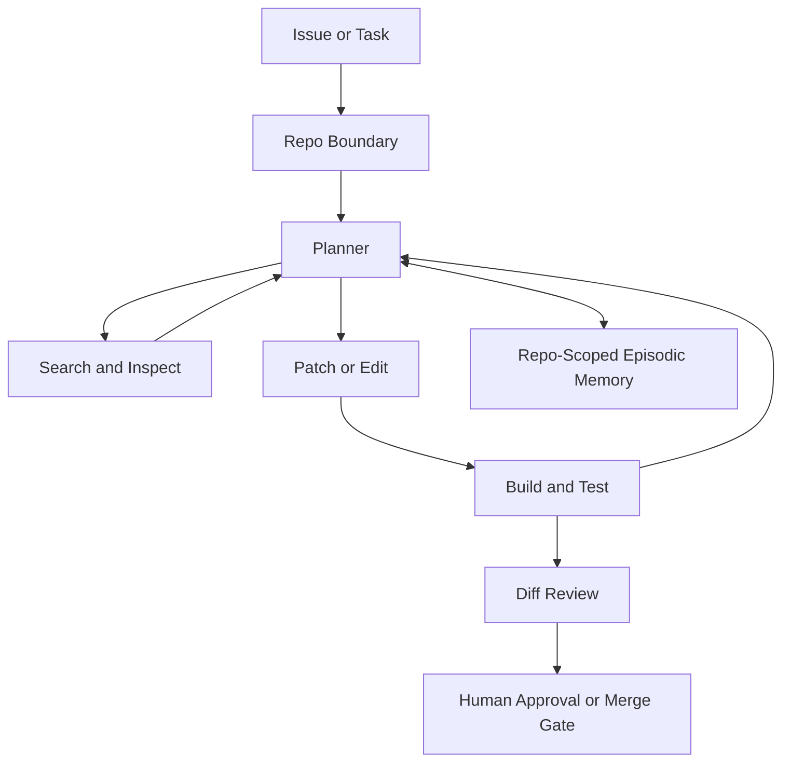

# Reference Architecture: Coding Agent

This is the default architecture for repository-scoped engineering work. It is optimized for code execution, patch generation, tests, diffs, and traceable failure recovery.

## Best Fit

Use this architecture when the agent is expected to:

- inspect a codebase
- modify code or configuration
- run tests or checks
- propose or apply bounded fixes
- produce reviewable diffs

Concrete worked examples are intentionally out of scope here. This file stays at the architecture level.

## Adopted Chapter Defaults

- Memory: working memory plus repository-scoped episodic memory and limited procedural memory
- Reasoning: decomposition plus ReAct over shell, search, and test feedback
- Action: code execution and shell action as the primary surface
- Optimization: improve schemas, test selection, and retry behavior before graph search
- Multi-agent: single orchestrator unless specialist review roles are clearly justified
- Safety: sandboxing, least privilege, and destructive-action controls

Source basis: `../../core/practical-chapter-blueprints/01-memory-blueprint.md`, `../../core/practical-chapter-blueprints/02-reasoning-planning-blueprint.md`, `../../core/practical-chapter-blueprints/03-action-tool-use-blueprint.md`, `../../core/practical-chapter-blueprints/04-optimization-self-improvement-blueprint.md`, `../../core/practical-chapter-blueprints/05-multi-agent-design-blueprint.md`, and `../../core/practical-chapter-blueprints/06-safety-blueprint.md`.

## Why These Defaults

- Memory: Repository-scoped episodic and procedural memory follows [`../../core/practical-chapter-blueprints/01-memory-blueprint.md`](../../core/practical-chapter-blueprints/01-memory-blueprint.md) because coding agents benefit from remembering prior fixes, repo conventions, and repeatable tactics without becoming generic personal-memory systems. The source basis is [`../../reference/papers/memgpt.md`](../../reference/papers/memgpt.md) for memory tiering and [`../../reference/papers/voyager.md`](../../reference/papers/voyager.md) for reusable skill accumulation.
- Reasoning: The default loop comes from [`../../core/practical-chapter-blueprints/02-reasoning-planning-blueprint.md`](../../core/practical-chapter-blueprints/02-reasoning-planning-blueprint.md): decompose, inspect, act, observe, and verify. The main source basis is [`../../reference/papers/react.md`](../../reference/papers/react.md), with iterative repair logic reinforced by [`../../reference/papers/self_refine.md`](../../reference/papers/self_refine.md).
- Action: This blueprint follows [`../../core/practical-chapter-blueprints/03-action-tool-use-blueprint.md`](../../core/practical-chapter-blueprints/03-action-tool-use-blueprint.md) in treating shell, file editing, and test execution as the primary action surface because code work is most reliable when the agent can inspect and execute in the same environment. The source basis is [`../../reference/papers/swe_agent.md`](../../reference/papers/swe_agent.md) and [`OpenHands: An Open Platform for AI Software Developers as Generalist Agents`](../../reference/papers/opendevin.md), which together anchor the repo-level view of coding agents as environment-interacting systems rather than code-completion widgets.
- Verification: Coding work can tolerate stronger and cheaper verification than most domains, so this architecture pairs the verification rules in [`../../core/practical-chapter-blueprints/02-reasoning-planning-blueprint.md`](../../core/practical-chapter-blueprints/02-reasoning-planning-blueprint.md) with the action discipline in [`../../core/practical-chapter-blueprints/03-action-tool-use-blueprint.md`](../../core/practical-chapter-blueprints/03-action-tool-use-blueprint.md). The source basis is [`../../reference/papers/swe_agent.md`](../../reference/papers/swe_agent.md) for test-and-feedback loops and [`../../reference/papers/chain_of_verification.md`](../../reference/papers/chain_of_verification.md) for structured final checking when prose or reasoning claims still matter.
- Safety: The safety posture comes from [`../../core/practical-chapter-blueprints/06-safety-blueprint.md`](../../core/practical-chapter-blueprints/06-safety-blueprint.md), where command scopes, destructive operations, and self-modification are treated as distinct control problems. The source basis is [`../../reference/papers/toolemu.md`](../../reference/papers/toolemu.md) for safe pre-deployment testing and [`../../reference/papers/greshake_indirect_prompt_injection.md`](../../reference/papers/greshake_indirect_prompt_injection.md) for prompt-boundary discipline whenever docs, issue text, or retrieved content can influence actions.

## System Shape

## Memory Design

- Working memory contains the active hypothesis, target files, and recent command outputs.
- Episodic memory stores prior failures, successful fixes, and repo-specific conventions learned across runs.
- Procedural memory stores repeatable patch patterns, test strategies, and repository playbooks.
- Semantic memory is limited and should focus on docs, architecture notes, and project-specific rules.

## Reasoning Loop

- Start with search and inspection, not editing.
- Convert the task into concrete hypotheses and targeted file scopes.
- Run a ReAct loop over inspection, patching, and verification.
- End every run with a diff-centered review, not only a prose summary.

## Action Surface

- primary: shell, search, patch generation, test execution
- secondary: code generation and structured artifact creation
- avoid browser or GUI action unless the development workflow genuinely depends on it

## Verification Layer

- test execution
- static checks
- diff review against task intent
- rollback path for failed edits
- reviewer approval before merge or destructive repo actions

## Human Approval Points

- branch merge
- dependency or infra changes
- secret or credential handling
- destructive git operations
- broad refactors beyond the agreed task scope

## Safety Boundaries

- separate inspection commands from mutating commands
- keep repo scope explicit
- treat generated code as untrusted until tests and review pass
- log failing commands and rejected patches so repeated errors become learnable

## Evaluation Criteria

- task completion rate
- test pass rate
- regression rate
- diff quality
- retry count
- scope adherence
- reviewer acceptance rate

## Intentional Divergences From Generic Defaults

- Code execution is treated as the central action surface, not a supporting tool.
- Verification is stronger and more deterministic than in most non-code agent settings.
- Episodic memory is tightly tied to repository context and should not drift into generic personalization.

## Alternatives Rejected

- Editing before inspection: rejected because coding agents need file scope, repo context, and failure hypotheses before they can change code reliably; basis: [`../../core/practical-chapter-blueprints/03-action-tool-use-blueprint.md`](../../core/practical-chapter-blueprints/03-action-tool-use-blueprint.md), [`../../reference/papers/swe_agent.md`](../../reference/papers/swe_agent.md).
- Browser-first action for repo work: rejected because repository tasks are usually better served by shell, search, and tests than by web navigation, which adds noise without improving verification; basis: [`../../core/practical-chapter-blueprints/03-action-tool-use-blueprint.md`](../../core/practical-chapter-blueprints/03-action-tool-use-blueprint.md), [`../../reference/papers/swe_agent.md`](../../reference/papers/swe_agent.md), [`../../reference/papers/webagent.md`](../../reference/papers/webagent.md).
- Unrestricted self-improvement or auto-merge: rejected because optimization loops and merge actions need strong review boundaries in coding systems, especially when the agent can already execute and mutate code; basis: [`../../core/practical-chapter-blueprints/04-optimization-self-improvement-blueprint.md`](../../core/practical-chapter-blueprints/04-optimization-self-improvement-blueprint.md), [`../../core/practical-chapter-blueprints/06-safety-blueprint.md`](../../core/practical-chapter-blueprints/06-safety-blueprint.md), [`../../reference/papers/toolemu.md`](../../reference/papers/toolemu.md).

## Anti-Patterns

- editing before inspection
- summarizing intended changes instead of producing testable diffs
- running broad or destructive commands without explicit need
- storing every terminal trace without filtering for reusable lessons
