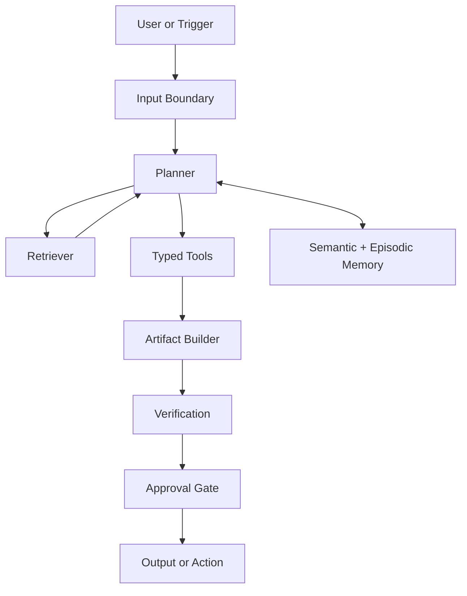

# Reference Architecture: Enterprise Agent

This is the default architecture for document-heavy, policy-sensitive, approval-gated enterprise work. It is optimized for bounded workflows, typed outputs, strong review boundaries, and durable retrieval-backed memory.

## Best Fit

Use this architecture when the agent is expected to:

- answer or draft against enterprise knowledge
- produce structured artifacts
- operate under policy constraints
- require human approval before high-impact actions

Concrete worked examples are intentionally out of scope here. This file stays at the architecture level.

## Adopted Chapter Defaults

- Memory: layered memory with semantic retrieval, episodic task logs, and limited procedural memory
- Reasoning: decomposition plus a bounded ReAct loop
- Action: typed tools and code only where replayability exists
- Optimization: prompt, schema, and routing improvement before workflow search
- Multi-agent: one orchestrator by default
- Safety: trust separation, least privilege, and approval gates

Source basis: `../../core/practical-chapter-blueprints/01-memory-blueprint.md`, `../../core/practical-chapter-blueprints/02-reasoning-planning-blueprint.md`, `../../core/practical-chapter-blueprints/03-action-tool-use-blueprint.md`, `../../core/practical-chapter-blueprints/04-optimization-self-improvement-blueprint.md`, `../../core/practical-chapter-blueprints/05-multi-agent-design-blueprint.md`, and `../../core/practical-chapter-blueprints/06-safety-blueprint.md`.

## Why These Defaults

- Memory: This architecture follows the retrieval-backed memory baseline in [`../../core/practical-chapter-blueprints/01-memory-blueprint.md`](../../core/practical-chapter-blueprints/01-memory-blueprint.md) because enterprise tasks need durable knowledge access without treating every interaction as permanent memory. The main source basis is [`../../reference/papers/memgpt.md`](../../reference/papers/memgpt.md), with production-oriented reinforcement from [`../../reference/papers/mem0.md`](../../reference/papers/mem0.md) and retention-policy guidance from [`../../reference/papers/memorybank.md`](../../reference/papers/memorybank.md).
- Reasoning: The default is bounded decomposition plus ReAct from [`../../core/practical-chapter-blueprints/02-reasoning-planning-blueprint.md`](../../core/practical-chapter-blueprints/02-reasoning-planning-blueprint.md) because enterprise work usually needs controlled subgoals rather than open-ended search. The main source basis is [`../../reference/papers/react.md`](../../reference/papers/react.md), with factual checking strengthened by [`../../reference/papers/chain_of_verification.md`](../../reference/papers/chain_of_verification.md).
- Action: Typed tools and replayable code paths follow the action hierarchy in [`../../core/practical-chapter-blueprints/03-action-tool-use-blueprint.md`](../../core/practical-chapter-blueprints/03-action-tool-use-blueprint.md), which prefers APIs and structured actions over browser improvisation. The main source basis is [`../../reference/papers/toolformer.md`](../../reference/papers/toolformer.md) for the tool-use pattern and [`../../reference/papers/gorilla.md`](../../reference/papers/gorilla.md) for API-grounded argument construction.
- Verification: Enterprise artifacts need explicit evidence checks and policy checks, which is why this blueprint combines the verification doctrine in [`../../core/practical-chapter-blueprints/02-reasoning-planning-blueprint.md`](../../core/practical-chapter-blueprints/02-reasoning-planning-blueprint.md) and the control logic in [`../../core/practical-chapter-blueprints/06-safety-blueprint.md`](../../core/practical-chapter-blueprints/06-safety-blueprint.md). The source basis is [`../../reference/papers/chain_of_verification.md`](../../reference/papers/chain_of_verification.md) for structured factual review and [`../../reference/papers/toolemu.md`](../../reference/papers/toolemu.md) for pre-deployment evaluation logic.
- Safety: The trust-boundary posture comes directly from [`../../core/practical-chapter-blueprints/06-safety-blueprint.md`](../../core/practical-chapter-blueprints/06-safety-blueprint.md), where retrieved content, memory writes, and write-capable tools are treated as separate risk surfaces. The main source basis is [`../../reference/papers/greshake_indirect_prompt_injection.md`](../../reference/papers/greshake_indirect_prompt_injection.md), with memory and retrieval risk reinforced by [`../../reference/papers/agentpoison.md`](../../reference/papers/agentpoison.md) and [`../../reference/papers/poisonedrag.md`](../../reference/papers/poisonedrag.md).

## System Shape

## Memory Design

- Working memory contains the current task state, retrieved evidence, and in-progress artifact state.
- Semantic memory stores policies, docs, product knowledge, and approved structured records.
- Episodic memory stores prior runs, reviewer comments, and notable corrections.
- Procedural memory stays narrow and should only capture stable playbooks or templates.

## Reasoning Loop

- Decompose the task into bounded subgoals and expected artifacts.
- Use a ReAct-style loop when retrieval or tools are required.
- Stop reasoning once the artifact reaches the minimum evidence threshold needed for verification.

## Action Surface

- Prefer typed API tools, retrieval tools, search tools, and code paths that are replayable.
- Avoid free-form browser or GUI action unless the workflow cannot be surfaced through a safer interface.
- Treat writes as a separate class of action with tighter controls than reads.

## Verification Layer

- Require source-backed artifact checks for factual claims.
- Require schema checks for structured outputs.
- Require deterministic policy checks before irreversible actions.
- Use critique or CoVe-style verification for higher-stakes synthesis outputs.

## Human Approval Points

- external communications
- financial or legal actions
- destructive data changes
- policy-sensitive escalations
- any action that cannot be cheaply rolled back

## Safety Boundaries

- Separate system instructions from retrieved or uploaded content.
- Treat memory writes as governed actions rather than automatic logging.
- Separate low-risk retrieval tools from high-risk write tools.
- Log every tool call, retrieval source, and approval event.

## Evaluation Criteria

- factual grounding rate
- artifact completeness
- policy-compliance rate
- approval-hit rate
- rollback-free action rate
- retrieval relevance quality
- reviewer correction frequency

## Intentional Divergences From Generic Defaults

- This architecture is stricter than the general blueprint on approval boundaries.
- It de-emphasizes multi-agent decomposition unless there is real role separation.
- It relies more on typed artifacts than on open-ended conversational outputs.

## Alternatives Rejected

- Broad browser-first action: rejected because enterprise systems usually expose safer typed interfaces, and pushing the default path through browsing expands the untrusted-content surface without adding much leverage; basis: [`../../core/practical-chapter-blueprints/03-action-tool-use-blueprint.md`](../../core/practical-chapter-blueprints/03-action-tool-use-blueprint.md), [`../../reference/papers/gorilla.md`](../../reference/papers/gorilla.md), [`../../reference/papers/webagent.md`](../../reference/papers/webagent.md).
- Free-form multi-agent conversation: rejected because open-ended agent chatter is usually weaker than typed artifacts and bounded orchestration for enterprise approval chains; basis: [`../../core/practical-chapter-blueprints/05-multi-agent-design-blueprint.md`](../../core/practical-chapter-blueprints/05-multi-agent-design-blueprint.md), [`../../reference/papers/autogen.md`](../../reference/papers/autogen.md), [`../../reference/papers/metagpt.md`](../../reference/papers/metagpt.md).
- Automatic memory logging without curation: rejected because enterprise memory needs governance, decay, and write boundaries rather than indiscriminate accumulation; basis: [`../../core/practical-chapter-blueprints/01-memory-blueprint.md`](../../core/practical-chapter-blueprints/01-memory-blueprint.md), [`../../reference/papers/memgpt.md`](../../reference/papers/memgpt.md), [`../../reference/papers/memorybank.md`](../../reference/papers/memorybank.md).

## Anti-Patterns

- letting retrieved policy text behave like trusted instructions
- writing to enterprise systems without explicit approval boundaries
- storing all interaction history without decay or curation
- using multi-agent conversation as a substitute for typed workflow stages
