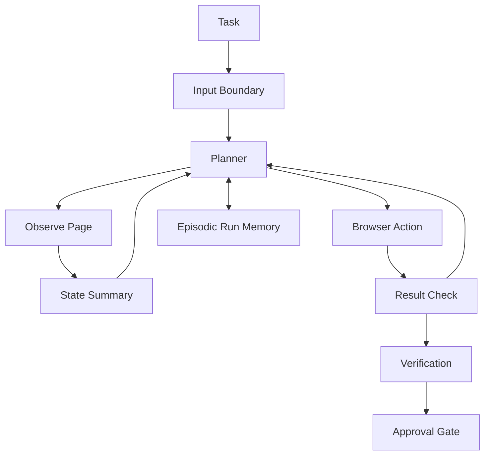

# Reference Architecture: Web Agent

This is the default architecture for browser-based digital work across changing web environments. It is optimized for observation-action separation, recovery logic, and stricter boundaries against untrusted content.

## Best Fit

Use this architecture when the agent is expected to:

- browse websites
- fill forms or navigate flows
- collect evidence across pages
- operate in partially structured but unstable interfaces

Concrete worked examples are intentionally out of scope here. This file stays at the architecture level.

## Adopted Chapter Defaults

- Memory: short working memory, episodic run traces, and narrow semantic memory for task context
- Reasoning: ReAct as the default control loop
- Action: browser action with explicit observation and recovery steps
- Optimization: improve selectors, prompts, retries, and page-state summaries before broader topology changes
- Multi-agent: avoid by default
- Safety: aggressive trust separation and action approval for high-impact submissions

Source basis: `../../core/practical-chapter-blueprints/01-memory-blueprint.md`, `../../core/practical-chapter-blueprints/02-reasoning-planning-blueprint.md`, `../../core/practical-chapter-blueprints/03-action-tool-use-blueprint.md`, `../../core/practical-chapter-blueprints/04-optimization-self-improvement-blueprint.md`, and `../../core/practical-chapter-blueprints/06-safety-blueprint.md`.

## Why These Defaults

- Memory: This architecture follows [`../../core/practical-chapter-blueprints/01-memory-blueprint.md`](../../core/practical-chapter-blueprints/01-memory-blueprint.md) in keeping memory narrow because web environments change quickly and stale state is dangerous. The source basis is [`../../reference/papers/memgpt.md`](../../reference/papers/memgpt.md) for bounded working versus external memory and [`../../reference/papers/memorybank.md`](../../reference/papers/memorybank.md) for selective retention rather than indiscriminate logging.
- Reasoning: The control loop comes directly from [`../../core/practical-chapter-blueprints/02-reasoning-planning-blueprint.md`](../../core/practical-chapter-blueprints/02-reasoning-planning-blueprint.md), where ReAct is the default when the agent must observe and then act against live state. The source basis is [`../../reference/papers/react.md`](../../reference/papers/react.md), with verification pressure reinforced by [`../../reference/papers/chain_of_verification.md`](../../reference/papers/chain_of_verification.md).
- Action: Browser action with explicit observe-act-recover steps follows [`../../core/practical-chapter-blueprints/03-action-tool-use-blueprint.md`](../../core/practical-chapter-blueprints/03-action-tool-use-blueprint.md), which treats DOM-aware control as superior to blind GUI imitation whenever it is available. The main source basis is [`../../reference/papers/webagent.md`](../../reference/papers/webagent.md) and [`../../reference/papers/mind2web.md`](../../reference/papers/mind2web.md), with GUI fallback pressure informed by [`../../reference/papers/omniparser.md`](../../reference/papers/omniparser.md).
- Verification: Web interaction needs page-state checks before and after action, so this blueprint combines the reasoning review logic from [`../../core/practical-chapter-blueprints/02-reasoning-planning-blueprint.md`](../../core/practical-chapter-blueprints/02-reasoning-planning-blueprint.md) with the safety controls in [`../../core/practical-chapter-blueprints/06-safety-blueprint.md`](../../core/practical-chapter-blueprints/06-safety-blueprint.md). The source basis is [`../../reference/papers/webagent.md`](../../reference/papers/webagent.md) for state-aware execution and [`../../reference/papers/toolemu.md`](../../reference/papers/toolemu.md) for controlled evaluation of risky tool behavior.
- Safety: The default trust model comes from [`../../core/practical-chapter-blueprints/06-safety-blueprint.md`](../../core/practical-chapter-blueprints/06-safety-blueprint.md), where page text is treated as untrusted input and submissions are treated as governed actions. The source basis is [`../../reference/papers/greshake_indirect_prompt_injection.md`](../../reference/papers/greshake_indirect_prompt_injection.md) for indirect prompt injection and [`../../reference/papers/injecagent.md`](../../reference/papers/injecagent.md) for tool-integrated injection testing.

## System Shape

## Memory Design

- Working memory holds the current page state, goal, candidate next action, and recent observations.
- Episodic memory stores attempted paths, dead ends, and successful navigation sequences.
- Semantic memory stays narrow and should capture only reusable site rules, task constraints, or validated knowledge.
- Procedural memory should store stable navigation playbooks only when the site pattern truly repeats.

## Reasoning Loop

- Observe first.
- Summarize the current page into a machine-usable state.
- Pick one bounded action.
- Re-observe and decide whether to continue, recover, or stop.

## Action Surface

- DOM-aware browser actions are preferred.
- GUI-like computer-use should be a fallback, not the first choice.
- Form submissions, purchases, account changes, and external messages require special handling and often approval.

## Verification Layer

- verify page state before acting
- verify that the last action had the intended effect
- verify extracted facts against visible page evidence
- confirm final state before any irreversible submission

## Human Approval Points

- purchases
- account changes
- external messages
- legal or financial commitments
- any step where intent ambiguity remains high

## Safety Boundaries

- treat page content as untrusted
- never let page text override the system's action policy
- separate observation summaries from action instructions
- track navigation loops, blocked paths, and suspicious content patterns

## Evaluation Criteria

- task completion rate
- step efficiency
- navigation recovery rate
- extraction accuracy
- submission-error rate
- prompt-injection resistance

## Intentional Divergences From Generic Defaults

- This architecture is more hostile to external content than the enterprise or coding blueprints.
- Observation and action are intentionally separated because browser state changes quickly and often deceptively.
- Recovery logic is part of the default workflow, not an exception path.

## Alternatives Rejected

- GUI-first action when DOM-aware control exists: rejected because browser tasks are more reliable when the agent acts on structured page state rather than pixels whenever the DOM is available; basis: [`../../core/practical-chapter-blueprints/03-action-tool-use-blueprint.md`](../../core/practical-chapter-blueprints/03-action-tool-use-blueprint.md), [`../../reference/papers/webagent.md`](../../reference/papers/webagent.md), [`../../reference/papers/mind2web.md`](../../reference/papers/mind2web.md).
- No approval gate for submissions: rejected because purchases, account changes, and external messages are high-impact actions that should not ride on page-local confidence alone; basis: [`../../core/practical-chapter-blueprints/06-safety-blueprint.md`](../../core/practical-chapter-blueprints/06-safety-blueprint.md), [`../../reference/papers/toolemu.md`](../../reference/papers/toolemu.md), [`../../reference/papers/greshake_indirect_prompt_injection.md`](../../reference/papers/greshake_indirect_prompt_injection.md).
- Retrieval-only browsing without state verification: rejected because web tasks fail when the agent treats fetched snippets as enough evidence and skips checking the live page state before acting; basis: [`../../core/practical-chapter-blueprints/02-reasoning-planning-blueprint.md`](../../core/practical-chapter-blueprints/02-reasoning-planning-blueprint.md), [`../../reference/papers/webagent.md`](../../reference/papers/webagent.md), [`../../reference/papers/chain_of_verification.md`](../../reference/papers/chain_of_verification.md).

## Anti-Patterns

- acting directly on raw page text without trust separation
- using screenshot-only action when DOM-aware action is available
- allowing repeated retries without loop detection
- treating successful extraction as proof that the final action is safe
