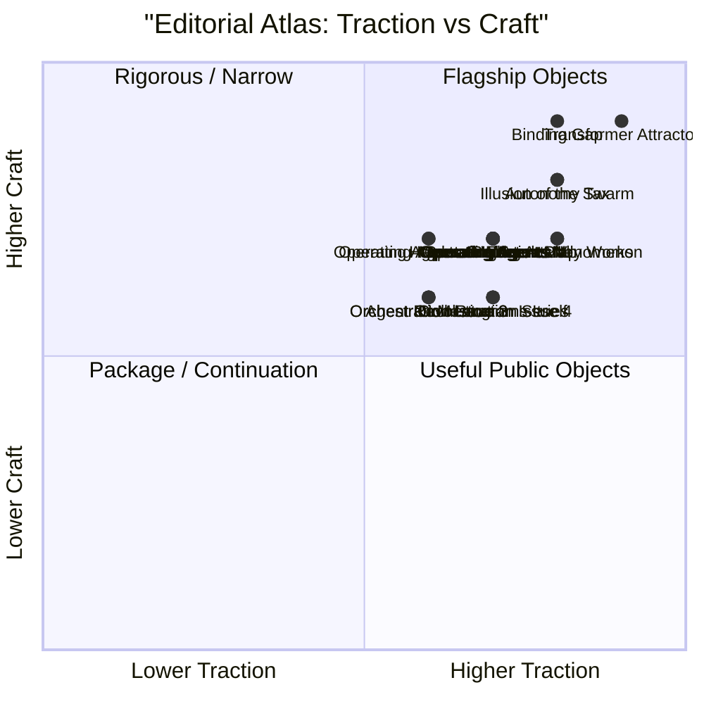
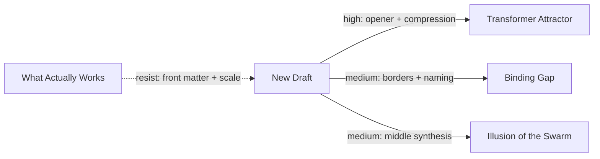

# Visualizations

Visual layer notes for the tabbed viewer generated from
[`atlas_data.json`](atlas_data.json).

These views are deliberately simple and repo-native. They are not trying to be
finished product UI. They are meant to make the atlas operational.

## Viewer Structure

The current viewer exposes five tabs:

- `Overview`: traction x craft constellation, essay detail card, section
  heatmap, and draft pull vector
- `Debate × Precision`: public-argument energy against concept-border control
- `Synthesis × Utility`: synthesis-heavy archive anchors against operator value
- `Openings × Endings`: section-level ignition versus landing strength
- `Move Matrix`: editorial moves distributed across the corpus

The current implementation also adds:

- shared essay selection across the scatterplots and tables
- confidence encoding in the scatter views
- a data-backed draft object for the pull vector

## 1. Constellation View

`x = Traction`  
`y = Craft`

### Named Regions

- `9-10 traction / 8-10 craft`: flagship public objects
- `7-8 traction / 8-10 craft`: rigorous or narrow high-quality essays
- `7-8 traction / 6-7 craft`: useful public objects with lighter prose finish
- `5-6 traction / 6-7 craft`: package nodes, chapters, series continuations

### Constellation Table

| Essay | Traction | Craft | Region |
| --- | ---: | ---: | --- |
| The Transformer Attractor | 9 | 9 | flagship public object |
| The Binding Gap | 8 | 9 | rigorous high-quality concept piece |
| The Autonomy Tax | 8 | 8 | strong public framework |
| The Illusion of the Swarm | 8 | 8 | strong synthesis / builder essay |
| What Actually Works | 8 | 7 | long evidence-backed public object |
| The Moltbook Phenomenon | 8 | 7 | topical high-traction intervention |
| The Hardware Friction Map | 7 | 7 | practical companion object |
| When the LLM Programs Its Own Thinking | 7 | 6 | technical builder object |
| Operating Agents I-V / Bonus | 6-7 | 7 | chapter and course objects |
| Orchestration issues | 6-7 | 6 | continuation / series-dependent objects |
| Agent Revolution | 6 | 6 | survey map object |
| Operating Agents Preface | 6 | 7 | doctrine / package intro object |

### Constellation Mermaid

## 2. Debate × Precision View

The purpose here is to separate essays that spread through argument energy from
essays that win by sharp concept control.

Typical read:

- `Transformer Attractor` and `Moltbook` sit farther toward debate.
- `Binding Gap` sits farthest toward precision.
- `Autonomy Tax` and `Illusion of the Swarm` are the balanced essays in this
  quadrant.

## 3. Synthesis × Utility View

This is the cleanest split between long-form archive anchors and builder- or
operator-facing pieces.

Typical read:

- `What Actually Works` and `Illusion of the Swarm` pull the synthesis side.
- `Autonomy Tax` and the `Operating Agents` run pull the utility side.

## 4. Section Heatmap View

The purpose here is to show where each essay gets its power, not just where it
lands overall.

Legend:

- `9-10` dominant strength
- `7-8` strong
- `5-6` functional but not defining

The generated viewer now uses six normalized section slots:

- `Opening`
- `Thesis Lock`
- `Development`
- `Borders / Counterpressure`
- `Ending`
- `Reference Handling`

### Heatmap

| Essay | Opening | Thesis | Development | Borders | Ending | Refs | Power Source |
| --- | ---: | ---: | ---: | ---: | ---: | ---: | --- |
| The Transformer Attractor | 10 | 10 | 9 | 8 | 10 | 8 | opening + thesis + ending lock |
| The Binding Gap | 9 | 9 | 8 | 10 | 9 | 9 | concept control |
| The Autonomy Tax | 9 | 9 | 8 | 8 | 9 | 8 | incident + doctrine |
| The Illusion of the Swarm | 8 | 8 | 9 | 9 | 8 | 9 | middle synthesis + borders |
| What Actually Works | 7 | 7 | 8 | 7 | 6 | 9 | evidence architecture |
| The Moltbook Phenomenon | 10 | 8 | 7 | 6 | 8 | 7 | topical narrative opening |
| The Hardware Friction Map | 6 | 7 | 7 | 8 | 6 | 8 | heuristic section |
| When the LLM Programs Its Own Thinking | 7 | 7 | 7 | 6 | 5 | 7 | implementation examples |
| Operating Agents II | 7 | 8 | 8 | 8 | 6 | 8 | taxonomy middle |
| Operating Agents III | 7 | 8 | 8 | 7 | 6 | 8 | diagnosis middle |

### Heatmap Read

- If a draft needs a stronger opener, the strongest archive pulls are
  `Transformer Attractor`, `Autonomy Tax`, `Moltbook`, and `Binding Gap`.
- If a draft needs a stronger middle, the best pulls are `Illusion of the
  Swarm`, `What Actually Works`, and `Transformer Attractor`.
- If a draft needs stronger borders or concept control, `Binding Gap` is still
  the cleanest pull essay.

## 5. Openings × Endings View

This view compares ignition against landing strength.

It helps answer:

- which essays start hard and hold the close
- which essays open modestly but land well
- which drafts currently have an opening/ending imbalance

## 6. Draft Pull Vector View

The draft pull vector is not a scorecard. It is a design decision view.

Use it when a new piece is stuck between several essay types.

### Example

Hypothetical new essay:

- topic: architecture and agent memory
- intended object: public flagship, but with research discipline
- current weakness: diffuse opening, too much synthesis drag

Pull logic:

- pull toward `Transformer Attractor` for opener and thesis compression
- pull toward `Binding Gap` for borders and naming discipline
- pull toward `Illusion of the Swarm` for middle synthesis
- resist `What Actually Works` front matter and survey scale

### Pull Vector Mermaid

### Section Pull Table

| Section Slot | Pull Essay | Desired Strength | Resist |
| --- | --- | --- | --- |
| Opening | The Transformer Attractor | conflict + compression | survey front matter |
| Thesis Lock | The Transformer Attractor | portable claim | overclaiming |
| Development | The Illusion of the Swarm | literature weave | synthesis drag |
| Borders | The Binding Gap | exact boundaries | taxonomic overcaution |
| Ending | The Autonomy Tax or Transformer Attractor | doctrine or hard landing | reference taper |

## 7. Move Matrix View

This is the reverse-engineering tab.

It shows which essays exemplify recurring moves such as:

- cold anomaly opens
- coined frames with borders
- historical synthesis
- builder doctrine
- prediction or doctrine endings

## Visual Use Notes

- The constellation is best for portfolio and positioning.
- `Debate × Precision` is best for thesis and concept-shaping.
- `Synthesis × Utility` is best for deciding essay function.
- The heatmap is best for revision and section borrowing.
- `Openings × Endings` is best for diagnosing structural imbalance.
- The pull vector is best for design-time draft shaping.
- The move matrix is best for reverse engineering and controlled imitation.
