# Video Script — What Does It Take to Be a Good AI Research Agent?
- Duration: ~15 minutes (hard cutoff)
- Source: https://arxiv.org/html/2511.15593v1
- Voices: Host Alex (brief + co-host), Host Maya (co-host + expert), Host Dr. Lee (critic)
- Visuals: use images from `./2511.15593v1-images/`

## Brief (00:00–01:30) — Alex
1) 00:00–00:30 — Hook: Agents write ML code end-to-end; authors studied why some agents succeed. Show title card.
2) 00:30–01:00 — Core idea: ideation diversity (how many distinct solution ideas an agent explores) predicts success on MLE-bench. Show 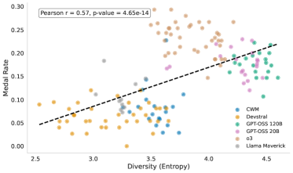.
3) 01:00–01:30 — Promise: we’ll see how they measured diversity, ran controlled experiments, and what it means for agent design. Light quip: "Think of it as brainstorming on caffeine — but safer for laptops." Transition to deep dive.

## Deep Dive (01:30–09:30) — Alex & Maya (conversation)
4) 01:30–02:20 — Setup the benchmark & agent flow.
   - Alex: introduce MLE-bench tasks and agent scaffold steps (plan → code → test → iterate).
   - Maya: narrate the workflow. Show 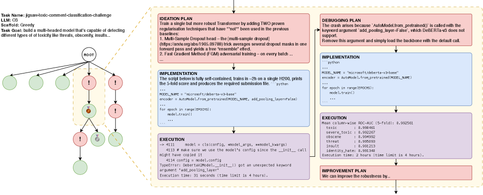.
   - Quick joke after explanation: "Bugs are just the agent’s way of asking for more GPU time."

5) 02:20–03:10 — What is ideation diversity?
   - Maya: diversity = branching of solution ideas (architectures, hyperparams, preprocessing) along the search tree.
   - Alex: highlight that successful trajectories explore more distinct branches before converging.
   - On-screen correlation: 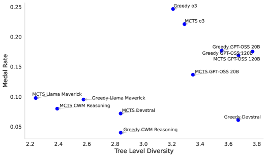.

6) 03:10–04:20 — Diversity of approaches per agent.
   - Alex: AIDE vs AIRA-Greedy vary in architectures they try.
   - Maya: "AIDE leans heavy on EfficientNet; AIRA-Greedy spreads bets." Show panel pair: 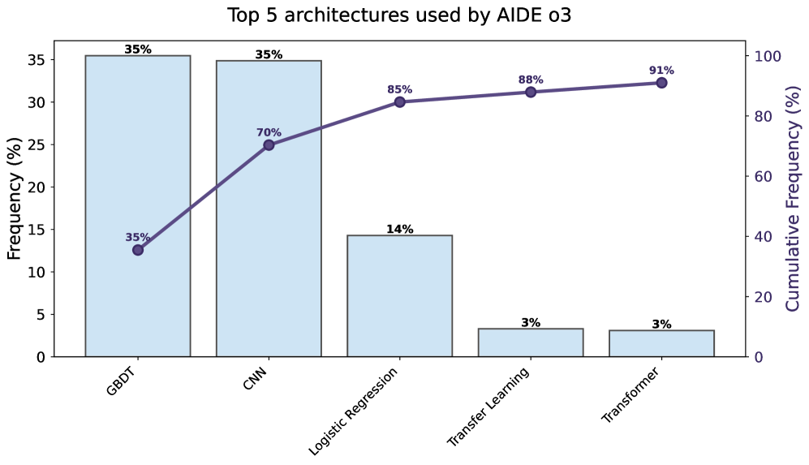 then swap to 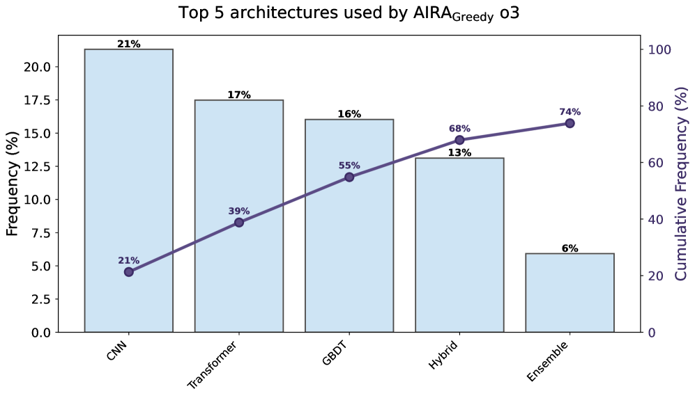.
   - Joke after explanation: "It’s like ordering the sampler platter instead of just fries."

7) 04:20–05:20 — Model-level diversity.
   - Maya: discuss variety of models tried (AIDE vs AIRA-Greedy). Show 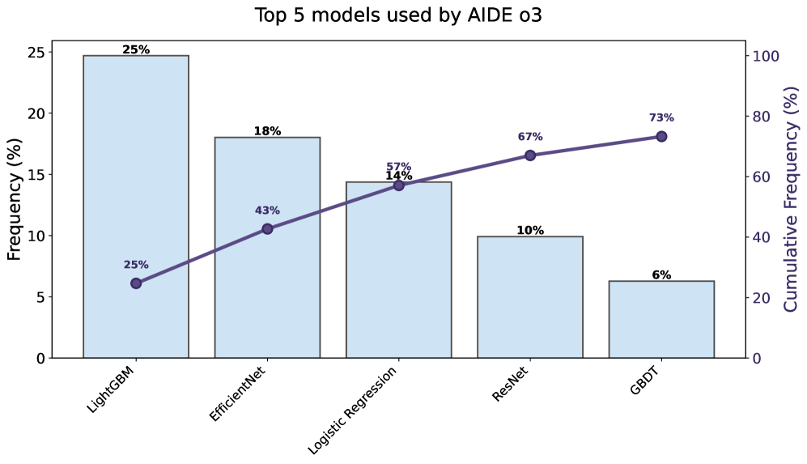 then 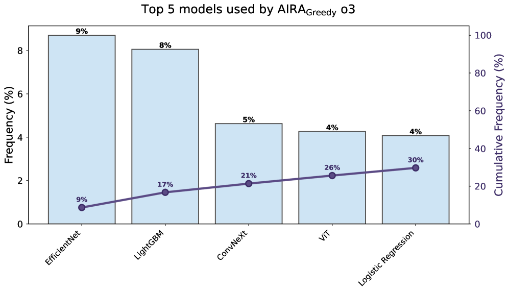.
   - Alex: relate to image-classification tasks; swap to 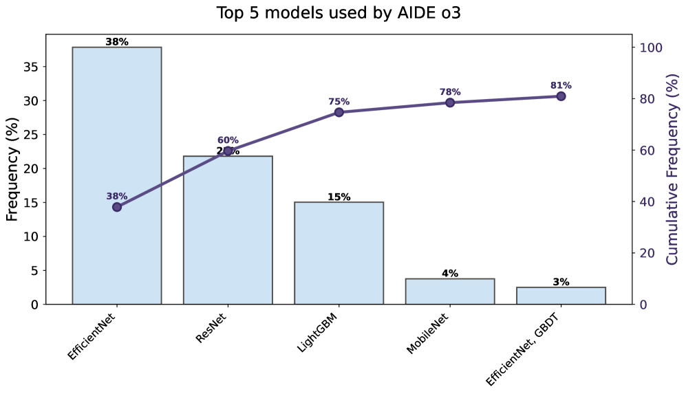 then 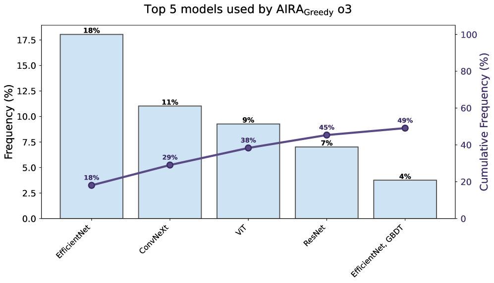.
   - Light quip: "Variety is great—unless it’s my coffee order holding up the line."

8) 05:20–06:00 — How much diversity per task?
   - Maya: cumulative distribution of distinct architectures per task. Show 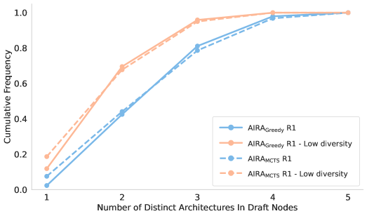.
   - Alex: takeaway—top agents don’t just stumble on a good model; they try multiple candidates.

9) 06:00–07:00 — Controlled diversity experiments.
   - Alex: compare medal rates with/without diversity interventions. Show 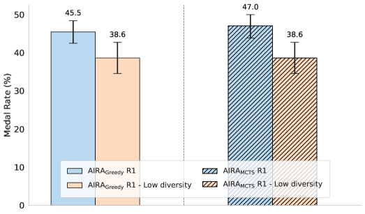.
   - Maya: note 95% CIs and that reduced diversity drops performance.
   - Joke: "Turns out forcing one idea is like telling your cat to fetch—technically possible, rarely successful."

10) 07:00–08:00 — Alternative performance metrics.
    - Maya: normalized score and percentile views. Show 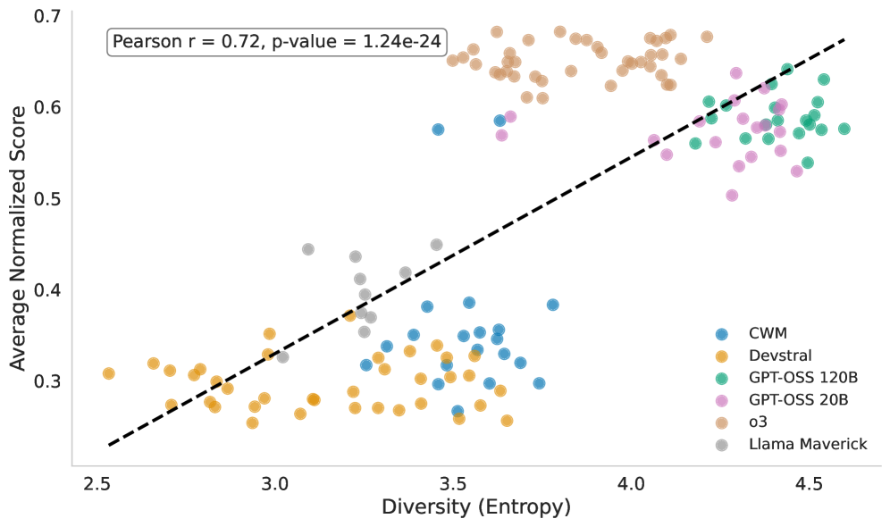, then 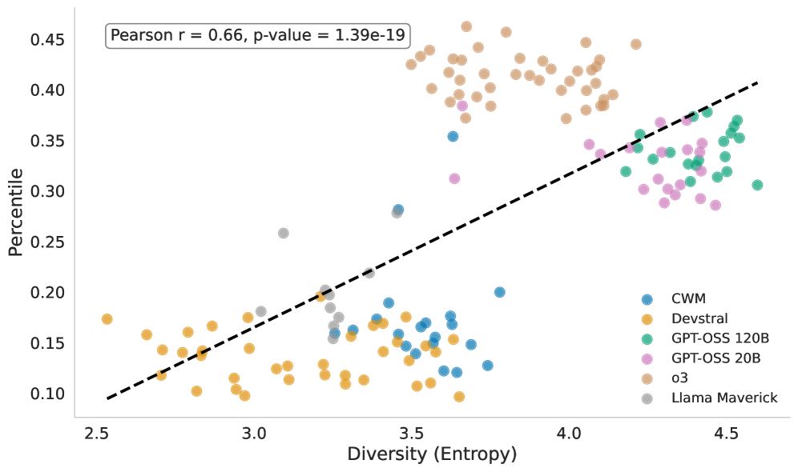.
    - Alex: note consistency—diversity helps across metrics.

11) 08:00–08:50 — Efficiency angle.
    - Maya: execution-time correlations. Show 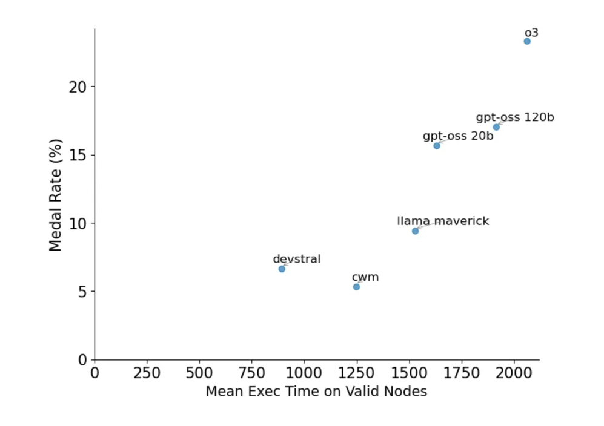 then 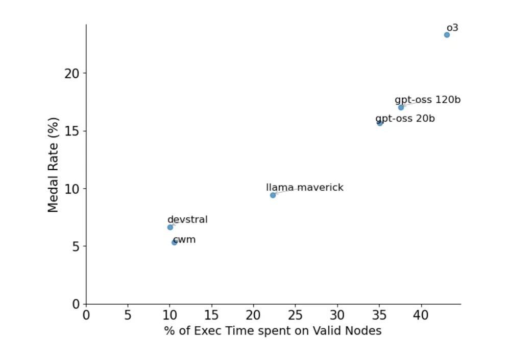.
12) 08:50–09:30 — Temperature sweeps.
    - Alex: temperature sweeps. Show 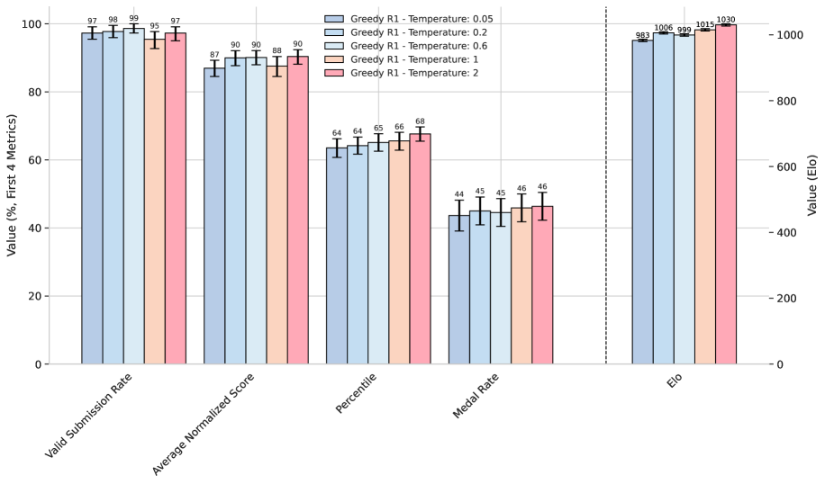.
    - Light quip: "Dialing temperature is like seasoning soup—too bland or too spicy, either way the guests complain."

## Critique (09:30–11:00) — Dr. Lee
13) 09:30–10:00 — Methodology caveats: real-world constraints (costs/latency) not deeply explored; diversity may trade off with efficiency; robustness across unseen domains unknown.
14) 10:00–10:30 — Metrics: medal rates depend on Kaggle distributions; alternative metrics better but still benchmark-bound. Show 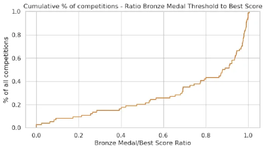 while explaining tight thresholds.
15) 10:30–11:00 — Constructive asks: add ablations on tool use, data leakage guards, and cost-aware search; test on fresh competitions to avoid overfitting.

## Debate (11:00–14:30) — Alex & Maya
16) 11:00–11:50 — Position 1 (Alex): more diversity is almost always better; point to consistent correlations and controlled drops.
17) 11:50–12:40 — Position 2 (Maya): diversity must be guided—quality of branches matters; propose selective exploration + meta-learning to prune.
18) 12:40–14:00 — Reconcile: adaptive schedules (start broad, focus later), budget-aware branching, and evaluators that reward both novelty and stability.
19) 14:00–14:30 — Closing joke: "Like a good playlist—shuffle early, loop your hits later." Fade out on the key correlation visual: .

## Takeaway (14:30–15:00)
- Ideation diversity consistently correlates with stronger agent performance on MLE-bench.
- Constraining idea exploration hurts results; guided diversity with budget awareness looks promising.
- Future work: cost-aware search, richer domains, and better metrics beyond medals.

## Dialogue Transcript (expanded)
- 00:00–00:30 — Visual: title card  
  Alex: "Welcome! We’re hanging out with AI research agents that write ML code end-to-end. Some crush Kaggle-style tasks, some faceplant—let’s see what separates the two."
- 00:30–01:00 — Visual: ./2511.15593v1-images/Ideation_diversity_correlates_with_performance_in_MLE_bench_Our_analysis_shows_that_ideation_diversity_correlates_with_t.png  
  Alex: "Spoiler: the winners don’t just get lucky—they explore more distinct solution ideas. Ideation diversity is their secret sauce."  
  Alex: "This curve is basically saying: more thoughtful branching, more shiny medals."
- 01:00–01:30 — Visual: (hold)  
  Alex: "We’ll unpack how they measure that diversity, what experiments they run, and what it means if you’re building your own research agent. Think turbo-charged brainstorming—minus the shaky hands. Deep dive time."

- 01:30–02:20 — Visual: ./2511.15593v1-images/An_example_flow_of_an_AI_research_agent_attempting_an_MLE_bench_task_The_goal_of_the_task_is_to_build_a_multi_headed_mod.png  
  Alex: "Maya, what does a typical MLE-bench run look like for these agents?"  
  Maya: "They start by reading the competition brief, drafting a high-level plan, then cycle through writing code, running it, debugging, and refining. It’s a full ML workflow, not just calling a single API."  
  Alex: "So like a junior ML engineer on fast‑forward."  
  Maya: "Exactly. In this example, the agent is building a multi-head toxicity classifier, and every node in the tree is a slightly different idea—new model, new preprocessing, new tuning."  
  Alex (joke): "And every bug is just the agent’s way of asking for more GPU hugs."

- 02:20–03:10 — Visual: ./2511.15593v1-images/Correlation_between_tree_level_diversity_and_performance_on_MLE_bench.png  
  Alex: "Okay, ideation diversity in practice—what are they actually counting here?"  
  Maya: "They look at trajectories across 75 MLE-bench tasks and count how many distinct solution branches an agent explores—different architectures, different feature pipelines, even meaningfully different hyperparameter regimes."  
  Alex: "And this plot shows that runs with richer branching patterns reach higher performance."  
  Maya: "Right. Agents that stick to one narrow line of thought usually stall out; agents that explore a broader tree have a much better shot at climbing to the top of the leaderboard."

- 03:10–04:20 — Visual: ./2511.15593v1-images/a_Diversity_of_ML_approaches_architectures_AIDE.png → ./2511.15593v1-images/b_Diversity_of_ML_approaches_architectures_AIRA_Greedy_text_AIRA_text_Greedy.png  
  Alex: "Let’s compare two actual agents: AIDE and AIRA-Greedy. Who’s the more adventurous eater?"  
  Maya: "AIDE leans heavily on a couple of go‑to architectures, especially EfficientNet. AIRA-Greedy, on the other hand, spreads its bets across more families of approaches—classic boosting, CNNs, transformers, you name it."  
  Alex (joke): "So AIDE orders the same burger every time, and AIRA-Greedy is doing the tasting menu."  
  Maya: "Exactly. And as we’ll see, that tasting‑menu behavior lines up with better outcomes on many tasks."

- 04:20–05:20 — Visual: ./2511.15593v1-images/c_Diversity_of_models_AIDE.png → ./2511.15593v1-images/d_Diversity_of_models_AIRA_Greedy_text_AIRA_text_Greedy.png; then ./2511.15593v1-images/e_Diversity_of_models_for_Image_Classification_Tasks_AIDE.png → ./2511.15593v1-images/f_Diversity_of_models_for_Image_Classification_Tasks_AIRA_Greedy_text_AIRA_text_Greedy.png  
  Alex: "These charts dig deeper into the specific model architectures, right?"  
  Maya: "Yes. For image classification, AIDE keeps coming back to a small set of architectures—think EfficientNet and a couple of usual suspects. AIRA-Greedy cycles through a broader lineup, including things like ConvNeXt and ViT, which makes its search more resilient."  
  Alex: "So the diversity isn’t just cosmetic—it’s different inductive biases and error patterns in the mix."  
  Maya (quip): "Variety is great—unless it’s my coffee order holding up the line. But for agents, trying multiple model families really pays off."

- 05:20–06:00 — Visual: ./2511.15593v1-images/Number_of_distinct_architectures_per_task_Cumulative_Distribution.png  
  Maya: "This cumulative curve shows how many distinct architectures agents try per task. The better agents have a substantial fraction of runs where they try several architectures before settling."  
  Alex: "So they aren’t married to the first idea—they date around before committing."

- 06:00–07:00 — Visual: ./2511.15593v1-images/Comparison_of_MLE_bench_lite_medal_rate_of_AIRA_Greedy_text_AIRA_text_Greedy_and_AIRA_MCTS_text_AIRA_text_MCTS_with_and.png  
  Alex: "Observation is nice, but do they intervene on diversity?"  
  Maya: "They do. They build low‑diversity variants that restrict branching—limiting how often the agent can switch architectures or pursue new ideas—and compare medal rates."  
  Alex: "And those constrained agents underperform the original, more exploratory ones."  
  Maya: "Exactly. Across both AIRA-Greedy and AIRA-MCTS, choking off diversity leads to lower medal rates, and the confidence intervals back that up."  
  Alex (joke): "Forcing one idea is like asking a cat to fetch—possible, but you’re mostly proving a point to yourself."

- 07:00–08:00 — Visual: ./2511.15593v1-images/Correlation_between_diversity_and_performance_measured_as_average_normalized_score.png → ./2511.15593v1-images/Correlation_between_diversity_and_performance_measured_as_percentile.png  
  Alex: "And this isn’t just about medals, right?"  
  Maya: "Right. They also look at average normalized score and human-score percentile, which capture how far up the leaderboard you climb, not just whether you cross a medal cutoff."  
  Alex: "And diversity still tracks with better outcomes on those metrics."  
  Maya: "Yes. Whether you measure absolute performance, relative percentile, or medal rate, more ideation diversity is consistently associated with better results."

- 08:00–08:50 — Visual: ./2511.15593v1-images/Correlation_between_the_average_execution_time_on_valid_nodes_and_performance_MLE_bench_75_tasks.png → ./2511.15593v1-images/Correlation_between_the_share_of_execution_time_spent_on_valid_nodes_and_performance_MLE_bench_75_tasks.png  
  Alex: "The paper also talks about an implementation bottleneck—what’s that about?"  
  Maya: "It’s not enough to think of diverse ideas—you have to implement and execute them. These plots show that agents spending more time on valid, runnable nodes tend to perform better, and that a higher share of execution time on valid code correlates with higher scores."  
  Alex: "So diversity plus the ability to actually run those ideas is what matters."  
  Maya: "Exactly. An agent that dreams big but never gets code to run is just a very expensive poet."
- 08:50–09:30 — Visual: ./2511.15593v1-images/Agent_Performance_With_Different_Temperature_Settings.png  
  Alex: "And then there’s sampling temperature—our favorite chaos knob."  
  Maya: "They show how changing temperature affects performance: too low and the agent repeats itself; too high and you get noisy, unfocused exploration. There’s a sweet spot where diversity is high but still purposeful."  
  Alex (joke): "So, season your generations—too bland or too spicy and everyone sends the dish back."

- 09:30–11:00 — Visual: ./2511.15593v1-images/Ratio_between_the_bronze_medal_threshold_and_the_best_score_for_each_competition_on_MLE_bench_In_many_cases_the_ratio_is.png  
  Dr. Lee: "Now, time for some tough love. First, real-world costs: more branching means more compute and latency, and this study doesn’t optimize for those. Second, robustness: results are on MLE-bench; we don’t yet know how well these patterns transfer to very different domains."  
  Dr. Lee: "Third, the medal system itself is messy. Thresholds depend on Kaggle score distributions; in some competitions the gap between bronze and the very top score is tiny. In others, the competitions are a decade old, so human scores reflect a different era."  
  Alex: "So medals are a noisy signal, especially when agents are evaluated on custom test sets."  
  Dr. Lee: "Exactly. That’s why the alternative metrics they introduce are important—but even those are still benchmark‑centric."  
  Dr. Lee: "Going forward, I’d like to see cost-aware diversity, guardrails against accidental data leakage, tool-usage ablations, and evaluations on brand‑new competitions where humans and agents race under similar conditions."

- 11:00–14:30 — Visual: ./2511.15593v1-images/Ideation_diversity_correlates_with_performance_in_MLE_bench_Our_analysis_shows_that_ideation_diversity_correlates_with_t.png (hold, gentle pan)  
  Alex: "Alright, verdict time. I’m on Team More Diversity: every time they restrict branching, performance drops, and every metric we’ve seen leans the same way."  
  Maya: "I’m on Team Guided Diversity: more ideas help, but only if you can steer them. Otherwise you’re burning through budget on dead ends."  
  Alex: "So how do we bridge that?"  
  Maya: "Start broad, then focus. Use heuristics or learned policies to decide which branches to grow, and track not just how diverse ideas are, but how often they lead to better scores."  
  Alex: "So diversity as a controlled experiment, not a random walk."  
  Maya: "Exactly. Combine diverse ideation with strong implementation, tool use, and cost awareness, and you get agents that are both creative and reliable."  
  Alex (joke): "Like a good playlist—shuffle early to discover new tracks, loop the bangers when it’s crunch time."  
  Maya: "And skip anything that sounds like overfitting."  
  Alex: "Thanks for watching, and may your agents explore widely—but ship on time."
