# The Hardware Friction Map

Date: 2025-12-10
URL: https://lambpetros.substack.com/p/the-hardware-friction-map

This post is the second post in **neural architecture adoption** and expands on the ideas of the first long article:

This entire line of posts started by my earlier post, a **history** **flashback** on neural architectures:

## TL;DR

- On 2023–2025 GPU stacks, **hardware and infrastructure economics** are a better early predictor of which architectures ship than small‑scale benchmarks.
- Techniques that stay close to **GEMMs + SRAM‑friendly memory access** and require no new serving topology (RoPE, RMSNorm, GQA, FlashAttention) diffuse quickly; ideas that fight this (pure SSMs at frontier scale, KANs, naive MoE at long context) become research curiosities or require massive capital.
- The **Hardware Friction Map** gives a practitioner checklist (kernel shape, memory, parallelism, serving topology, infra maturity) to score new papers and predict adoption risk—especially for startups that don’t control their hardware stack.
- Above hardware and infrastructure economics **(**Gate 1), **optimization behavior and scaling laws** still decide which low‑friction ideas win (e.g., Transformers vs LSTMs); the map is a viability filter, not an oracle.
- The essay ends with explicit, falsifiable bets about Mixture‑of‑Depths, Titans‑style external memory, and pure SSM frontier models, so the framework can be tested—not just admired.
- Finally a published [dataset of 100+ scored neural network architectures on Github](https://github.com/petroslamb/hardware-friction-scorecard-dataset), open for contributions.

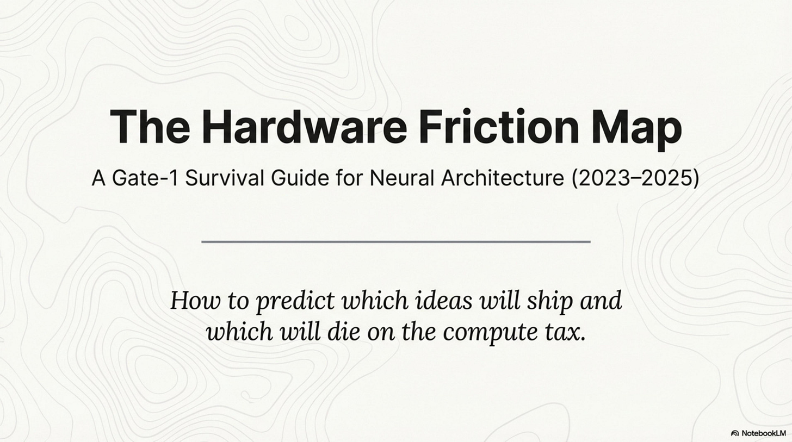

## A Gate-1 Survival Guide for Neural Architecture (2023–2025)

---

In December 2024, DeepSeek shipped V3—a 671B-parameter model with 256 experts. Training it required rewriting the entire cluster scheduler, custom-building routing kernels, and six months of dedicated infrastructure work before the first training run began. The architecture paper devotes **three full pages** to distributed expert placement alone.

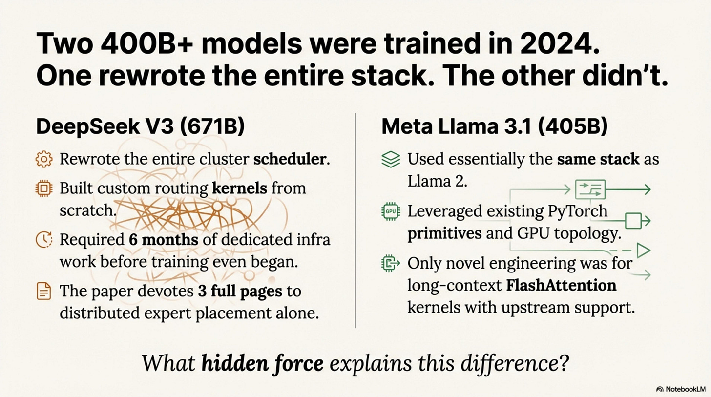

Three months earlier, Meta trained Llama 3.1 405B using essentially the same stack as Llama 2. Same PyTorch primitives. Same GPU topology. Same serving infrastructure. The only novel engineering was for long-context FlashAttention kernels that already had upstream support.

Both models pushed to 400B+ parameters. One required rebuilding the infrastructure from scratch. The other didn’t. **This is the friction map.**

---

## Introduction

The last two years of neural architecture on GPU-based LLM stacks can be summarized in one sentence: **Economics determines what survives.**

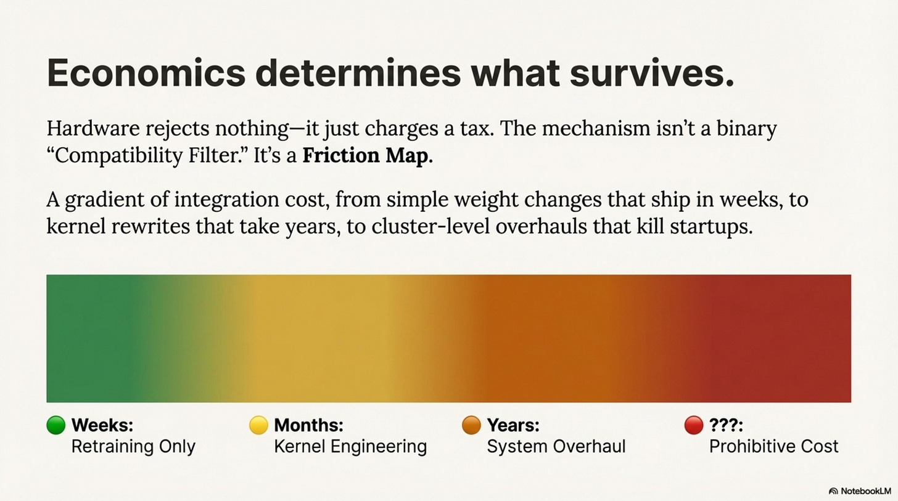

Hardware rejects nothing—it just charges a tax. You can run KANs. You can run pure Neural ODEs. They just cost 100× more per token than a dense matrix multiplication. The mechanism isn’t a binary “Compatibility Filter.” It’s a **Friction Map**—a gradient of integration cost from weight-only changes that ship in weeks, to kernel rewrites that take years, to cluster-level overhauls that kill startups.

This essay is about **Gate 1: hardware and infrastructure viability**. Once an idea clears this gate, later gates—optimization behavior, scaling laws, data quality—decide which low-friction architectures actually win. LSTMs, for example, were hardware-viable but lost to Transformers at Gates 2–3 because they scaled worse and trained less reliably at frontier sizes.

---

## The Four Friction Zones

Modern AI hardware heavily subsidizes specific behaviors: dense matrix multiplications (GEMMs) on tensor cores, hierarchical memory reuse (SRAM tiling), and massive data parallelism. The further you deviate from these primitives, the higher your **Hardware Friction**—the engineering and compute cost required to make the architecture viable.

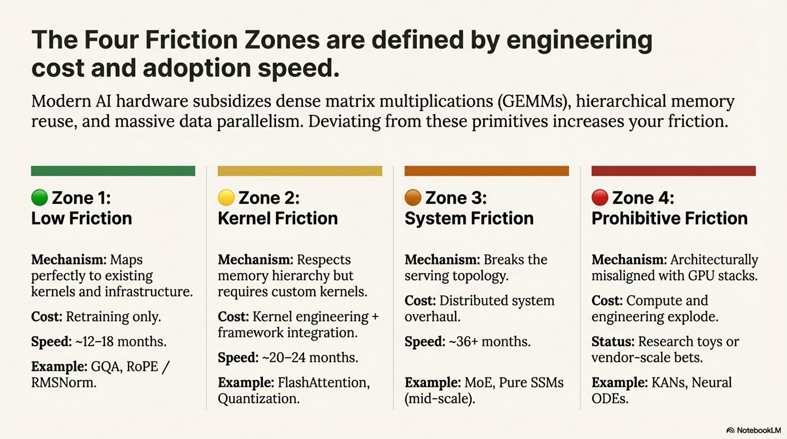

### Zone 1: Low Friction (🟢 Green)

*Techniques that map perfectly to existing kernels and infrastructure.*

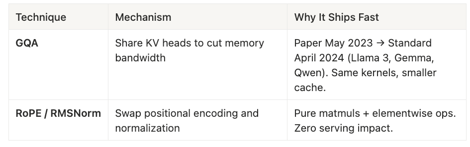

**Cost:** Retraining only.

**Adoption Speed:** ~12–18 months (one retrain cycle).

Grouped Query Attention (GQA) exemplifies this zone. By sharing KV heads across multiple query heads, it cuts memory bandwidth requirements without touching the kernel layer. The paper appeared in May 2023; by April 2024, GQA was standard in Llama 3, Gemma, and Qwen all using identical kernels, just with smaller KV caches.

Similarly, RoPE and RMSNorm are pure weight-space changes: swapping positional encoding or normalization layers requires only retraining, since both map to standard matmuls and elementwise operations. They have zero serving impact and ship as fast as labs can complete a training run.

### Zone 2: Kernel Friction (🟡 Yellow)

*Techniques that respect the memory hierarchy but require custom kernels.*

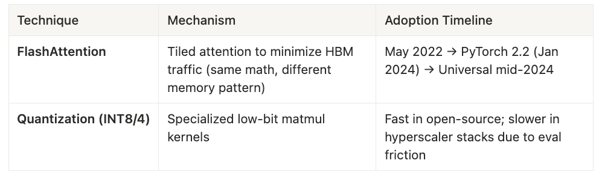

**Cost:** Kernel engineering + framework integration.

**Adoption Speed:** ~20–24 months, sometimes gated by eval/safety validation.

FlashAttention is the canonical example—tiled attention that minimizes HBM traffic by keeping intermediate states in on-chip SRAM. The math is identical to standard attention, but the memory access pattern is fundamentally different. Despite demonstrating 2-4× speedups from day one, FlashAttention took 20 months to reach universal adoption.

Quantization (INT8/4 matmuls) follows a similar pattern: custom kernels are straightforward to write, but integrating them into production stacks—especially hyperscaler environments that require extensive numerical validation—adds another year to the timeline

### Zone 3: System Friction (🟠 Orange)

*Techniques that break the serving topology.*

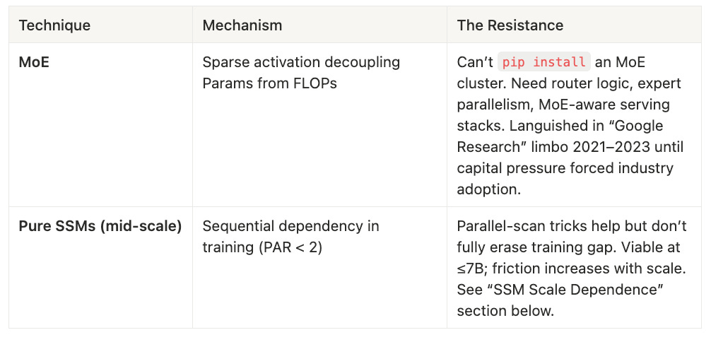

**Cost:** Distributed system overhaul (routing, load balancing, state management).

**Adoption Speed:** ~36+ months.

Mixture-of-Experts is the template here. Sparse activation decouples parameter count from FLOPs, but you cannot `pip install` an MoE cluster. Router logic, expert parallelism, and MoE-aware serving stacks must be built from scratch. MoE languished in “Google Research limbo” from 2021 to 2023, ignored by industry until capital pressure to scale beyond dense models became unbearable.

Pure State Space Models at mid-scale (≤7B parameters) also live in this zone. Sequential dependencies in training create a compute tax that parallel-scan tricks reduce but do not eliminate. The friction is survivable at 7B but compounds dramatically beyond 13B.

### Zone 4: Prohibitive Friction (🔴 Red)

*Techniques architecturally misaligned with current GPU stacks.*

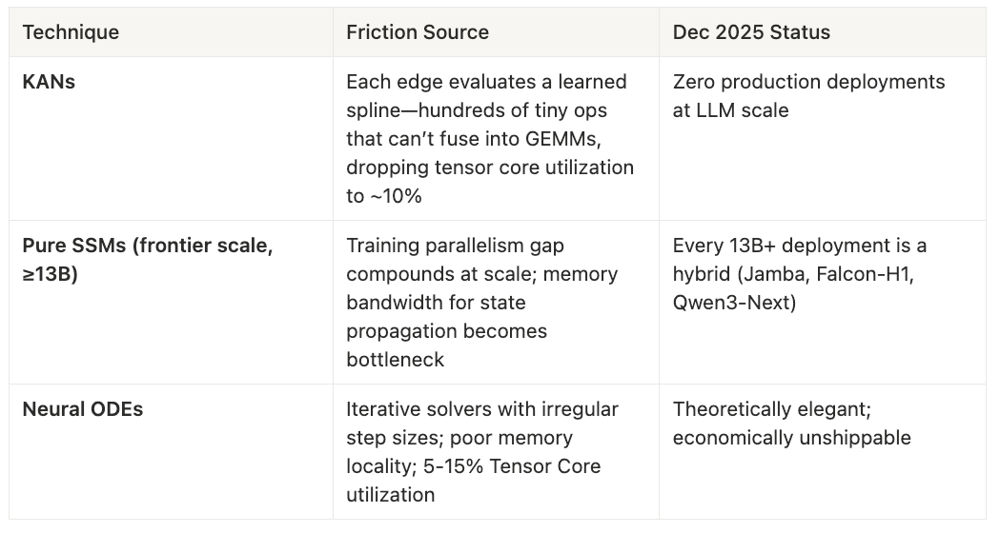

**Cost:** Both compute and engineering explode.

**Status:** Research toys or vendor-scale bets only.

Kolmogorov-Arnold Networks (KANs) exemplify architectural incompatibility. Each edge evaluates a learned spline function—hundreds of tiny, irregular operations that cannot batch into dense matmuls. Tensor core utilization drops to roughly 10%. As of December 2025, there are zero production deployments at LLM scale. Pure SSMs at frontier scale (≥13B parameters) face different but equally brutal friction: the training parallelism gap compounds with model size, and memory bandwidth for sequential state propagation becomes the bottleneck.

Every 13B+ SSM deployment in production is a hybrid—Jamba, Falcon-H1, Qwen3-Next all pair state-space blocks with attention layers. Neural ODEs round out this zone: iterative solvers with irregular step sizes thrash GPU caches and achieve 5-15% tensor core utilization. Theoretically elegant, economically unshippable.

---

## FlashAttention: The Yellow Zone Template

FlashAttention is the canonical example of kernel friction—technically beneficial from Day 1, but taking 20+ months to reach universal adoption:

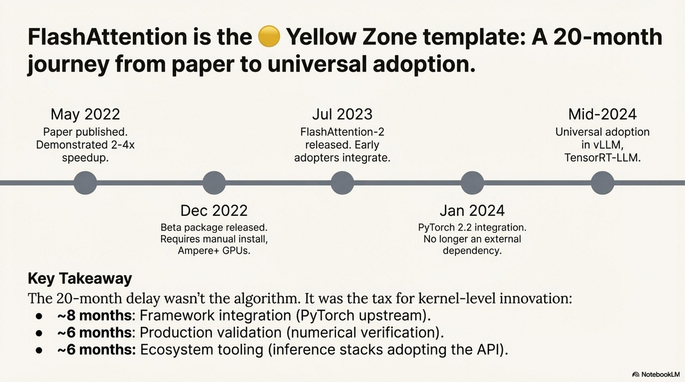

FlashAttention is the canonical example of kernel friction—technically beneficial from Day 1, but taking 20+ months to reach universal adoption. The paper appeared in May 2022 (arXiv:2205.14135), demonstrating 2-4× speedup and memory savings. Six months later, a beta `flash-attn` package shipped (v0.2), but it required manual installation and worked only on Ampere-generation GPUs.

FlashAttention-2 arrived in July 2023 with improved parallelism, and early adopters like Meta and Mistral began integrating it into training pipelines. The breakthrough came in January 2024 when PyTorch 2.2 integrated FlashAttention-v2 directly into `scaled_dot_product_attention`, eliminating the external dependency.

By mid-2024, universal adoption was complete—vLLM, TensorRT-LLM, and every major inference stack defaulted to FlashAttention.

**Why 20 months?** Not because FlashAttention was hard to write—the core kernel existed in 2022. The delay was:

1. **Framework integration** (~8 months): Getting upstream into PyTorch required API standardization and extensive testing
2. **Production validation** (~6 months): Hyperscalers needed to verify identical numerical behavior at scale
3. **Ecosystem tooling** (~6 months): Inference stacks (vLLM, TGI) needed to adopt the new API

This is the tax for kernel-level innovation: even when the algorithm works, **the ecosystem takes 2 years to catch up**.

---

## MoE: The Orange Zone Template

Mixture-of-Experts tells a different story—36+ months from “research curiosity” to “production standard,” because the friction was *systemic*, not just kernel-level:

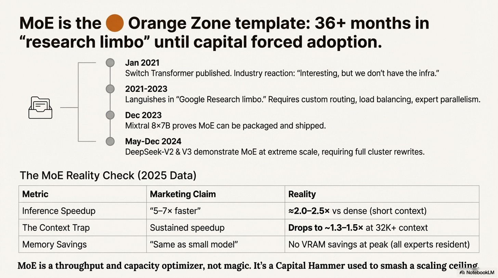

The Switch Transformer appeared in January 2021 (Google, arXiv:2101.03961), demonstrating MoE at 1.6T parameters. Industry reaction: “Interesting, but we don’t have the infrastructure.”

For the next two years, MoE languished in “Google Research limbo.” There was no open-source MoE stack. Custom routing, load balancing, and expert parallelism had to be built from scratch. Training runs required full-time infrastructure teams. The breakthrough came in December 2023 when Mistral released Mixtral 8×7B—the first open-source MoE that actually mattered, competitive with Llama 2 70B at a fraction of the inference cost. Mixtral proved MoE could be packaged. Six months later, DeepSeek-V2 (236B total, 21B active) demonstrated MoE with Multi-head Latent Attention (MLA) at scale and optimized routing.

Then in December 2024, DeepSeek-V3 arrived: 671B total parameters, 37B active, 256 experts. The team rewrote the entire cluster scheduler. Three full pages of the architecture paper are devoted to expert placement alone. DeepSeek-V3 set new throughput benchmarks.

**Why 36+ months?** MoE didn’t just need kernels—it needed:

1. **Routing logic:** Top-k selection, load balancing, auxiliary losses
2. **Expert parallelism:** Distributing 256 experts across nodes
3. **MoE-aware serving:** vLLM and TensorRT-LLM only added robust MoE support in late 2024
4. **Capital commitment:** No one would pay the engineering tax until dense models hit scaling ceilings

MoE is the perfect example of **overcoming friction with capital**. It didn’t “pass” a filter—it sat in the High Friction zone until the economic pressure to scale beyond dense models became unbearable. Labs like DeepSeek and Meta paid the massive engineering tax to make it work.

**The MoE Reality Check (2025 Data):**

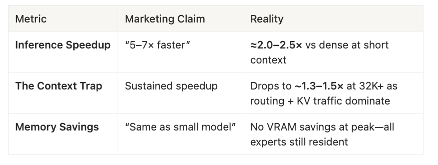

MoE is a **throughput and capacity optimizer**, not a magic bullet. It’s a Capital Hammer that frontier labs used to smash through a throughput ceiling.

---

## SSM Scale Dependence: The 7B Cliff

The friction zone for State Space Models is **not constant—it depends on scale**. This nuance is critical for understanding why Mamba simultaneously “works” and “fails”:

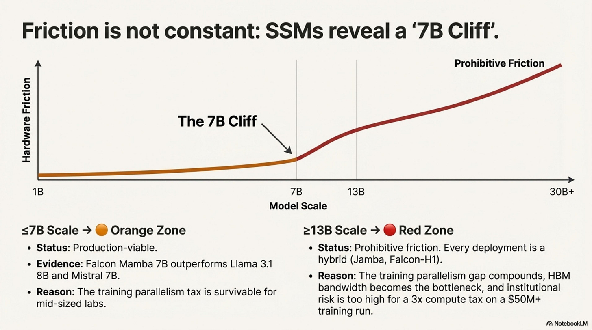

**At ≤7B scale (🟠 Orange Zone):** Pure SSMs are production-viable. Falcon Mamba 7B (September 2024) outperformed Llama 3.1 8B and Mistral 7B on multiple benchmarks while offering faster inference. The training parallelism penalty exists but is survivable—community teams and mid-sized labs can absorb the compute tax. Mamba-1 and Mamba-2 at 130M–2.8B parameters match same-scale Transformers across the board.

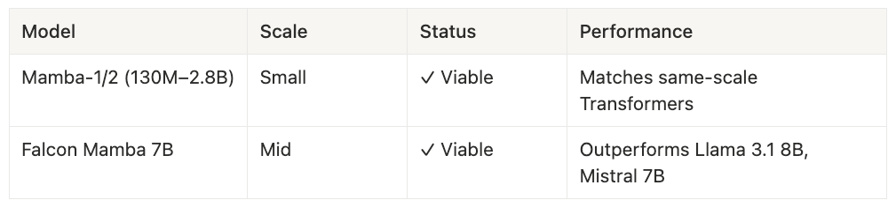

**At ≥13B scale (🔴 Red Zone):** The friction becomes prohibitive. Every 13B+ deployment is a hybrid—state-space blocks for local and sequential structure paired with attention layers for global routing. Jamba (AI21, 52B active parameters) uses attention to handle “routing” across experts. Falcon-H1 (140B total) deploys SSM blocks for local context and attention for global dependencies. Qwen3-Next (unreleased) is betting on the hybrid architecture for long-context efficiency. The training parallelism gap compounds: what’s a 1.5× compute tax at 7B becomes a 3-5× tax at 65B due to communication overhead in distributed training.

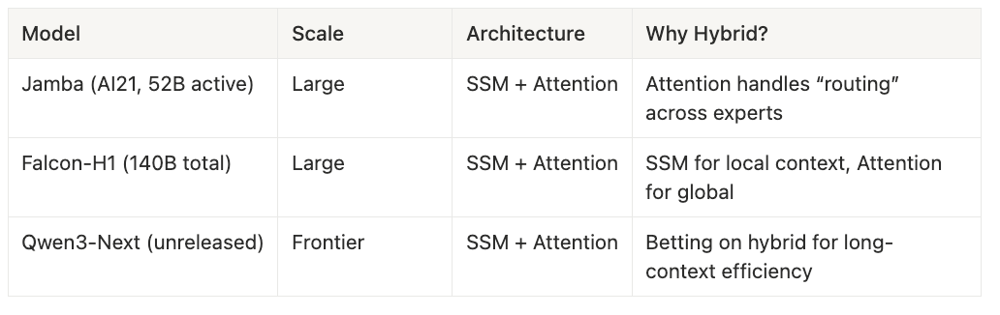

**Why the cliff at 13B?**

1. **Training parallelism**: SSM’s sequential dependency requires more synchronization across GPUs. At 7B on 8 GPUs, the overhead is tolerable. At 65B on 512 GPUs, it dominates.
2. **Memory bandwidth**: SSM hidden state must propagate sequentially. At scale, HBM bandwidth becomes the bottleneck, not compute.
3. **Institutional risk**: Labs willing to spend $50M+ on a training run won’t accept a 3× compute tax when hybrids offer SSM benefits with Transformer reliability.

**The practical heuristic:** If you’re building at ≤7B, pure SSM is a legitimate option (Orange zone). If you’re building at ≥13B, plan for a hybrid or accept Red-zone friction.

---

## The Startup Heuristic: Moat vs. Death

This Friction Map is not symmetric. It depends on your bank account.

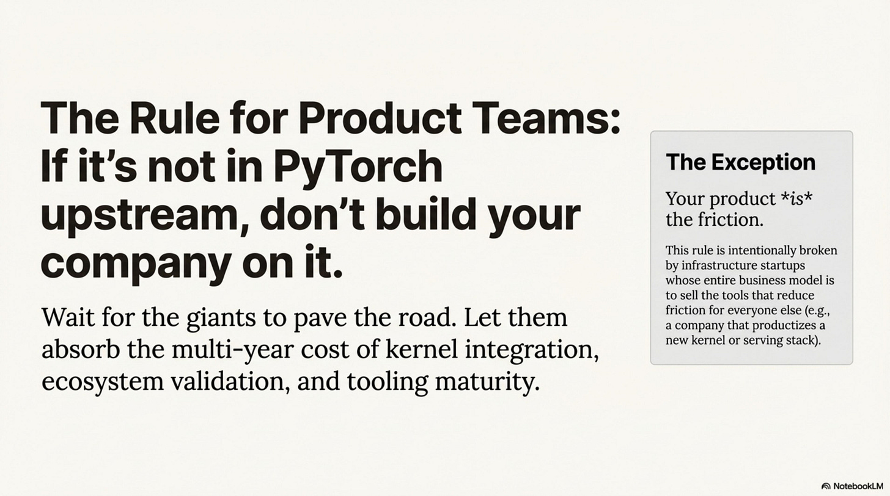

For Google, Meta, and DeepSeek, high friction is a **moat**. They have the capital to burn through 36 months of kernel development and cluster scheduling rewrites. When they make MoE work—when they ship DeepSeek-V3 with 256 experts on a custom serving stack—they’ve built something you can’t replicate. The friction that killed a dozen startups becomes their competitive advantage.

For startups, high friction is **death**. Betting on a Red Zone architecture means burning your runway debugging CUDA kernels while your competitors ship products. You’ll spend eighteen months building infrastructure that a frontier lab built with a dedicated team—and you still won’t catch up, because they’re iterating six months ahead of you.

> The Rule (for product teams): If it’s not in PyTorch upstream, don’t build your company on it. Wait for the giants to pave the road.
>
> **The Exception:** If you are an infra startup, you’re breaking this rule on purpose—because *your product is the friction*.

---

## The Hardware Friction Scorecard

Turn intuition into a repeatable rubric. This scorecard decomposes Gate-1 friction into five measurable axes.

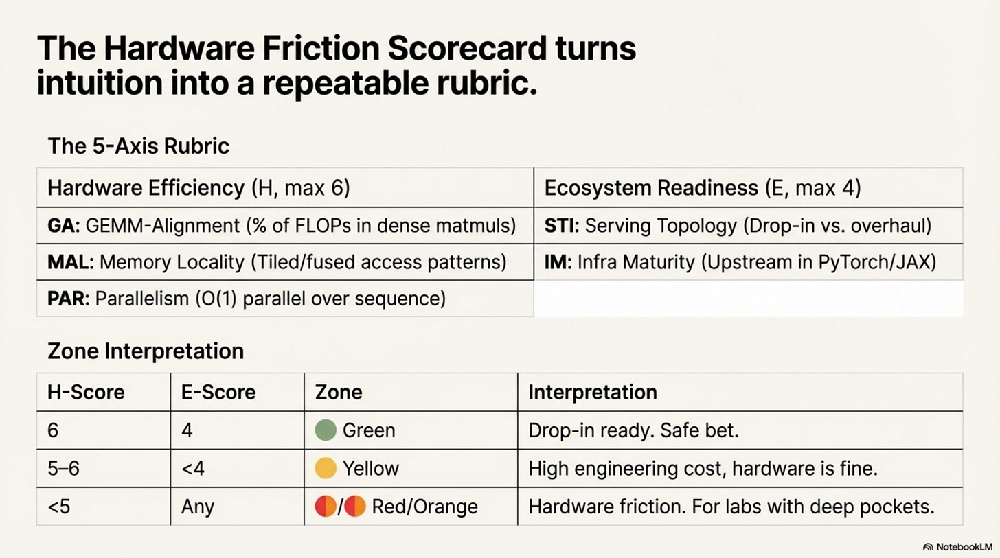

### The 5-Axis Rubric

**Hardware Efficiency (H, max 6)**

The H-Score is the sum of GA, MAL, and PAR—how well the architecture fits GPU primitives, scored 0 to 6.

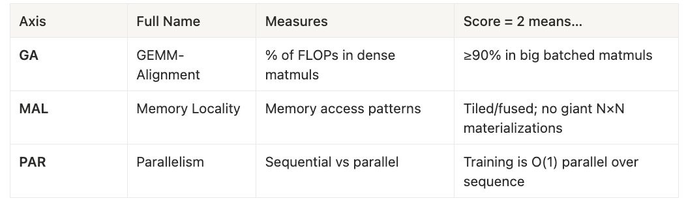

**Ecosystem Readiness (E, max 4)**

The E-Score is the sum of STI and IM—how much ecosystem work remains, scored 0 to 4. Together, they place every architecture in one of four friction zones.

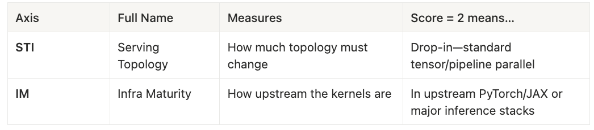

**Composite Scores:**

- **H-Score = GA + MAL + PAR** (0–6)
- **E-Score = STI + IM** (0–4)

### Zone Interpretation

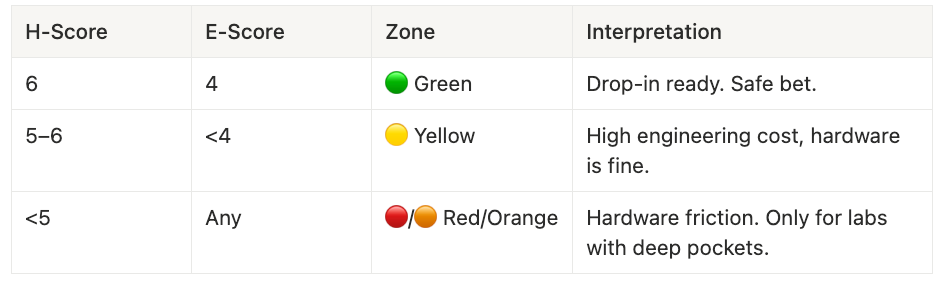

### Worked Examples

**Vanilla Transformer + FlashAttention** scores H = 6, E = 4, placing it firmly in the Green zone. All heavy lifting is dense matmuls, FlashAttention turns attention into a tiled SRAM-resident kernel, the serving topology remains unchanged, and the kernels are upstream in PyTorch.

- **H = 6, E = 4 → 🟢 Green**

**Mixtral-8×7B (MoE)** scores H ≈ 5, E = 3, landing in the Yellow zone. The experts themselves are standard feed-forward networks with excellent GEMM alignment, and routing is small matmuls plus top-k selection. The friction comes from serving topology changes: router logic, expert parallelism, and MoE-aware inference stacks.

- **H ≈ 5, E = 3 → 🟡 Yellow**

**Pure Mamba (Falcon Mamba 7B)** scores H ≈ 4, E = 3, placing it in the Orange zone. Input and output projections are dense matmuls, but the core SSM operation—a parallel scan—is less tensor-core friendly. It’s viable at 7B scale, but friction increases dramatically beyond 13B.

- **H ≈ 4, E = 3 → 🟠 Orange**

**KANs** score H ≈ 2, E ≈ 0, firmly in the Red zone. Per-edge spline evaluation cannot batch into GEMMs. The architecture produces many tiny, irregular operations that thrash caches and starve tensor cores. As of December 2025, there is no robust LLM-scale implementation—only research code.

- **H ≈ 2, E ≈ 0 → 🔴 Red**

**How to use this on a new technique:** Score each axis (0, 1, or 2) based on the rubric definitions above. Sum GA, MAL, and PAR to compute the H-Score. Sum STI and IM to compute the E-Score. Map the resulting scores to the zone interpretation table. Then ask yourself the critical question: “Can I afford this friction given my resources?”

Here is [a public dataset of 100+ scored architectures](https://github.com/petroslamb/hardware-friction-scorecard-dataset) on Github, open for contributions.

---

## Falsifiable Predictions

A useful friction heuristic is one you can test in public. Here are the bets—designed to be **crisp, measurable, and risky**:

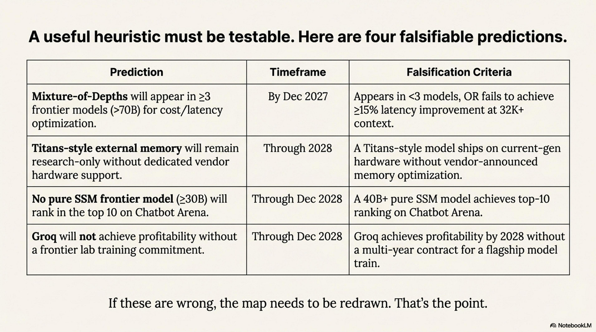

These predictions are designed to be **falsifiable**—if any are wrong, the friction map needs to be redrawn. That’s the point.

---

## Conclusion: The Geometry of What Ships

We are not designing neural networks on a whiteboard. We are leasing time on silicon heaters.

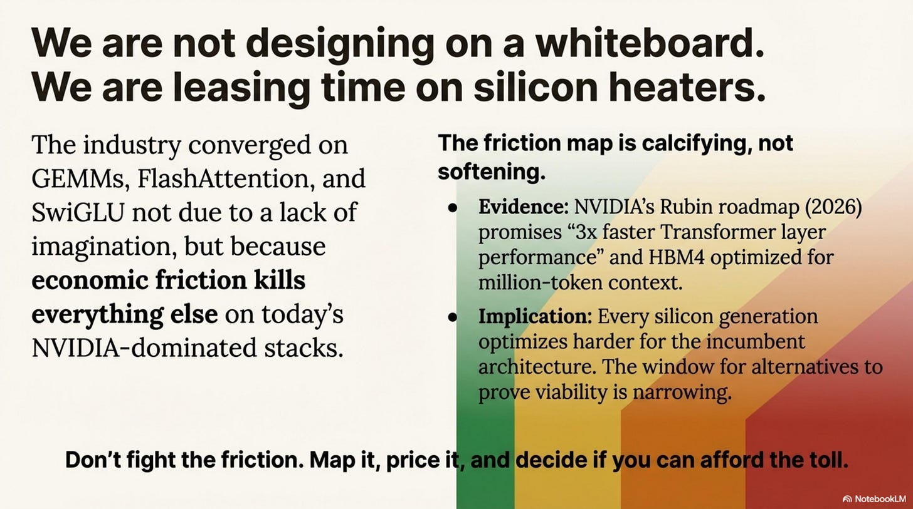

The industry has converged on a narrow set of primitives—GEMMs, FlashAttention, SwiGLU—not because we lack imagination, but because **economic friction kills everything else** on today’s NVIDIA-dominated GPU stacks. Innovation hasn’t stopped. It has moved to where the friction is lower: **Training** (post-training, data curation) and **Hybrids** (MoE, Attention+SSM).

**The friction map is calcifying, not softening.** NVIDIA’s Rubin roadmap (2026) promises “3× faster Transformer layer performance” and HBM4 optimized for million-token context. Every silicon generation optimizes harder for GEMMs. The window for alternative architectures to prove viability is narrowing—not because alternatives can’t work, but because the cost of making them work rises with every hardware generation.

Don’t fight the friction. Map it, price it, and decide if you can afford the toll.

The Transformer doesn’t need to be optimal. It just needs to be **good enough—and too expensive to escape**.

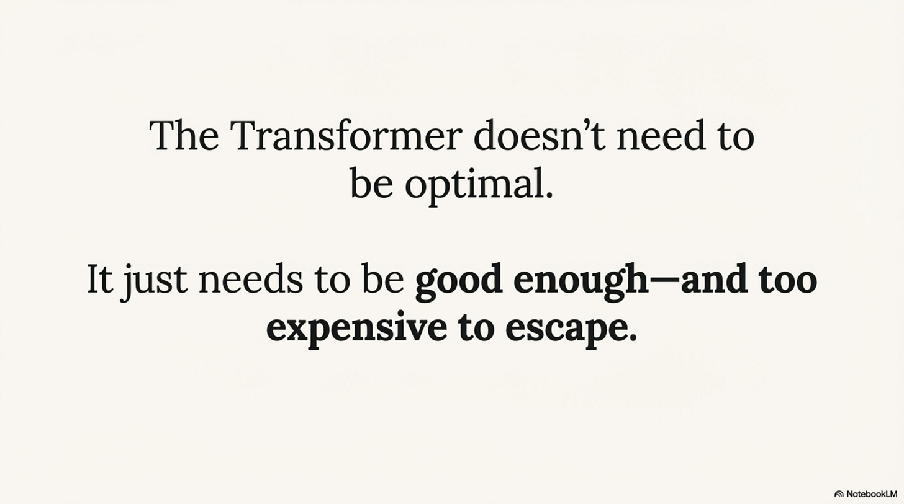

---

# Appendix B — Pure SSM Scale and Hybrid Dominance

**Where Pure Mamba/SSM Exists (as of Dec 2025)**

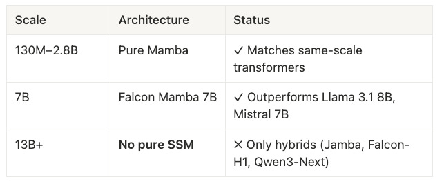

---

# Appendix C — Gate-1 Friction Zones (Summary Table)

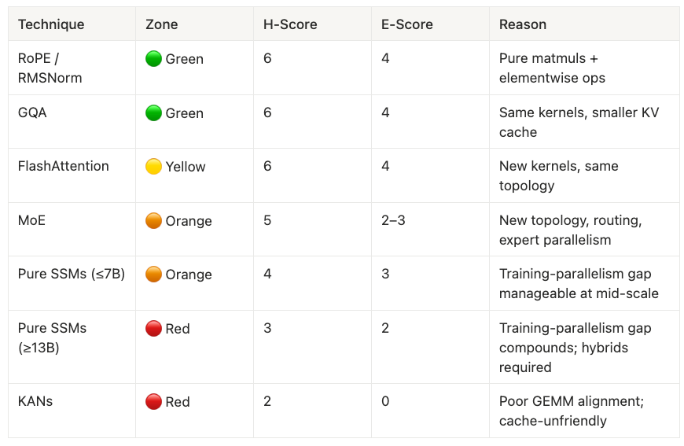

---

# Appendix D — References (Selected)

- [The Dataset of 100+ Scored Architectures on Github](https://github.com/petroslamb/hardware-friction-scorecard-dataset), open for contributions

**Mixture-of-Experts**

- Fedus et al., 2021 — *“Switch Transformers”* (arXiv:2101.03961)
- DeepSeek-V3 and DeepSeek-R1 technical reports (2024–2025)
- Mixtral-8×7B technical report (Mistral, 2023)
- Meta Llama 4 (Scout/Maverick) model cards

**FlashAttention**

- Dao et al., 2022 — *“FlashAttention”* (arXiv:2205.14135)
- Dao et al., 2023 — *“FlashAttention-2”* (arXiv:2307.08691)
- PyTorch 2.2 release notes (Jan 2024)

**SSM / Mamba**

- Gu et al., 2021 — S4 (arXiv:2111.00396)
- Gu & Dao et al., 2023 — Mamba (arXiv:2312.00752)
- Falcon Mamba 7B, Jamba, Falcon-H1, Qwen3-Next technical reports

**Core LLM Architectures**

- Llama 2/3/4 (Meta), Gemma 2 (Google), Qwen2.5 (Alibaba), Mistral 7B, DeepSeek-V2/V3/R1

For the full bibliography, see the research notes linked alongside this essay and the [scored architectures dataset on GitHub](https://github.com/petroslamb/hardware-friction-scorecard-dataset).

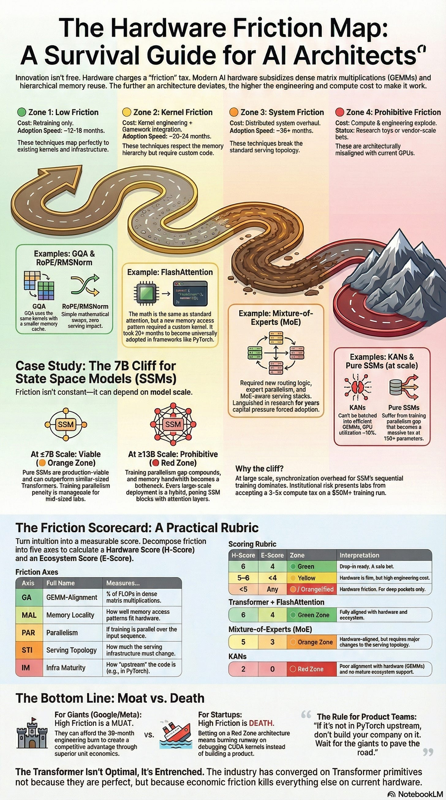

Thanks for reading Petros Rooted Layers! Subscribe for free to receive new posts and support my work.
