# The Orchestration Paradigm: Issue 4 - The Reality

Date: 2025-12-29
URL: https://lambpetros.substack.com/p/the-orchestration-paradigm-issue-397

***NOTE:** The video acts as a TL;DR. click on the audio toggle next to it to get the DEEP podcast EXPLAINER. The written post lies BETWEEN the two.*

[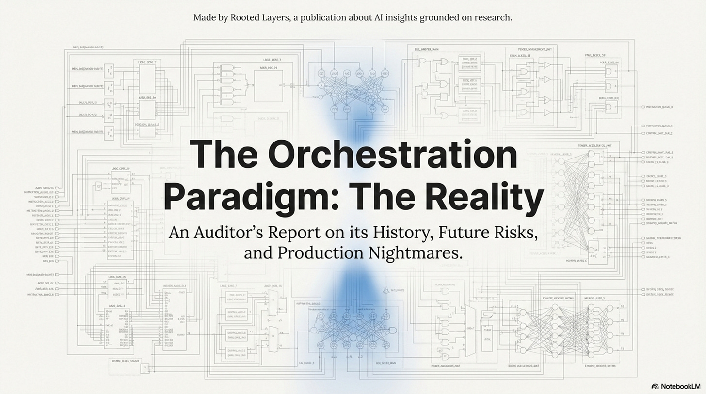](https://substackcdn.com/image/fetch/$s_!Jg0w!,f_auto,q_auto:good,fl_progressive:steep/https%3A%2F%2Fsubstack-post-media.s3.amazonaws.com%2Fpublic%2Fimages%2F4789d58f-4b12-4f05-9be6-8ba493c9bab2_2867x1600.png)

If you ask a Research Scientist about agents, they will talk about Chain-of-Thought and recursive reasoning. If you ask a Production Engineer, they will talk about infinite loops, 50-second latencies, and bills that bankrupt the department. **This final issue is not for the dreamers. It is for the builders.**

In this final issue, we connect the dots. We trace the lineage from **Chain-of-Thought** to **ToolOrchestra** to understand *why* the industry is shifting this way, map the **unsolved frontiers** (recursive coordination, tool synthesis) that prevent full autonomy, and create a **brutal decision tree** for engineers deciding whether to adopt this architecture right now.

## How to Read This Series

**Each part is self-contained.** You can read them in order or jump to whichever topic interests you most. Every part ends with an **Annotated Bibliography** pointing to the primary papers with notes on why each one matters.

* **ML practitioners** will learn how to build orchestrated systems.
* **Researchers** will find a comprehensive literature review of tool use and compound AI through the lens of one well-executed paper.
* **Technical leaders** will get concrete cost and performance trade-offs for evaluating orchestration architectures.
* **Curious minds** can understand where AI is heading without needing a PhD to follow along.

### Prerequisites

This series assumes familiarity with machine learning basics like loss functions and gradient descent, neural network fundamentals including attention and transformers, and Python programming sufficient to read pseudocode.

If you’re newer to these topics, **Parts 02 and 10** include appendices covering RL and agency fundamentals. Start with **Issue 1** for the core thesis, then jump to **Issue 4** for strategic implications. If you’re purely interested in business implications, **Part 12** has the CTO decision tree and unit economics.

---

# The Orchestration Paradigm: Issue 4 - The Reality

> Issue 4: The Reality | Parts 10, 11, 12 This bundle covers the lineage of agentic AI, unsolved frontiers, and production deployment risks.

[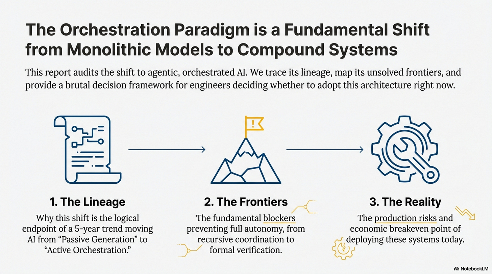](https://substackcdn.com/image/fetch/$s_!QQ74!,f_auto,q_auto:good,fl_progressive:steep/https%3A%2F%2Fsubstack-post-media.s3.amazonaws.com%2Fpublic%2Fimages%2Fce4b24d7-9106-4cda-aa99-9fab0c3b3aee_2867x1600.png)

## Part 10: Lineage and Theory

### The Evolution of Action

> [!NOTE] System Auditor’s Log: To understand the future, we trace the lineage. ToolOrchestra is not a random mutation; it is the logical endpoint of a 5-year trend moving AI from “Passive Generation” to “Active Orchestration.” This Part merges the historical context with the theoretical “Compound AI” thesis to explain why the industry is shifting this way.

The history of Agentic AI is essentially the history of the **Action Operator (*****A*****)**. Originally, Language Models only had one operator, `generate_token()`, existing as isolated brains in a jar.

[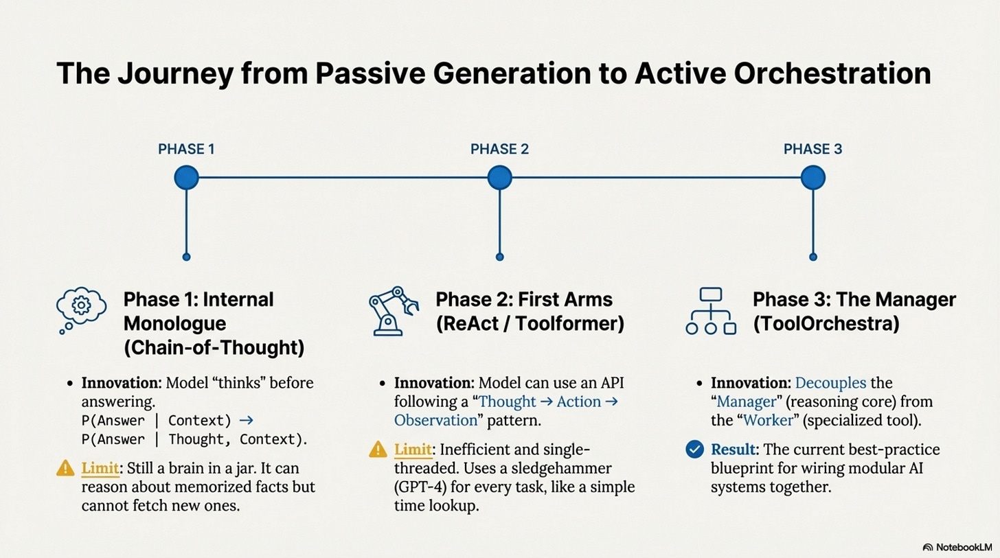](https://substackcdn.com/image/fetch/$s_!IzK8!,f_auto,q_auto:good,fl_progressive:steep/https%3A%2F%2Fsubstack-post-media.s3.amazonaws.com%2Fpublic%2Fimages%2Fc4c4a029-8990-4960-a08a-546ce160ba4f_2867x1600.png)

**Phase 1** brought the **Internal Monologue (Chain-of-Thought)**, allowing the model to “talk to itself” before answering. This innovation proved that intermediate tokens could represent “thinking,” but the model was still limited to hallucinating about facts it had memorized.

**Phase 2** introduced the **First Arms (Toolformer / ReAct)** by giving the model an API. While revolutionary, these single-threaded loops were inefficient, often using a sledgehammer (GPT-4) to crack a nut (Time Lookup).

**Phase 3** is the **Manager (ToolOrchestra / Compound AI)**. The “**Compound AI**” thesis posits that monolithic models have hit diminishing returns—training a 10x larger model yields less than 10x better reasoning, while composing specialized models can yield more than 10x better performance/cost. ToolOrchestra implements this by treating “Intelligence” not as a single model’s weights, but as the **flow of information** between specialized components.

### Why Composition Beats Scale

Formally, this is about **Error Correction** and **Specialization**.

[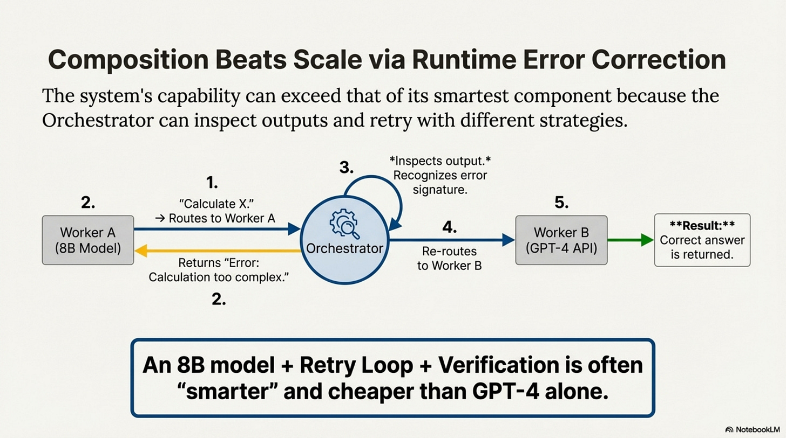](https://substackcdn.com/image/fetch/$s_!pmr2!,f_auto,q_auto:good,fl_progressive:steep/https%3A%2F%2Fsubstack-post-media.s3.amazonaws.com%2Fpublic%2Fimages%2F36db9d51-5f7d-4113-b136-d2a63bd0f4f6_2867x1600.png)

In a monolith, if one layer hallucinates, the error propagates forward with no feedback loop to “catch” it. In a compound system, the Orchestrator inspects the output of Worker A. If it looks wrong, the Orchestrator routes to Worker B. This **Runtime Error Correction** extends the capability of the system beyond the capability of its smartest component. The 8B model is “dumber” than GPT-4, but `8B + Retry Loop + Verification Tool` is often “smarter” than `GPT-4 (Zero Shot)`.

This lineage suggests that the “**God Model**” (one model to do it all) is an economic dead end. The future is likely **Modular**, composed of gigantic frozen **Knowledge Bases**, tiny agile **Reasoning Cores**, and deterministic **Compute Engines**.

### Annotated Bibliography

**Wei et al. (2022)** - *Chain-of-Thought Prompting Elicits Reasoning in Large Language Models*: The “Phase 1” breakthrough that proved intermediate tokens could represent “thinking.”

**Yao et al. (2023)** - *ReAct: Synergizing Reasoning and Acting in Language Models*: The “Phase 2” breakthrough that combined CoT with external tool actions in a single prompt loop.

**Zaharia et al. (2024)** - *The Shift from Models to Compound AI Systems*: The “Phase 3” manifesto (Berkeley AI Research) arguing for the modular, compound architecture that ToolOrchestra exemplifies.

[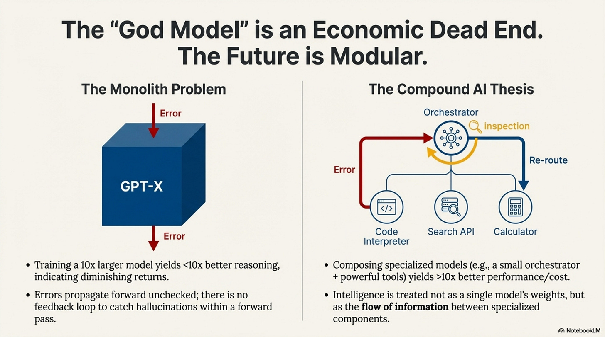](https://substackcdn.com/image/fetch/$s_!jEuF!,f_auto,q_auto:good,fl_progressive:steep/https%3A%2F%2Fsubstack-post-media.s3.amazonaws.com%2Fpublic%2Fimages%2F79403994-ef03-45ac-a91f-5cf2ad4eb89c_2867x1600.png)

---

## Part 11: Unsolved Frontiers

Currently, ToolOrchestra is a flat hierarchy: One Manager, many Workers. Real organizations are deep hierarchies. The problem is **Credit Assignment**. If the VP delegates to the Director, who delegates to the Worker, and the Worker fails, who gets the negative reward? Should the VP be punished for choosing the wrong Director? Or the Worker for failing?

### Recursive Orchestration (Turtles All the Way Down)

> [!NOTE] System Auditor’s Log: We have audited what works. Now we look at what keeps engineers up at night. These are not “future features”; these are fundamental blockers that prevent ToolOrchestra from running the world economy.

Consider a “**Research Agent**” that orchestrates three sub-agents.

[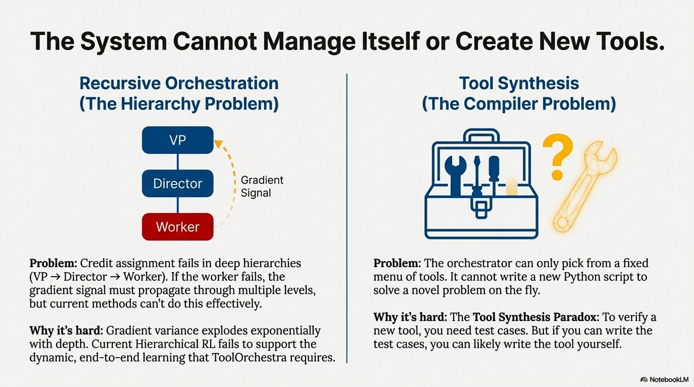](https://substackcdn.com/image/fetch/$s_!HX7m!,f_auto,q_auto:good,fl_progressive:steep/https%3A%2F%2Fsubstack-post-media.s3.amazonaws.com%2Fpublic%2Fimages%2Fb19acb87-f7f0-479c-8fcd-31841f3202bd_2867x1600.png)

If the final output is wrong because the ArXiv API returned stale data, the gradient signal must propagate through four levels of abstraction. Current GRPO cannot do this effectively because of **variance explosion**. In hierarchical settings, gradient variance scales **exponentially** with depth, making deep training computationally infeasible. Solving this requires breakthroughs in **Off-policy credit assignment** or **Hierarchical value functions**, neither of which are currently production-ready.

### Tool Synthesis (The Compiler Loop)

ToolOrchestra picks from a fixed menu; it cannot cook. If you need to “Convert .xyz file to .pdf” and there is no tool for it, the agent fails. A truly general agent would write the tool, verify it, save it, and then use it. The problem is **verification**. To verify a synthesized tool, you need test cases. To write test cases, you need to understand the problem well enough that you could probably just write the tool yourself. This is the **Tool Synthesis Paradox**.

### Continual Learning (The Optimization Drift Problem)

To add a new tool to ToolOrchestra, you can add its description and the orchestrator will route to it based on semantic similarity.

[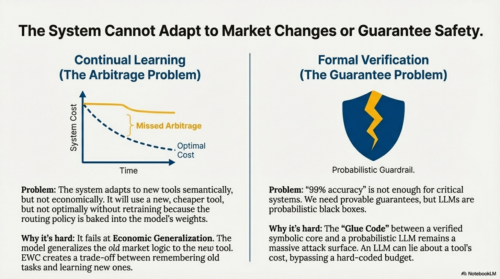](https://substackcdn.com/image/fetch/$s_!WHsU!,f_auto,q_auto:good,fl_progressive:steep/https%3A%2F%2Fsubstack-post-media.s3.amazonaws.com%2Fpublic%2Fimages%2F9e1ab1b1-c914-4de0-b6dd-d3966e81d491_2867x1600.png)

This is **Semantic Generalization**, and it works. However, **Economic Generalization** is fragile. The orchestrator learns market principles like “High-fidelity calculation is expensive.” If the market shifts and a new tool is both cheap and cheap, the learned heuristic fails. The model generalizes the old market logic to the new tool, resulting in missed arbitrage. This requires **In-context adaptation** via retrieval-augmented routing rather than baking preferences into weights.

### Formal Verification

We can verify code, but we cannot verify standard LLMs. For an agent to control a bank account, “99% accuracy” is insufficient. Current LLM safety mechanisms like content filters and prompt constraints are **probabilistic**. Formal verification provides **deterministic guarantees** but only for systems with known structure. The only viable path is a hybrid **Neuro-Symbolic Architecture** where a verified core enforces invariants (like budget limits) while the probabilistic LLM makes suggestions. The vulnerability lies in the interface between them—the verified core needs to validate LLM outputs without reimplementing the LLM’s capability.

### Annotated Bibliography

**Sutton et al. (1999)** - *Between MDPs and Semi-MDPs*: The theoretical basis for “Recursive Orchestration” and hierarchical credit assignment.

**Chen et al. (2021)** - *Evaluating Large Language Models Trained on Code*: Discusses “Program Synthesis,” the capability needed for an agent to write its own tools.

**D’Amour et al. (2020)** - *Underspecification Presents Challenges for Credibility in Modern Machine Learning*: A core text on why “Formal Verification” of neural networks is hard.

---

## Part 12: Production Engineering

### The Latency Tail and Cost Attacks

> [!NOTE] System Auditor’s Log: So you want to deploy this. You have your weights, your tools, and your Kubernetes cluster. Here is every way it will break in the first 24 hours.

[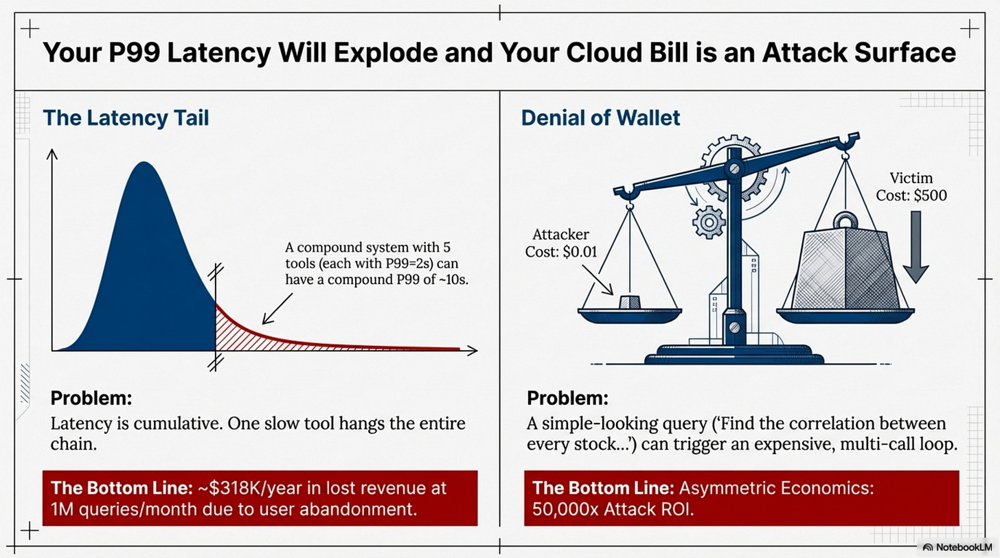](https://substackcdn.com/image/fetch/$s_!Bn_7!,f_auto,q_auto:good,fl_progressive:steep/https%3A%2F%2Fsubstack-post-media.s3.amazonaws.com%2Fpublic%2Fimages%2Fd69ab962-f06d-4122-8dcc-72c1d2de668a_2867x1600.png)

In a single model call, latency is predictable. In an orchestration loop, latency is **Cumulative**. If any single tool in the chain hangs, the entire request hangs. If you ignore this, your P99 latency will be dominated by the slowest tool in your chain, causing users to abandon the product. Revenue impact can be massive.

Similarly, the **Cost Attack (Denial of Wallet)** is a constant threat. A malicious user can frame a “simple” query that triggers an “expensive” loop, achieving a **50,000x attack ROI**. Without budget constraints and rate limiting, you will wake up to a $10,000 cloud bill and no recourse.

### The Debuggability Crisis and Versioning Hell

When a chatbot fails, you look at the chat log. When an orchestrator fails, you have a **Distributed Trace**.

[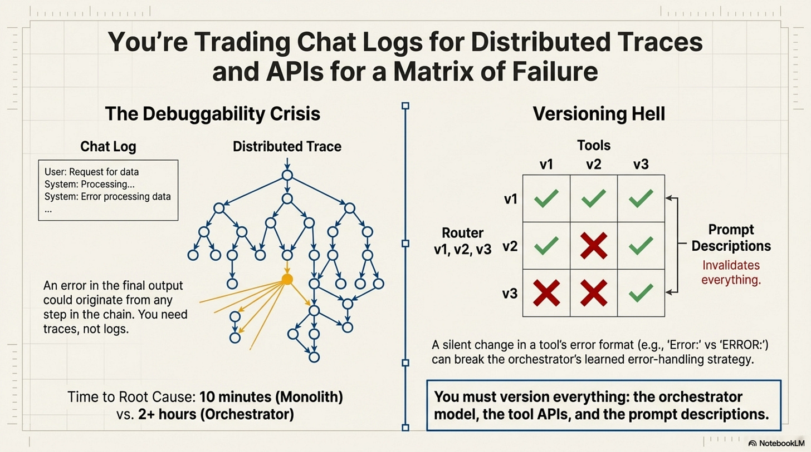](https://substackcdn.com/image/fetch/$s_!Pn4F!,f_auto,q_auto:good,fl_progressive:steep/https%3A%2F%2Fsubstack-post-media.s3.amazonaws.com%2Fpublic%2Fimages%2F2f79ce38-99ba-418b-b60f-fbc6640937a5_2867x1600.png)

Finding the root cause requires tracing every thought, action, and observation as a span. Without this, you will spend 10 hours debugging a production issue that a proper trace would have revealed in 10 minutes.

Furthermore, **Versioning Hell** is real. An orchestrator is tightly coupled to the exact behavior of its tools. If an API functionality or error format changes, the Router’s learned strategy might break. You must pin everything—dependencies, API versions, and models—or face silent degradation.

### The Breakeven Analysis

At what scale does orchestration pay off? Fixed costs for infrastructure are around **$200/month**. Variable costs per query for the orchestrator are roughly **$0.0028/query**, compared to **$0.008/query** for a GPT-5 monolith.

[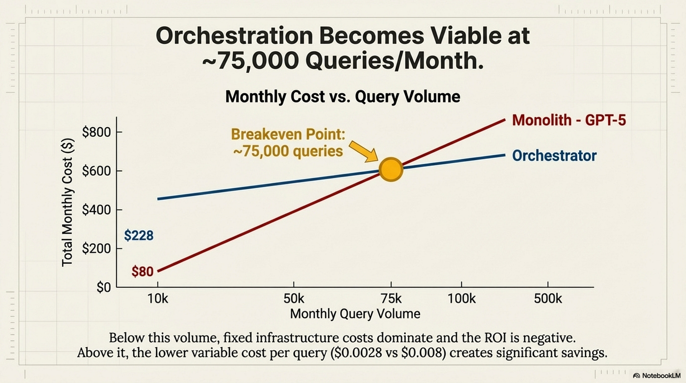](https://substackcdn.com/image/fetch/$s_!wtrD!,f_auto,q_auto:good,fl_progressive:steep/https%3A%2F%2Fsubstack-post-media.s3.amazonaws.com%2Fpublic%2Fimages%2Fee69a4dc-4d8f-4220-b6bb-bd2d39b782f1_2867x1600.png)

The Rule is that orchestration becomes viable at **~75,000 queries/month**. Below that, fixed infrastructure costs dominate.

### Should You Adopt Orchestration?

There are **Four Gates** to pass.

1. **Volume Gate (≥75K queries/month)**: Below this, fixed costs kill ROI.
2. **Team Gate (≥3 ML Engineers)**: To handle the 3x operational complexity.
3. **Latency Gate (P99 SLA ≥2s)**: Multi-hop adds significant latency.
4. **Stability Gate (Stable APIs)**: To avoid versioning hell.

[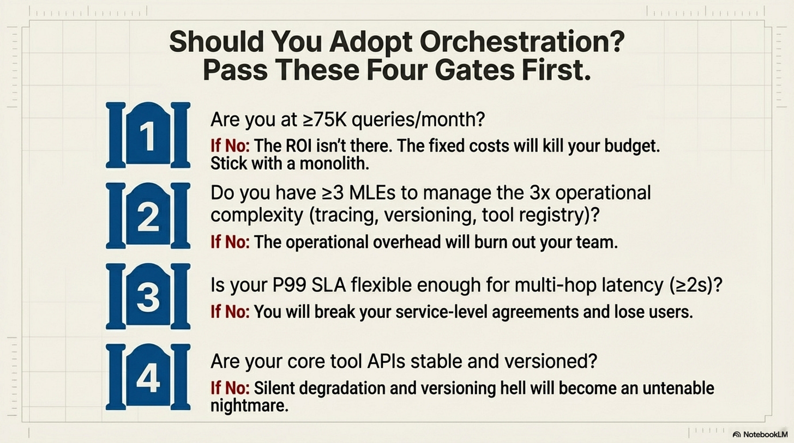](https://substackcdn.com/image/fetch/$s_!E_-v!,f_auto,q_auto:good,fl_progressive:steep/https%3A%2F%2Fsubstack-post-media.s3.amazonaws.com%2Fpublic%2Fimages%2F93573c26-5885-4784-ba3f-13306661857a_2867x1600.png)

If all gates pass, proceed with a 4-week rollout from shadow mode to canary to full ramp.

### Final Verdict

ToolOrchestra is a triumph of research. It proves we *can* teach models to adhere to a budget. **But for the production engineer, it is a bundle of new liabilities.** It trades “Hallucination Risk” (Monolith) for “System Complexity Risk” (Compound). Choose your poison carefully.

[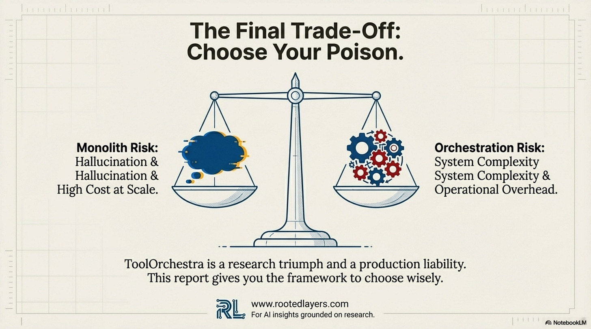](https://substackcdn.com/image/fetch/$s_!e1-w!,f_auto,q_auto:good,fl_progressive:steep/https%3A%2F%2Fsubstack-post-media.s3.amazonaws.com%2Fpublic%2Fimages%2F134a295d-5836-442b-87d7-99ad62de55c0_2867x1600.png)

This series was optimized for understanding, not replication. If you have the resources (16 H100s, expert team), you now have the conceptual foundation. If you don’t, you have the knowledge to evaluate vendors and a decision framework to know when to buy. Most organizations will consume orchestration as a managed service rather than building it themselves. Understanding the paradigm is more valuable than training your own orchestrator.

### Annotated Bibliography

**Dean et al. (2013)** - *The Tail at Scale*: The Google paper on distributed system latency. Explains why the “P99” of a compound system degrades expontentially with the number of components.

**OWASP Top 10 for LLM Applications (2023)**: Categorizes the “Cost Attack” (Resource Exhaustion) and “Prompt Injection” risks discussed in this audit.

**Sculley et al. (2015)** - *Hidden Technical Debt in Machine Learning Systems*: The classic Google paper arguing that “Glue Code” (the orchestration layer) is the primary source of technical debt in ML systems.

[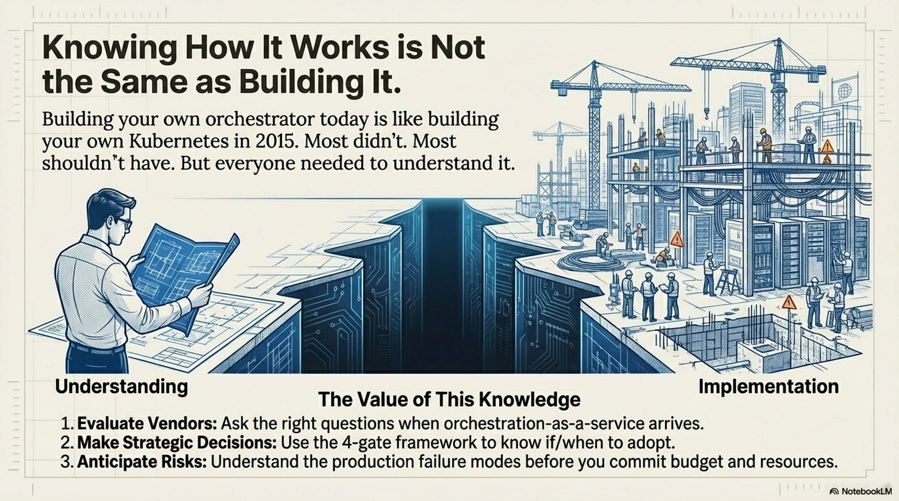](https://substackcdn.com/image/fetch/$s_!cJK4!,f_auto,q_auto:good,fl_progressive:steep/https%3A%2F%2Fsubstack-post-media.s3.amazonaws.com%2Fpublic%2Fimages%2F785f1844-d3e1-4e28-a2b3-f89f2afc3d09_2867x1600.png)

[Share](https://lambpetros.substack.com/p/the-orchestration-paradigm-issue-397?utm_source=substack&utm_medium=email&utm_content=share&action=share)

Consider commenting with your thoughts below, I will be glad to respond.

[Leave a comment](https://lambpetros.substack.com/p/the-orchestration-paradigm-issue-397/comments)

Otherwise, I will appreciate a **like**, if you found this series of value. Liking it is the *best signal for me to continue* the effort on such tedious multi-part work.

---

---

## Appendices

### Appendix: Research Connections (Optional)

This appendix connects ToolOrchestra to broader research themes. **Agency is distinct from Capability.** A model might have the capability to refuse harmful requests but not always recognize which requests are harmful. ToolOrchestra addresses the capability to solve problems versus knowing when to delegate—a form of “Agency.”

This also relates to **Weak-to-Strong Generalization**. ToolOrchestra inverts OpenAI’s program. Instead of asking if a weak supervisor can train a strong model, it asks if a weak model can supervise the deployment of strong models. The answer appears to be yes, suggesting a research agenda to map which meta-cognitive skills are orthogonal to object-level skills.

### Appendix: Reflective Cognition (Optional)

The orchestration problem is fundamentally a problem of **reflective cognition**: a system’s ability to reason about its own reasoning. Humans do this naturally; models do not. ToolOrchestra improves reflective cognition in the domain of tool use through reinforcement learning on outcomes. The principle is: if you want a model to reason about its own reasoning, train it on outcomes of its own reasoning, not just on outputs. Whether this generalizes to safety or honesty remains an open question, but the frame is suggestive. The 8B orchestrator does not need to know physics; it only needs to know that it does not know physics. That is a fundamentally simpler learning target.

---

Thanks for reading Rooted Layers! Subscribe for free to receive new posts and support my work.