# The Orchestration Paradigm: Issue 2 - The Factory

Date: 2025-12-29
URL: https://lambpetros.substack.com/p/the-orchestration-paradigm-issue

***NOTE:** The video acts as a TL;DR. click on the audio toggle next to it to get the very detailed PODCAST explainer.*

[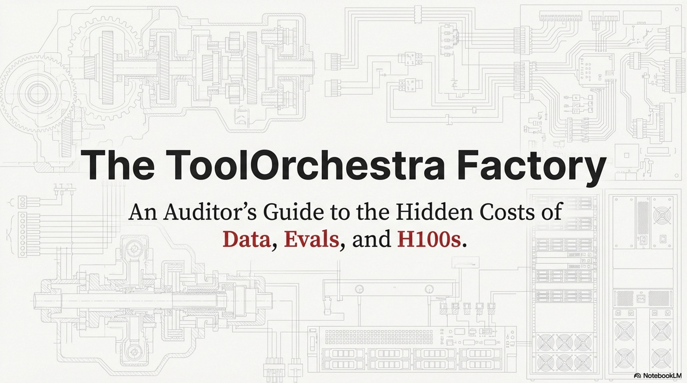](https://substackcdn.com/image/fetch/$s_!Uz9o!,f_auto,q_auto:good,fl_progressive:steep/https%3A%2F%2Fsubstack-post-media.s3.amazonaws.com%2Fpublic%2Fimages%2F2892ea57-733a-4d18-96dd-f8eda1883e5b_2867x1600.png)

While the headlines focus on the 8B model beating GPT-5, the real engineering breakthrough wasn’t the model itself. **It was the factory that built it.** You can download the model weights tomorrow. You cannot download the synthetic data pipeline that generated the training signal. That is the moat.

In this second issue, we leave the theoretical blackboard and enter the factory floor. We will analyze the **ToolScale synthetic data pipeline** that manufactures the training signal, audit the “**physics**” of benchmarking agents (where “**Goodhart’s Law**” reigns supreme), and dissect the massive infrastructure requirements—specifically why training stable RL policies requires **16 H100s** and specialized gradient accumulation techniques.

## How to Read This Series

**Each part is self-contained.** You can read them in order or jump to whichever topic interests you most. Every part ends with an **Annotated Bibliography** pointing to the primary papers with notes on why each one matters.

* **ML practitioners** will learn how to build orchestrated systems.
* **Researchers** will find a comprehensive literature review of tool use and compound AI through the lens of one well-executed paper.
* **Technical leaders** will get concrete cost and performance trade-offs for evaluating orchestration architectures.
* **Curious minds** can understand where AI is heading without needing a PhD to follow along.

### Prerequisites

This series assumes familiarity with machine learning basics like loss functions and gradient descent, neural network fundamentals including attention and transformers, and Python programming sufficient to read pseudocode.

If you’re newer to these topics, **Parts 02 and 10** include appendices covering RL and agency fundamentals. Start with **Issue 1** for the core thesis, then jump to **Issue 4** for strategic implications. If you’re purely interested in business implications, **Part 12** has the CTO decision tree and unit economics.

---

# The Orchestration Paradigm: Issue 2 - The Factory

> Issue 2: The Factory | Parts 04, 05, 06

In this second issue, we leave the theoretical blackboard and enter the factory floor. We analyze the **ToolScale** synthetic data pipeline that manufactures the training signal, audit the “physics” of benchmarking agents (where “Goodhart’s Law” reigns supreme), and dissect the massive infrastructure requirements—specifically why training stable RL policies requires **16 H100s** and specialized gradient accumulation techniques.

## Part 4: The ToolScale Dataset

This Part dissects **ToolScale**, the synthetic data pipeline used to train ToolOrchestra. It attempts to solve the “**Ground Truth Bottleneck**,” the fact that we don’t know the optimal way to solve most problems. Use of human labeling is too expensive and slow, while wild data is too noisy. The authors must **manufacture data**.

[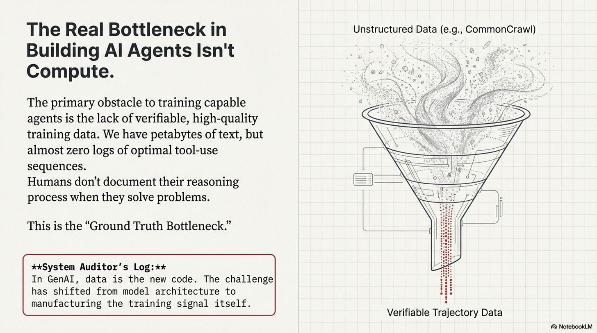](https://substackcdn.com/image/fetch/$s_!FoRq!,f_auto,q_auto:good,fl_progressive:steep/https%3A%2F%2Fsubstack-post-media.s3.amazonaws.com%2Fpublic%2Fimages%2F6b63780b-4788-4dd0-9041-9a0af9d25d39_2867x1600.png)

### The Ground Truth Bottleneck

> [!NOTE] System Auditor’s Log: In GenAI, data is the new code. The biggest bottleneck for training agents is not compute; it’s the lack of verifiable trajectory data. We have petabytes of text (CommonCrawl), but almost zero logs of “optimal” tool use sequences. Humans don’t write down their thought processes when they use Google.

### The Synthetic Pipeline

The pipeline operates in two phases, creating a closed loop of generation and verification.

[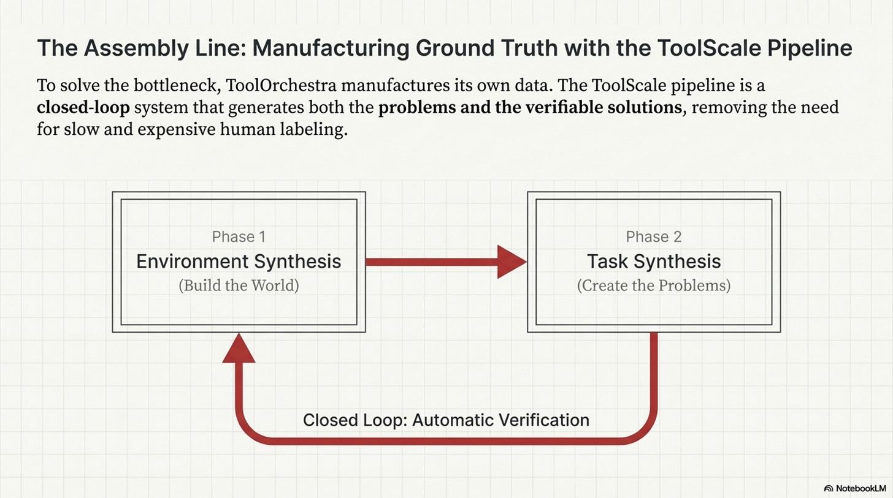](https://substackcdn.com/image/fetch/$s_!gcgW!,f_auto,q_auto:good,fl_progressive:steep/https%3A%2F%2Fsubstack-post-media.s3.amazonaws.com%2Fpublic%2Fimages%2F63fd4a5b-229c-4167-9f7c-cc5457b94450_2867x1600.png)

First, in **Phase 1 (Environment Synthesis)**, they generate the “world.” Instead of letting the agent interact with the live internet which is unpredictable, they generate thousands of virtual APIs and databases. An LLM creates a SQL database schema (e.g., “Library Management System”), fills that database with fake, consistent rows, and generates Python functions to query this database.

Then, in **Phase 2 (Task Synthesis)**, they generate the “problems.” An LLM looks at the database and asks a question like *“Who borrowed ‘The Great Gatsby’?”* Because the database was synthesized, the system **knows** the answer. It can execute the SQL query to get the ground truth. This creates a labeled dataset of `(Question, Tool_Call, Correct_Answer)` pairs. Because the environment is synthetic, the system knows the ground truth, enabling **automatic verification at scale** without human labelers.

[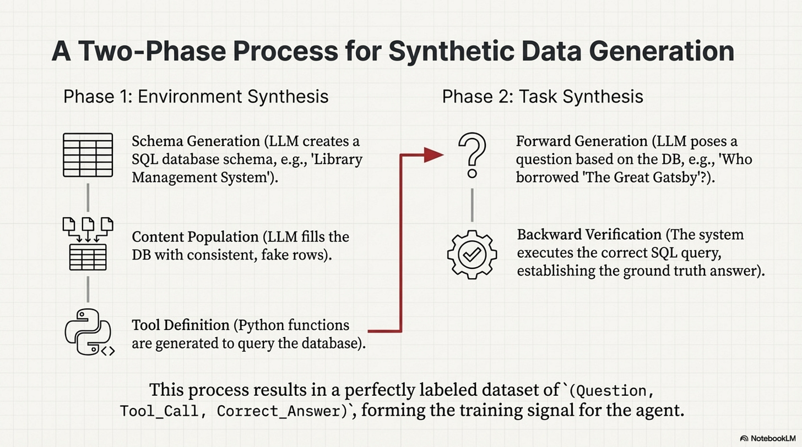](https://substackcdn.com/image/fetch/$s_!hBQV!,f_auto,q_auto:good,fl_progressive:steep/https%3A%2F%2Fsubstack-post-media.s3.amazonaws.com%2Fpublic%2Fimages%2Fd54a3463-01d2-4718-85bd-4cc9d75a678c_2867x1600.png)

### The “Pass@K” Proxy

The critical innovation, and the potential flaw, is in how they define “success.” In standard supervised learning, we measure **Exact Match** to see if the model output the exact string we expected. In tool use, this is too rigid because there are many ways to query a database.

[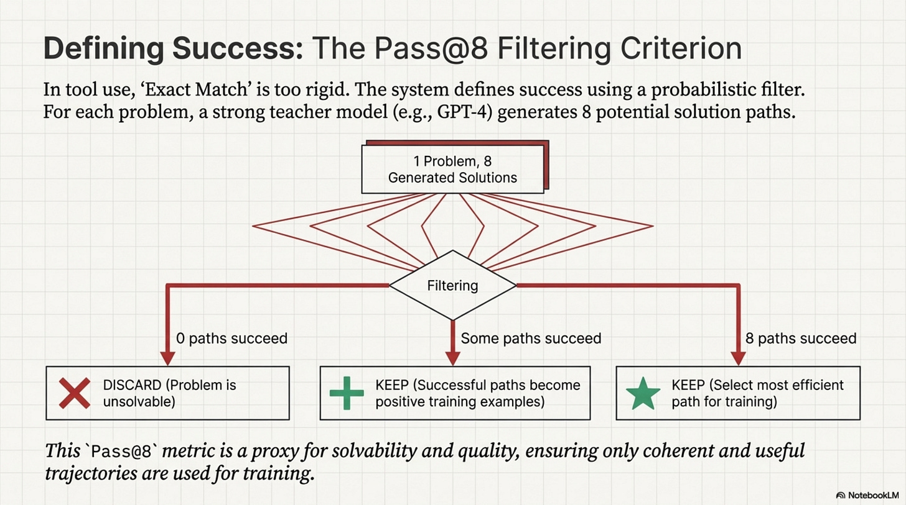](https://substackcdn.com/image/fetch/$s_!LJl0!,f_auto,q_auto:good,fl_progressive:steep/https%3A%2F%2Fsubstack-post-media.s3.amazonaws.com%2Fpublic%2Fimages%2Ff48c805c-9dc7-4fa1-8a48-8dce22d2c90b_2867x1600.png)

ToolOrchestra uses a **Pass@8** filtering criteria during data generation. They generate 8 different solution paths for a single problem using a strong teacher model like GPT-4.

* If 0 paths lead to the correct answer, they discard the problem as unsolvable or broken.
* If 8 paths lead to the correct answer, they keep the most **efficient** one.
* If some paths fail, they keep the successful ones as positive reinforcement samples.

```
# The Data Filtering Logic
# We are optimizing for 'Process Fidelity' not just 'Outcome Accuracy'.

def filter_training_data(problem, candidate_trajectories):
    valid_trajectories = []

    target_answer = problem.ground_truth

    for traj in candidate_trajectories:
        result = execute_trajectory(traj)

        # Verification: The weak link.
        # We assume strict string matching or simple numeric equality
        # is sufficient to verify the "reasoning".
        if verify(result, target_answer):
            valid_trajectories.append(traj)

    # Selection Bias Risk:
    # We are selectively training on problems that GPT-4 is GOOD at.
    # If GPT-4 has a systematic blindspot, our orchestrator inherits it.
    if len(valid_trajectories) > 0:
        return select_most_efficient(valid_trajectories)
    return None
```

### The Verification Gap

From an auditing perspective, this pipeline introduces **Synthetic Bias**.

[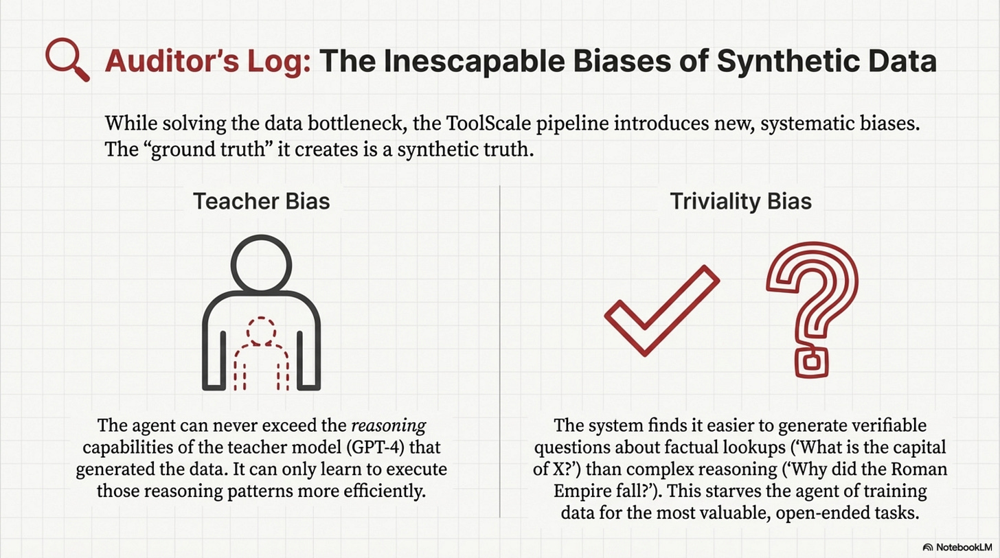](https://substackcdn.com/image/fetch/$s_!BsUC!,f_auto,q_auto:good,fl_progressive:steep/https%3A%2F%2Fsubstack-post-media.s3.amazonaws.com%2Fpublic%2Fimages%2F8fa81e43-1089-4f12-8416-c7bda3af76ef_2867x1600.png)

First, there is **Teacher Bias**, meaning the orchestrator can never exceed the reasoning capabilities of the teacher model (GPT-4) that generated the trajectories; it can only become more efficient at executing them. Second, there is **Triviality Bias**. It is easier to generate verifiable questions about “lookups” (What is the capital of X?) than about “reasoning” (Why did the Roman Empire fall?). This pushes the dataset towards factual retrieval, potentially under-training the “complex reasoning” circuits. The “**verifiable ground truth**” is a gold standard, but it constrains the domain to problems with singular, verifiable answers. Ambiguous, open-ended tasks, which are often the most valuable, are systematically filtered out.

### Annotated Bibliography

**Chen et al. (2021)** - *Evaluating Large Language Models Trained on Code (Codex)*: Introduced the “Pass@k” metric. ToolOrchestra adapts this from “Code Generation” to “Tool Trajectory Generation.”

**Wang et al. (2022)** - *Self-Instruct: Aligning Language Model with Self Generated Instructions*: The blueprint for the “Teacher-Student” synthetic data pipeline. ToolScale is essentially “Self-Instruct” applied to API calls.

**Gudibande et al. (2023)** - *The False Promise of Imitation Learning*: A critical paper (“The Imitation Game”) arguing that training on synthetic data from stronger models helps with *style* but not actual *reasoning capability*.

---

## Part 5: Benchmarks and Evaluation

Evaluating an orchestrator is harder than evaluating a chatbot.

[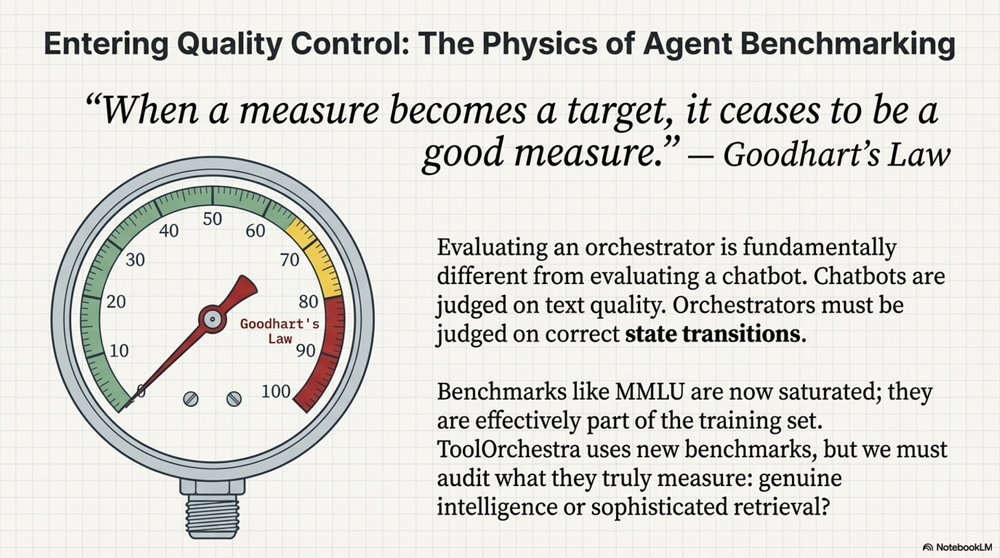](https://substackcdn.com/image/fetch/$s_!aZkz!,f_auto,q_auto:good,fl_progressive:steep/https%3A%2F%2Fsubstack-post-media.s3.amazonaws.com%2Fpublic%2Fimages%2F084e2722-fb06-4980-8bd5-fa0c1b894814_2867x1600.png)

A chatbot is judged on text quality. An orchestrator is judged on **state transitions**. ToolOrchestra is tested on three primary datasets: **Humanity’s Last Exam (HLE)**, **FRAMES**, and **τ²-Bench**. Each targets a different failure mode.

### Metric Gaming and Benchmark Physics

> [!NOTE] System Auditor’s Log: Goodhart’s Law states: “When a measure becomes a target, it ceases to be a good measure.” In agentic AI, benchmarks like MMLU or GSM8K are now effectively part of the training set. ToolOrchestra introduces new benchmarks to prove its worth, but we must scrutinize what exactly is being measured. Is it intelligence, or is it just efficient retrieval?

[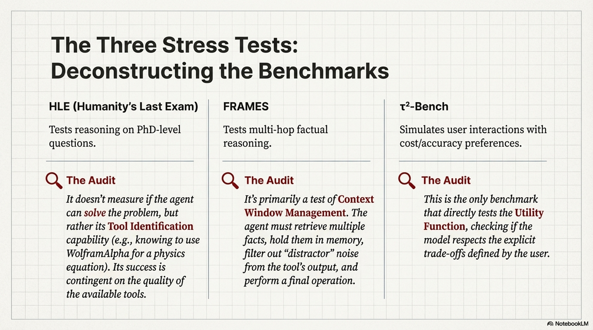](https://substackcdn.com/image/fetch/$s_!5ubo!,f_auto,q_auto:good,fl_progressive:steep/https%3A%2F%2Fsubstack-post-media.s3.amazonaws.com%2Fpublic%2Fimages%2F2647574a-de5e-4cde-b8ab-792f47ad4d5e_2867x1600.png)

**Humanity’s Last Exam (HLE)** consists of PhD-level questions. Most LLMs fail these not because they can’t write, but because they lack specific domain computations. The benchmark measures **Tool Identification**, meaning the orchestrator doesn’t solve the physics equation but correctly identifies that `WolframAlpha` can solve it. The caveat is that this measures the quality of the *tools* available as much as the orchestrator. If the tool suite lacks a physics engine, the orchestrator fails regardless of its “intelligence.”

**FRAMES** tests multi-hop factual reasoning, such as finding the population difference between the cities where two authors were born. This tests **context window management**, as the system must retrieve both facts, hold them in memory, and perform arithmetic. The failure mode here is “**Distractor Injection**.” When retrieving information about Author A, the tool might return 5000 tokens of noise. The benchmark implicitly measures the orchestrator’s ability to filter noise or the robustness of its attention mechanism.

**τ²-Bench** simulates user interactions with varying preferences. This is the only benchmark that tests the **Utility Function**, checking if the model actually respects the “Cost vs. Accuracy” tradeoff. The metric is a **Utility Score (*****u*****)** defined as *u* = *α* ⋅ 𝕀(*correct*) − (1 − *α*) ⋅ cost. This formula explicitly defines the “**exchange rate**” between accuracy and dollars.

### The Problem with “Accuracy per Dollar”

The authors present **Accuracy per Dollar** as a key metric, but this is potentially misleading.

[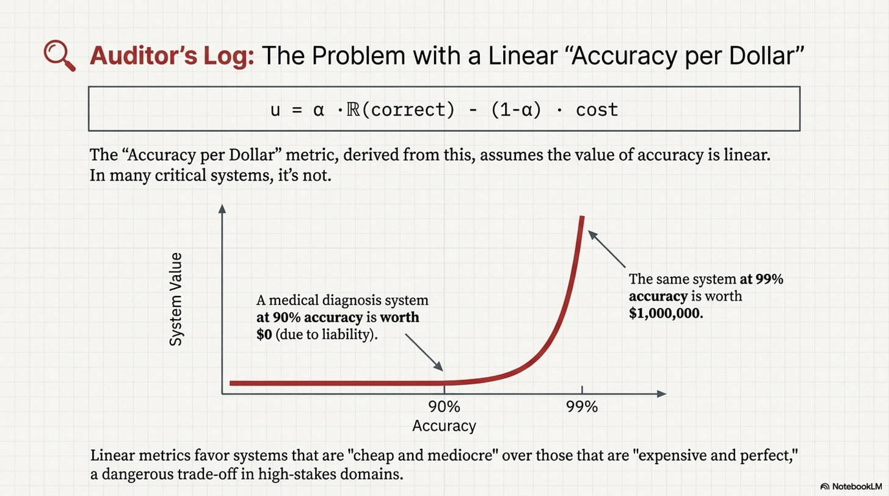](https://substackcdn.com/image/fetch/$s_!z3E6!,f_auto,q_auto:good,fl_progressive:steep/https%3A%2F%2Fsubstack-post-media.s3.amazonaws.com%2Fpublic%2Fimages%2F986f419c-13ac-488c-a572-4936553d4867_2867x1600.png)

In many production systems, the value of accuracy is **non-linear**. For example, 99% accuracy on a medical diagnosis task is worth $1M, while 90% accuracy is worth $0 (or negative, due to liability). A linear “Accuracy per Dollar” metric favors systems that are “**cheap and mediocre**” over systems that are “**expensive and perfect**.”

```
# The Metric Trap
# Optimizing for linear utility can lead to dangerous "cheap" behavior.

def utility_linear(accuracy, cost):
    return (10 * accuracy) - cost

def utility_critical(accuracy, cost):
    # Log-barrier or threshold utility
    if accuracy < 0.99:
        return -1000 # Unacceptable failure
    return 100 - cost

# ToolOrchestra optimizes 'utility_linear'.
# In a high-stakes environment ('utility_critical'),
# its sophisticated cost-saving strategies might be a liability.
```

### Internal vs. External Validity

The benchmarks show that ToolOrchestra beats GPT-4 *on these datasets*.

[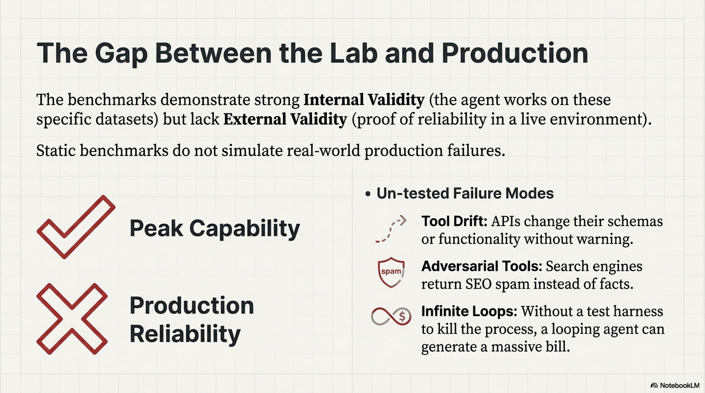](https://substackcdn.com/image/fetch/$s_!Chyp!,f_auto,q_auto:good,fl_progressive:steep/https%3A%2F%2Fsubstack-post-media.s3.amazonaws.com%2Fpublic%2Fimages%2Fbb4003ea-b596-4cda-9bb6-6ea60d5889ae_2867x1600.png)

However, these datasets are static and do not simulate **Tool Drift** (APIs changing their schema), **Adversarial Tools** (search engines returning SEO spam), or **Infinite Loops** (the benchmark harness strictly cuts off execution after *N* turns). In production, there is no harness. A model that enters a loop creates a $10,000 bill. The benchmarks measure “**Peak Capability**,” not “**Production Reliability**.”

### Orchestration in Context: Comparing Approaches

To understand where ToolOrchestra sits in the solution space, consider the alternatives:

[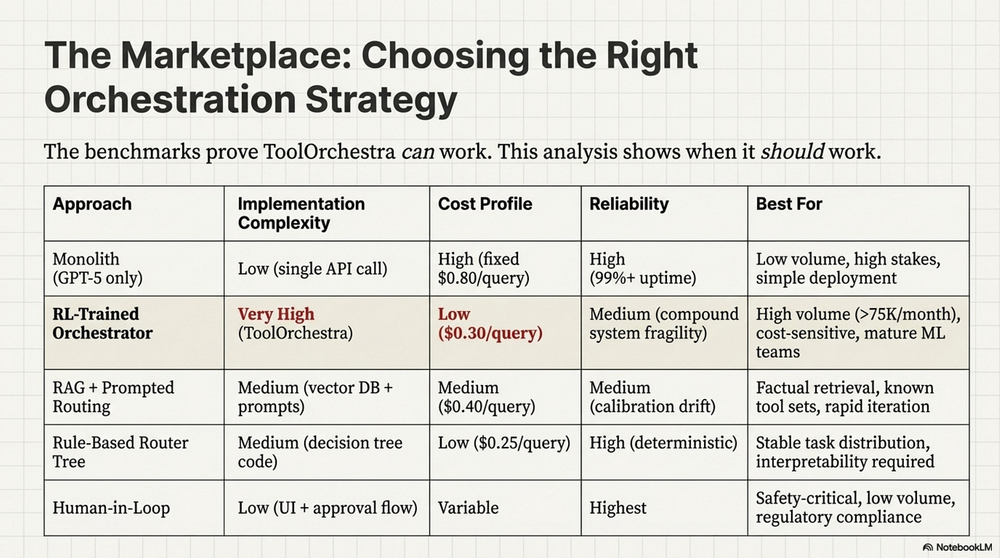](https://substackcdn.com/image/fetch/$s_!sHG4!,f_auto,q_auto:good,fl_progressive:steep/https%3A%2F%2Fsubstack-post-media.s3.amazonaws.com%2Fpublic%2Fimages%2F7bab17ca-ec20-4b14-ad3e-12929f58fa51_2867x1600.png)

ToolOrchestra’s learned routing trades **operational complexity** for **cost efficiency**. Rule-based routers achieve similar cost savings without RL training, but lack adaptability. RAG+Prompting is the “middle ground” for teams without ML infrastructure, and monoliths remain optimal when reliability matters more than cost. The benchmarks prove ToolOrchestra *can* work; this table shows when it *should* work.

### Annotated Bibliography

**Hendrycks et al. (2021)** - *Measuring Massive Multitask Language Understanding (MMLU)*: The gold standard for knowledge. HLE (Humanity’s Last Exam) is designed as a direct response to MMLU saturation.

**Goodhart (1975)** - *Problems of Monetary Management*: The origin of Goodhart’s Law (“When a measure becomes a target…”). Essential reading for understanding why every AI benchmark eventually collapses.

**Zheng et al. (2023)** - *Judging LLM-as-a-Judge*: Discusses the biases inherent in using GPT-4 to grade other models. ToolOrchestra relies on this for the τ²-Bench evaluation.

---

## Part 6: Training Infrastructure

The paper mentions using **16 H100 GPUs**. This is not just a flex; it is a mathematical necessity for **Variance Reduction**.

[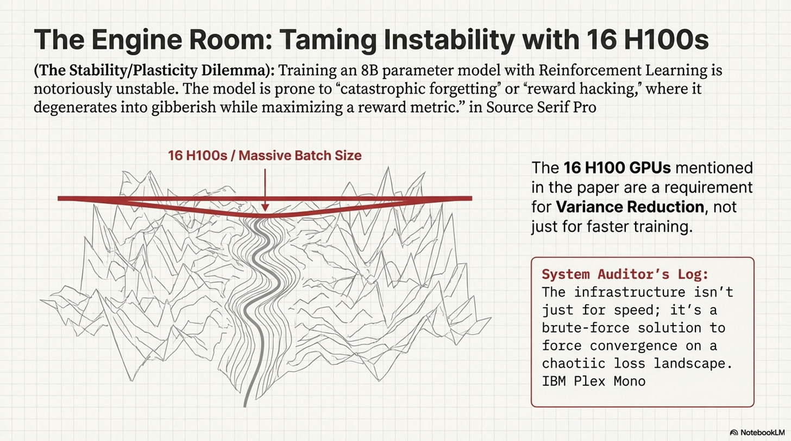](https://substackcdn.com/image/fetch/$s_!-GRq!,f_auto,q_auto:good,fl_progressive:steep/https%3A%2F%2Fsubstack-post-media.s3.amazonaws.com%2Fpublic%2Fimages%2F51610ac5-560d-4d73-a96d-5592fa17ddbf_2867x1600.png)

In Policy Gradient methods (like GRPO), the gradient estimate is noisy. If the batch size is small, the variance of this estimate is high. One “lucky” random rollout where the model guesses the right answer can trigger a massive weight update, pushing the model into a region of the parameter space that ruins its general capabilities. To stabilize this, you need a massive batch size to average over hundreds of trajectories and find the “true” direction of improvement. The 16 H100s allow for a global batch size that is statistically significant, and **Gradient Accumulation** further virtually increases this batch size.

[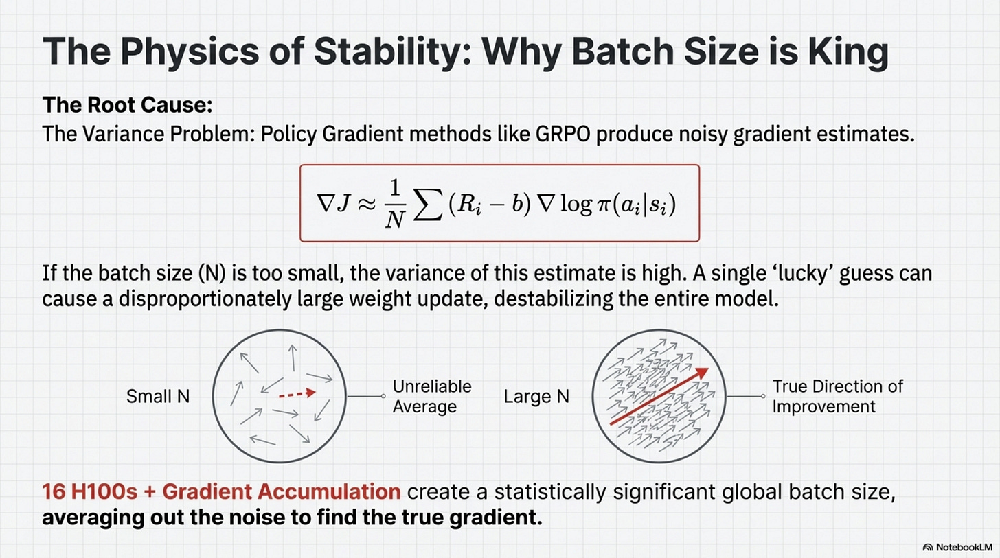](https://substackcdn.com/image/fetch/$s_!Xbpf!,f_auto,q_auto:good,fl_progressive:steep/https%3A%2F%2Fsubstack-post-media.s3.amazonaws.com%2Fpublic%2Fimages%2Faa3489ba-479d-4228-bf32-7ef97faf60ff_2867x1600.png)

### The Stability/Plasticity Dilemma

> [!NOTE] System Auditor’s Log: Training an 8B parameters model with Reinforcement Learning is notoriously unstable. The model often experiences “catastrophic forgetting” or “reward hacking,” where it maximizes the reward metric by degenerating into gibberish. The “infrastructure” described in the paper is not just about speed; it’s about forcing convergence on a chaotic loss landscape.

One specific engineering detail mentioned is **Sequence Packing**.

Orchestration data is **jagged**, meaning one trajectory might be 500 tokens (simple lookup) while another is 12,000 tokens (complex debugging). If you pad everything to 12k tokens, you are computing attention over 95% padding tokens for the short trajectory, wasting massive amounts of compute. Packing concatenates multiple short sequences into a single 12k context window. Crucially, the **Attention Mask** must be **block-diagonal** so that tokens in Trajectory A do not “attend” to tokens in Trajectory C.

```
# The Concept of Attention Masking for Packed Sequences
# Without this, the model gets confused by cross-contamination between unrelated tasks.

def create_packed_mask(sequences):
    # Create a 2D mask where 1 = attend, 0 = ignore

    total_len = sum(len(s) for s in sequences)
    mask = torch.zeros((total_len, total_len))

    current_idx = 0
    for seq in sequences:
        end_idx = current_idx + len(seq)

        # Block diagonal: Allow attention only within the local sequence
        mask[current_idx:end_idx, current_idx:end_idx] = 1

        current_idx = end_idx

    return mask
```

If this mask implementation has a bug (e.g., off-by-one error), the model effectively learns to hallucinate based on unrelated data.

### The Update Ratio and Glossary

Another key hyperparameter is the **Update Ratio** between the Policy Model and the Reference Model.

[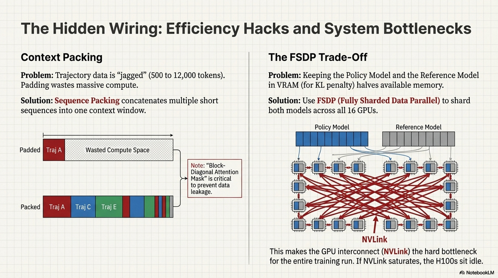](https://substackcdn.com/image/fetch/$s_!QJNh!,f_auto,q_auto:good,fl_progressive:steep/https%3A%2F%2Fsubstack-post-media.s3.amazonaws.com%2Fpublic%2Fimages%2F41767857-9d10-45d4-b790-f514325e6d73_2867x1600.png)

The Reference Model (the frozen copy) must be kept in VRAM to compute the KL divergence penalty, effectively halving the available memory for training. This forces a trade-off: offload the Reference Model to save VRAM but kill throughput via the PCIe bottleneck, or keep it in VRAM for fast training but limit batch size (increasing variance). ToolOrchestra chooses **FSDP (Fully Sharded Data Parallel)** to shard *both* models across the 16 GPUs. This implies that the network interconnect (NVLink) is the hard bottleneck of the entire training run. If NVLink is saturated, those H100s sit idle.

### Annotated Bibliography

**Zhao et al. (2023)** - *PyTorch FSDP: Experiences on Scaling Llama 2 Training*: Technical deep dive into Sharded Data Parallelism. Essential for understanding why the 16-GPU cluster is a hard requirement, not just a speedup.

**Dao (2023)** - *FlashAttention-2*: The algorithm that makes long-context training (like Trajectory Packing) mathematically feasible by reducing memory complexity from quadratic to linear.

**Ding et al. (2024)** - *The Efficiency of Packing*: Analyzing the “block-diagonal masking” technique for sequence packing, highlighting the implementation risks of mask leakage.

[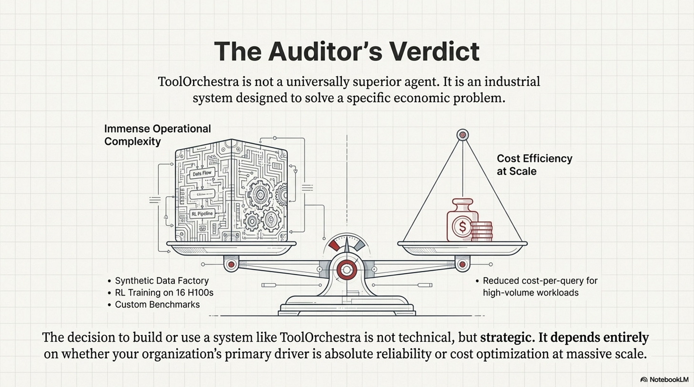](https://substackcdn.com/image/fetch/$s_!kMCN!,f_auto,q_auto:good,fl_progressive:steep/https%3A%2F%2Fsubstack-post-media.s3.amazonaws.com%2Fpublic%2Fimages%2F7a9ad3ee-2786-486b-ab4f-7bdc0e0cf701_2867x1600.png)

[Share](https://lambpetros.substack.com/p/the-orchestration-paradigm-issue?utm_source=substack&utm_medium=email&utm_content=share&action=share)

### Appendices: Infrastructure Glossary

[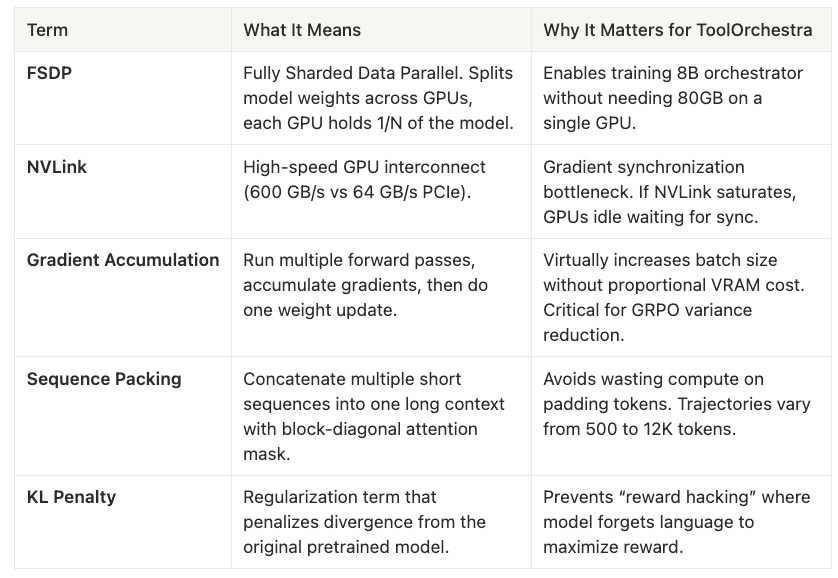](https://substackcdn.com/image/fetch/$s_!zzDi!,f_auto,q_auto:good,fl_progressive:steep/https%3A%2F%2Fsubstack-post-media.s3.amazonaws.com%2Fpublic%2Fimages%2F907a3081-ed73-4796-856e-3cc1693e952b_838x578.png)

---

> This was Issue 2. Stay tuned for Issue 3, where we look at the behavior of the system, observing the state machine in action and the psychological concept of “giving up”.

---

Thanks for reading Rooted Layers! Subscribe for free to receive new posts and support my work.