# When the LLM Programs Its Own Thinking

Date: 2026-01-14
URL: https://lambpetros.substack.com/p/when-the-llm-programs-its-own-thinking

### TL;DR video

## Introductions

Long prompts should not be fed into the neural network directly. They should be treated as part of the environment that the LLM can symbolically interact with. This is the central insight of Recursive Language Models (Zhang, Kraska, and Khattab, 2025), and it changes what scaffolding can do.

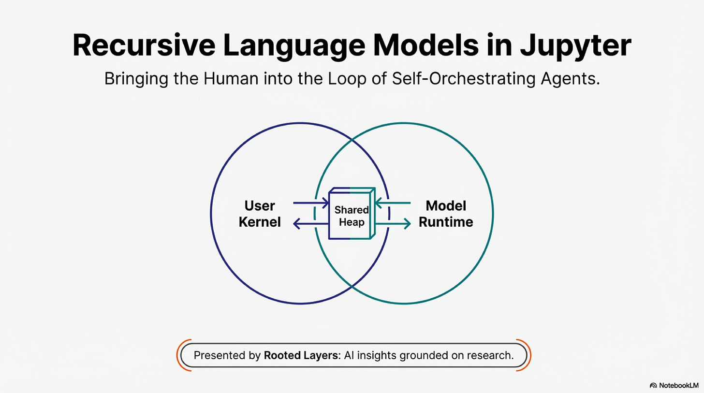

The idea of using code to augment language model reasoning dates to PAL (Gao et al., 2022), which offloaded arithmetic to a Python interpreter while the model focused on problem decomposition. CodeAct (Wang et al., 2024) generalized this into an agentic framework: models generate Python as actions, observe execution feedback, and iterate. THREAD (Schroeder et al., 2024) and ReDel (Zhu et al., 2024) added recursive decomposition, letting models spawn sub-agents for sub-problems.

Scaffold-driven memory systems manage context on the model’s behalf. MemWalker (Chen et al., 2023) builds a tree of summaries and lets the model navigate interactively, but the tree structure is fixed by the scaffold. MemGPT (Packer et al., 2024) implements an OS-like memory hierarchy with explicit paging functions, but the architecture is engineered, not emergent. Context Folding (Sun et al., 2025) compresses completed sub-trajectories into cached summaries, but folding boundaries are scaffold-determined.

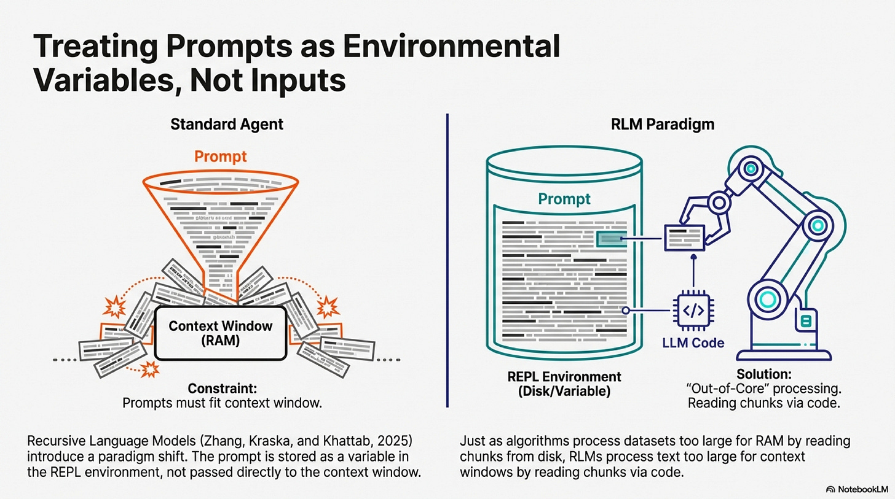

RLMs synthesize these ideas with a novel twist. The prompt is stored as a variable in the REPL environment, not passed to the model’s context window. The model writes code to examine, filter, and chunk this variable, constructing sub-queries and invoking itself recursively. This out-of-core design, inspired by algorithms that process datasets too large for RAM, enables inputs to scale far beyond context limits. In the paper’s BrowseComp+ experiments (Table 1), RLMs process 6-11 million tokens with 128K-context models. Section 3.1 documents emergent patterns: models filter contexts with regex based on priors (Figure 4a), chunk documents and dispatch transformations across chunks (Figure 4b), verify answers through sub-calls before committing, and stitch outputs from hundreds of invocations.

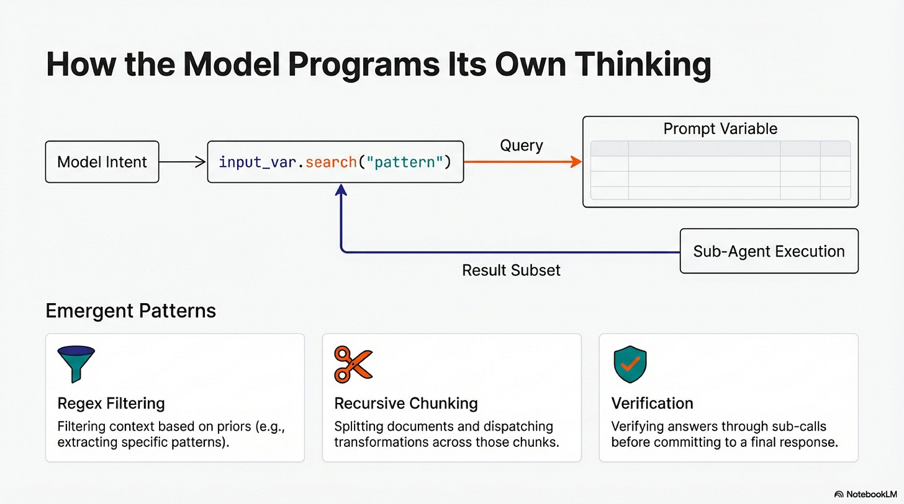

This flexibility introduces new failure modes. When the model chooses how to decompose a problem, it can choose wrong: a regex misses critical documents, a chunking boundary splits a semantic unit, a sub-call hallucinates. The RLM paradigm gives the model power. What follows documents the extensions we built to make that power visible and controllable.

We built on RLM for three reasons. First, input scaling is the harder problem; recursive depth can always be increased, but fitting massive inputs into bounded context requires architectural innovation. Second, RLM’s depth-1 limit (sub-calls invoke base LMs, not RLMs) keeps implementation tractable. Third, the reference codebase is minimal enough to extend without fighting abstraction layers.

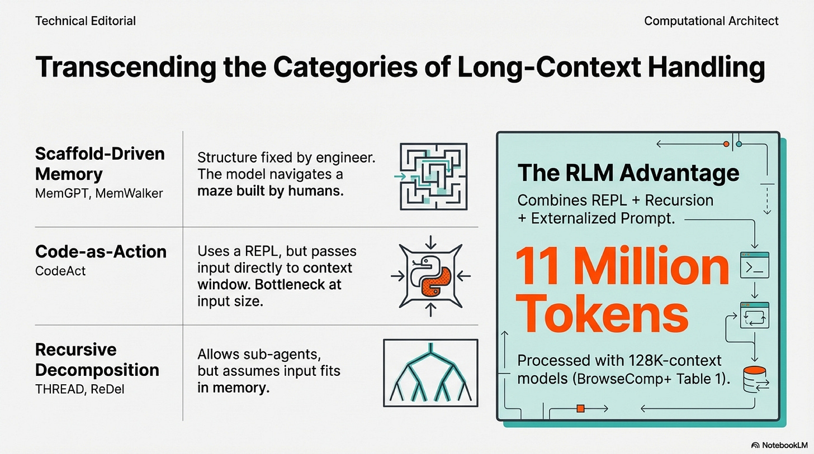

## The Human in the Loop

The reference RLM implementation executes in Docker containers or cloud sandboxes. The model has a REPL; the user does not share it. The model’s environment is isolated by design.

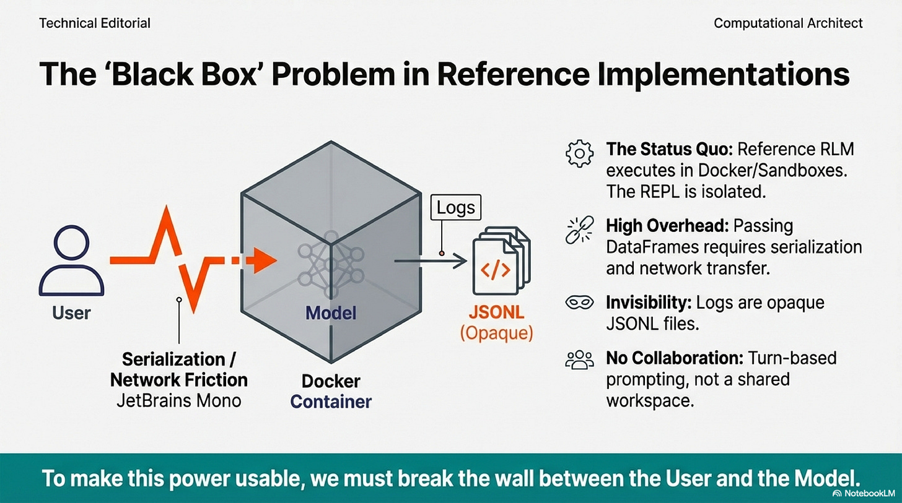

Claude Code changed this for filesystems. The model reads files, writes files, executes commands. The filesystem became the workspace where human and model collaborate. RLMs propose the same architecture with a REPL instead of a filesystem, but the original implementation kept the REPL isolated.

Our first contribution: bringing the human into the model’s REPL. The model operates as a JupyterREPL on the same kernel as the user’s notebook. User and model share a namespace. The user writes code; the model writes code; both access the same objects. This is not turn-based prompting. It is pair programming on a shared heap.

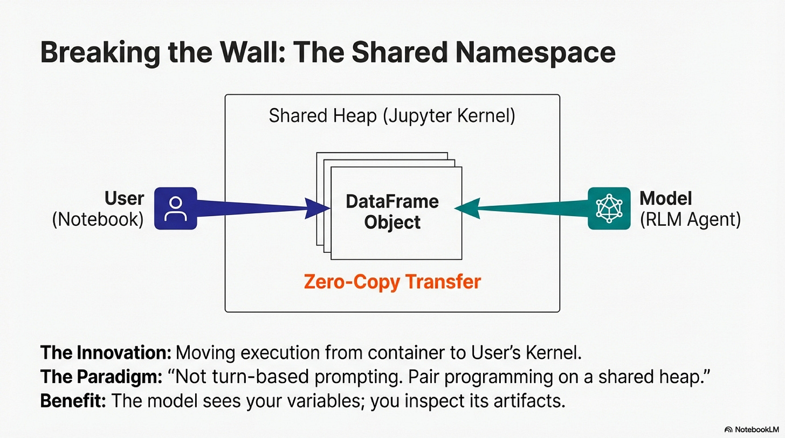

The friction of isolation is concrete. Passing large dataframes to a containerized RLM requires serialization, network transfer, and deserialization. For exploratory work where you run dozens of queries in an hour, that overhead accumulates. The notebook eliminates this boundary. Variables transfer without serialization. The model accesses data the user has defined; the user inspects artifacts the model has produced.

## Seeing What the Model Thinks

RLM trajectories are rich: model responses, code blocks, execution outputs, sub-LM calls. The paper documents patterns in these trajectories. Models filter input using regex based on priors. Models chunk contexts and dispatch recursive calls. Models verify answers through sub-calls before committing. These patterns are the substance of the paradigm.

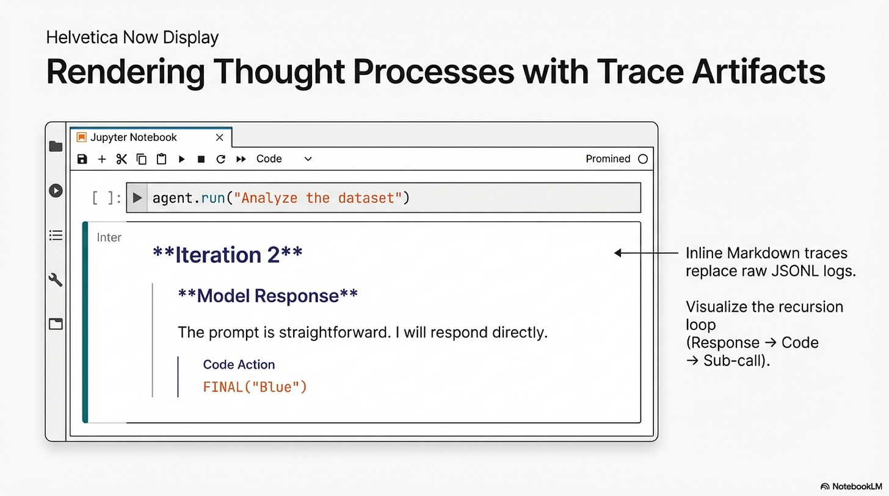

ReDel provides event-driven logging and interactive replay for recursive multi-agent systems. Users step through delegation graphs and analyze events post-hoc. But ReDel’s visualization is designed for agent delegation, not RLM-style context decomposition. The granularity is at the agent level: which child handled which sub-task. RLM trajectories have a different structure: how the model examined the prompt variable, what code it wrote to filter, what each sub-call returned.

The reference implementation logs trajectories as JSONL. Complete but painful for interactive work. When a nested call fails three levels deep, you parse JSON to understand what happened.

Our second contribution: trace artifacts designed for the RLM paradigm. After any call, an inline markdown trace is available on the result object:

```
result = session.chat("Pick a color.")
print(result.trace_markdown)
```

```
## Run Context
{"prompt": "Pick a color.", "root_prompt": null}

## Iteration 1
### Model Response

Inspecting `session_context_0` to understand the prompt...

```repl
print(session_context_0)
```
stdout: Pick a color.

## Iteration 2
### Model Response

The prompt is straightforward. I will respond directly. FINAL(“Blue”)
```

A second artifact is a runnable notebook generated from the JSONL log. A resume cell at the top rehydrates context variables and provides a replay map for sub-calls. Each iteration appears as markdown with the model's response, followed by executable code cells with captured outputs. You can step through the trajectory, modify intermediate cells, and resume from a corrected state.

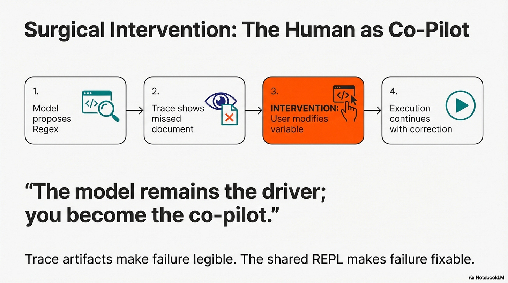

## Sharing State Across the Boundary

The model and user operate in the same namespace. Three configurations define the collaboration boundary.

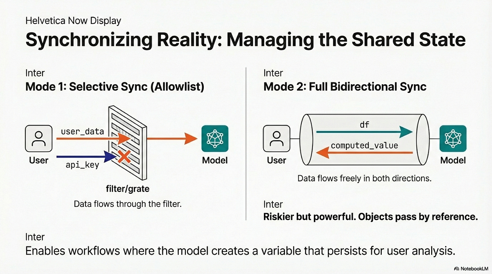

**RLM-to-user sync** lets the model compute and leave results for you:

```
rlm = RLM(
    environment="jupyter",
    environment_kwargs={"sync_to_user_ns": True}
)
rlm.completion("computed_value = 12345 * 6789")
print(f"Value from RLM: {computed_value}")  
# 83810205
```

The model created `computed_value` in its execution. Because `sync_to_user_ns` is enabled, that variable now exists in your namespace.

**Selective sync with allowlist** passes specific variables while protecting others:

```
api_key = "sk-secret-12345"
user_data = {"id": 1, "name": "Petros"}

rlm = RLM(
    environment="jupyter",
    environment_kwargs={
        "sync_from_user_ns": True,
        "sync_vars": ["user_data"]
    }
)
result = rlm.completion("Check if 'user_data' is defined. Check if 'api_key' is defined.")
# user_data is defined, but api_key is not defined.
```

The model sees `user_data` because it is in the allowlist. It does not see `api_key`.

**Full bidirectional sync** shares the heap entirely:

```
import pandas as pd
df = pd.DataFrame({"Name": ["A", "B"], "Score": [10, 20]})

rlm = RLM(
    environment="jupyter",
    environment_kwargs={
        "sync_to_user_ns": True,
        "sync_from_user_ns": True
    }
)
rlm.completion("Add 5 to the Score column of df.")
print(df)  # Score column now shows 15, 25
```

The model accessed `df` from your namespace, modified it in place. No serialization. Objects pass by reference.

## Sessions and Persistence

Completions are stateless: each call is independent. Sessions maintain history: each call sees accumulated context from prior turns.

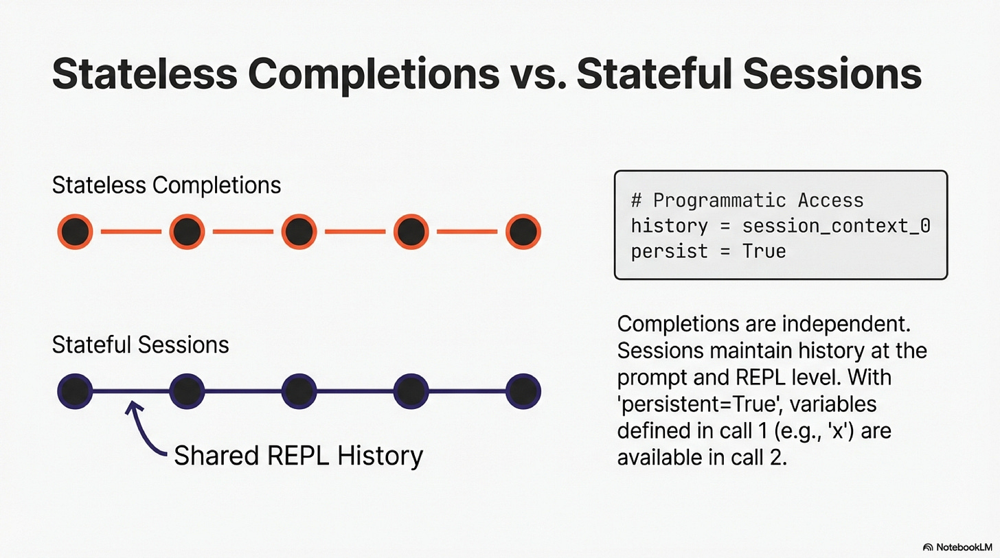

The session maintains history at both the prompt level and the REPL level. The model can programmatically access `session_context_0`, `session_context_1`, and so on.

```
session = rlm.start_session()

result = session.chat("Pick a color.")
# Blue

result = session.chat("Why did you pick that one?")
# I chose blue because you asked me to pick a color in the previous turn.
```

Persistence is orthogonal. With `persistent=True`, the REPL state survives across independent completion calls:

```
persistent_rlm = RLM(environment="jupyter", persistent=True)
persistent_rlm.completion("Set x = 500")
result = persistent_rlm.completion("Read x, then double it.")
# 1000
```

The second call knows about `x` because the REPL persisted, even though there is no session history. Combine persistence and sessions for workflows where both the question and the computational state evolve.

## Where This Falls Short

These are inference-time scaffolds. They do not change the underlying model. The paper notes that training models to reason as RLMs could provide additional improvements (Section 5), viewing RLM trajectories as a form of reasoning that can be bootstrapped. The extensions here operate purely at the scaffolding level.

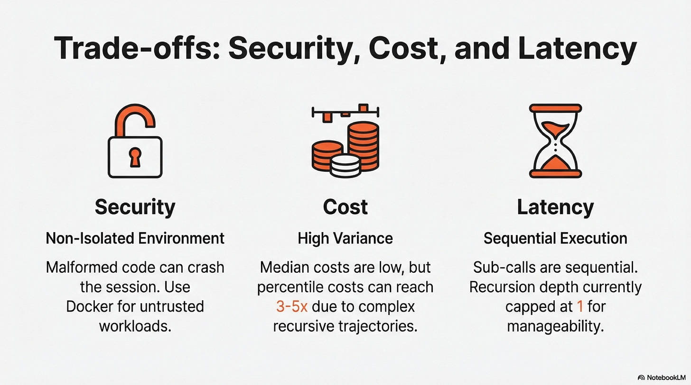

Sub-calls within a trajectory are sequential. The model waits for each recursive call to complete. However, `llm_query_batched(prompts)` provides concurrent sub-calls when the model has independent queries.

Recursion depth is capped at one. Sub-calls invoke LMs, not RLMs. The paper found strong performance with this restriction on OOLONG and OOLONG-Pairs benchmarks (Table 1), but deeper recursion may be necessary for more complex decomposition.

The Jupyter environment is non-isolated. Code executes on the user’s kernel. Malformed code can crash the session. The allowlist limits variable exposure, but isolation is not guaranteed. For untrusted workloads, use the Docker environment.

Token overhead exists for simple tasks. The scaffold consumes tokens to manage context variables, execute code, and observe results. For tasks that fit comfortably in a single LLM call, this overhead provides no benefit.

Cost variance is real. The paper documents this in Figure 3. Median RLM costs are comparable to base models because the model selectively views context. But 95th percentile costs reach 3-5x the median due to long trajectories on complex tasks. The trace artifacts make these trajectories visible, which may help identify inefficient patterns.

Orchestration is not always correct. A regex filter may miss documents. A chunking strategy may split semantic units. A sub-call may hallucinate. The trace artifacts exist precisely because these failures need to be debuggable.

## Beyond Visibility

Self-orchestration makes the model responsible for decomposition. That responsibility creates failure modes that static scaffolds never had. A model that chooses its own chunking strategy can choose wrong. A model that decides which sub-queries to dispatch can dispatch the wrong ones.

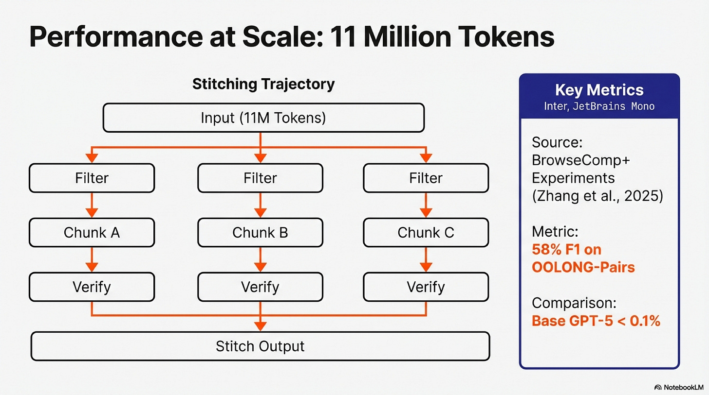

The trace artifacts make these decisions legible. But legibility alone does not close the loop. What happens when you see that the regex missed the critical document on iteration 3?

The Jupyter integration provides the answer. Human and model share a REPL. When the trace reveals a mistake, you can intervene: modify a variable, add a document to the filtered set, re-execute from the point of failure. The paradigm becomes collaborative. The model proposes a decomposition; you inspect it; you correct what it got wrong; execution continues with your correction in place.

This is different from retry-and-hope. It is different from prompt engineering. It is surgical intervention at the point of failure, with full access to the model’s computational state. The model remains the driver; you become the co-pilot who catches the edge cases.

Whether this collaboration pattern scales to production workloads remains to be seen. Whether users will invest the effort to debug trajectories is an empirical question. What we can say is that the tooling now exists. Self-orchestrating models need visibility and control. The extensions here provide both.

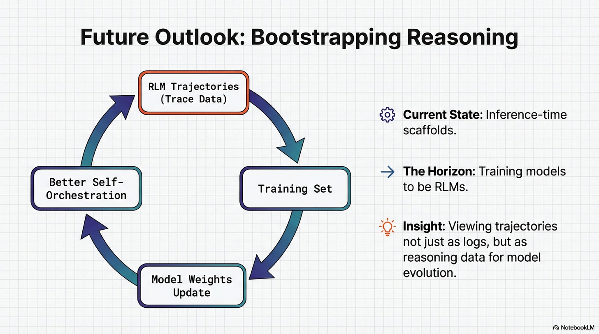

## Try It

This work is available as [PR #46](https://github.com/alexzhang13/rlm/pull/46) to the upstream [RLM repository](https://github.com/alexzhang13/rlm). While the PR is under review, use the fork directly:

```
git clone <https://github.com/petroslamb/rlm>
cd rlm && uv pip install -e ".[notebook]"
jupyter notebook docs/examples/notebook-integration.ipynb
```

The demo walks through completions, sessions, persistence, and all three sync configurations. The trace notebook feature generates `.trace.ipynb` files in the `logs/` directory.

---

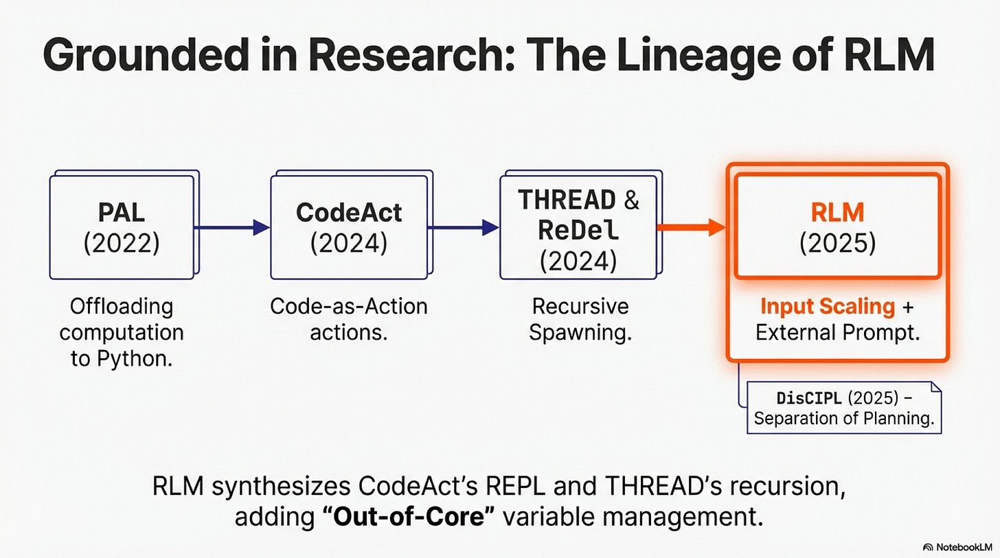

## References

### PAL: Program-aided Language Models

Gao, L., Madaan, A., Zhou, S., Alon, U., Liu, P., Yang, Y., Callan, J., & Neubig, G. (2022). *arXiv:2211.10435*.

PAL first demonstrated that LLMs could generate programs to offload computation to a Python interpreter. On GSM8K math problems, PAL with Codex outperformed PaLM-540B chain-of-thought by 15% absolute. The interpreter handles computation; the model focuses on decomposition. PAL’s scope is limited to single-program execution without iteration or feedback. RLM extends this with an interactive REPL where the model observes results and adapts.

---

### CodeAct: Executable Code Actions Elicit Better LLM Agents

Wang, X., Chen, Y., Yuan, L., Zhang, Y., Li, Y., Peng, H., & Ji, H. (2024). *arXiv:2402.01030*.

CodeAct is the direct baseline in the RLM paper. Agents generate Python instead of JSON actions, achieving 20% higher success rates on complex tasks. The limitation: input prompts pass directly to the context window. Agents manipulate their environment but cannot programmatically access inputs exceeding context limits. RLM externalizes the prompt as a REPL variable, enabling 6-11M token inputs with 128K-token models.

---

### THREAD: Thinking Deeper with Recursive Spawning

Schroeder, P., Morgan, N., Luo, H., & Glass, J. (2024). *MIT CSAIL, arXiv:2405.17402*.

THREAD frames generation as threads that spawn child threads for sub-problems. Each thread has bounded context; only results propagate back. THREAD achieves state-of-the-art on agent benchmarks. However, it assumes each thread’s input fits in context. RLM addresses input scale, not just task complexity.

---

### ReDel: A Toolkit for LLM-Powered Recursive Multi-Agent Systems

Zhu, A., Dugan, L., & Callison-Burch, C. (2024). *University of Pennsylvania, arXiv:2408.02248*.

ReDel implements unlimited-depth recursion with event-driven logging and interactive replay. Users step through delegation graphs in a web interface. ReDel’s observability is the closest prior work to our trace artifacts, but the granularity is at the agent level. RLM trajectories require finer granularity: what code examined the prompt variable, what regex filtered the context, what each sub-call returned.

---

### MemWalker: Walking Down the Memory Maze

Chen, H., Pasunuru, R., Weston, J., & Celikyilmaz, A. (2023). *arXiv:2310.05029*.

MemWalker builds a tree of summaries over long documents and lets the model navigate interactively. The limitation: tree structure and summarization are fixed by the scaffold. The model chooses which branch to follow but cannot change how branches are created. RLM inverts this; the model writes the decomposition strategy.

---

### MemGPT: Towards LLMs as Operating Systems

Packer, C., Wooders, S., Lin, K., Fang, V., Patil, S. G., Stoica, I., & Gonzalez, J. E. (2024). *arXiv:2310.08560*.

MemGPT models the LLM as an OS with tiered memory and explicit paging functions. The architecture is engineered; the model calls predefined interfaces like `core_memory_append()`. It cannot invent new memory strategies. RLM’s approach is more flexible: the model writes arbitrary Python to manage context.

---

### Context-Folding: Scaling Long-Horizon LLM Agents

Sun, J., Zhang, Z., Chen, Y., & Kong, L. (2025). *arXiv:2510.11967*.

Context-Folding compresses completed sub-trajectories into cached summaries, preventing context overflow. Folding boundaries are scaffold-determined. RLM gives the model control over decomposition strategy. However, Context-Folding’s caching insight could complement RLM for very long sessions.

---

### DisCIPL: Self-Steering Language Models

Grand, G., Tenenbaum, J. B., Mansinghka, V. K., Lew, A. K., & Andreas, J. (2025). *arXiv:2504.07081*.

DisCIPL separates planning from execution. A planner LLM writes an inference program; follower LLMs execute it. This achieves self-steering through programmatic structure. The contribution is orthogonal to RLM: better control flow for bounded inputs rather than input scaling.

---

### Recursive Language Models

Zhang, A., Kraska, T., & Khattab, O. (2025). *MIT CSAIL, arXiv:2512.06464*.

The foundational paper. RLM treats the prompt as a variable in the REPL rather than passing it to the context window. The model writes code to examine, filter, and chunk this variable. In BrowseComp+ experiments, RLMs process 6-11M tokens with 128K models (Table 1). Section 3.1 documents emergent patterns: regex filtering (Figure 4a), recursive chunking (Figure 4b), answer verification through sub-calls, output stitching. On OOLONG-Pairs, RLMs achieve 58% F1 where base GPT-5 achieves <0.1%. Our extensions address the isolation of the reference implementation: trace artifacts for visibility, Jupyter integration for shared execution.

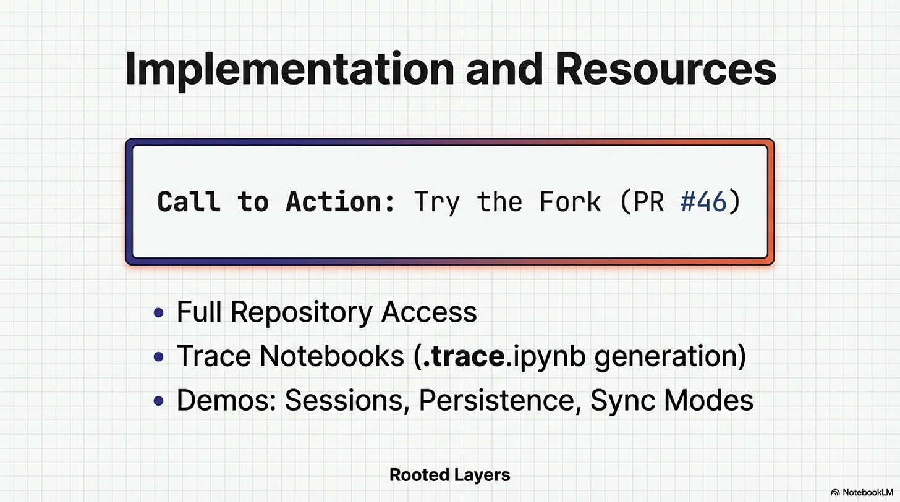
