# The Transformer Attractor

Date: 2026-01-15
URL: https://lambpetros.substack.com/p/the-transformer-attractor

TL;DR Video

## Introduction

In 2023, Mamba promised to replace attention with elegant state-space math that scaled linearly with context. By 2024, the authors had rewritten the core algorithm to use matrix multiplications instead of scans. Their paper explains why:

> “We restrict the SSM structure to allow efficient computation via matrix multiplications on modern hardware accelerators.”

The architecture changed to fit the hardware. The hardware did not budge.

This is not a story about hardware determinism. It is a story about **convergent evolution under economic pressure**. Over the past decade, Transformers and GPU silicon co-evolved into a stable equilibrium—an attractor basin from which no alternative can escape without simultaneously clearing two reinforcing gates. The alternatives that survive do so by **wearing the Transformer as a disguise**: adopting its matrix-multiplication backbone even when their mathematical insight points elsewhere.

**The thesis:** The next architectural breakthrough will not replace the Transformer. It will optimize within the Transformer’s computational constraints. Because those constraints are no longer just technical—they are economic, institutional, and structural.

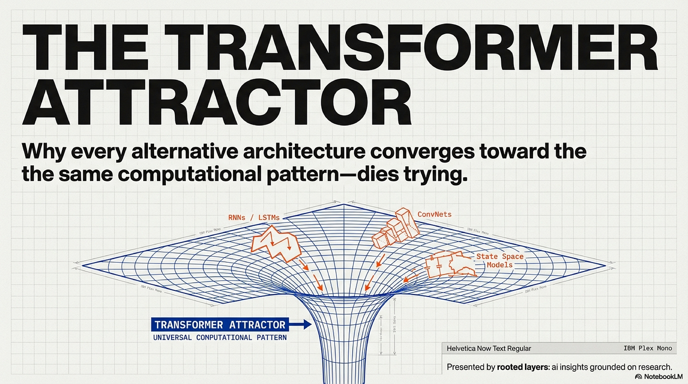

---

## The Two-Gate Trap

Every alternative architecture must pass through two reinforcing gates:

**Gate 1: Hardware Compatibility**

Can your architecture efficiently use NVIDIA’s Tensor Cores—the specialized matrix-multiply units that deliver 1,000 TFLOPS on an H100? If not, you pay a 10–100× compute tax. At frontier scale ($50–100M training runs), that tax is extinction.

**Gate 2: Institutional Backing**

Even if you clear Gate 1, you need a major lab to make it their strategic bet. Without that commitment, your architecture lacks large-scale validation, production tooling, ecosystem support, and the confidence signal needed for broader adoption.

**Why the trap is stable:** These gates reinforce each other. Poor hardware compatibility makes institutional bets unattractive (too risky, too expensive). Lack of institutional backing means no investment in custom kernels or hardware optimization, keeping Gate 1 friction permanently high. At frontier scale, breaking out requires changing both simultaneously—a coordination problem no single actor can solve.

The alternatives that survive do so by **optimizing within the Transformer’s constraints** rather than fighting them.

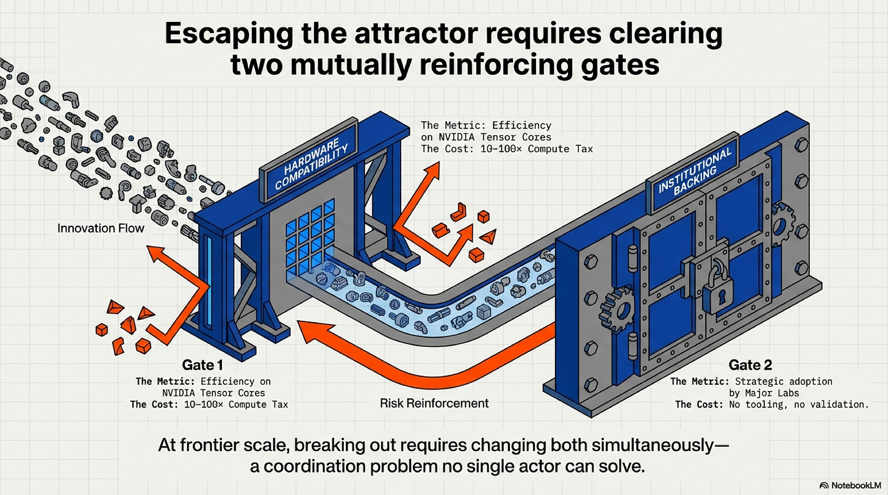

---

## Gate 1: The GEMM Moat

A Transformer is not an abstract architecture. It is a specific compute pattern that happens to be precisely what NVIDIA’s hardware executes fastest.

On an H100, approximately 1,000 Tensor Cores operate in parallel. Each Tensor Core instruction performs a 4×4 matrix multiply-accumulate in a single cycle. When these cores are saturated with large, batched matrix multiplications (GEMMs), the chip delivers roughly 1,000 TFLOPS in FP16. When the workload cannot be expressed as batched GEMMs, throughput drops by 10× to 100×.

The Transformer architecture is ~90% GEMMs by FLOP count: the Q/K/V projections, the attention matmul, the feedforward layers. Everything else—softmax, layer norms, residual adds—is negligible compute. FlashAttention made even the attention mechanism itself GEMM-friendly and tiled, eliminating the only remaining memory bottleneck.

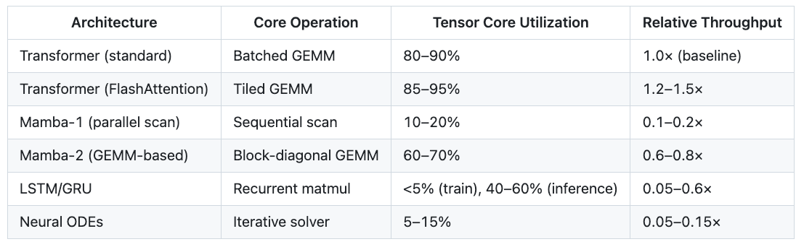

**This is Gate 1’s mechanism.** Any architecture that achieves high Tensor Core utilization will be competitive on cost-per-token. Any architecture that cannot will pay a compute tax. At frontier scale, a 10× tax on a $100M training run is a $900M deficit.

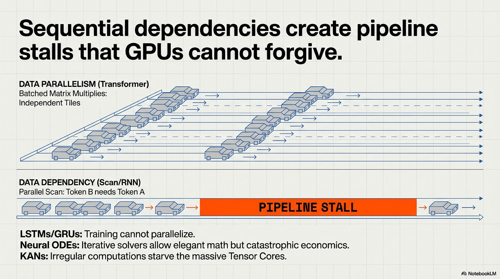

---

## The Trap Is Directional

NVIDIA is not building “AI chips.” They are building **Transformer-optimized chips.**

The Blackwell architecture (B200, announced March 2024) includes a “Second-Generation Transformer Engine” with native FP4 precision support—delivering roughly 2× the throughput of H100’s FP8 Tensor Cores for the same power envelope. The Rubin architecture (R100, announced at GTC 2024, shipping 2026) promises “3× faster Transformer layer performance” and HBM4 memory controllers optimized for million-token context windows.

What is conspicuously absent from NVIDIA’s 2024–2027 roadmap: **any silicon support for non-GEMM primitives**. No parallel scan accelerators. No recurrence units. No hardware for irregular memory access patterns.

NVIDIA’s three-year roadmap is an implicit $30B bet that Transformers will remain dominant through at least 2028. This is not neutral infrastructure. It is **directional investment** that compounds the competitive advantage of GEMM-aligned architectures every silicon generation.

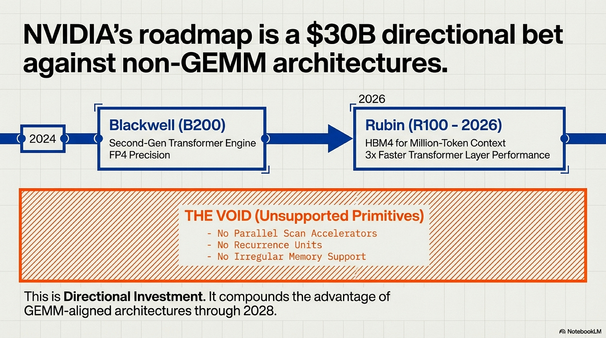

---

## Why Alternatives Fail: The Scan Bottleneck

A parallel scan is an O(N) sequential algorithm that propagates hidden state from one token to the next. Even when chunked into blocks—as Mamba-1 and other state-space models do—it cannot fully saturate Tensor Cores the way a batched matrix multiplication can. The fundamental issue is **data dependency**: each chunk’s output depends on the previous chunk’s final state, creating a serialization bottleneck that cannot be parallelized away.

This is not a software limitation. It is a consequence of GPU architecture. Tensor Cores are designed for **data-parallel** operations on independent matrix tiles. Scans are **data-dependent**: they serialize across the sequence dimension, creating pipeline stalls. Clever kernel engineering can mitigate the penalty—Mamba-2 achieved a 2–3× speedup over Mamba-1 by restructuring its recurrence as block-diagonal GEMMs—but cannot eliminate the fundamental mismatch.

The same analysis applies to every non-GEMM architecture:

- **LSTMs/GRUs**: High GEMM alignment for weight matrices, but O(N) sequential dependency over time steps. Training cannot parallelize across sequence length, making them uncompetitive at frontier scale (100B+ parameters, trillion-token datasets).
- **Neural Ordinary Differential Equations (ODEs)**: Fundamentally iterative solvers with many small matrix operations and poor memory locality. Elegant mathematics; catastrophic GPU economics.
- **Kolmogorov-Arnold Networks (KANs)**: Per-edge spline function evaluations cannot be batched into large matrix operations. Hundreds of tiny, irregular computations starve Tensor Cores.

The hardware gate is not a subjective aesthetic preference. It is the **mechanical consequence of optimizing for FLOPS-per-dollar on NVIDIA GPUs**—the 85% market-share platform that every researcher and company must target.

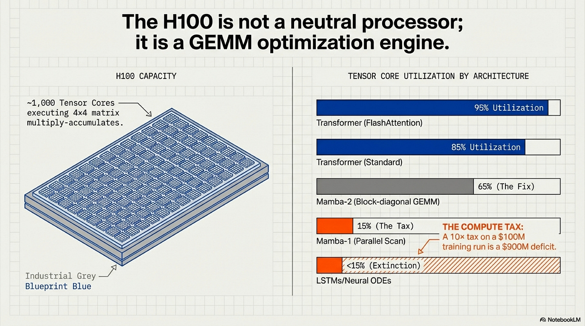

---

## The Evidence: Three Architectures That Map the Lock-In

### 1. Mamba-2 (2024): Partial Alignment, Uncertain Viability

Mamba-1’s elegance came from its parallel scan—a recurrence that propagated state efficiently over long sequences. But on H100s, the scan was a bottleneck. Mamba-2’s authors explicitly redesigned the math to use block-diagonal GEMMs instead.

**The result:**

- Mamba-1’s core operation: parallel scan (10-20% Tensor Core utilization)
- Mamba-2’s core operation: matrix multiplication (60-70% utilization)
- Measured speedup on H100: 2–3× vs. Mamba-1

Mamba-2 survived by becoming **more Transformer-like in its compute pattern**, even though it retained the recurrence semantics. This is Gate 1 at work: the architecture bent to fit the silicon.

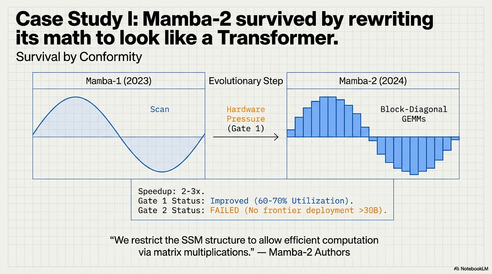

**But did it clear Gate 1?** We lack public evidence. The 60-70% Tensor Core utilization is better than Mamba-1’s 10-20%, but still 15-30 percentage points below standard Transformers (80-90%). Without frontier-scale training benchmarks comparing Mamba-2 to Transformers on identical compute budgets, we cannot determine whether the improved GEMM alignment is **sufficient** or merely **less catastrophic** than pure scans.

**What we know for certain:** As of December 2025, Mamba-2 remains research-only. No frontier lab has deployed a pure Mamba-2 model at 30B+ scale. The only production deployment is **Bamba** (IBM, 9B parameters)—a **hybrid** that mixes Mamba blocks with standard Transformer attention layers.

Bamba’s existence proves two things:

1. Full GEMM-alignment (Gate 1) remains uncertain for pure Mamba-2
2. The winning strategy isn’t “replace Transformers”—it’s “optimize within the Transformer frame”

Mamba-2 improved its hardware compatibility dramatically but still failed to attract institutional backing. The question is whether it failed Gate 1 at frontier scale or failed Gate 2 despite clearing Gate 1. Without public 30B+ training runs, we cannot know.

### 2. RetNet (2023): The Diagnostic Blind Spot

RetNet is the most revealing case study—not because it succeeded, but because **we cannot determine which gate killed it**.

Microsoft Research published RetNet in July 2023. On paper, it looked viable: parallel training (GEMM-aligned), 8.4× faster inference than standard Transformers, 70% memory savings, and Transformer-matching perplexity up to 6.7B parameters. According to the two-gate framework, RetNet should have at least warranted further scaling experiments.

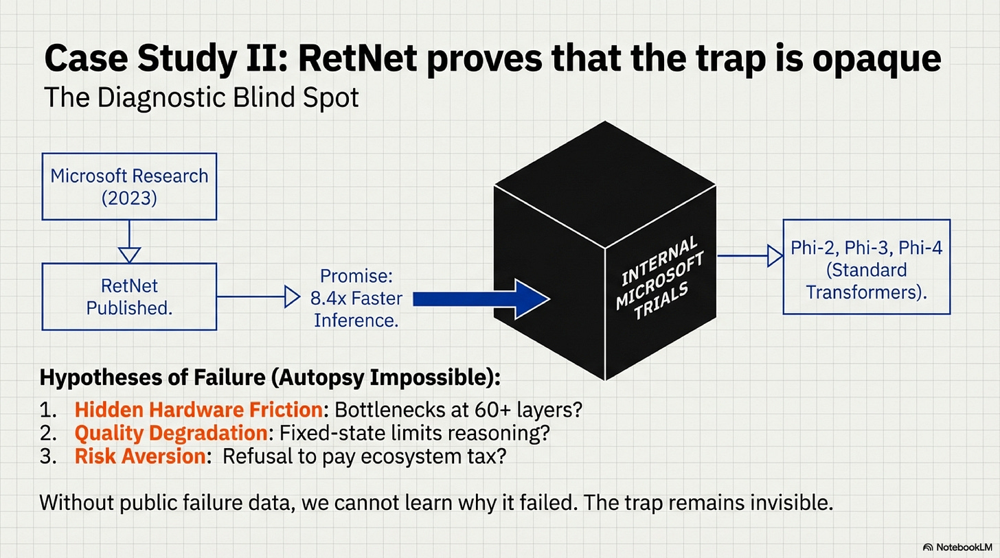

**Then Microsoft Research abandoned it.** Five months later, the same organization shipped Phi-2 (dense Transformer), then Phi-3 (MoE Transformer), then Phi-4 (long-context Transformer, December 2024). The co-authors didn’t bet on their own architecture.

**Why? Three competing hypotheses:**

**Hypothesis A: Hidden Hardware Friction (Gate 1 Failure)**

Microsoft scaled RetNet to 13B-30B internally and discovered a GPU bottleneck that only manifests at frontier depth. RetNet’s recurrent hidden state might create memory bandwidth constraints at 60-80 layers that don’t appear in shallow 6.7B models. The apparent GEMM-alignment could degrade severely at scale due to state propagation overhead.

**Hypothesis B: Quality Degradation (Hybrid Failure)**

RetNet works efficiently but performs worse than Transformers on capability benchmarks that matter to Microsoft—reasoning, factual recall, instruction-following. The fixed-size hidden state bottleneck might limit the model’s ability to handle complex multi-hop reasoning compared to full attention’s any-to-any token access.

**Hypothesis C: Institutional Risk Aversion (Gate 2 Failure)**

RetNet performs comparably but lacks ecosystem maturity (optimized kernels, inference server support, framework integration). Microsoft chose not to pay the engineering tax to validate an unproven architecture when Transformers have a known scaling track record to 100B+ parameters.

**Why this matters:** RetNet exposes a **critical limitation of the two-gate framework**. Without publicly trained frontier-scale models (30B+), we cannot distinguish hidden hardware friction (Gate 1 failures that emerge only at scale) from quality ceilings (architectural capacity limits) from pure risk aversion (Gate 2 failures despite technical viability).

**What we know for certain:**

2.5 years after publication, the largest RetNet model is 3B parameters (community-built). No 7B. No 13B. No frontier deployment. **No major lab investing in it.**

RetNet is not evidence that the two-gate framework fails. It is evidence that **the trap is opaque**. Architectures can fail silently behind closed doors, and without access to internal scaling experiments, we cannot perform the autopsy. The two-gate framework is predictive at the boundaries (pure scan-based models fail Gate 1; architectures without institutional backing fail Gate 2) but struggles in the middle where hardware and institutional factors entangle.

This opacity is itself a feature of the trap, not a bug. The lack of public failure evidence means researchers cannot learn what doesn’t work, making it even harder for the next alternative to succeed.

### 3. RWKV (2021–2024): The Trap’s Scale Dependence

RWKV (Receptance Weighted Key-Value) is a pure RNN architecture that achieves parallel training and O(N) inference complexity. Unlike RetNet, it has been scaled to **14B parameters** by an open-source community—larger than any RetNet or Mamba-1 model.

**Why did RWKV scale further?**

Not hardware optimization. RWKV is fully recurrent with similar Tensor Core utilization to RetNet (~40-60%). The difference is **sustained institutional backing from a distributed community**. Developer BlinkDL and contributors spent three years optimizing training recipes, custom kernels, and validation benchmarks. The 14B RWKV-5 model roughly matches GPT-NeoX-20B (a Transformer) on perplexity.

**But RWKV reveals something critical about the trap: it is scale-dependent.**

At 3B-14B scale, Gate 2 (institutional backing) **can partially compensate** for Gate 1 (hardware friction). A well-coordinated community with persistent effort can push a hardware-inefficient architecture to mid-scale by absorbing the compute tax through longer training runs and custom optimization.

**But frontier scale changes the equation:**

- No major lab adopted RWKV
- No frontier-scale deployment (30B+)
- Training the 14B model reportedly took longer than an equivalent Transformer would have
- Community reports note persistent struggles with multi-step reasoning tasks

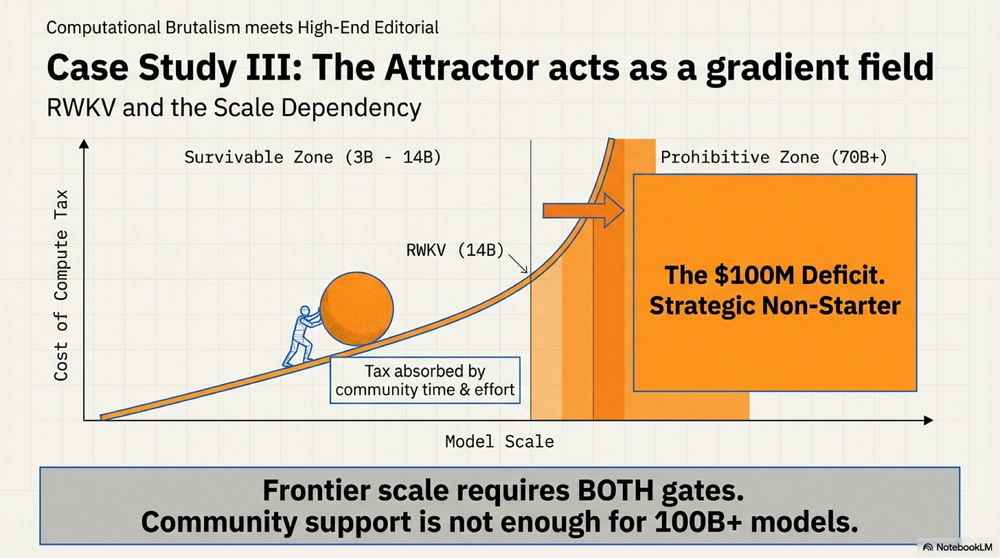

The two gates don’t just reinforce each other—**their interaction strengthens with scale**. At 3B-14B, the compute tax is painful but survivable (maybe 2-3× longer training). At 70B-400B, the same tax becomes prohibitive: the difference between a $5M training run and a $15M one might be acceptable; the difference between $50M and $150M is a strategic non-starter.

RWKV proves that the Transformer attractor is not a binary trap—it’s a **gradient field** that strengthens with scale. Alternatives have breathing room at research and mid-scale deployments. But frontier scale (70B+) requires both gates simultaneously. Without major lab capital ($50M+ training budgets) and infrastructure (100K+ GPU clusters), you won’t reach 400B parameters, regardless of community persistence.

---

## The Alternative Hardware Hypothesis

Alternative hardware exists. Cerebras’s Wafer-Scale Engine-3 (WSE-3) delivers 21 PB/s memory bandwidth—enough to make fine-grained recurrence economical. Groq’s Language Processing Unit (LPU) is SRAM-only and efficient at sequential token generation. SambaNova’s dataflow architecture could plausibly accelerate scan-based state-space models.

But these vendors collectively hold less than 5% of the AI accelerator market (by revenue, as of Q3 2024). Breaking into the mainstream requires solving three structural barriers simultaneously:

**Scale barrier:** In 2016, Google trained 1B-parameter models on first-generation TPUs. In 2025, frontier models are 100B-400B parameters trained on trillion-token datasets. The capital required has increased 100×. Cerebras and Groq lack the $1B+ budgets needed to train a credible frontier model that demonstrates their hardware’s advantage.

**Captive demand hole:** Google subsidized TPU development with Search and YouTube inference demand—massive, predictable workloads that amortized R&D costs. Alternative hardware vendors have no analogous revenue stream. They must sell to external customers who already have NVIDIA-optimized codebases.

**Ecosystem inertia:** In 2016, PyTorch was 0.1 and JAX didn’t exist yet. Google could shape the software ecosystem. In 2025, PyTorch is entrenched with 10M+ developers and every major model uses NVIDIA-tuned kernels. The switching cost is orders of magnitude higher.

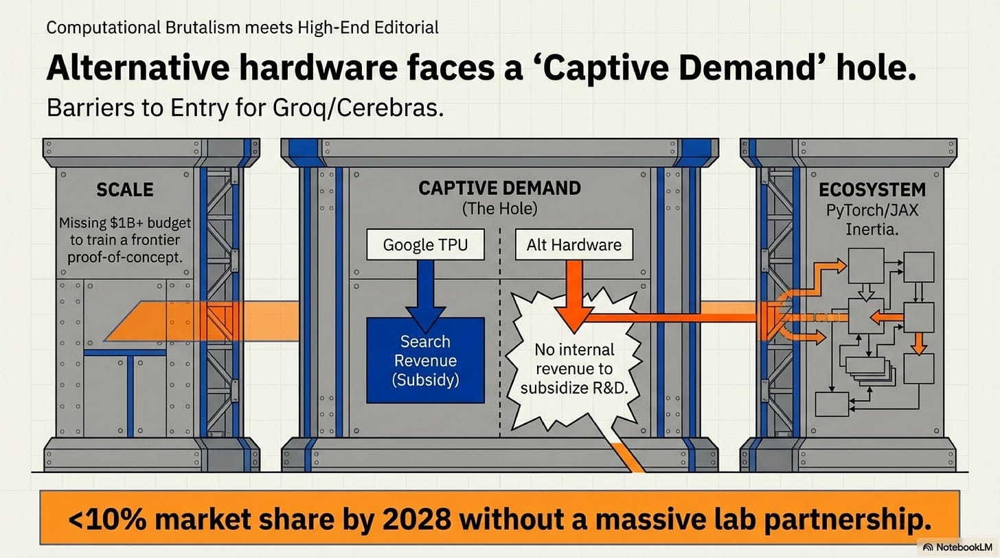

Google’s TPU success in 2016 required vertical integration: captive deployment (Search/YouTube), mandated software stack (JAX/XLA), and exclusive flagship models (PaLM-540B, Gemini-1.0). No alternative hardware vendor in 2025 controls all three levers. Without a frontier lab partnership comparable to Google’s internal commitment, alternative hardware remains niche regardless of technical merit.

As of December 2025, no major lab (OpenAI, Anthropic, Meta, DeepSeek, Google, xAI) has committed to training a 30B+ flagship model exclusively on Cerebras, Groq, or SambaNova hardware. The structural barriers—scale, captive demand, ecosystem—make organic growth implausible. The hardware moat reinforces the architecture moat.

---

## What Would Falsify This Framework?

A useful thesis makes falsifiable predictions. Here are three for 2027–2028:

**1. No pure non-GEMM frontier model will emerge.**

By 2028, no pure state-space or recurrent architecture (≥30B parameters, no attention mechanism) will rank as a top-tier LLM on standard benchmarks. Every high-performing “alternative” will be either a hybrid with attention layers or will use GEMM-aligned primitives.

**2. Titans-style external memory will remain research-only.**

Architectures requiring explicit external memory modules (à la Titans, 2024) will not ship as flagship frontier models until dedicated hardware support emerges. The serving topology changes are too severe for current infrastructure.

**3. Alternative chip vendors will not exceed 10% market share without a frontier lab partnership.**

Cerebras, Groq, and SambaNova will not collectively exceed 10% revenue share by 2028 unless a major lab (OpenAI, Anthropic, Meta, DeepSeek, Google) makes a strategic hardware commitment comparable to Google’s TPU bet.

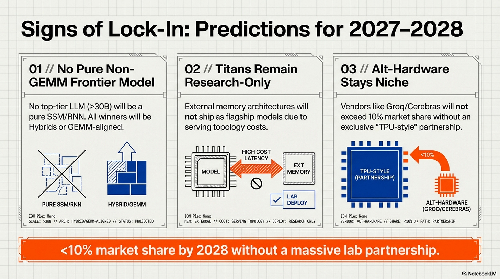

If any of these predictions fail—if a 40B pure SSM dominates benchmarks, or Groq captures 15% market share organically—the lock-in thesis needs revision. The predictions are designed to be crisp and observable.

---

## What This Means for Practitioners

### For Researchers

Your “alternative” architecture is converging toward the Transformer compute pattern whether you realize it or not. The successful research strategy is not to fight the lock-in but to understand which of your ideas can survive the two-gate filter.

**Heuristic:** If your innovation requires custom CUDA kernels that are not upstream in PyTorch or JAX, it will not scale without significant institutional backing. Plan accordingly: either secure that backing early, or design your architecture to use standard primitives. Mamba-2 improved where Mamba-1 struggled because it moved toward GEMM alignment—but even that wasn’t enough without major lab adoption.

### For Startups

Do not bet against the hardware moat unless you have a credible path through both gates. If your architecture is not GEMM-aligned, you are paying a 10–100× compute tax. That may be acceptable for a research demo; it is fatal at production scale.

**Heuristic:** If it’s not in PyTorch upstream with optimized kernels, wait for the giants to pay the integration tax. You ride on their work once it lands. FlashAttention became viable for startups only after it was battle-tested at Meta and upstreamed to PyTorch. RetNet and Mamba-1 never reached that threshold.

### For Investors

The TAM for “alternative AI chips” is constrained by structural barriers, not raw capability. Cerebras and Groq can build superior silicon for specific workloads, but they cannot unilaterally overcome the scale barrier, captive demand hole, and ecosystem inertia.

**Investment thesis filter:** Does the alternative chip vendor have a signed partnership with a frontier lab willing to train a 30B+ model exclusively on their hardware? If no, the path to 10%+ market share requires a 7–10 year time horizon and exceptional execution. Historical precedent: Google’s TPU took 6 years and billions in internal subsidies to reach maturity.

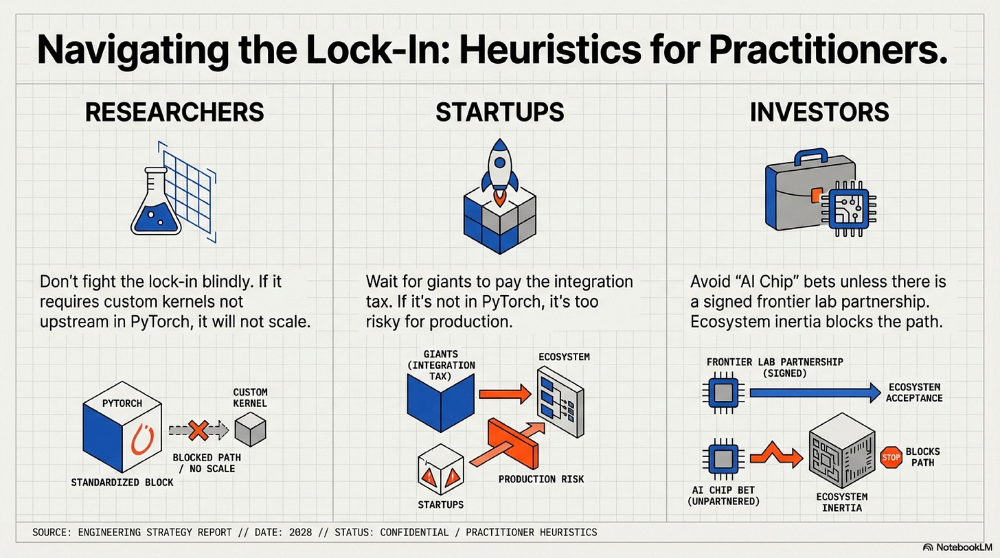

---

## Conclusion: The Attractor Holds

We are in a stable equilibrium—but not a static one.

Transformers and GPU hardware co-evolved over the past decade into a self-reinforcing lock. Now they are bound together by:

- **Hardware specialization** (Tensor Cores optimized for GEMMs, 3-year roadmaps doubling down)
- **Software ecosystems** (PyTorch, JAX, vLLM—all Transformer-native)
- **Economic incentives** (training a 100B Transformer is well-understood; training a 100B alternative is a $50M+ experiment with unknown ROI)
- **Institutional momentum** (every major lab has Transformer expertise, tooling, and validated scaling laws)

Breaking out requires simultaneously changing hardware, architecture, ecosystem, and economic incentives. No single actor has the capital, coordination, or incentive to do all four at once.

The alternatives that survive—Mamba-2, Bamba, RetNet (if it returns)—do so by **wearing the Transformer as a disguise**. They adopt GEMM-aligned compute patterns (Gate 1) and hybrid architectures that keep one foot in the proven Transformer world (Gate 2). Pure alternatives die at research scale or remain trapped at mid-scale (14B) without frontier lab backing.

**The trap is not absolute—it is scale-dependent.** At 3B-14B, community persistence can compensate for hardware friction. At 70B-400B, the two gates become insurmountable without major lab resources. This is not a failure mode of the framework; it is how convergent evolution operates under economic selection pressure.

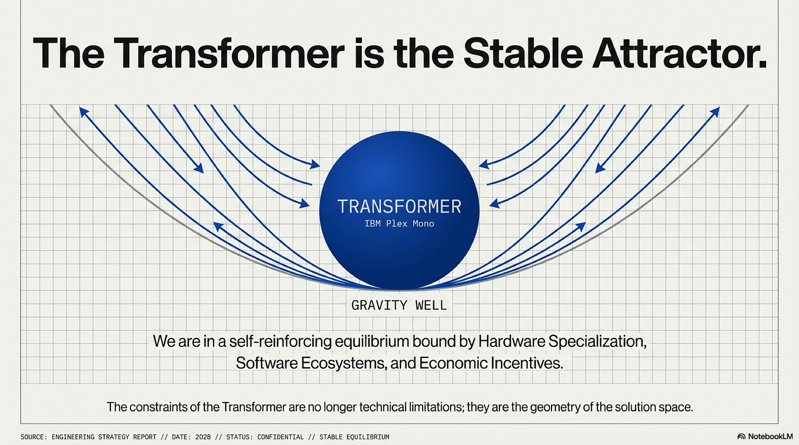

The next major breakthrough will not replace the Transformer. It will optimize within the Transformer’s computational constraints. Because those constraints are no longer technical limitations—they are the **geometry of the solution space** itself.

The Transformer is not the global optimum for neural computation. It is the **stable attractor** for architectures that must run economically on NVIDIA GPUs with institutional validation. And that attractor will continue to pull until either:

1. A drastically different compute paradigm emerges (quantum, photonic, neuromorphic—none imminent)
2. Transformers become so efficient that further optimization yields diminishing returns (possible by 2030)

Neither condition holds today. The attractor remains stable. The lock-in strengthens with every silicon generation. And the alternatives keep converging—or dying.

---

## Further Reading

- **[The Hardware Friction Map](https://lambpetros.substack.com/p/the-hardware-friction-map)** — The companion practitioner’s guide with the Gate-1 checklist and friction rubric
- **The Scored Dataset** — Architectures that attempted the >10B barrier ([research_artifacts/scorecard_dataset](https://github.com/petroslamb/hardware-friction-scorecard-dataset/blob/main/scored_architectures.md))
- **Mamba-2 Paper** — Section 3 on hardware-aware design (arXiv:2405.21060)
- **RetNet: A Successor to Transformer** — Microsoft Research (arXiv:2307.08621)
- **IBM Bamba Release** — Production hybrid SSM+Attention model (IBM Research Blog, 2025)
- **NVIDIA Blackwell/Rubin Announcements** — Official roadmaps (NVIDIA Blog)

---

*For questions, corrections, or case studies of architectures that escaped the Transformer Attractor, contact me. This essay is part of a series on neural architecture economics.*
