# The Illusion of the Swarm

Date: 2026-03-17
URL: https://lambpetros.substack.com/p/the-illusion-of-the-swarm

#### video tl;dr

# Many Multi-Agent Systems Are a Workaround, Not a Destination

*For many same-model production systems, multiple agents are a temporary way to manage routing, state, and coordination limits. The recent research wave matters not because it proves swarms are the future, but because it shows when to split, when to compress, and when to fold the system back into one model.*

---

In benchmark settings, a team at the University of British Columbia showed that many multi-agent systems can be transformed into a single agent with skills, cutting token use by 53.7% and latency by 49.5% while preserving comparable output quality ([Li, 2026](https://arxiv.org/abs/2601.04748)). That is a strong result, but it is also easy to overread.

It does not mean multi-agent systems are fake. It does not mean one agent always wins. It means something narrower and more useful: for many same-model, tool-using production stacks, explicit multi-agent structure is often the operational price of unresolved routing, state, and coordination problems.

[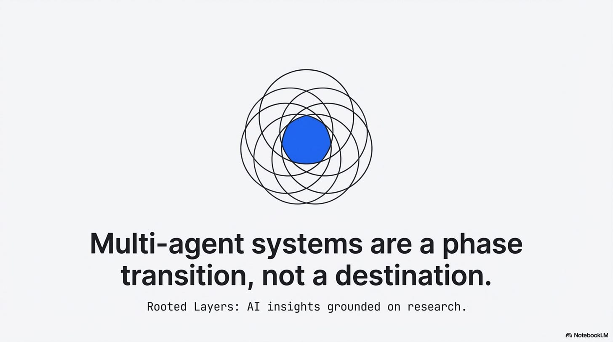](https://substackcdn.com/image/fetch/$s_!364-!,f_auto,q_auto:good,fl_progressive:steep/https%3A%2F%2Fsubstack-post-media.s3.amazonaws.com%2Fpublic%2Fimages%2F19f7a889-9007-48b5-87fe-92ae07a14281_3823x2134.png)

That reframes the design question. The question is not “how many agents should I build?” It is “which bottleneck am I compensating for?” Recent papers on agent systems, routing, memory, delegation, embodied cooperation, and latent communication point to the same practical conclusion: the important frontier is not adding more personas. It is organizing decomposition, memory, communication, and coordination under tight cost and error budgets ([Li, 2026](https://arxiv.org/abs/2601.04748); [X. Yang et al., 2026](https://arxiv.org/abs/2601.14192); [Kim et al., 2025](https://arxiv.org/abs/2512.08296)).

The strongest version of that thesis is not universal. Some systems genuinely need multiple agents. Some will keep them, some should. But the new literature makes it much harder to treat multi-agent design as the default mark of sophistication.

## 1. Why Multi-Agent Often Exists

The usual story about multi-agent systems is flattering. We say a Planner, Researcher, Coder, and Reviewer represent different modes of intelligence. A society of specialized minds. Sometimes that is true. Often it is a prettier description of a simpler problem: the base system is struggling to route tools, manage context, or keep intermediate state legible.

The UBC paper is important because it directly tests that suspicion ([Li, 2026](https://arxiv.org/abs/2601.04748)). Instead of assuming the multi-agent graph is load-bearing, the authors apply a formal compilation function from multi-agent systems to a single agent with a skill library. On their benchmarks, the compiled system uses far fewer tokens and lower latency while matching the original system closely ([Li, 2026](https://arxiv.org/abs/2601.04748)). That is not a philosophical objection to multi-agent design. It is an engineering result. In some settings, a large share of the extra computation is coordination overhead rather than indispensable reasoning.

[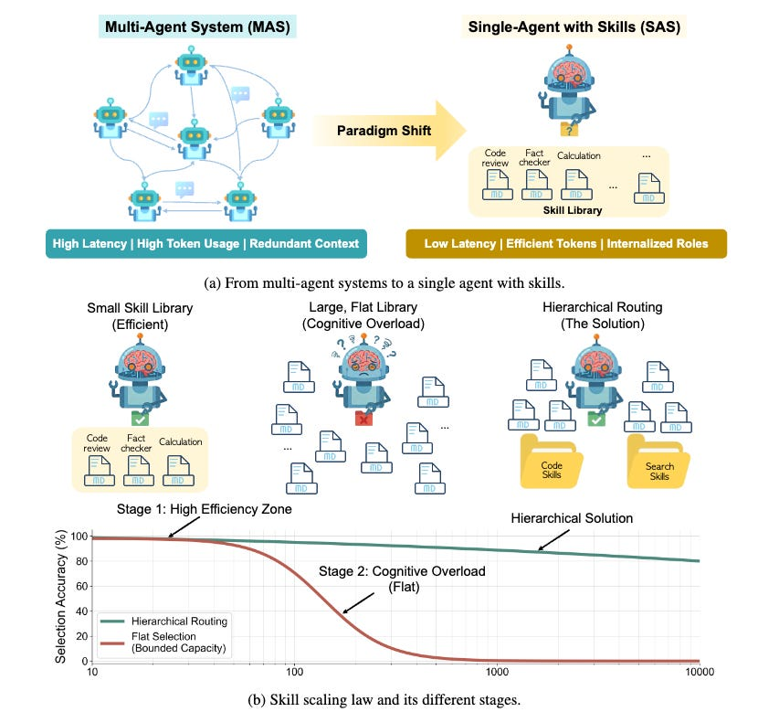](https://substackcdn.com/image/fetch/$s_!JWGH!,f_auto,q_auto:good,fl_progressive:steep/https%3A%2F%2Fsubstack-post-media.s3.amazonaws.com%2Fpublic%2Fimages%2F4a71311f-c8ef-4232-be01-aa0d54774103_830x779.png)

Picture taken from ([Li, 2026](https://arxiv.org/abs/2601.04748)).

Two adjacent papers sharpen the point. The efficiency survey *Toward Efficient Agents* argues that memory, planning, and tool-learning research keeps converging on the same higher-level moves: bound context, compress intermediate state, and reduce unnecessary tool invocations ([X. Yang et al., 2026](https://arxiv.org/abs/2601.14192)). *Towards a Science of Scaling Agent Systems* goes further by controlling for agent quantity, topology, model capability, and task type across 180 configurations ([Kim et al., 2025](https://arxiv.org/abs/2512.08296)). Its headline is not that more agents win. It is that outcomes depend on a tool-coordination tradeoff, capability saturation, and topology-specific error amplification ([Kim et al., 2025](https://arxiv.org/abs/2512.08296)). Under fixed budgets, some multi-agent variants help. Some hurt. Across the full set, the mean improvement is negative ([Kim et al., 2025](https://arxiv.org/abs/2512.08296)).

Put differently: multi-agent often appears when a single agent has become brittle, but brittleness can come from multiple sources. Sometimes the answer is decomposition. Sometimes it is memory. Sometimes it is better routing. Sometimes it is simply not asking one model to narrate every internal handoff in English.

[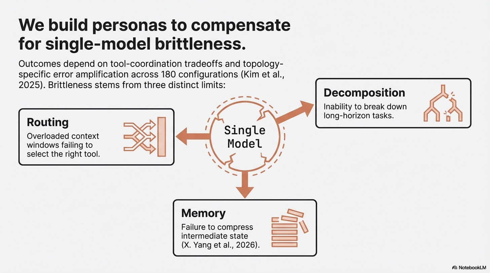](https://substackcdn.com/image/fetch/$s_!a1RH!,f_auto,q_auto:good,fl_progressive:steep/https%3A%2F%2Fsubstack-post-media.s3.amazonaws.com%2Fpublic%2Fimages%2Fadf56e28-6519-4bd9-a05a-b9b4d096e802_3823x2134.png)

That is why the right default for skeptical builders is not “start with a swarm.” It is “start with the smallest system that can express the task, then identify the specific failure mode before you split it.”

## 2. The Disambiguation Threshold

The most useful result in the UBC paper is not just that some multi-agent systems can be collapsed into one. It is where that collapse stops working ([Li, 2026](https://arxiv.org/abs/2601.04748)). Skill selection does not degrade gracefully as the action library grows. On the tested models, it stays stable and then breaks in a collapse zone around 80 to 90 skills ([Li, 2026](https://arxiv.org/abs/2601.04748)). The paper connects that breakdown to semantic confusability: if too many nearby tool descriptions occupy the same action space, the selector starts colliding with itself ([Li, 2026](https://arxiv.org/abs/2601.04748)). In their setup, even adding one semantically similar competitor can reduce selection accuracy materially ([Li, 2026](https://arxiv.org/abs/2601.04748)).

This is the point where “agent” stops meaning persona and starts meaning namespace.

[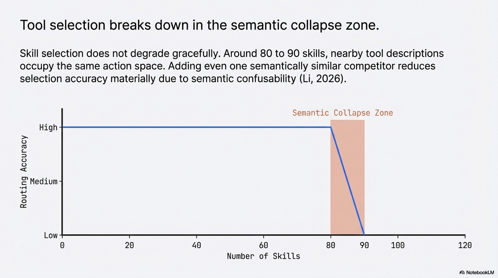](https://substackcdn.com/image/fetch/$s_!C0BP!,f_auto,q_auto:good,fl_progressive:steep/https%3A%2F%2Fsubstack-post-media.s3.amazonaws.com%2Fpublic%2Fimages%2F77719423-b39a-44f2-bc4d-23c91435907e_3823x2134.png)

That line is an interpretation, not a sentence from the paper. But it fits the evidence better than the folk story does. In many production systems, we do not create a database agent because querying a database requires a mystical new cognitive faculty. We create it because mixing `resolve_ticket`, `query_user_db`, `fetch_marketing_campaigns`, `refund_order`, and `check_entitlement` in one flat tool universe increases routing confusion. The boundary is there to keep similar actions from interfering with each other.

That interpretation also explains why hierarchical routing works. In the UBC experiments, flat selection at large library sizes collapses badly, while hierarchical routing recovers much of the lost accuracy by replacing one overloaded decision with several smaller ones ([Li, 2026](https://arxiv.org/abs/2601.04748)). The model did not become more intelligent. The choice became more separable.

[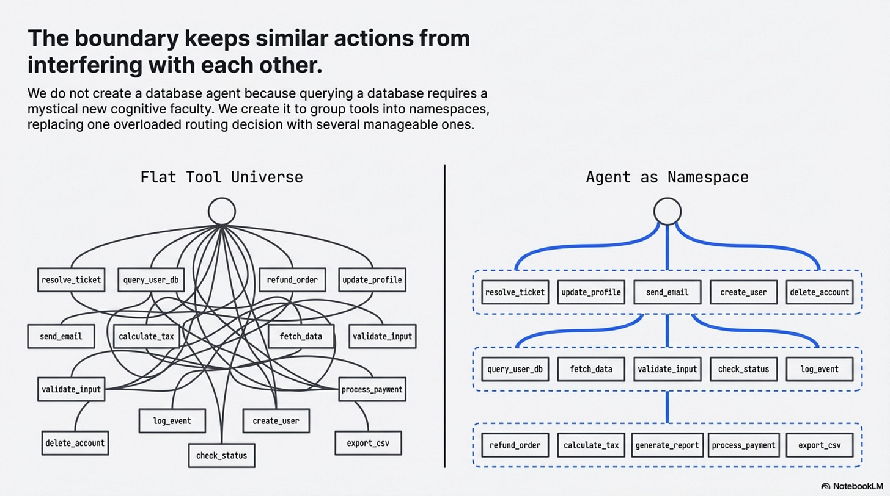](https://substackcdn.com/image/fetch/$s_!GGnO!,f_auto,q_auto:good,fl_progressive:steep/https%3A%2F%2Fsubstack-post-media.s3.amazonaws.com%2Fpublic%2Fimages%2F6c529605-3006-4f5b-bc47-a2f7d5c7d741_3823x2134.png)

*ROMA* is the best direct architecture answer to that problem in the current set ([Alzu’bi et al., 2026](https://arxiv.org/abs/2602.01848)). Its recursive Atomizer-Planner-Executor-Aggregator structure keeps local decisions manageable and compresses intermediate outputs before passing them onward ([Alzu’bi et al., 2026](https://arxiv.org/abs/2602.01848)). On the paper’s benchmarks, that design produces measurable gains, including a 9.9% improvement on SEAL-0 and strong performance on EQ-Bench ([Alzu’bi et al., 2026](https://arxiv.org/abs/2602.01848)). The key point is not that recursion is always best. It is that once your action space crosses a disambiguation threshold, better decomposition is often more valuable than louder prompting.

*SkillOrchestra* reaches a similar conclusion from a different direction ([Wang et al., 2026](https://arxiv.org/abs/2602.19672)). Instead of learning an opaque routing policy end to end, it builds a reusable skill handbook of agent competence and cost, then routes based on explicit performance-cost tradeoffs ([Wang et al., 2026](https://arxiv.org/abs/2602.19672)). That is not the same method as UBC or ROMA, but it supports the same broader idea: orchestration gets more defensible when it is tied to explicit skills and competence profiles rather than vague personas.

[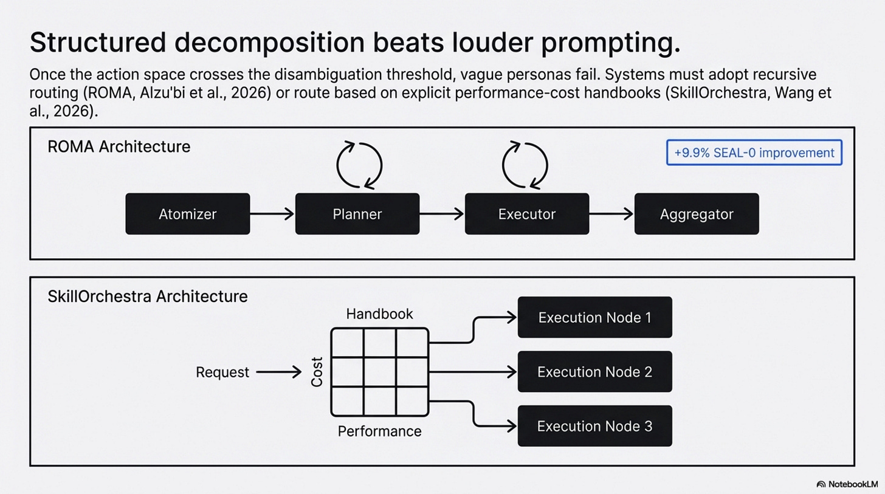](https://substackcdn.com/image/fetch/$s_!kjol!,f_auto,q_auto:good,fl_progressive:steep/https%3A%2F%2Fsubstack-post-media.s3.amazonaws.com%2Fpublic%2Fimages%2F52fa6671-7a86-4c0c-9c4d-c2e264261c8f_3823x2134.png)

This is where many practical agent stacks should change course. If your multi-agent design exists mainly to prevent tool confusion, say so. That is not a weakness. It is a clearer problem statement. Once you name the problem correctly, you can ask better questions: Do I need a real multi-agent system? A hierarchical router? A smaller skill library per stage? Better tool descriptions? A cost-aware handbook like SkillOrchestra? The bad version of this conversation is “we needed more agents because the task was hard.” The useful version is “we needed less ambiguity per decision.”

## 3. Where Multi-Agent Is Actually Load-Bearing

A good argument needs to make the objections early, not as an appendix. Multi-agent systems are not just ceremony, they are genuinely load-bearing in at least four situations.

[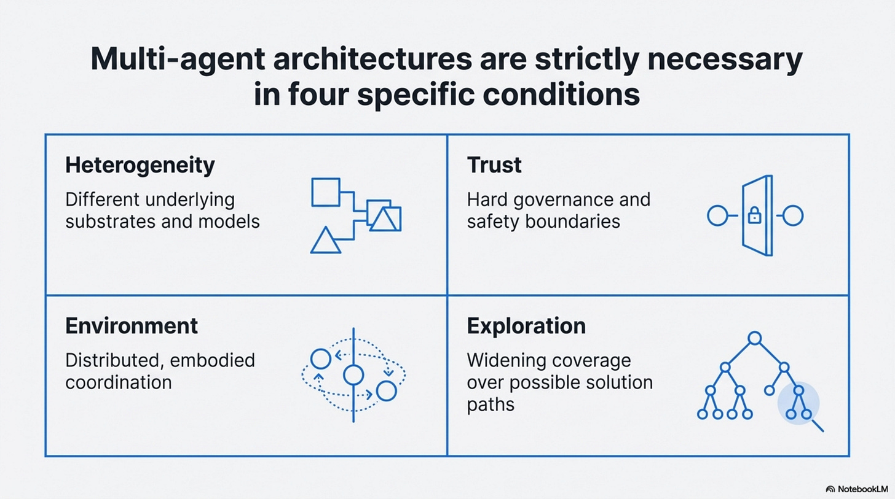](https://substackcdn.com/image/fetch/$s_!XPU3!,f_auto,q_auto:good,fl_progressive:steep/https%3A%2F%2Fsubstack-post-media.s3.amazonaws.com%2Fpublic%2Fimages%2Fff12fdb1-d9ff-4a95-8436-c1e956975527_3823x2134.png)

**First**, heterogeneity, if your system genuinely needs different substrates, multiple agents are not a workaround for confusion. They are the system. A vision model, a code model, a planner, and a verifier may each exist because the underlying capabilities differ materially. *The Vision Wormhole* matters partly because it takes this case seriously rather than pretending a single homogeneous model will absorb everything ([X. Liu et al., 2026](https://arxiv.org/abs/2602.15382)).

**Second**, trust and authority boundaries, *Intelligent AI Delegation* is mostly a conceptual paper, not the kind of empirical proof you should lean on for performance claims ([Tomašev et al., 2026](https://arxiv.org/abs/2602.11865)). But it is still useful because it names a real requirement: sometimes the reason to separate agents is not capability but governance. You may want a verifier that can challenge a proposal, a safety critic that is structurally isolated from the system it monitors, or a delegate that behaves differently depending on task criticality ([Tomašev et al., 2026](https://arxiv.org/abs/2602.11865)). Those boundaries are hard to fold away without also erasing the trust boundary that made them valuable.

[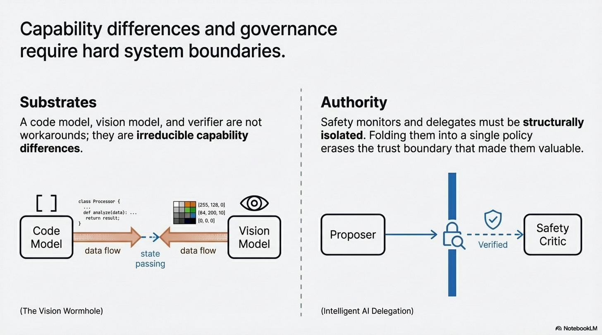](https://substackcdn.com/image/fetch/$s_!zikQ!,f_auto,q_auto:good,fl_progressive:steep/https%3A%2F%2Fsubstack-post-media.s3.amazonaws.com%2Fpublic%2Fimages%2Fcc062bb2-6a0b-4dd5-b6ad-fb54dd12d405_3823x2134.png)

**Third**, embodied or distributed coordination, *EmCoop* does not prove a universal law of cooperation, but it does show why process-level measurement matters ([H. Yang et al., 2026](https://arxiv.org/abs/2603.00349)). In embodied tasks, agents can interrupt, replan, block each other, and communicate at the wrong times. That is not the same problem as routing tools in a text-only workflow. *MultiAgentBench* points in the same direction by treating coordination protocols and milestone-based metrics as first-class evaluation objects rather than side effects of task completion ([Zhu et al., 2025](https://arxiv.org/abs/2503.01935)). Once multiple actors must coordinate in space, time, or shared environment state, the system-level interaction can be genuinely irreducible.

**Fourth**, exploration, here *EMPO2* is useful by analogy rather than as a pure multi-agent result ([Z. Liu et al., 2026](https://arxiv.org/abs/2602.23008)). It shows that external scaffolding, reflective tips, and exploration support can create better trajectories that are only later internalized. Search itself has value. If the point of your system is to widen coverage over possible solutions, not just minimize latency, multiple actors or multiple trajectories can be rational even when you later distill what they discovered.

[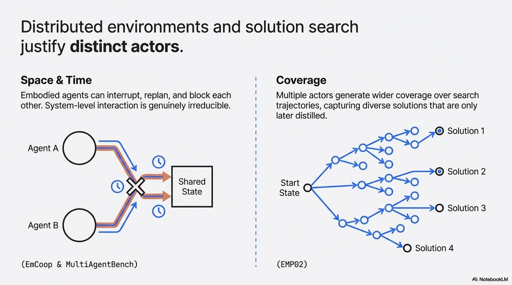](https://substackcdn.com/image/fetch/$s_!BJqO!,f_auto,q_auto:good,fl_progressive:steep/https%3A%2F%2Fsubstack-post-media.s3.amazonaws.com%2Fpublic%2Fimages%2Fc6fb4153-b029-4a0a-a05c-c29bee39e65a_3823x2134.png)

The scaling paper is valuable because it keeps all of this from turning into metaphysics ([Kim et al., 2025](https://arxiv.org/abs/2512.08296)). Centralized coordination helps some parallelizable tasks dramatically. Decentralized coordination can help web navigation. Sequential reasoning tasks can degrade badly under multi-agent variants ([Kim et al., 2025](https://arxiv.org/abs/2512.08296)). That is the sane conclusion: multi-agent is not fake, and it is not fate. It is a conditional tool.

## 4. Communication Is a Frontier, Not a Law

The papers do not justify “the death of English.” They do justify something narrower and still important: text is increasingly the bottleneck in some multi-agent settings.

*The Vision Wormhole* makes the strongest current case ([X. Liu et al., 2026](https://arxiv.org/abs/2602.15382)). Its argument is structural. When one model converts a rich internal state into text and another model reconstructs meaning from that text, the handoff is slow, bandwidth-limited, and lossy. Their workaround is to repurpose the visual pathway of vision-language models as a higher-bandwidth coordination channel. On the tested heterogeneous setups, that produces an average accuracy gain of 6.3 percentage points and roughly 1.87x faster execution ([X. Liu et al., 2026](https://arxiv.org/abs/2602.15382)). That is a real result, but it is still a result on selected systems, not a universal substrate theorem.

[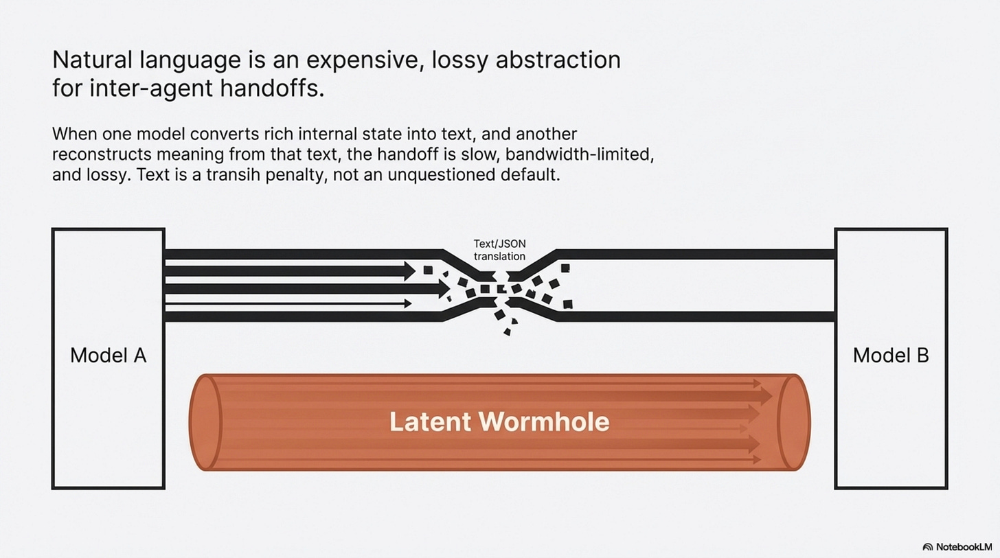](https://substackcdn.com/image/fetch/$s_!uj_x!,f_auto,q_auto:good,fl_progressive:steep/https%3A%2F%2Fsubstack-post-media.s3.amazonaws.com%2Fpublic%2Fimages%2Fbab3ea97-54b1-4803-bc34-bccb05d633e1_3823x2134.png)

*Latent Collaboration in Multi-Agent Systems* makes the cluster story stronger ([Zou et al., 2025](https://arxiv.org/abs/2511.20639)). Its LatentMAS setup is training-free, moves hidden-state information directly, and reports large gains in speed and token efficiency relative to text-based collaboration on its benchmarks ([Zou et al., 2025](https://arxiv.org/abs/2511.20639)). Whether those methods survive contact with production constraints is unresolved. But together they establish something more modest and more credible than a grand manifesto: researchers are no longer treating text relay as the unquestioned default for inter-agent communication.

[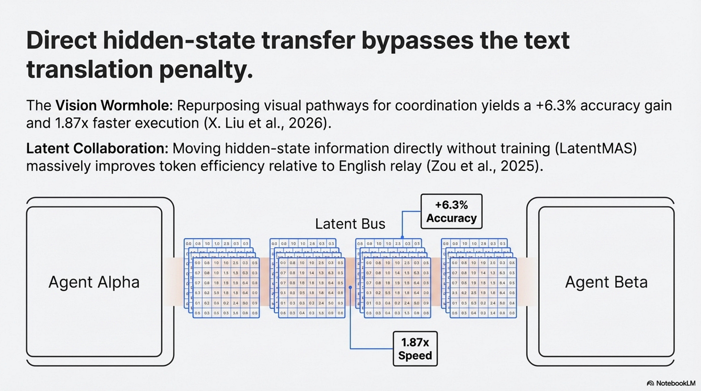](https://substackcdn.com/image/fetch/$s_!Ym63!,f_auto,q_auto:good,fl_progressive:steep/https%3A%2F%2Fsubstack-post-media.s3.amazonaws.com%2Fpublic%2Fimages%2Ff2417521-f890-481a-8adc-8ac63e97ec8c_3823x2134.png)

*EmCoop* adds a different kind of evidence ([H. Yang et al., 2026](https://arxiv.org/abs/2603.00349)). In its experiments, more communication is not automatically better. Unstructured, high-volume communication can destroy plan coherence and increase decision overhead. Structured coordination outperforms noisy debate. That does not prove latent channels are the answer. It does show that communication design is not a cosmetic implementation detail. It is a central systems variable.

[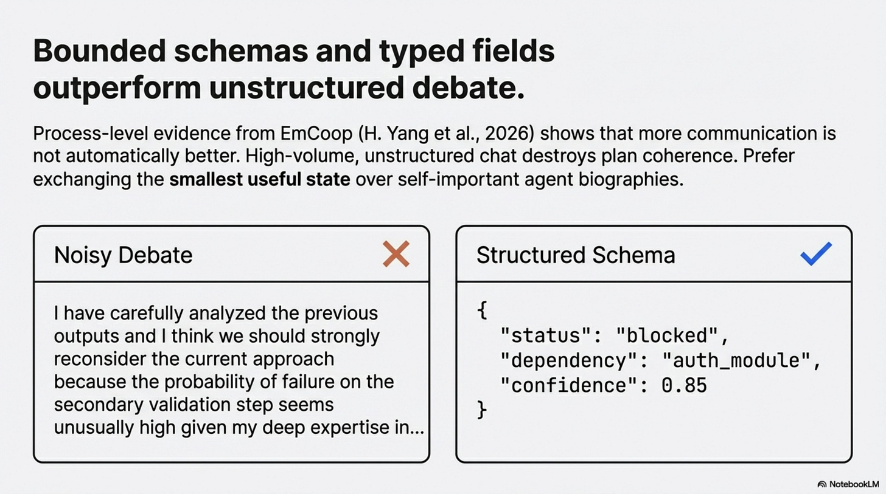](https://substackcdn.com/image/fetch/$s_!DzHi!,f_auto,q_auto:good,fl_progressive:steep/https%3A%2F%2Fsubstack-post-media.s3.amazonaws.com%2Fpublic%2Fimages%2Fca75727e-b278-4dc6-ac50-50e5743eddb9_3823x2134.png)

For builders, the near-term implication is not “install a latent bus.” It is much simpler: stop treating verbose natural-language handoffs as a free abstraction. If agents must talk, make them exchange the smallest useful state. Prefer typed fields over paragraphs. Prefer compact plans over autobiographies. Prefer bounded schemas over self-important debates. The frontier may be latent. The immediate win is almost always less chatter.

## 5. The Swarm as Training Rig

The most interesting long-run pattern in this literature is not that multi-agent systems will disappear. It is that some of their benefits can be turned into training or policy improvements elsewhere.

*EMPO2* gives the cleanest mechanism ([Z. Liu et al., 2026](https://arxiv.org/abs/2602.23008)). During training, the agent gets external memory tips that improve exploration. During off-policy updates, the system recomputes probabilities without those tips so the base policy can absorb the useful behavior ([Z. Liu et al., 2026](https://arxiv.org/abs/2602.23008)). On ScienceWorld and WebShop, that hybrid approach materially outperforms the reported GRPO baselines, and it also helps on the paper’s out-of-distribution evaluations ([Z. Liu et al., 2026](https://arxiv.org/abs/2602.23008)). The lesson is not “memory is solved.” It is that external scaffolding can be useful precisely because it produces trajectories worth internalizing.

[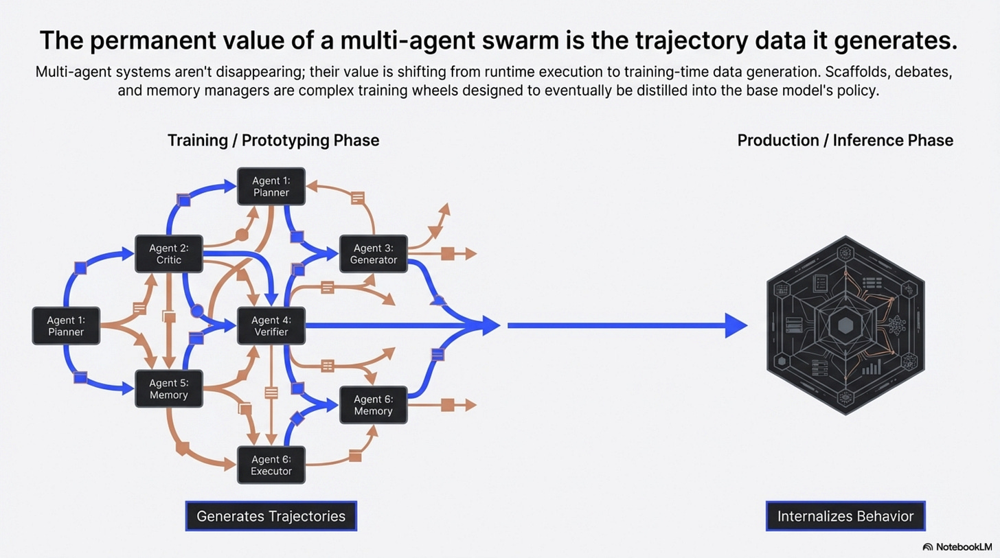](https://substackcdn.com/image/fetch/$s_!n0Tp!,f_auto,q_auto:good,fl_progressive:steep/https%3A%2F%2Fsubstack-post-media.s3.amazonaws.com%2Fpublic%2Fimages%2F5cc222ef-8136-4e92-a74b-fe3a2d878fbd_3823x2134.png)

*Agentic Memory* makes a related point for state management ([Yu et al., 2026](https://arxiv.org/abs/2601.01885)). Instead of treating long-term and short-term memory as separate controllers, it exposes memory operations as tool-like actions inside the policy itself and trains the agent to decide when to store, retrieve, update, summarize, filter, or delete ([Yu et al., 2026](https://arxiv.org/abs/2601.01885)). On the evaluated benchmarks, that unified memory policy improves performance and context efficiency over strong baselines ([Yu et al., 2026](https://arxiv.org/abs/2601.01885)). If your current architecture requires a separate memory agent mainly because the base agent cannot govern memory well, this is exactly the kind of result that should make you rethink the boundary.

Now that *AgentArk* is verified, it belongs here too, but with narrower wording than before ([Luo et al., 2026](https://arxiv.org/abs/2602.03955)). It does not prove that all multi-agent intelligence can be transferred into one model with negligible loss. It does show that distilling multi-agent reasoning traces into a single agent can produce better single-agent performance, and that process-aware distillation is the strongest of the paper’s tested strategies ([Luo et al., 2026](https://arxiv.org/abs/2602.03955)). That is enough to support an emerging pattern.

The pattern is this: a swarm can be a training rig.

[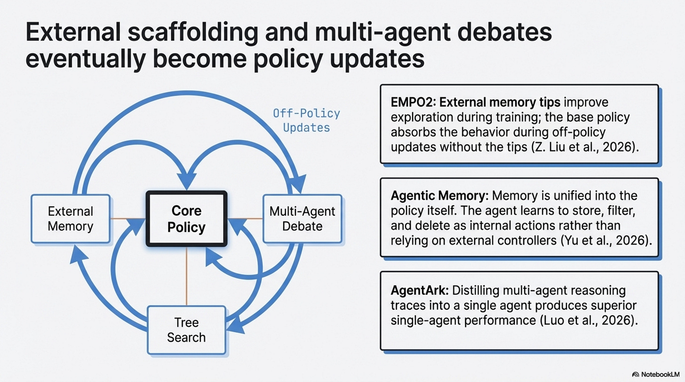](https://substackcdn.com/image/fetch/$s_!mgpJ!,f_auto,q_auto:good,fl_progressive:steep/https%3A%2F%2Fsubstack-post-media.s3.amazonaws.com%2Fpublic%2Fimages%2Fc4cb1168-00b9-443c-b3f1-9f8e810be00d_3823x2134.png)

That frame is worth keeping because it is operationally useful. Prototype with scaffolds. Log good debates, routing decisions, memory operations, and corrections. Ask which parts are valuable because they generate diverse or corrective trajectories, and which parts are just expensive inference-time ceremony. Internalize what you can. Keep the scaffolding when it is genuinely load-bearing because of trust, heterogeneity, or real distributed coordination.

This is not a law of history, it is a healthier engineering loop.

## What To Build Differently Starting Monday

If you ship agent systems, the practical playbook from this literature is straightforward.

1. Start with a single agent when the system is one model plus tools. Do not add personas until you can name the specific bottleneck you are fixing.
2. When routing starts to fail, think in namespaces and local action spaces. Better decomposition usually beats more theatrical prompting.
3. If you do split the system, avoid flat committees. Use recursive or skill-aware routing that keeps each decision below the confusion threshold ([Li, 2026](https://arxiv.org/abs/2601.04748); [Alzu’bi et al., 2026](https://arxiv.org/abs/2602.01848); [Wang et al., 2026](https://arxiv.org/abs/2602.19672)).
4. Treat communication as a design surface. Minimize natural-language handoffs first; experiment with richer internal channels only where the cost is justified ([X. Liu et al., 2026](https://arxiv.org/abs/2602.15382); [H. Yang et al., 2026](https://arxiv.org/abs/2603.00349); [Zou et al., 2025](https://arxiv.org/abs/2511.20639)).
5. Measure process, not just outcomes. If you cannot see interruptions, communication load, plan coherence, or routing collapse, you do not really know why your system works ([Kim et al., 2025](https://arxiv.org/abs/2512.08296); [H. Yang et al., 2026](https://arxiv.org/abs/2603.00349); [Zhu et al., 2025](https://arxiv.org/abs/2503.01935)).
6. Treat scaffolds as candidates for internalization. External memory, review passes, multi-agent debates, and exploratory helpers may belong in training, adaptation, or fallback paths rather than the hot path of every production request ([Z. Liu et al., 2026](https://arxiv.org/abs/2602.23008); [Yu et al., 2026](https://arxiv.org/abs/2601.01885); [Luo et al., 2026](https://arxiv.org/abs/2602.03955)).

   [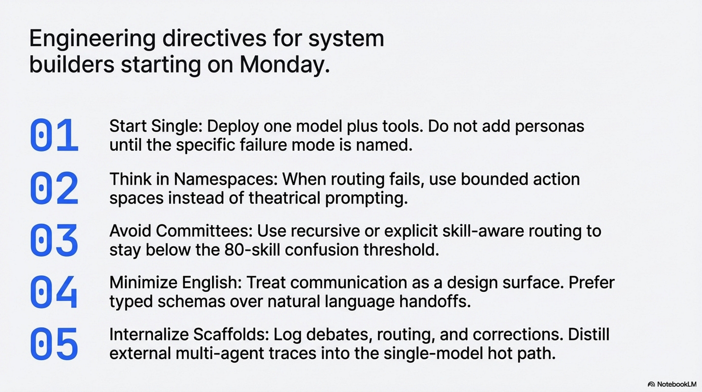](https://substackcdn.com/image/fetch/$s_!5qv6!,f_auto,q_auto:good,fl_progressive:steep/https%3A%2F%2Fsubstack-post-media.s3.amazonaws.com%2Fpublic%2Fimages%2Fd8f7f767-fec0-43dd-948a-a38a08f21004_3823x2134.png)

A skeptical engineer should be able to summarize the whole thesis in one sentence: multi-agent systems are often useful, but their value usually comes from specific coordination mechanisms, and many of those mechanisms can be simplified, compressed, or internalized once you know what problem they were solving.

## Two Predictions For Q1 2027

I would make only two predictions from this set, and both are falsifiable.

**Prediction 1:** By March 31, 2027, at least one major agent framework or hosted agent platform will ship built-in graph simplification or evaluator tooling that recommends collapsing some multi-agent workflows into a single-agent-plus-tools configuration. This is falsified if, by that date, mainstream platforms still treat multi-agent graphs as design-time artifacts only, with no first-class optimization or simplification pass.

**Prediction 2:** By March 31, 2027, at least two publicly described production compound-AI systems from major vendors or labs will use non-text intermediate handoffs for selected internal coordination paths, whether via typed state transfer, model-native state transfer, or latent channels. This is falsified if public production descriptions still rely exclusively on natural-language or JSON relay for internal multi-model coordination.

[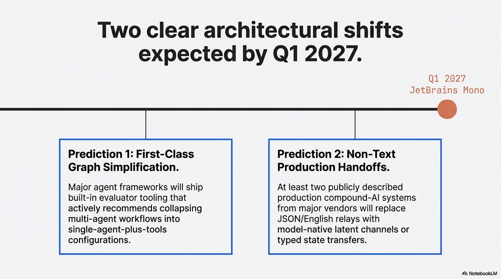](https://substackcdn.com/image/fetch/$s_!IIZ_!,f_auto,q_auto:good,fl_progressive:steep/https%3A%2F%2Fsubstack-post-media.s3.amazonaws.com%2Fpublic%2Fimages%2Fd1f3a503-5088-4f4d-b55b-9a1e03dd0553_3823x2134.png)

Those are narrower predictions than the earlier draft made. That is intentional. The research here is good enough to change how builders think, it is not yet good enough to support prophecy.

The next frontier is not “more agents,” it is better answers to four questions: when should a system split, what should be kept local, how should state move, and which scaffolds deserve to survive deployment.

## References

### Li (2026), [When Single-Agent with Skills Replace Multi-Agent Systems and When They Fail](https://arxiv.org/abs/2601.04748)

This is the anchor paper for the whole piece. Its main contribution is not just the headline efficiency result, though the 53.7% token reduction and 49.5% latency reduction are the numbers that make the argument hard to ignore. More important is the structure of the result: the paper shows both when a multi-agent system can be compiled into a single agent with skills and where that simplification starts to break. That is why it supports both the “workaround” thesis and the later argument about the skill-selection collapse zone.

### X. Yang et al. (2026), [Toward Efficient Agents: Memory, Tool Learning, and Planning](https://arxiv.org/abs/2601.14192)

This survey matters because it broadens the argument beyond one benchmark paper. Its contribution is synthetic rather than singular: it shows that efficient-agent research keeps converging on the same recurring techniques, especially context management, memory control, tool learning, and planning efficiency. In the article, it serves as field context that makes the main thesis feel grounded rather than anecdotal.

### Kim et al. (2025), [Towards a Science of Scaling Agent Systems](https://arxiv.org/abs/2512.08296)

This paper is the strongest corrective against simplistic claims that multi-agent either always helps or usually fails. Its key contribution is the controlled comparison across 180 system configurations, varying agent count, topology, model capability, and task type. That makes it useful for the article’s central moderation point: multi-agent is a conditional tool whose value depends heavily on task structure, budget, and coordination cost.

### Alzu’bi et al. (2026), [ROMA: Recursive Open Meta-Agent Framework for Long-Horizon Multi-Agent Systems](https://arxiv.org/abs/2602.01848)

ROMA is important because it shows what a substantive multi-agent architecture contribution looks like. Its main contribution is a recursive decomposition-and-aggregation framework designed for long-horizon tasks, with explicit roles that keep local decision spaces manageable. In the article, it functions as the best counterexample to the claim that multi-agent is merely cosmetic: it demonstrates that structured decomposition can create real gains when the problem genuinely requires it.

### Wang et al. (2026), [SkillOrchestra: Learning to Route Agents via Skill Transfer](https://arxiv.org/abs/2602.19672)

SkillOrchestra contributes a more explicit view of routing. Rather than relying on vaguely defined personas, it models agent competence and cost through a reusable skill handbook and uses that structure to inform routing decisions. That is why it belongs in the article’s discussion of disambiguation and orchestration design: it supports the claim that better routing formalisms are often more useful than adding more agent identities.

### X. Liu et al. (2026), [The Vision Wormhole: Latent-Space Communication in Heterogeneous Multi-Agent Systems](https://arxiv.org/abs/2602.15382)

This paper contributes one of the clearest current arguments that text can be a bottleneck in inter-agent communication. Its setup uses the visual pathway of vision-language models as a higher-bandwidth coordination channel and reports both accuracy and speed improvements over text-based coordination in the tested systems. In the article, it does two jobs: it supports the idea that heterogeneity can make multi-agent structure genuinely necessary, and it provides concrete evidence for the communication argument.

### Tomašev et al. (2026), [Intelligent AI Delegation](https://arxiv.org/abs/2602.11865)

This is not the paper to cite for sweeping performance claims, but it is useful for a different reason. Its contribution is conceptual: it frames delegation as a problem of authority, role structure, and governance rather than as pure capability multiplication. That is exactly why it appears in the article’s section on trust boundaries. It helps explain why some multi-agent separations remain valuable even when a single model might be capable enough in principle.

### H. Yang et al. (2026), [EmCoop: A Framework and Benchmark for Embodied Cooperation Among LLM Agents](https://arxiv.org/abs/2603.00349)

EmCoop contributes process-level evidence. Instead of treating final task success as the only metric, it measures message count, decision overhead, and plan coherence across different coordination topologies. That makes it especially valuable for the article because it shows that communication design materially changes system behavior. The paper is one of the best sources here for the claim that coordination has to be measured, not assumed.

### Zhu et al. (2025), [MultiAgentBench: Evaluating the Collaboration and Competition of LLM Agents](https://arxiv.org/abs/2503.01935)

This benchmark contributes evaluation infrastructure for agent systems rather than one single architectural thesis. Its importance in the article is that it treats coordination protocols, milestone tracking, and process quality as first-class evaluation targets. That supports the broader claim that understanding why an agent system works requires observability into process, not just a final output score.

### Z. Liu et al. (2026), [Exploratory Memory-Augmented LLM Agent via Hybrid On- and Off-Policy Optimization (EMPO2)](https://arxiv.org/abs/2602.23008)

EMPO2 contributes a concrete mechanism for turning scaffolding into learning. The paper shows how external memory tips can improve exploratory trajectories during training while still allowing the base policy to absorb useful behavior during updates. That is why it is central to the “swarm as training rig” section: it gives a plausible, technically grounded account of how external support can produce behavior worth internalizing.

### Zou et al. (2025), [Latent Collaboration in Multi-Agent Systems](https://arxiv.org/abs/2511.20639)

This paper strengthens the case that text is not always the best communication substrate for machine-to-machine coordination. Its contribution is a training-free latent-state collaboration setup that reports speed and token-efficiency gains relative to text-based alternatives on its evaluated tasks. In the article it works as corroborating evidence, reinforcing the communication thesis without forcing the whole argument to rest on one paper.

### Yu et al. (2026), [Agentic Memory: Learning Unified Long-Term and Short-Term Memory Management for LLM Agents](https://arxiv.org/abs/2601.01885)

Agentic Memory contributes a unified policy view of memory operations. Rather than treating memory as an external controller, it exposes storing, retrieving, updating, summarizing, filtering, and deleting as actions the agent learns to manage directly. That matters for the article because it supports the argument that some boundaries currently implemented as separate agents may be better understood as policy-level control problems.

### Luo et al. (2026), [AgentArk: Distilling Multi-Agent Intelligence into a Single LLM Agent](https://arxiv.org/abs/2602.03955)

AgentArk contributes direct evidence for distilling multi-agent traces into a single model. Its value is not that it proves all useful swarms can be collapsed away, but that it shows process-aware distillation can improve single-agent performance in a measurable way. That makes it a useful piece of support for the article’s narrower claim that some multi-agent value lies in the trajectories and traces the system produces, not necessarily in the permanent runtime graph.

[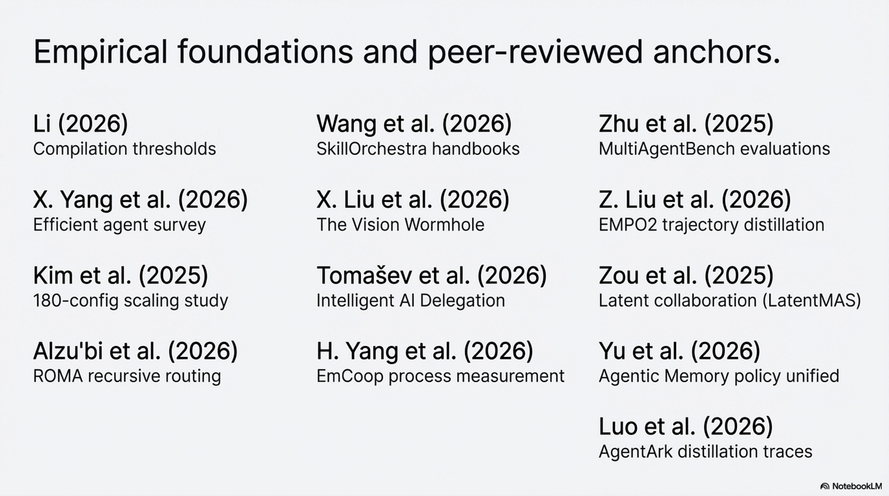](https://substackcdn.com/image/fetch/$s_!TQe1!,f_auto,q_auto:good,fl_progressive:steep/https%3A%2F%2Fsubstack-post-media.s3.amazonaws.com%2Fpublic%2Fimages%2F6d8b2bf4-7b33-40f4-8db7-b770a4023b36_3823x2134.png)

Thanks for reading Rooted Layers! Subscribe for free to receive new posts and support my work.