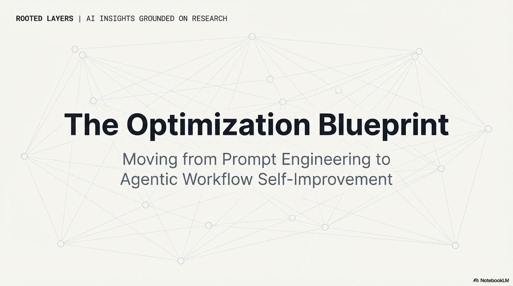
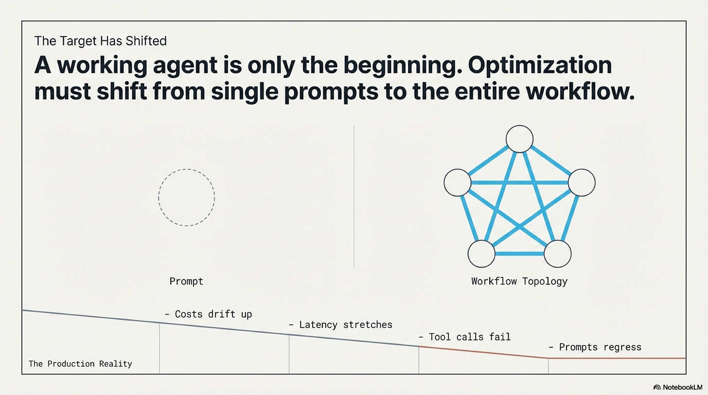
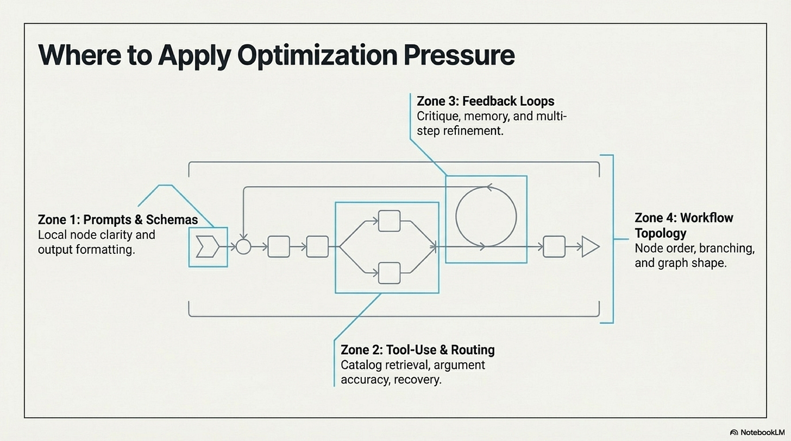
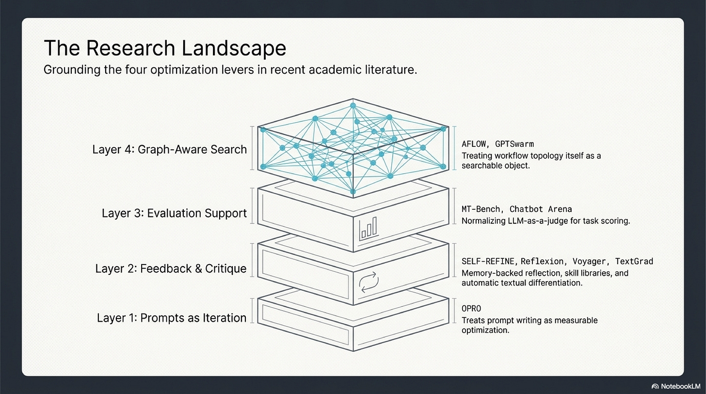
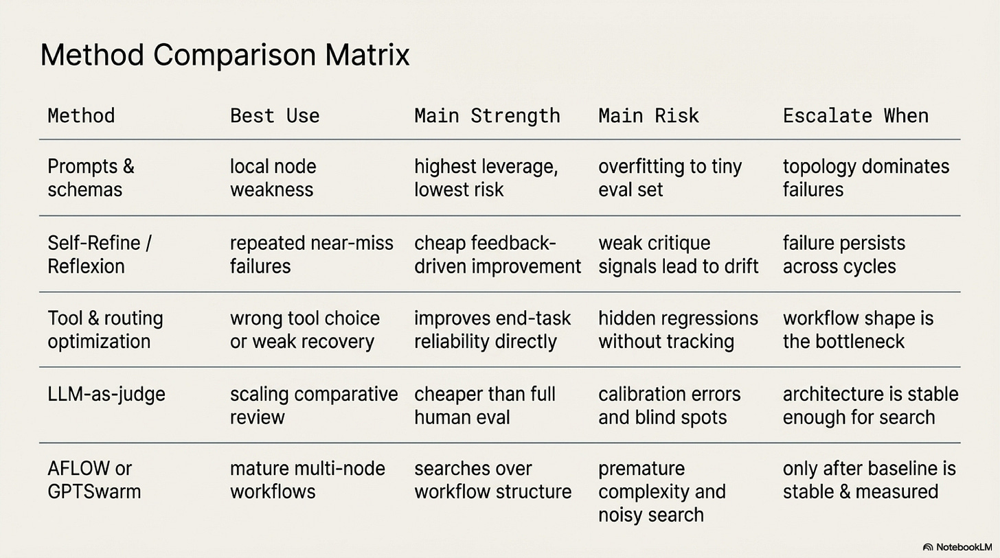
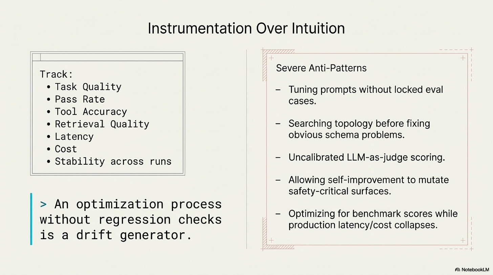
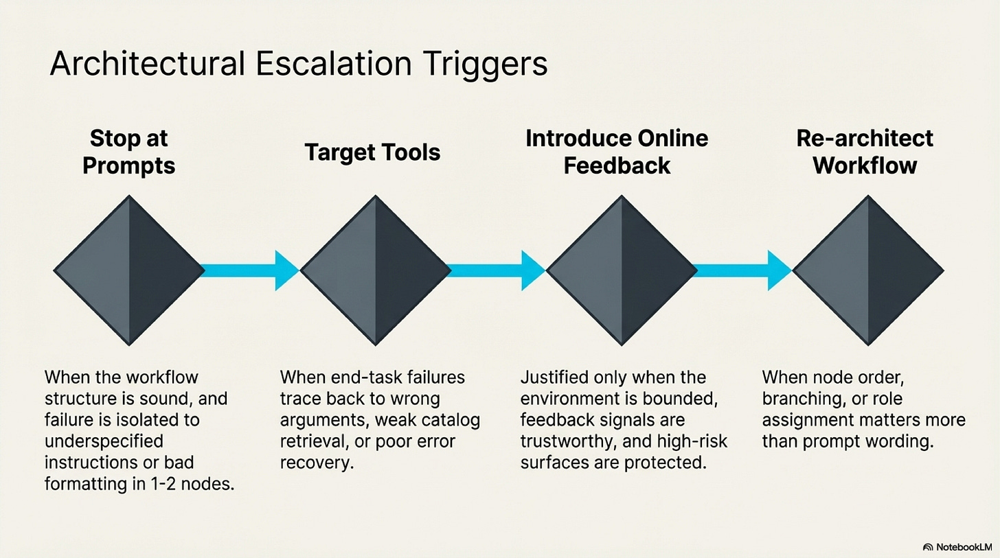
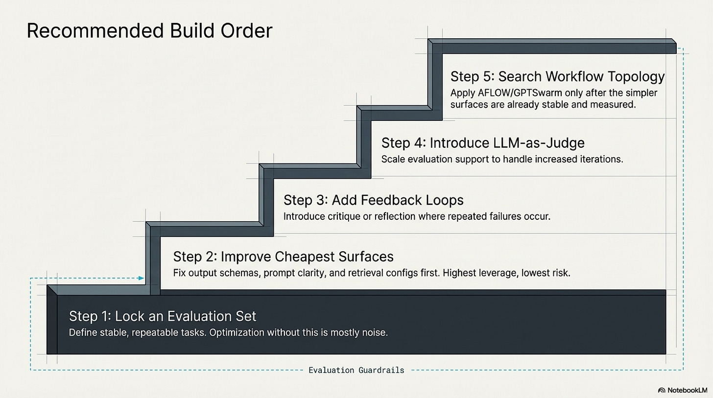
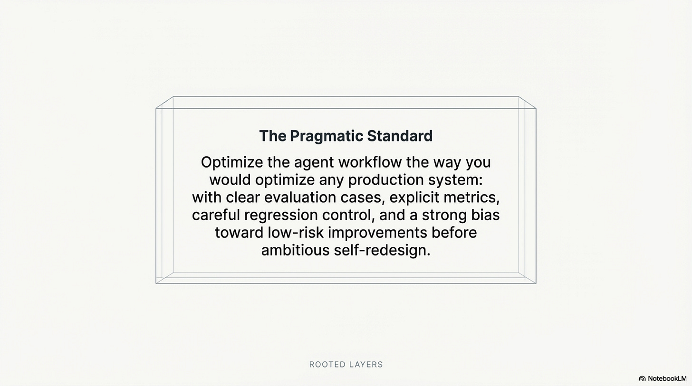

# Operating Agents Bonus: Workflow Optimization and Evaluation

Date: 2026-03-27
URL: https://lambpetros.substack.com/p/operating-agents-bonus-the-workflow

*Part of the Operating Agents series, a builder-first run on how modern agent systems actually work once language leaves the prompt and starts acting inside software.*

#### Video TL;DR

Optimization stays last because the workflow becomes the object only after it is stable enough to deserve improvement. Before that point, prompt tuning is usually just movement on the easiest visible surface rather than progress on the system that actually carries the work.

Most agent optimization is fake.

A team spent six weeks improving a document-routing workflow that was already useful enough to be tempting. Humans still corrected the tail of the work, but the economics made sense and the system was stable enough that the team decided it was time to improve it.

Over the next month they edited the prompt repeatedly. One revision seemed to help the recent failures everyone still remembered. Another quietly improved performance on renewal cases while making escalations noisier downstream. Tool descriptions changed. Instructions got longer. The team debated phrasing with the urgency people reserve for work that feels productive.

Nothing important improved because the team was tuning the easiest visible surface before it had stabilized the objective. There was no fixed evaluation set, no clean failure taxonomy, no agreement about whether latency and correction rate belonged inside the goal, and no serious view of whether the underlying issue lived in schema design, routing, retrieval quality, or prompt wording at all.

That is the anti-pattern. Prompt churn without measurement.

That framing is the optimization distillation taken here from the broader [foundation-agents survey](https://arxiv.org/abs/2504.01990) and tightened in the local [optimization blueprint](https://github.com/petroslamb/content/blob/main/autonomous-agent-blueprint/core/practical-chapter-blueprints/04-optimization-self-improvement-blueprint.md). The transcript gives the sequence, but the core claim is simpler: optimization begins only once the workflow, the objective, and the evaluation loop are stable enough to argue about without drifting every week.

## Optimization Starts When The Objective Stops Moving

The field likes to discuss optimization at the exciting end. Prompt search. Self-improving graphs. Systems that rewrite themselves. Production teams usually need a duller first move.

They need to freeze the object of argument.

*[OPRO](https://arxiv.org/abs/2309.03409)* mattered because it made that prerequisite impossible to ignore. Its visible claim was that prompts can be optimized by search. Its deeper claim was that optimization presupposes an objective and a repeated evaluation loop. Without those two things there is no optimization. There is only editing.

That distinction sounds basic. Teams violate it constantly. The last ugly incident gets more influence than the fifty tasks that quietly stayed stable. A prettier answer is mistaken for a better workflow. A shorter prompt is mistaken for a better system. The objective keeps moving with the latest memory of failure, and the team keeps calling the movement progress.

If the objective is still moving, prompt work is just recency bias with better formatting.

## Evaluation Is Part Of The System

Evaluation is often treated as a phase that begins after the system exists. That is a category error. A real evaluation layer is part of the system. It has defined cases, defined outcomes, owners, stored comparisons over time, and regression conditions that can stop a bad change from being celebrated as an improvement.

*[MT-Bench and Chatbot Arena](https://arxiv.org/abs/2306.05685)* mattered because it made model-based judging operational enough to use at scale. The important lesson was not that automated judges are magically trustworthy. It was that comparative evaluation can become usable when it is calibrated and tied to a concrete review design. In agent systems that lesson matters even more because the object being judged is not only answer quality. It is tool use, schema adherence, approval burden, retries, latency, cost, and correction load across representative tasks.

Once that layer exists, optimization arguments get less theatrical. The prompt may not be the problem. The output schema may be turning a decent answer into downstream failure. The routing logic may be sending the wrong cases down a brittle path. The evidence layer may be weak enough that no wording change can save it.

The workflow is the object because the prompt is only one surface inside it.

## Failure Classes Matter More Than Average Lift

A local change can still make the system worse.

That is the mistake teams make when they optimize toward one recent failure slice and stop there. A routing threshold lowers latency on easy cases while pushing harder cases into a fragile path. A classification prompt improves on renewals while making escalations noisier. A cleaner answer format pleases a judge while quietly breaking the downstream parser. Average scores move in the right direction while the expensive tail gets worse.

Serious optimization work therefore tracks failure categories, not only blended averages. The question is not only whether a metric moved. It is which failure class moved, what downstream consumer was affected, and whether the claimed gain survived contact with the rest of the workflow.

## Human Review Load Belongs In The Score

One of the easiest optimization mistakes is to treat human effort as an externality. The system gets slightly more accurate on paper, but reviewers now spend longer unwinding noisy artifacts, fixing schema drift, or handling a larger tail of ambiguous cases routed into manual review. The dashboard says improvement. The workflow feels worse.

Serious optimization work therefore counts review burden inside the objective. Approval rate, correction time, exception volume, and rework per case are not side notes. They are part of the system cost. If a change improves one node while making the human boundary slower, noisier, or harder to trust, the workflow has not clearly improved. It has shifted cost to a surface teams often forget to measure.

That is one reason failure-class accounting matters so much. The tail often lands on a human.

## Improve In A Conservative Order

The useful rule here is not optimize everything. It is repair the cheapest truth-preserving surface first.

Freeze the evaluation set and the regression guard. Tighten schemas. Repair routing. Clean the evidence layer. Make tool descriptions and return objects less misleading. Tune prompts only after the surrounding interfaces stop lying to you. Add bounded feedback loops only after the baseline is stable enough that the signal is real. Search workflow structure only after simpler explanations for failure have already been ruled out.

That order is conservative because most systems do not fail from insufficient ambition. They fail from premature complexity.

## Bounded Self-Improvement Is The Only Version Worth Trusting

The more ambitious optimization papers belong in the story, but they belong late.

*[Voyager](https://arxiv.org/abs/2305.16291)* remains one of the most useful references here because it shows a believable form of improvement. The system does not become trustworthy by rewriting itself everywhere at once. It accumulates validated routines into a skill library. Promote only the behavior that has earned promotion.

That is the sane interpretation of later optimization work as well. If schemas are sloppy, retrieval is weak, or the failure taxonomy is still muddy, a self-improving system will optimize around noise. It will produce local changes that look persuasive against an unstable target, and the team will mistake drift for intelligence because the system authored some of the edits itself.

Bounded self-improvement is the version worth keeping. Improve only the surfaces you can evaluate. Promote only the routines that repeatedly survive review. Let judge systems and workflow search arrive only after the baseline is already measurable and stable.

Freeze the object before you tune the surface.

## References

[Advances and Challenges in Foundation Agents: From Brain-Inspired Intelligence to Evolutionary, Collaborative, and Safe Systems](https://github.com/petroslamb/content/blob/main/autonomous-agent-blueprint/advances-and-challenges-in-foundation-agents.md) ([arXiv](https://arxiv.org/abs/2504.01990)) is the source booklet from which this chapter was ultimately distilled. Its key contribution is breadth. It places optimization inside the wider operating stack of action, memory, reasoning, coordination, and safety. This essay narrows that larger survey into one practical argument: optimization only begins once the workflow itself has become a stable, measurable object.

[Chapter 9 Blueprint: Workflow Optimization and Evaluation](https://github.com/petroslamb/content/blob/main/autonomous-agent-blueprint/core/practical-chapter-blueprints/04-optimization-self-improvement-blueprint.md) is the builder-facing backbone for this chapter. Its key contribution is conservative sequencing. It fixes the order of operations around evaluation sets, regression guards, failure taxonomies, routing, schema repair, prompt tuning, and bounded self-improvement so teams do not optimize the noisiest visible surface first.

[Optimizing AI Agent Workflows for Production transcript](https://github.com/petroslamb/content/blob/main/autonomous-agent-blueprint/essays/optimization/artifacts/transcript_Optimizing%20AI%20Agent%20Workflows%20for%20Production_full.txt) is the direct narrative source behind this draft. Its key contribution is the sequence the essay follows: the anti-pattern of prompt churn, the need to freeze the objective, evaluation as part of the system, failure-class accounting, human review load inside the score, and the narrow conditions under which self-improvement is worth trusting.

*[OPRO](https://arxiv.org/abs/2309.03409)* matters because it makes the prerequisite for optimization painfully clear. Its key contribution is forcing the field to admit that no stable objective means no real optimization. This essay uses that move to separate editing from improvement.

*[MT-Bench and Chatbot Arena](https://arxiv.org/abs/2306.05685)* matter because they made comparative judging operational enough to influence real workflows. Their key contribution here is not blind trust in automated judges but the idea that evaluation can be explicit, calibrated, and part of the system rather than an afterthought.

*[Voyager](https://arxiv.org/abs/2305.16291)* matters because it shows a believable path to bounded improvement. Its key contribution is promoting validated routines rather than mutating every surface at once. This essay leans on that restraint as the sane version of self-improvement.

*[TextGrad](https://arxiv.org/abs/2406.07496)* matters because it sharpens the question of local optimization over bounded surfaces. Its key contribution is showing that local improvement can be real when the target and objective are already stable, which is exactly the condition this essay keeps returning to.

*[AFLOW](https://arxiv.org/abs/2410.10762)* matters because it pushes optimization up from prompts to workflow structure itself. Its key contribution is clarifying where the frontier is actually heading, while also making clear why late power and early restraint belong together.
