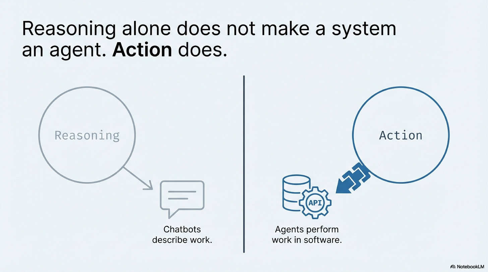
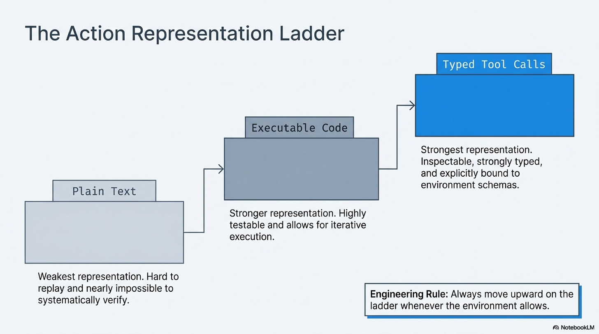
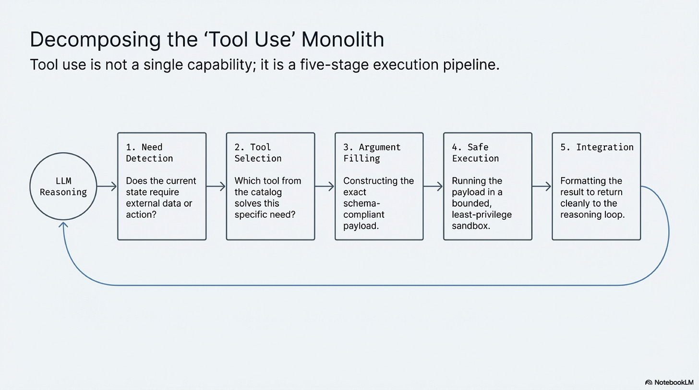
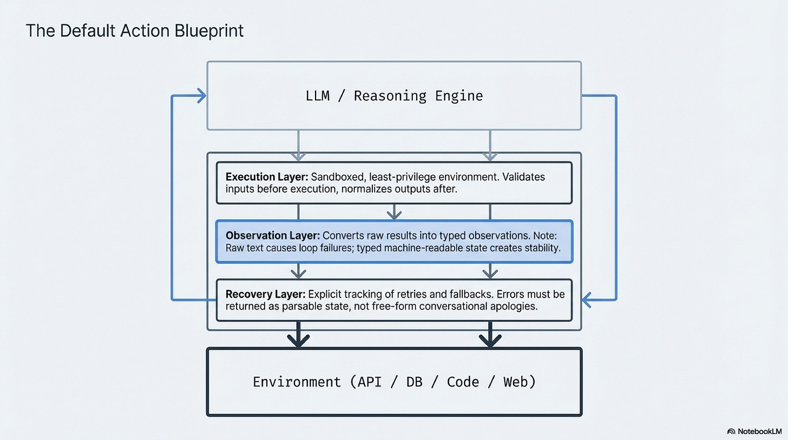
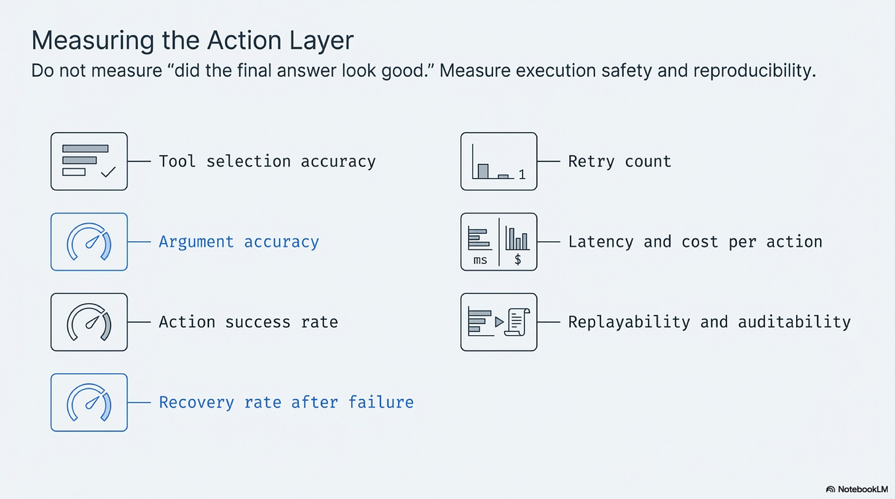
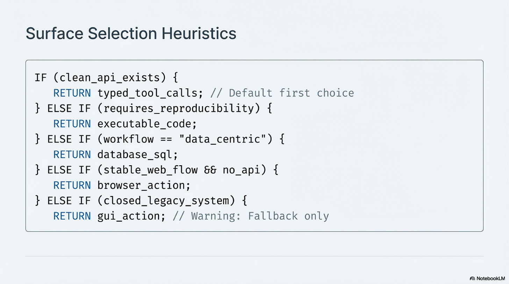
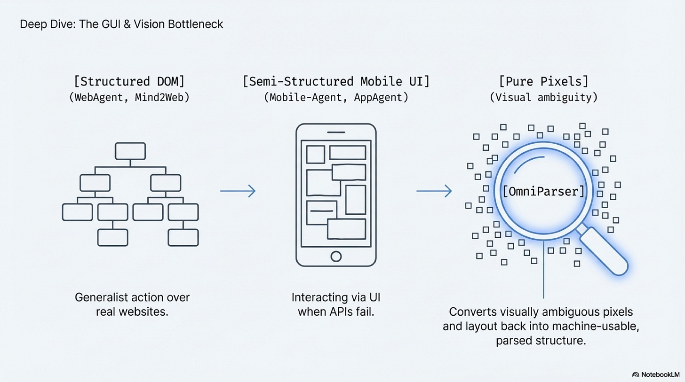
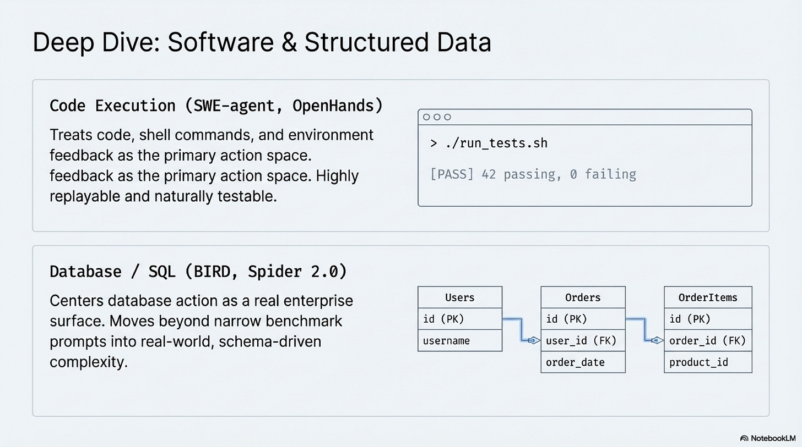
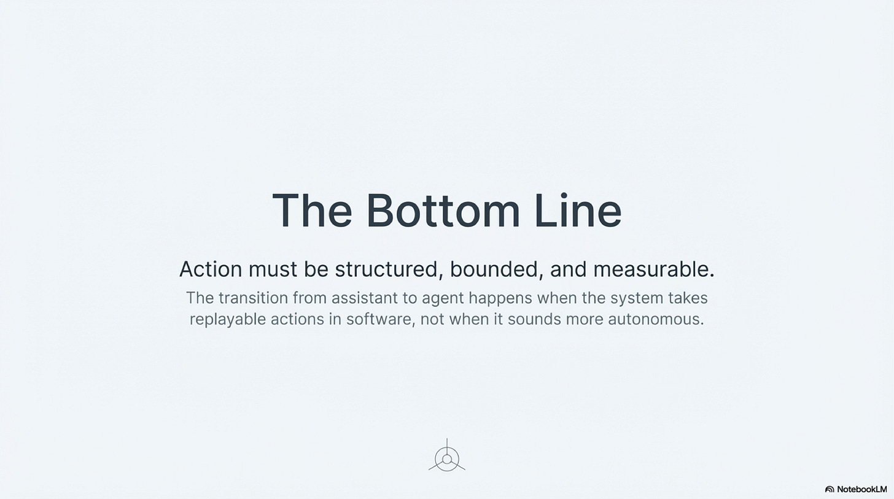

# Operating Agents I: Action Systems and Tool Use

Date: 2026-03-27
URL: https://lambpetros.substack.com/p/operating-agents-i-when-language

*Part of the Operating Agents series, a builder-first run on how modern agent systems actually work once language leaves the prompt and starts acting inside software.*

#### Video TL;DR

## When Language Starts Doing Work

A language model can explain a batch file rename perfectly and still leave every file untouched. It can describe the shell command, warn about edge cases, and even produce a neat Python script for the job. Nothing in the directory changes until something executes the write, checks the result, and confirms that the state of the world is now different from what it was a minute earlier. That gap is where most of the confusion around agents begins. Systems that speak fluently about work are often treated as if they have already crossed into doing the work. They have not.

This is the boundary that matters in action systems. The move from assistant to agent does not happen when a model sounds more forceful or more self-directed. It happens when language stops serving only as description and starts participating in state change. The moment an output can call an API, run code, submit a form, query a live database, or alter a software environment, the engineering problem changes with it. The question is no longer whether the model can produce plausible text about a task. The question is whether the system can take an action that is bounded, observable, replayable, and correct. That framing is the core action distillation taken here from the broader [foundation-agents survey](https://arxiv.org/abs/2504.01990) and tightened in the local [action blueprint](https://github.com/petroslamb/content/blob/main/publications/autonomous-agents/core/practical-chapter-blueprints/03-action-tool-use-blueprint.md).

That shift is easier to see when action is treated as a representation problem instead of a marketing label. At the weakest end of the ladder sits plain text. A model writes, "I updated the customer record," and a human reader may feel satisfied. A machine should not. Plain text is hard to verify, hard to replay, and easy to misread. It carries intent in the loosest possible form. Code is stronger because it is executable and testable. A script can run, fail, return an error, or produce a measurable artifact. Typed tool calls are stronger still because they force intent into a narrow contract. A function call with defined fields, checked arguments, and structured output gives the system far less room to hide its mistakes inside a graceful paragraph.

This is why the gap between describing work and performing work does not close through reasoning alone. It closes when the action channel becomes strict enough that the model has to commit to something machine-readable. Once that happens, failure stops looking like vague weakness in the model and starts appearing at precise seams in the loop. The transcript is strongest here because it refuses to talk about tool use as one ability. It breaks the process into the places where systems actually fail.

## Where Tool Use Breaks

The first seam is tool need detection. A model has to recognize that the answer is not already inside its static training distribution and that live state is required. This sounds obvious until you watch a system bluff. Ask for a flight next Tuesday, a current balance, or a production metric, and the model has to suspend the impulse to answer from plausibility. It has to reach the colder conclusion that the right next step is not another sentence but an external call. A surprising amount of fragility begins here, because a system that fails to notice the need for action never reaches the rest of the pipeline.

The second seam is tool selection. Once a system knows it needs help from the world outside the prompt, it still has to choose the right interface. That problem grows harder as the catalog grows larger. In the abstract, "use a tool" sounds like one decision. In practice, it becomes a discrimination problem among overlapping APIs, search functions, internal services, data paths, and execution surfaces. A system can understand the task and still pick the wrong handle for it. That is one reason papers like *[Toolformer](https://arxiv.org/abs/2302.04761)* and *[Gorilla](https://arxiv.org/abs/2305.15334)* mattered when they appeared. They made tool use less mystical and more specific. The field had to stop asking whether a model could call a tool in principle and start asking whether it could identify the right one under real interface pressure.

Then comes argument filling, which is where many impressive systems fall apart in ways that look almost petty. The right tool is selected, but one field is wrong. A date arrives in the wrong order. A location is passed as free text when the schema expects an airport code. A status enum drifts. A parameter name changes in the documentation and the call quietly becomes invalid. This is not a side issue. It is often the entire action problem in miniature. The model may understand the business task perfectly and still fail because software does not reward approximation at the boundary. *[Gorilla](https://arxiv.org/abs/2305.15334)* helped make that plain by framing tool use as an API understanding problem rather than as a vague extension of general reasoning.

Even correctly formed intent is not enough. The next seam is execution itself. A system has to run the action inside a permission boundary that matches the task, with checks that keep obvious nonsense from reaching the environment. If the workflow needs read access to a database, read access is enough. If it needs to execute code, the code runs in a sandbox rather than against the open surface of a production machine. This part of the loop often receives less attention than planning because it looks mundane beside the spectacle of a model making decisions. It is not mundane at all. It is where architecture decides whether a small generation error becomes a recoverable miss or a live incident. And when the task itself spans multiple specialist capabilities rather than one narrow surface, orchestration work like *[HuggingGPT](https://arxiv.org/abs/2303.17580)* becomes relevant because the controller has to route execution cleanly instead of pretending one generic node can do everything.

The fifth seam is result integration, and it is the one teams routinely underestimate. Tool output is not self-explanatory just because it comes from a real system. An API may return an acknowledgment that means queued rather than complete. A database query may succeed but expose partial data. A shell command may emit a long stack trace that contains the one line that matters buried under noise. If raw output is dumped back into the model as a block of text, the system is pushed back toward the same ambiguity that made plain text a weak action representation in the first place. Reliable loops therefore do not only constrain invocation. They also constrain observation. Results have to come back in a shape the next step can reason over without guessing what happened.

Seen together, these seams explain why action systems have such a different feel from ordinary chatbot evaluation. The public tends to judge by surface confidence. Did the final answer look coherent. Did the system sound sure of itself. Did the demo keep moving. Builders cannot afford that luxury. They need to know whether the right tool was chosen, whether the arguments were valid on the first try, whether execution succeeded safely, whether recovery happened after failure, and whether the entire sequence can be replayed after the fact. The unit of trust is no longer the paragraph. It is the action trace.

## Choosing the Surface

This is also where the choice of action surface starts to matter more than many teams expect. If a clean API exists, that is usually the best place to begin because the environment already exposes a contract designed for machines. Code is the right surface when the task needs reproducibility, transformation, or testable logic. SQL belongs here as well, especially in enterprise work, because many high-value tasks are really structured data questions wearing the costume of general intelligence. Browser action enters only when the system that matters exposes no usable interface beyond the web itself. GUI action sits even farther out at the edge, where the software world has given the agent nothing but pixels, visual ambiguity, and shifting layouts.

Each step away from typed interfaces increases the interpretive burden placed on the system. Browser control can still be effective, but selectors drift, page flows change, and completion is often implied rather than declared. GUI control is weaker still because the system is forced to infer structure from screenshots and coordinate systems that were designed for human eyes rather than machine contracts. That is exactly the pressure described by *[WebAgent](https://arxiv.org/abs/2307.12856)* on the browser side and by *[OmniParser](https://arxiv.org/abs/2408.00203)* once the interface collapses into pixels. This is why the most theatrical demos can be the least informative. A model clicking through a desktop may look more agentic than a typed service call. The quieter system is often the one with the stronger boundary.

That pattern shows up again in software engineering, which is why work like *[SWE-agent](https://arxiv.org/abs/2405.15793)* landed with such force. The point was not that code agents had become magically autonomous. The point was that repositories, shells, file operations, and tests form an action surface with harder feedback than prose ever can. A test passes or fails. A file edit applies or does not. An error log exposes the mismatch between intent and environment. Once a model can work inside that loop, the conversation about capability becomes less theatrical and more operational. The same logic extends to data systems. When an agent speaks SQL against live schemas instead of pretending to reason over exported text, the environment itself does part of the truth maintenance, which is why benchmarks like *[Spider 2.0](https://arxiv.org/abs/2411.07763)* matter more than older, cleaner text-to-SQL setups.

## The World These Systems Need

What emerges from all of this is a less glamorous view of agency and a more useful one. Reliable action is not a product of eloquence. It is a product of structure. Models improve, but they only become dependable workers when the surrounding world gives them surfaces that can be called precisely, observed clearly, and audited afterward. The transcript ends on the right provocation because it pushes the argument beyond model quality and into system design. If agents struggle in real environments, the bottleneck may not be that they lack intelligence. The bottleneck may be that we have spent decades building software for human interpretation and very little of it for machine action.

That possibility has a strange implication. The future of agents may depend less on teaching models to cope with every ambiguity in our software world and more on changing that world so ambiguity recedes at the boundary. Better schemas, cleaner APIs, typed observations, narrower permissions, and machine-readable state are not support work around the edges of intelligence. They are the conditions under which intelligence can act without dissolving into theater. For a long time the field treated tool use as a feature. It is starting to look more like an interface discipline. That is a quieter conclusion than the industry usually prefers. It is also the one most likely to hold.

For a broader map of action surfaces, tool-system taxonomy, browser and GUI escalation, and the surrounding literature, continue with the [Action Companion](https://github.com/petroslamb/content/blob/main/publications/autonomous-agents/essays/action/companion.md).

#### Next Chapter:

## References

[Advances and Challenges in Foundation Agents: From Brain-Inspired Intelligence to Evolutionary, Collaborative, and Safe Systems](https://github.com/petroslamb/content/blob/main/publications/autonomous-agents/advances-and-challenges-in-foundation-agents.md) ([arXiv](https://arxiv.org/abs/2504.01990)) is the source booklet from which this chapter was ultimately distilled. Its key contribution is breadth. It maps the full foundation-agents landscape across action, memory, reasoning, coordination, optimization, and safety. This essay is a narrowed public extraction from that larger survey: it pulls out the action chapter, compresses it into a single narrative arc, and keeps only the design pressures that matter most for builders trying to understand when language becomes accountable software behavior.

[Chapter 8 Blueprint: Action Systems and Tool Use](https://github.com/petroslamb/content/blob/main/publications/autonomous-agents/core/practical-chapter-blueprints/03-action-tool-use-blueprint.md) is the builder-facing backbone for this chapter. Its key contribution is not new research but disciplined synthesis. It reduces the action problem to three design questions, fixes the action-surface hierarchy, names the representation ladder, and turns the literature into operating defaults around execution, observation, recovery, evaluation, build order, and anti-patterns.

[Action Systems and Tool Use transcript](https://github.com/petroslamb/content/blob/main/publications/autonomous-agents/essays/action/artifacts/transcript_Action%20Systems%20and%20Tool%20Use_full.txt) is the direct narrative source behind this draft. Its key contribution is structural rather than scholarly. It provides the progression this essay follows: the boundary between describing and performing work, the ladder from plain text to typed calls, the five failure seams of tool use, the escalation across action surfaces, and the closing argument that machine-readable environments matter as much as smarter models.

[Toolformer: Language Models Can Teach Themselves to Use Tools](https://arxiv.org/abs/2302.04761) is the conceptual bridge from language-only generation to explicit tool use. Its key contribution is showing that tool invocation can become part of a model's operating pattern rather than a wrapper bolted on from outside. That matters here because the essay treats tool use as a native behavioral shift, not as a decorative product feature.

[Gorilla: Large Language Model Connected with Massive APIs](https://arxiv.org/abs/2305.15334) narrows the action problem to API understanding and argument construction. Its key contribution is making clear that many failures do not come from weak general reasoning but from choosing the wrong interface or filling the schema incorrectly. That is why this essay treats argument accuracy as one of the main failure seams.

[HuggingGPT: Solving AI Tasks with ChatGPT and its Friends in Hugging Face](https://arxiv.org/abs/2303.17580) contributes the controller view of action. It treats the language model as an orchestrator that plans, routes, and integrates specialist capabilities instead of trying to do every subtask itself. That matters for this chapter because action systems often fail when one generalist node is forced to carry work that should have been delegated across narrower tools.

[SWE-agent: Agent-Computer Interfaces Enable Automated Software Engineering](https://arxiv.org/abs/2405.15793) is the clearest action paper for code as a serious operating surface. Its key contribution is showing that repositories, bounded editing commands, tests, and environment feedback form an interface that can make failure local and measurable. This is why the essay treats code as a stronger action representation than prose whenever reproducibility matters.

[A Real-World WebAgent with Planning, Long Context Understanding, and Program Synthesis](https://arxiv.org/abs/2307.12856) is the anchor reference for browser-native action. Its key contribution is showing that web execution is not just clicking but a systems problem involving decomposition, long-context page understanding, and generated actions over unstable interfaces. That supports the essay's claim that browser automation is real action, but weaker and more brittle than typed machine surfaces.

[Spider 2.0: Evaluating Language Models on Real-World Enterprise Text-to-SQL Workflows](https://arxiv.org/abs/2411.07763) pushes the database story out of the toy-benchmark regime. Its key contribution is showing that enterprise SQL work means huge schemas, multiple dialects, codebases, metadata, and multi-step workflows rather than neat textbook prompts. That is why the essay treats SQL as a first-class action surface instead of a side case.

[OmniParser for Pure Vision Based GUI Agent](https://arxiv.org/abs/2408.00203) is the cleanest reference for the GUI perception bottleneck. Its key contribution is not proving that computer use is solved, but isolating the parsing problem that stands between screenshots and usable machine structure. That matters here because the essay's warning about GUI action rests on exactly this point: pixels are a weak contract unless another layer reconstructs the structure machines need.

## Chapters List

Thanks for reading Rooted Layers! Subscribe for free to receive new posts and support my work.
