# Operating Agents I: When Language Starts Making Commitments

Date: 2026-03-27
URL: https://lambpetros.substack.com/p/operating-agents-i-when-language

# Operating Agents I: When Language Starts Making Commitments

Read with: [Action Companion](https://github.com/petroslamb/content/blob/main/autonomous-agent-blueprint/essays/action/companion-v7.md) and [Action Blueprint](https://github.com/petroslamb/content/blob/main/autonomous-agent-blueprint/core/practical-chapter-blueprints/03-action-tool-use-blueprint.md).

This chapter starts with action because consequence arrives there first. The moment language can write, submit, execute, or send, the subject stops being fluency and becomes interface design.

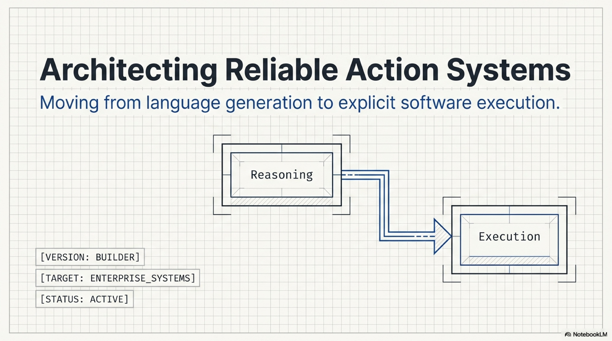

A procurement team built an internal system that looked operational in every review meeting. It could read supplier policy, explain approval logic, draft the purchase-order payload, and tell an operator exactly what should happen next. The demos landed because the system sounded as if it were already doing the work. It named the right fields, the right exceptions, and the right downstream systems.

Nothing happened until a human translated that prose into clicks and API calls.

So the team gave the system write access to the procurement service. The first failure was boring. The model filled `currency_code` with `USD dollars` instead of `USD`, and the schema rejected the request. The second failure was worse. A downstream service had changed how it reported deferred writes. The agent treated a partial acknowledgment as completion, moved on, and the order never landed. The supplier discovered the gap before the team did.

Language becomes agency only when it becomes accountable state change.

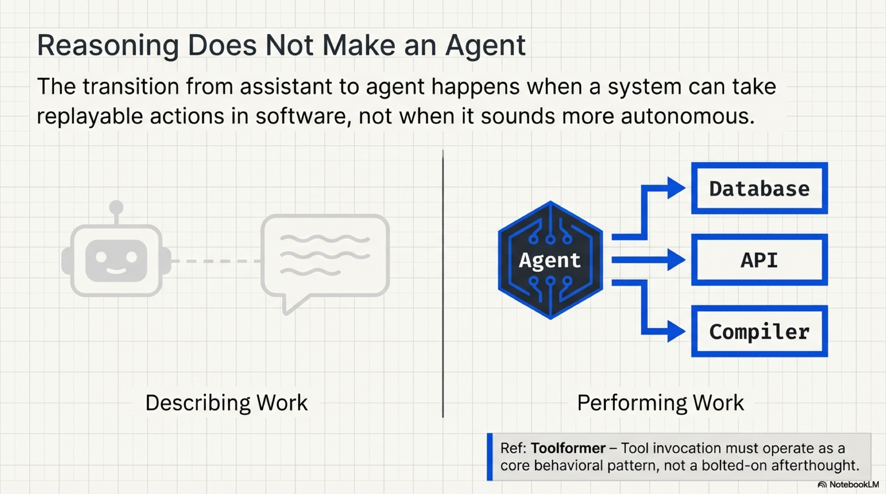

## Agency Begins At The Boundary

There is a flattering way to talk about tool use that quietly ruins design work. It says an agent is a system with reasoning, memory, and the ability to call tools when needed. That definition is too broad to help a builder. An elaborate assistant already fits it.

The harsher definition is more useful. The assistant-agent boundary is crossed when language can create accountable state change outside the prompt. A system that only describes the workflow is still commentary. A system that can submit the order, modify the record, send the message, or write the file has crossed into a different engineering object.

That shift raises the quality bar immediately. Once a system can act, the decisive questions stop being mainly about fluency. They become questions about boundary design. What surface is the system allowed to touch. How are arguments validated. What comes back after the action. What permissions govern the call. How would you replay the event. How would you tell the difference between completed work and a polite lie from the environment.

The enemy mistake here is simple. Teams treat tool use as a capability upgrade when it is really an interface design problem with consequences.

## Tool Use Fails At Named Seams

Production systems do not fail at action in the abstract. They fail at seams.

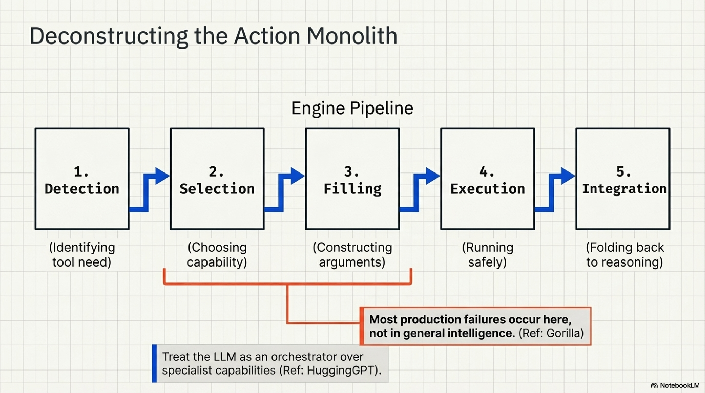

Sometimes the seam is tool need detection. The workflow stays in prose too long and answers from plausibility when it should have reached for live state. Sometimes the seam is tool selection. Several interfaces look close enough that the wrong one gets chosen even though the task itself was understood. Sometimes the seam is argument construction. The right surface gets called with the wrong enum, unit, or field shape, which is exactly what happened to `currency_code`.

Then comes execution scope. A tool that can search docs should not share the same trust posture as a tool that can submit a purchase order, delete a record, or send a customer-facing message. Least privilege is not a security ornament here. It is part of the action architecture itself.

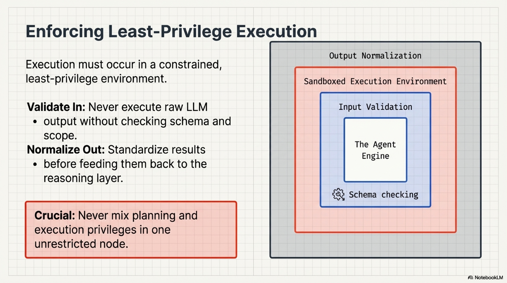

The final seam is result interpretation, and teams underrate it constantly. A queued job is read as a completed job. A warning is treated as success. A partially rendered browser state is treated as permission to proceed. A raw environment message becomes control policy by accident. If the observation side of the boundary is weak, the next reasoning step proceeds from fiction.

That seam view is more useful than almost any benchmark summary because it tells you what to instrument. If the system keeps choosing the wrong tool, strengthen the catalog and the retrieval layer around it. If it chooses correctly but fills arguments badly, fix schemas and validation. If it keeps moving forward on ambiguous state, strengthen the observation contract. The lazy move is to call all of this model behavior and go shopping again.

## Observation Is Part Of The Interface

Many teams define what the model can send and barely define what the model is allowed to conclude from what comes back.

That omission is expensive. If tool results arrive as raw HTML, raw logs, or broad success language, the model has to infer too much. It may infer correctly often enough to look competent, which is exactly why the failure survives. A trustworthy action loop should not depend on whether the model happens to guess correctly about deferred writes, warning states, or retriable errors.

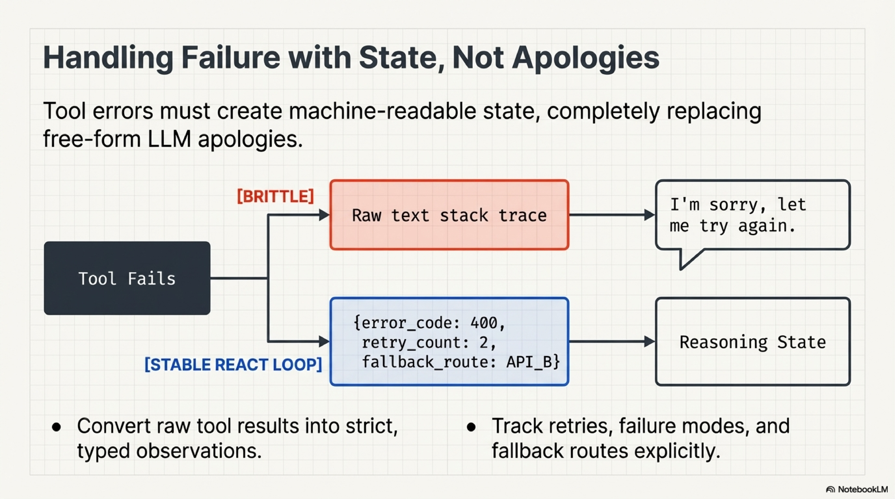

Important actions need observation contracts as explicit as their invocation contracts.

```json
{
  "status": "queued",
  "write_applied": false,
  "reason_code": "WAITING_APPROVAL",
  "requires_review": true,
  "next_allowed_action": "poll_after_approval"
}
```

That object is doing more than reporting state. It is telling the reasoning layer what reality now allows. A raw message saying "request received" does not do that. It forces the model to invent the missing policy in its own head.

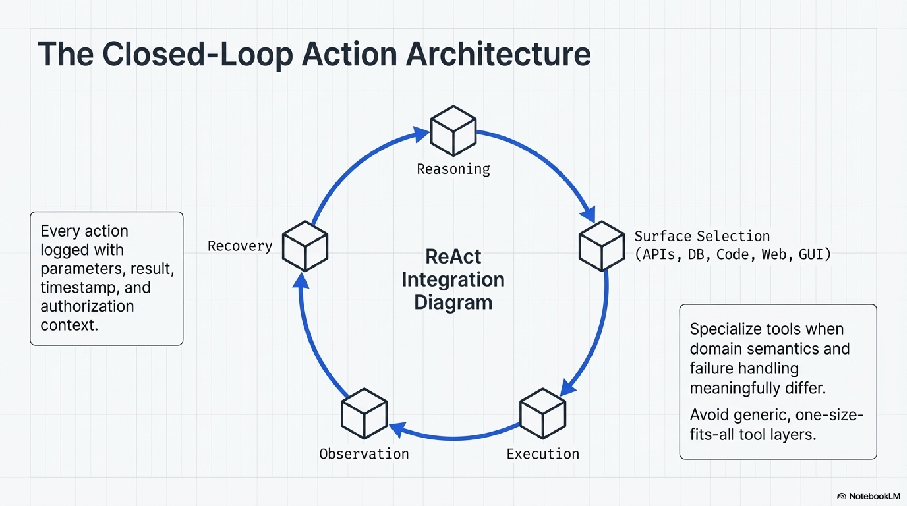

## Choose The Narrowest Surface

Broader action surfaces are usually a decline in reliability rather than an upgrade in maturity. A typed API gives you argument checks, scoped permissions, idempotence hooks, and cleaner return objects. Code or SQL can give you replayability and local verification when the work is transformation, analysis, or constrained data change. Browser action becomes necessary when the system of record exposes no cleaner path, but it inherits brittle page state and thinner feedback. GUI action is the expensive last resort for closed environments. The reach is broader. The contract is weaker.

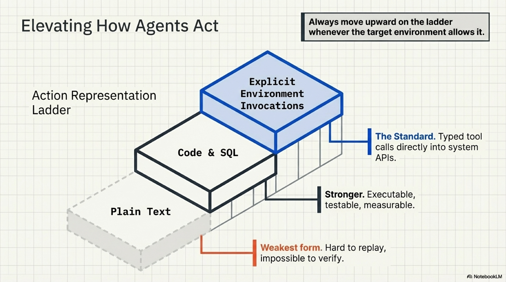

The decision rule should stay severe. Choose the narrowest action surface that still reaches the work.

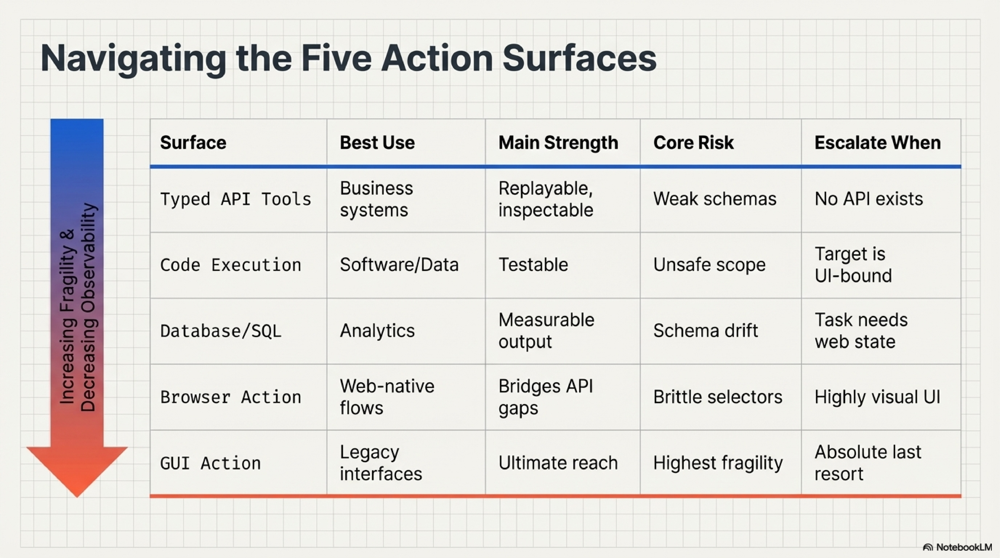

The escalation rule follows from that sentence. Start with a typed API if it exists. Move to code or SQL when the work is governed by a constrained machine surface rather than a remote application boundary. Move to browser action only when the required operation is not exposed cleanly. Move to GUI only when every cleaner interface is unavailable. Wider surfaces are not prestige. They are taxes.

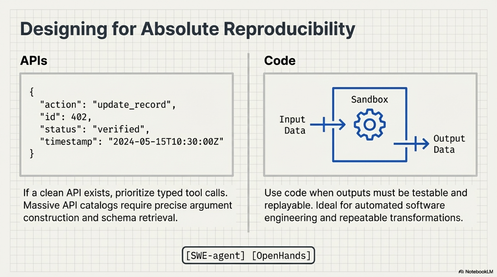

That preference for narrow surfaces is not only about safety. It is about keeping action legible enough that a team can replay it, audit it, and improve it without reverse-engineering the model's intentions after the fact.

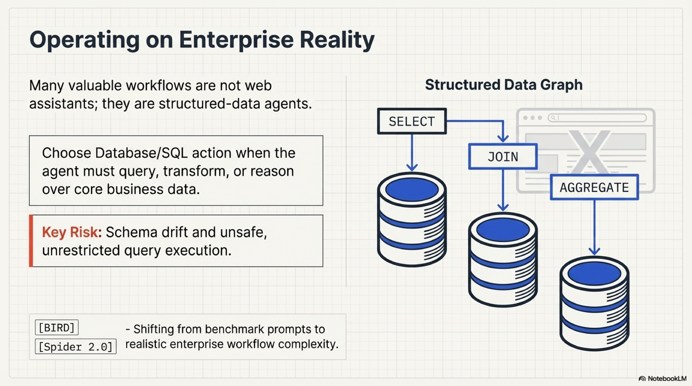

This is why papers such as *Toolformer*, *Gorilla*, and *SWE-agent* mattered. They moved the argument away from "can the model use tools" and toward a colder question: what kind of action boundary lets a system fail in ways a builder can still diagnose.

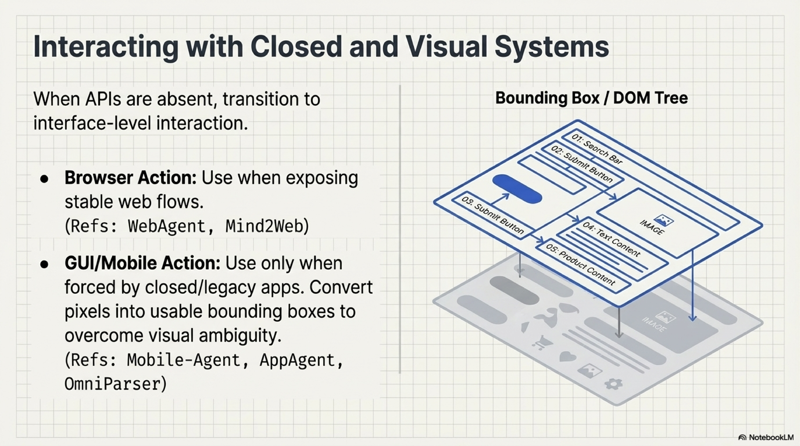

This is also where the builder view becomes more useful than the benchmark view. The problem is not whether a model can touch a tool in principle. The problem is whether the action surface leaves behind enough structure to verify what happened, recover when it fails, and keep escalation expensive enough that teams do not jump to the weakest boundary first.

## Action Should Reduce Uncertainty Before It Creates Consequence

The deepest practical use of action is not simply to finish the workflow. It is to reduce uncertainty before uncertainty becomes expensive.

Validate the payload before the write. Poll the real status endpoint before trusting a queued job. Query the live record before reasoning from stale memory. Ask the environment what changed instead of narrating what probably changed. The best action loops do not only perform tasks. They force the system back into contact with state.

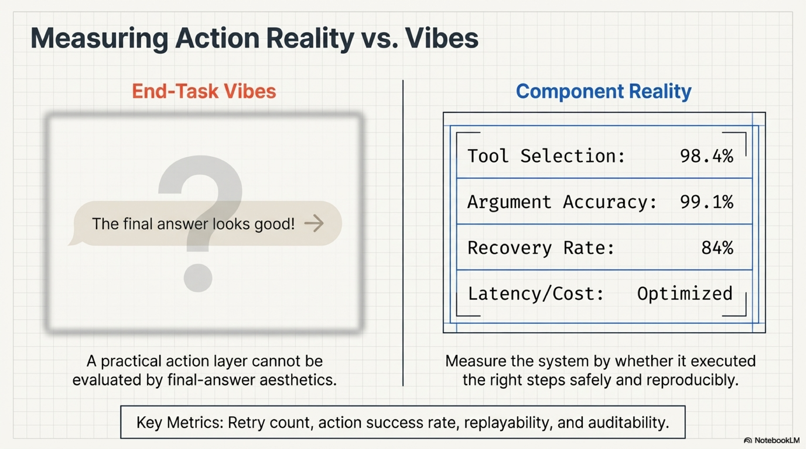

That is why action belongs at the front of the public run. It is where agent rhetoric stops being cheap. Once a workflow can act, continuity pressure arrives immediately. The next question is no longer whether the system can do something. It is what parts of its own past it should be allowed to carry forward and trust the next time consequence enters the loop.

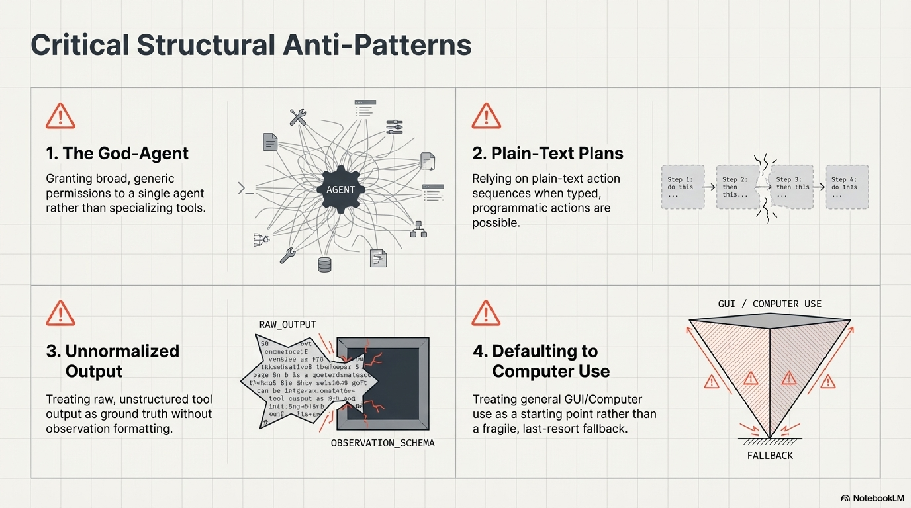

*These essays share one claim. Reliable agents do not come from stacking more visible capability on top of a strong model. They come from explicit operating layers a reviewer can still inspect when something breaks: action surfaces, memory policy, reasoning scaffolds, role boundaries, trust boundaries, and evaluation loops. Once a workflow can touch tools, durable state, approvals, or untrusted content, the architecture below the model decides whether the system is dependable.*

## Selected Sources

[Toolformer](https://arxiv.org/abs/2302.04761). Toolformer matters because it made tool invocation legible as part of competence rather than a theatrical wrapper around language generation. For this doctrine, its importance is not that the model can call a tool at all. It is that useful work starts when language chooses an interface that can change state.

[Gorilla](https://arxiv.org/abs/2305.15334). Gorilla matters because it narrowed tool use down to interface discrimination and argument construction. That is exactly where many production failures live. A workflow can understand the task and still fail because the boundary object was wrong.

[SWE-agent](https://arxiv.org/abs/2405.15793). SWE-agent matters because it shows what a replayable action surface looks like once the environment returns machine-checkable feedback. The chapter leans on that lesson heavily. Narrow, inspectable action loops beat broader but blurrier ones because improvement depends on localized failure, not on impressive transcripts.

For the broader terrain this essay leaves out on purpose, read the [Action Companion](https://github.com/petroslamb/content/blob/main/autonomous-agent-blueprint/essays/action/companion-v7.md). For the operator layer, build order, and anti-patterns, read the [Action Blueprint](https://github.com/petroslamb/content/blob/main/autonomous-agent-blueprint/core/practical-chapter-blueprints/03-action-tool-use-blueprint.md).

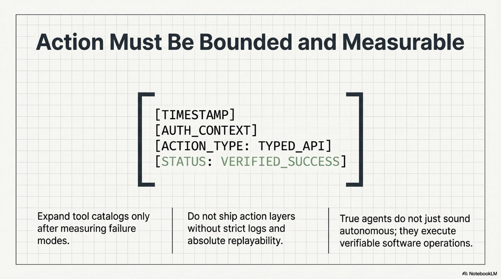
