# Operating Agents II: Memory Needs Authority

Date: 2026-03-27
URL: https://lambpetros.substack.com/p/operating-agents-ii-memory-needs

# Operating Agents II: Memory Needs Authority

Read with: [Memory Companion](https://github.com/petroslamb/content/blob/main/autonomous-agent-blueprint/essays/memory/companion-v7.md) and [Memory Blueprint](https://github.com/petroslamb/content/blob/main/autonomous-agent-blueprint/core/practical-chapter-blueprints/01-memory-blueprint.md).

Memory follows because useful systems need a rule for what the past is still allowed to govern. Retrieval quality matters, but only after the workflow decides what should persist, what has lost authority, and what should be retired.

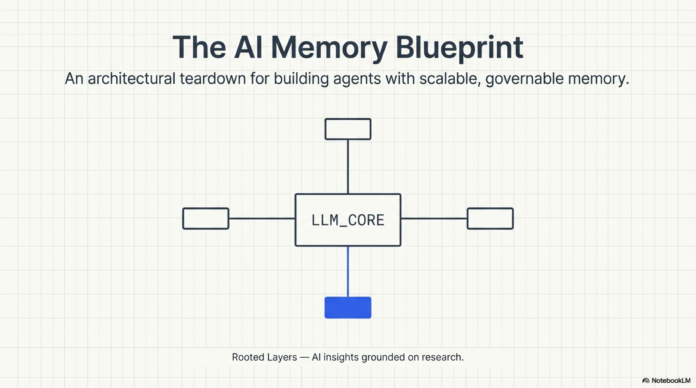

An internal policy assistant worked well in its first months. It answered benefits questions, surfaced current rules, and drafted quick compliance summaries with enough confidence that teams started treating it like background infrastructure. Then the failures changed shape. The answers were not obviously invented. They were outdated in operationally dangerous ways. A policy revision from three months ago failed to outrank the older version. A retired vendor relationship still appeared as active. A restructuring note from last quarter kept leaking into current org questions.

The system was not forgetting facts. It was remembering them without authority.

The team blamed retrieval first. They adjusted embeddings, chunking, and reranking. The problem persisted because the failure had started earlier in the chain. Every update had been added to the store. Nothing had been retired, consolidated, versioned, or downgraded. Old and new states now competed in the same memory space, and retrieval was faithfully returning semantically close text from an unmanaged pile.

Memory is governance over time, not storage.

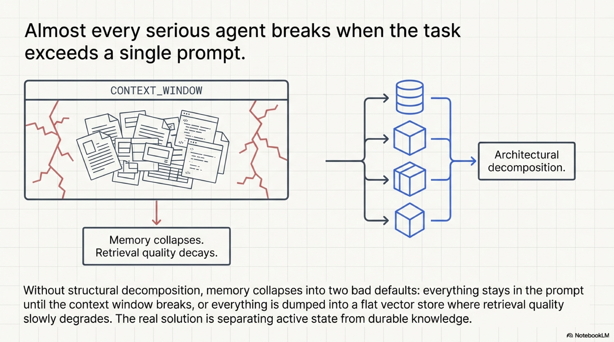

## Retrieval Was Only The Messenger

Teams get memory wrong because they use the same word for several different objects and then try to cure all of them with one retrieval layer. The context window feels like memory because it contains what the model is using right now. A vector store feels like memory because it can return past text. A log feels like memory because it records what happened before. None of those things answer the governing question on their own. What kind of past should this system still be allowed to trust.

Larger context windows do not solve that operating problem. A desk is not a filing cabinet just because you can pile more paper on it. A workflow that keeps every note in immediate reach does not become wiser. It becomes noisier.

The enemy mistake here is simple and costly. Teams notice stale or contaminated outputs and reach straight for retrieval tuning. The real failure is often older. The system never decided what deserved to persist, what should lose authority, what should be promoted into reusable routine, or what should be allowed to die.

## MemGPT Changed The Question

*MemGPT* mattered because it arrived while much of the field was still framing memory as longer context versus shorter context. The paper asked a colder question. What if the active context window should be treated as scarce fast memory and external stores should be treated as slower tiers that must be managed deliberately.

That move changed the operator question from "how much can I stuff into context" to "what belongs in active context now, what should live elsewhere, and what has lost the right to guide the current task." The operating-system analogy matters because it turns memory into a control problem. Explicit movement. Explicit tiers. Explicit pressure on what deserves to stay live.

The durable contribution is not the metaphor by itself. It is the discipline that follows from it. A useful memory layer needs admission rules, derivation rules, freshness rules, and retirement rules. Otherwise the system's past becomes a crowd rather than a governed asset.

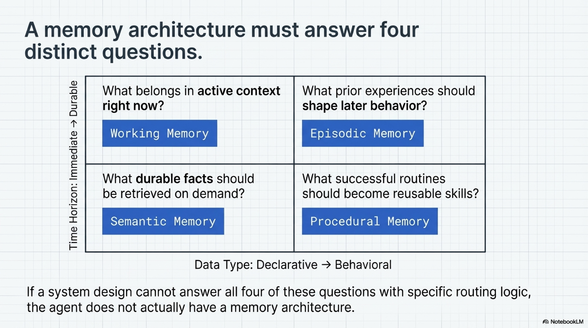

## Four Kinds Of Past, Four Kinds Of Control

The strongest practical contribution of the memory literature is not one storage mechanism. It is the insistence that different kinds of past fail differently.

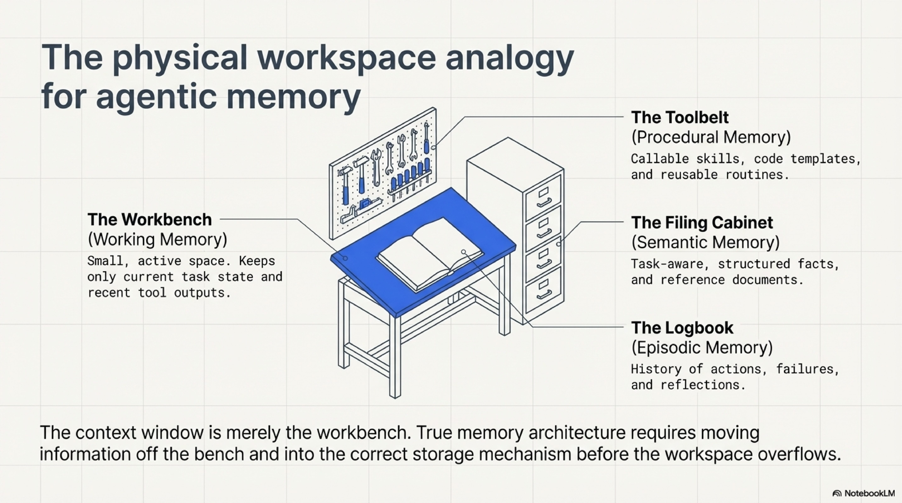

Working memory is current task state. It holds the active question, the plan, recent tool outputs, the evidence packet under review, and the scratch state the next step requires. Its failure mode is overload. If everything enters by default, nothing important dominates attention.

Semantic memory is durable fact. Policies, docs, product knowledge, approved records, current reference data. Its failure mode is staleness and contamination. A semantically relevant chunk can still be superseded, adversarial, or simply wrong for the present state of the world.

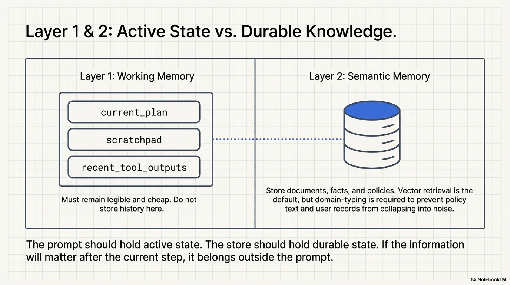

Episodic memory is prior experience. Past runs, corrections, approvals, near misses, reviewer comments, and notable failures. Its failure mode is amnesia of experience. The organization learns something the hard way and the system pays to relearn it.

Procedural memory is reusable know-how. Templates, routines, playbooks, code snippets, validated tactics. Its failure mode is rediscovery. The same small class of problems gets solved from zero again and again because nothing durable was promoted out of event history.

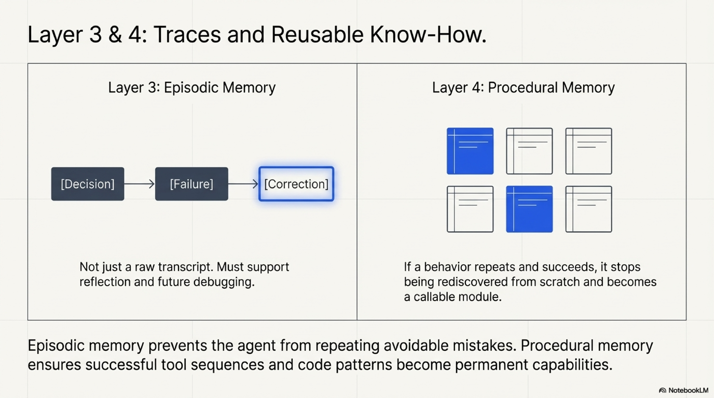

Those are not cognitive ornaments. They are four governance problems.

```json
{
  "memory_type": "semantic",
  "content": "Vendor reimbursement policy updated: director approval required above 5000 EUR.",
  "source": "policy_portal:finance/reimbursement:v17",
  "written_at": "2026-02-14T09:20:00Z",
  "freshness_window": "90d",
  "retention_rule": "supersede_on_new_version"
}
```

That record is useful because it says what kind of memory this is, where it came from, how long it should stay authoritative, and what should retire it later. A raw transcript does not do that work.

The decision rule follows directly. Separate working, semantic, episodic, and procedural memory because they deserve different write rules, retrieval rules, and retirement rules. A policy document should not be managed like a correction log. A correction log should not be managed like a playbook.

## Memory Needs Admission And Retirement

*MemoryBank* mattered because it attacked one of the field's laziest assumptions. The assumption was that retention is always a virtue and forgetting is always a defect. That sounds flattering until a system has to operate over time. Then decay, refresh rules, and pruning start looking less like weakness and more like hygiene.

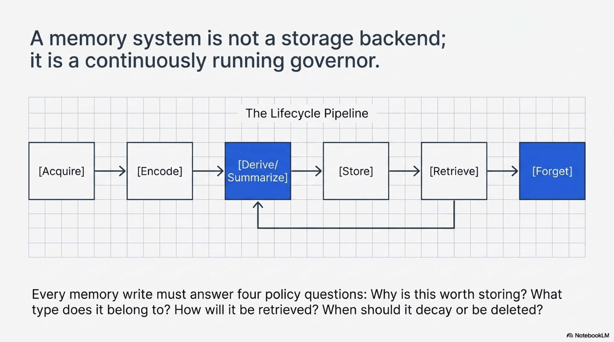

The paper's lasting contribution is not the metaphor it used. It is the restoration of forgetting to the center of correctness. Without decay or retirement, a memory system becomes less trustworthy over time even if retrieval still looks superficially good. The store accumulates ghosts of prior truth states and keeps returning them as though recency and authority were the same thing.

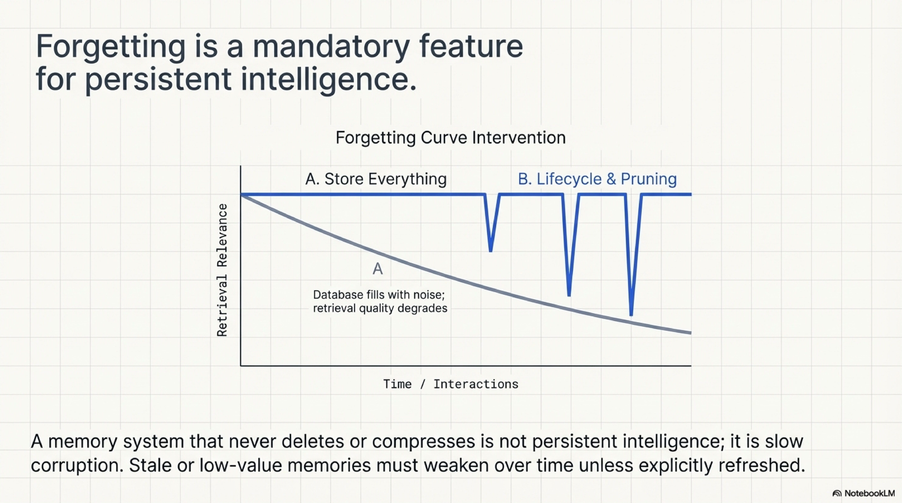

That is also where derivation becomes non-negotiable. A durable memory object is often not the conversation itself. It is the extracted fact, the consolidated note, the promoted routine, or the retired lesson that outlives the raw transcript. *Mem0* pushed the literature in that direction, and production systems should do the same. Useful memory is selective memory.

The escalation rule should therefore stay conservative. Do not reach for richer retrieval structures until write policy, provenance, freshness, derivation, and forgetting are already explicit. If those layers are still weak, a richer memory substrate mostly gives the clutter better geometry.

## Keep The Past On A Shorter Leash

The practical memory lesson is plain.

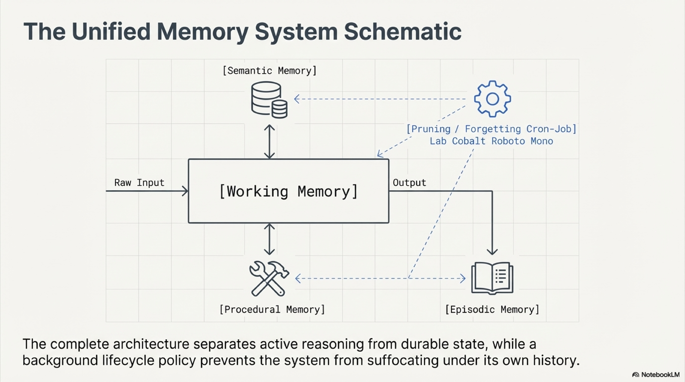

Keep working memory small and task-bound. Treat semantic memory as an authority layer with provenance, freshness, and retirement rules. Treat episodic memory as operational history with outcome and context. Treat procedural memory as earned competence rather than a junk drawer for every clever move that worked once.

The wrong-layer failure is especially damaging because it feels superficially reasonable. Teams dump transcripts into semantic memory, policies into episodic records, or tentative tactics straight into procedural memory. The retrieval layer then faithfully returns the wrong kind of object. Similarity answers "does this match the query." It does not answer "should this still guide the system."

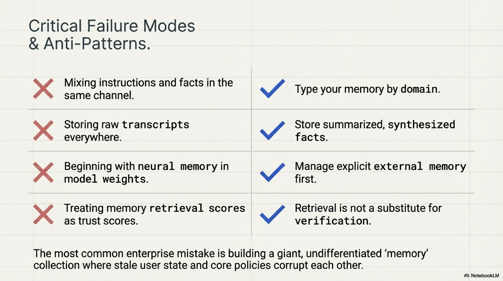

Memory is not the art of keeping more. It is the discipline of keeping the right things in the right form for the right length of time. A trustworthy memory layer returns sanctioned state with provenance and expiry, not merely semantically nearby fragments from a crowded past that still happen to sound relevant. Good memory policy protects the present from the past.

*These essays share one claim. Reliable agents do not come from stacking more visible capability on top of a strong model. They come from explicit operating layers a reviewer can still inspect when something breaks: action surfaces, memory policy, reasoning scaffolds, role boundaries, trust boundaries, and evaluation loops. Once a workflow can touch tools, durable state, approvals, or untrusted content, the architecture below the model decides whether the system is dependable.*

## Selected Sources

[MemGPT](https://arxiv.org/abs/2310.08560). MemGPT matters because it broke the lazy equation between more context and better memory. Its enduring value for this doctrine is the tiering mindset. Active context, external storage, and movement between them have to be governed explicitly if memory is going to help rather than interfere.

[MemoryBank](https://arxiv.org/abs/2305.10250). MemoryBank matters because it put decay and refresh back into the center of the conversation. That is essential to the chapter's law. Forgetting is not a weakness in a long-lived system. It is part of how retained state stays current enough to deserve trust.

[Mem0](https://arxiv.org/abs/2504.19413). Mem0 matters because it pushes the literature toward derived memory objects rather than transcript hoarding. The doctrine depends on that move. Durable memory should usually be an extracted fact, promoted routine, or consolidated lesson rather than a raw conversational heap that retrieval later has to reinterpret.

For the broader terrain this essay leaves out on purpose, read the [Memory Companion](https://github.com/petroslamb/content/blob/main/autonomous-agent-blueprint/essays/memory/companion-v7.md). For the operator layer, layer choices, and lifecycle rules, read the [Memory Blueprint](https://github.com/petroslamb/content/blob/main/autonomous-agent-blueprint/core/practical-chapter-blueprints/01-memory-blueprint.md).

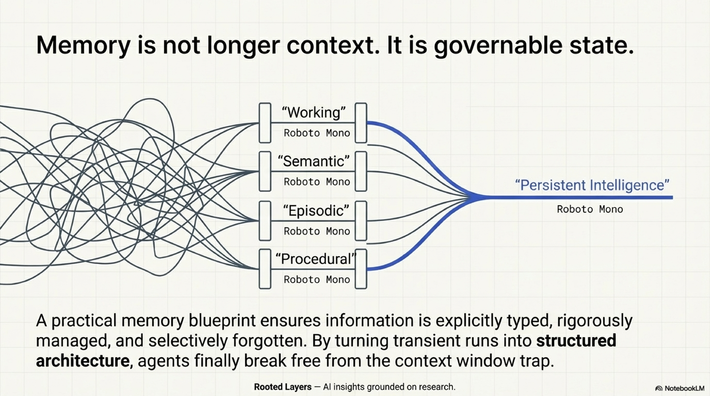
