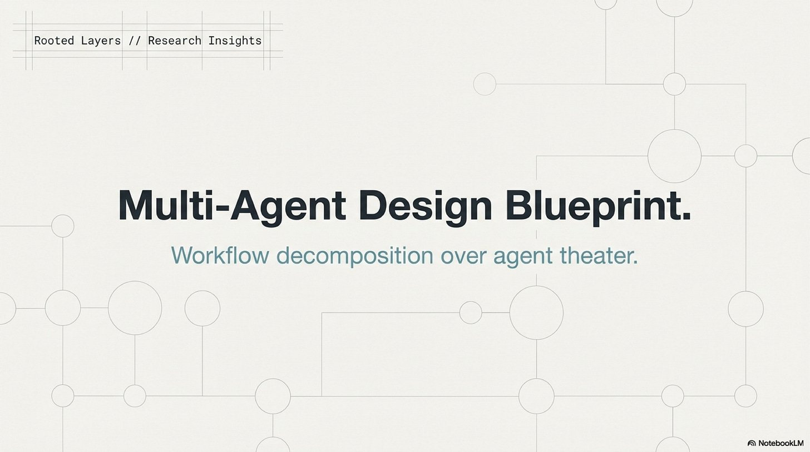
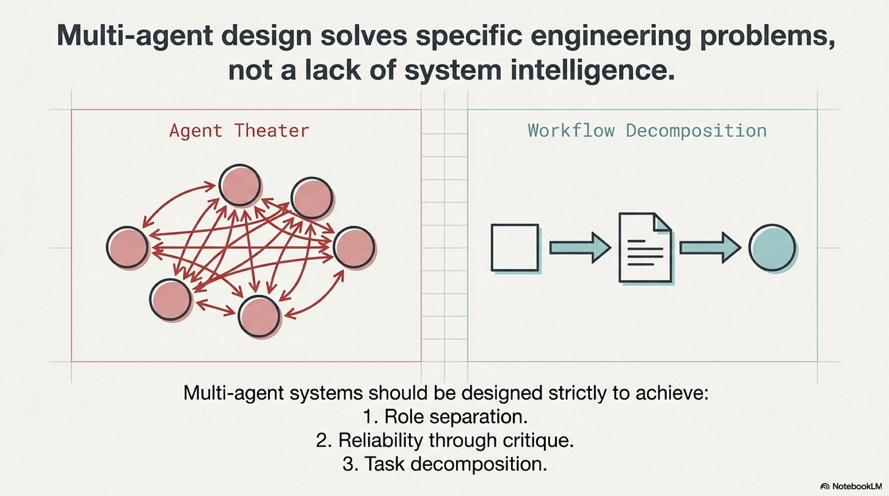
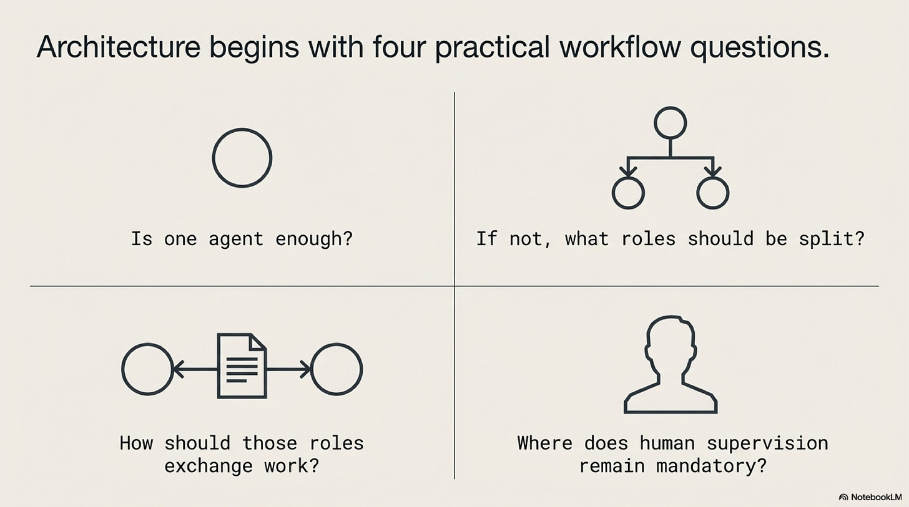
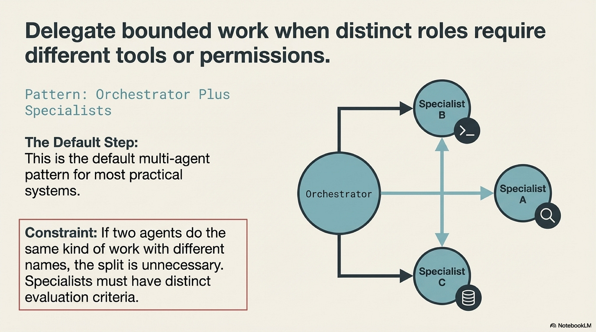
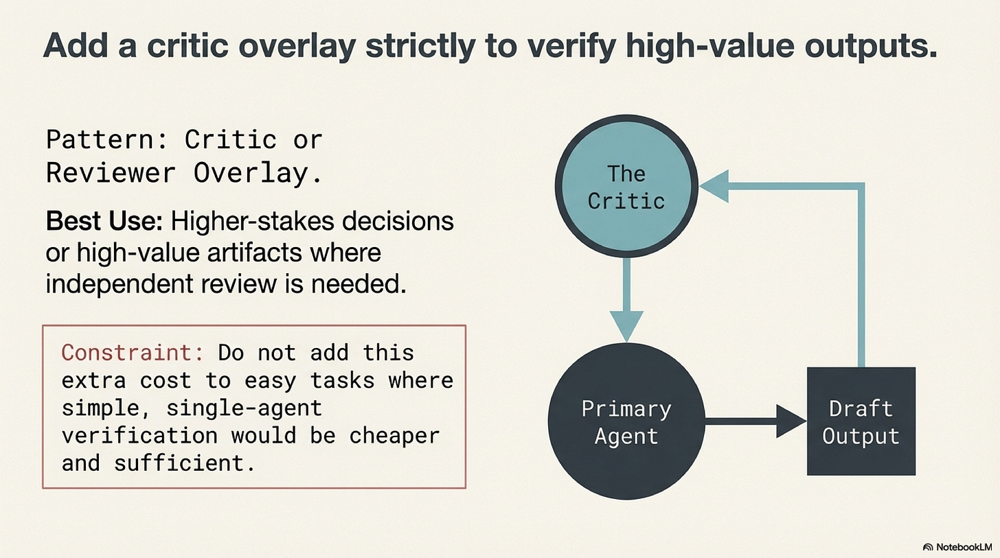
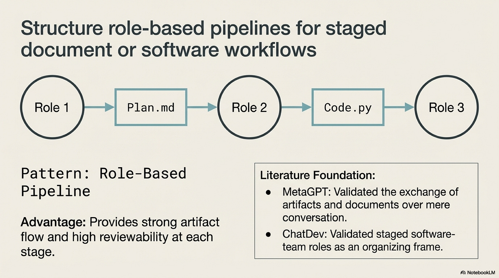
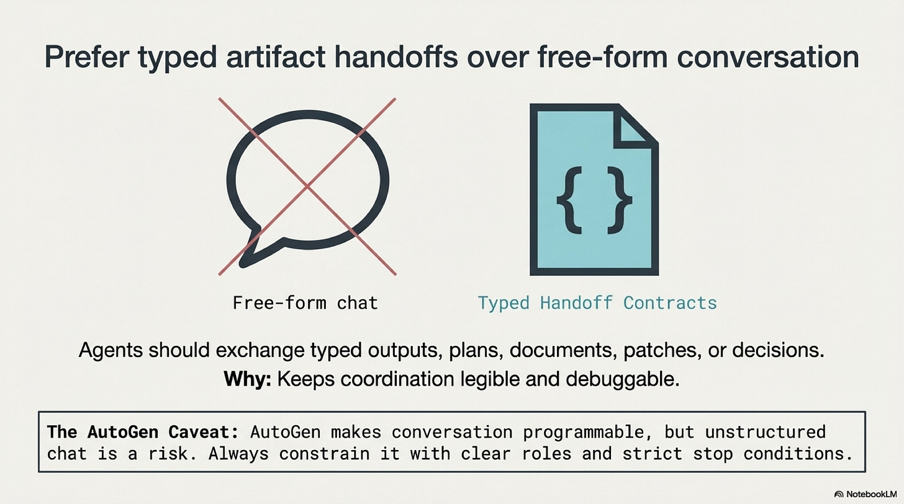
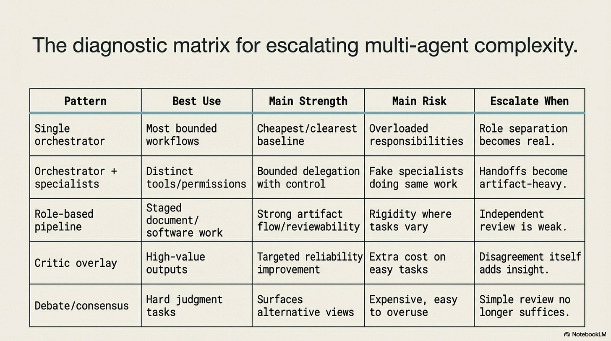
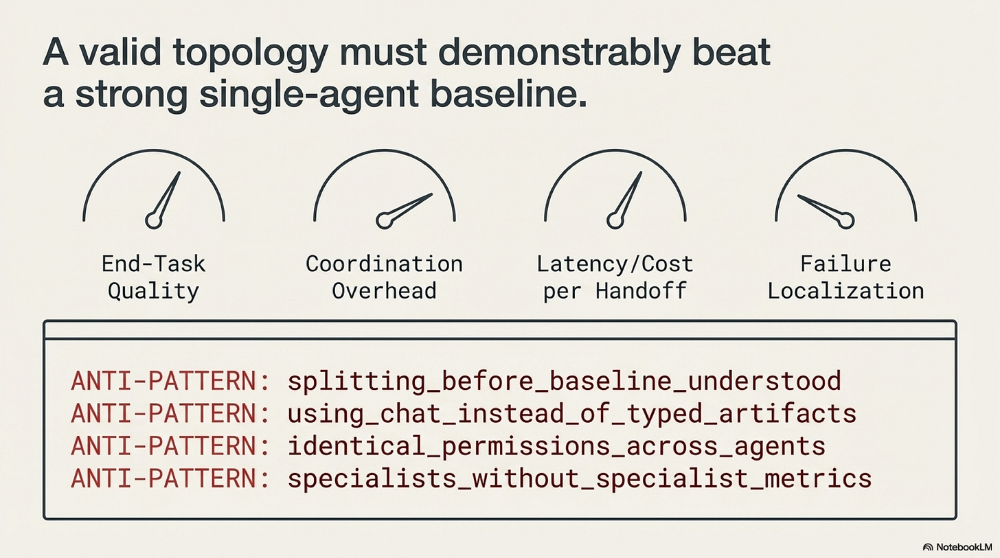
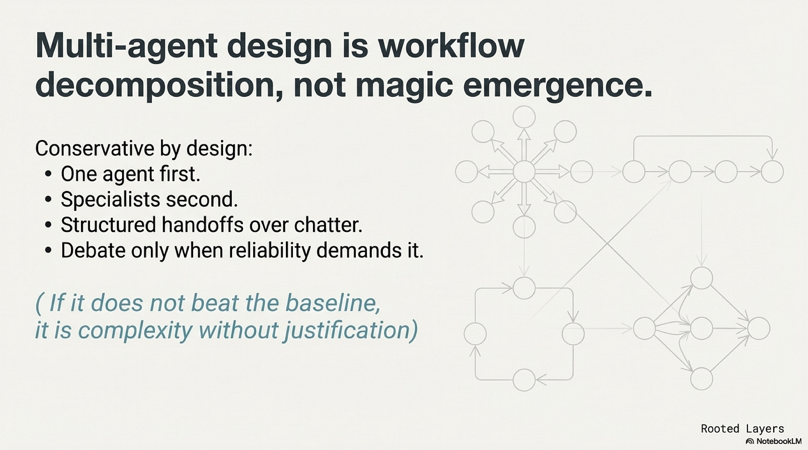

# Operating Agents IV: Multi-Agent Boundaries and Handoffs

Date: 2026-03-27
URL: https://lambpetros.substack.com/p/operating-agents-iv-the-second-agent

*Part of the Operating Agents series, a builder-first run on how modern agent systems actually work once language leaves the prompt and starts acting inside software.*

#### Video TL;DR

Multi-agent design comes later because extra roles only help after a single workflow is already legible enough to justify another boundary. More voices do not create structure on their own. They only widen ambiguity unless the handoff becomes explicit.

A platform team built a six-role incident workflow after a string of painful production bugs. One role reproduced the issue, another gathered telemetry, another proposed the fix, another wrote the patch, another reviewed it, another prepared the release note, and a human approver signed at the end. Each handoff was a long conversational summary. One Friday the wrong rollback script shipped against the wrong service, and nobody could localize where the bad assumption had entered. The reproducer and patch writer had the same permissions. The reviewer never received a typed failure artifact. The approver had to reconstruct the whole run from chat.

The system looked sophisticated. The split bought narration, not architecture.

Extra agents multiply ambiguity unless they create a real boundary.

That is the multi-agent distillation taken here from the broader [foundation-agents survey](https://arxiv.org/abs/2504.01990) and tightened in the local [multi-agent blueprint](https://github.com/petroslamb/content/blob/main/autonomous-agent-blueprint/core/practical-chapter-blueprints/05-multi-agent-design-blueprint.md). The transcript supplies the progression, but the practical thesis is narrower: another agent only helps when it buys a boundary that a single workflow could not buy more cheaply.

## Multi-Agent Design Is Boundary Economics

The public story about multi-agent systems is still badly distorted. Multi-agent is often treated as though it were one axis of more capability. More roles, more perspectives, more intelligence. The practical literature says something stricter. A multi-agent system is not one upgrade. It is a choice to buy a boundary a single-agent workflow could not provide cleanly.

That boundary can be worth a great deal. It can also cost more than it returns. Every extra role adds another handoff, another local context, another evaluation burden, and another place where ambiguity can either be reduced or multiplied. If the split does not change authority, evidence flow, or review structure, the system gets more expensive without becoming more legible.

The default should stay severe. Keep one agent, bounded tools, and a clear control loop until another role buys something a single-agent workflow cannot buy as cheaply.

In practice, there are only three reasons that count.

## Boundary One Is Permission

Sometimes a second role exists because one component should not both decide and act with the same authority. An executor should not necessarily hold the same permissions as a reviewer. A planner may need broad read access but no write authority. A compliance or approval role may need independence precisely because accountability is the point.

This is the cleanest reason to split roles because it changes what each role is allowed to do. The second agent is not there to sound different. It is there to make the authority structure explicit and narrower. The human role often matters most here. A human approver is not a leftover from a less advanced system. In many serious workflows that role is the boundary the rest of the design is trying to protect.

If the split does not change who is allowed to do what, it probably is not a permission architecture at all.

## Boundary Two Is Independent Critique

Other workflows do not fail because one role had too much authority. They fail because the first pass has predictable blind spots and the cost of a miss is high enough to justify another view.

This is where critique earns its keep. Debate and reviewer papers such as *[MAD](https://arxiv.org/abs/2305.19118)* matter because they treat disagreement as a controlled reliability intervention rather than as background noise. The valuable move is not many voices are better. It is narrower. A second role can challenge an evidence gap, a reasoning shortcut, or a weak recommendation when the task truly benefits from an independent pass.

That architecture is easy to overuse. Many teams add reviewer agents where a deterministic verification stage would have been cheaper, faster, and easier to govern. Critique is real. It is just not the answer to every weak workflow. If the reviewer mostly paraphrases, if latency rises while quality barely moves, or if disagreement never changes the decision, the system is paying coordination debt for ceremony.

Independent critique is justified when the second role changes what gets challenged.

## Boundary Three Is Typed Artifact Handoffs

Some tasks really do have stages that deserve different local contexts and different deliverables. A planner writes a spec. A retriever assembles an evidence packet. An executor produces an artifact against that packet. A reviewer checks the result against explicit criteria.

The key point is not that several personalities are talking. The key point is that the stages exchange typed objects.

*[MetaGPT](https://arxiv.org/abs/2308.00352)* mattered because it pushed multi-agent design back toward artifacts, documents, and staged outputs at a moment when the field was drifting toward role-play. *[ChatDev](https://arxiv.org/abs/2307.07924)* reinforced the same lesson in a more theatrical form. The useful part is not pretending to be a software company. The useful part is that a spec, evidence packet, patch, test report, or pass-fail record gives the next stage something inspectable to receive.

A long conversational message that mixes instructions, evidence, assumptions, and tentative conclusions does the opposite. It forces the receiving role to reconstruct what is binding. Once the workflow fails, no one can say where the error entered because the handoff never became explicit enough to inspect.

Typed handoffs are the architecture. Conversation is only the transport.

## Failure Localization Is The Only Serious Score

One of the easiest ways to tell whether a split was justified is to ask what happens after a miss. In a good topology, failure becomes easier to localize. The team can say which role had authority, which artifact carried the error, which review stage missed it, and whether the next role received the right object. In a bad topology, every extra role expands the search space for blame without improving the evidence.

That makes the best single-agent baseline the right control case. If a multi-agent workflow cannot clearly beat one bounded agent with stronger tools, cleaner artifacts, and a sharper verification path, the extra topology is complexity without justification. Transcript sophistication is the wrong score. Whether the split bought a boundary and made failure review easier is the right one.

The decision rule therefore stays narrow. Add another agent only when it buys a permission boundary, an independent critique, or a typed artifact handoff.

## Collapse Decorative Roles

The conservative rule after deployment should be as strict as the rule before deployment. If a reviewer never changes the decision, collapse it. If a specialist has the same permissions, the same tools, and the same output contract as the orchestrator, collapse it. If a planning role produces prose no downstream stage can check against a typed artifact, collapse it.

Role count is sticky once teams grow attached to the theater of specialization. A named role starts to feel like a capability even when it is only extra latency. Builders should instead treat every role as guilty until it proves one thing: that removing it would blur authority, weaken critique, or erase a typed handoff the workflow genuinely needs.

That is the escalation rule for the chapter. Keep the default single-agent until one of those three boundaries is clearly missing and measurable. Then split only what the workflow has earned.

## References

[Advances and Challenges in Foundation Agents: From Brain-Inspired Intelligence to Evolutionary, Collaborative, and Safe Systems](https://github.com/petroslamb/content/blob/main/autonomous-agent-blueprint/advances-and-challenges-in-foundation-agents.md) ([arXiv](https://arxiv.org/abs/2504.01990)) is the source booklet from which this chapter was ultimately distilled. Its key contribution is breadth. It places multi-agent design inside a larger systems story about action, memory, reasoning, safety, and optimization. This essay narrows that broader survey into one practical question: when does another agent create a real boundary rather than more narration.

[Chapter 10 Blueprint: Multi-Agent Boundaries and Handoffs](https://github.com/petroslamb/content/blob/main/autonomous-agent-blueprint/core/practical-chapter-blueprints/05-multi-agent-design-blueprint.md) is the builder-facing backbone for this chapter. Its key contribution is discipline around why roles exist at all. It reduces the split decision to permission boundaries, independent critique, and typed artifact handoffs, then ties those decisions to collapse rules once a role becomes decorative.

[The escalation path for multi agent AI transcript](https://github.com/petroslamb/content/blob/main/autonomous-agent-blueprint/essays/multi-agent/artifacts/transcript_The%20escalation%20path%20for%20multi%20agent%20AI_full.txt) is the direct narrative source behind this draft. Its key contribution is the sequence the essay follows: the failure archetype of handoff confusion, the boundary economics of extra roles, the three reasons to split, and the insistence that failure localization is the only serious score after deployment.

*[MAD](https://arxiv.org/abs/2305.19118)* matters because it makes critique legible as a specific reliability intervention rather than as a general argument for more voices. Its key contribution is narrowing the value of disagreement. A second role earns its keep only when it changes what gets challenged.

*[MetaGPT](https://arxiv.org/abs/2308.00352)* matters because it pushed multi-agent design back toward documents, artifacts, and staged outputs at a moment when the field was drifting toward role-play. Its key contribution is showing that typed handoffs are what make stages inspectable. This essay leans on that move heavily.

*[ChatDev](https://arxiv.org/abs/2307.07924)* matters because it makes the artifact-pipeline lesson visible in a more theatrical form. Its key contribution is not the simulated company itself but the visibility of staged outputs. The paper helps clarify why conversation is only the transport and not the architecture.

*[AutoGen](https://arxiv.org/abs/2308.08155)* matters because it made programmable multi-agent conversation practical and, by doing so, also made it easier to confuse communication fabric with architecture. Its key contribution for this essay is negative clarity: flexible transport does not rescue a decorative split.

*[RECONCILE](https://arxiv.org/abs/2309.13007)* matters because it sharpens the question of when disagreement carries real signal and when it is only extra coordination overhead. Its key contribution is helping keep reviewer overlays narrow enough to justify their cost.

