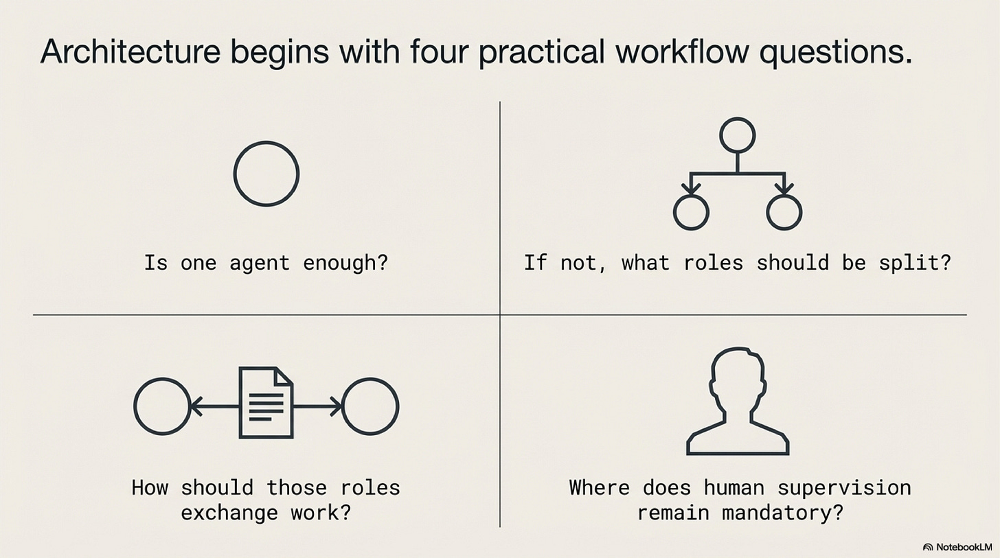
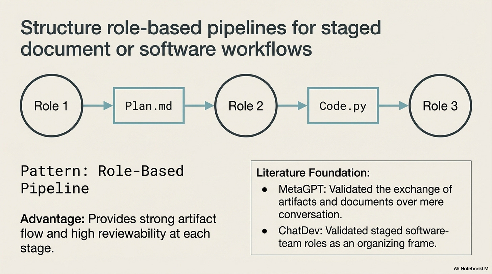
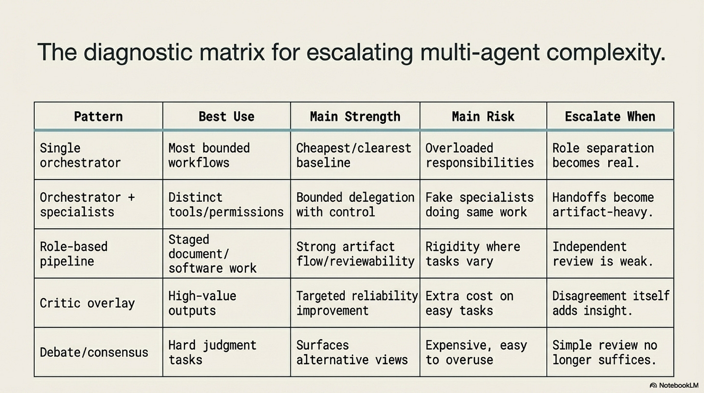
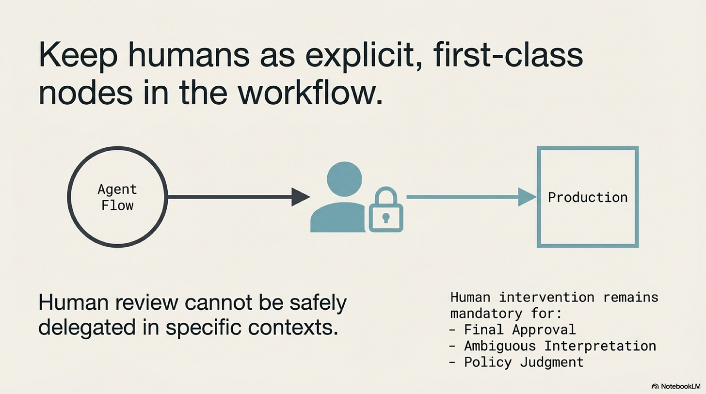

# Operating Agents IV: Multi-Agent Boundaries and Handoffs

Date: 2026-03-27
URL: https://lambpetros.substack.com/p/operating-agents-iv-the-second-agent

*Part of the Operating Agents series, a builder-first run on how modern agent systems actually work once language leaves the prompt and starts acting inside software.*

#### Video TL;DR

## Multi-Agent Starts With A Baseline

A team can build an incident workflow with a planner agent, an analyst agent, an executor agent, and a reviewer agent, then still make the wrong rollback for a simple reason: all four nodes see the same context, hold the same permissions, and communicate through loose chat summaries that nobody can audit. The architecture looks elaborate. The boundary structure is thin. When the output is wrong, the team cannot tell which node introduced the mistake because no typed handoff artifact preserved the decision clearly enough to inspect. That is the failure shape that matters in multi-agent design. Additional agents only help when they create a boundary that makes the workflow clearer, safer, or easier to review.

The first lesson, then, is that multi-agent architecture should be treated as an escalation rather than a baseline. The right starting question is not "how many agents should this workflow have." The right starting question is "what problem can one well-bounded agent not solve cleanly enough on its own." That framing follows the broader [foundation-agents survey](https://arxiv.org/abs/2504.01990) and the local [multi-agent blueprint](https://github.com/petroslamb/content/blob/main/publications/autonomous-agents/core/practical-chapter-blueprints/05-multi-agent-design-blueprint.md). The practical unit of analysis is the workflow boundary, not the number of speaking roles on the screen.

One useful way to teach the topic is to reduce it to four questions. Is one agent enough. If not, what responsibility should actually be split out. What artifact should carry the handoff between roles. Where must a human remain part of the approval or arbitration path. These questions are intentionally unglamorous. They force the design back into systems engineering, where a split must buy something concrete such as narrower permissions, clearer role ownership, cleaner review, or easier debugging.

This is also why the single-agent baseline matters so much. Without it, there is no honest comparison point. A multi-agent system can always be made to feel more sophisticated because more nodes create more visible activity. That visual complexity is not evidence of better architecture. If one orchestrating agent with bounded tools and typed outputs can already solve the task reliably, then splitting the work prematurely adds coordination cost without purchasing a meaningful new boundary.

## When A Second Agent Actually Helps

A second agent earns its place when it introduces a real separation the first design could not provide cleanly. There are several common reasons. One agent may need access to a retrieval corpus that the downstream writer should not see directly. A coding agent may need shell and repository access while a reviewer agent should only inspect a patch artifact. An approval node may need to evaluate a proposal without inheriting the full tool surface that produced it. In each of these cases, the additional agent is justified not by personality but by boundary economics.

The reader-writer pattern is a useful example because it is so often overused. At first glance it seems obvious: let one agent read a large corpus and let another produce the answer. In practice the split only helps when it solves a concrete problem such as token limits, permission separation, or specialized retrieval logic. Otherwise the workflow simply moves the information bottleneck into the handoff. The writer now works from a compressed summary rather than from the original evidence, and the system has paid extra latency and fidelity loss to reconstruct a weaker view of the same problem.

That coordination cost deserves careful attention. Every handoff asks the upstream node to select what matters, encode it in a form the downstream node can recover, and omit what does not belong. Every downstream node then has to infer intent from that artifact without access to all the original context. If the split was unnecessary, the team has created a translation layer that carries cost without adding control.

This is where the literature becomes useful. *[MetaGPT](https://arxiv.org/abs/2308.00352)*, *[ChatDev](https://arxiv.org/abs/2307.07924)*, and *[AutoGen](https://arxiv.org/abs/2308.08155)* are often grouped together under "multi-agent systems," but they teach slightly different lessons. MetaGPT and ChatDev are easiest to learn from when read as staged artifact pipelines: plan, implement, review, package. AutoGen is helpful as programmable orchestration fabric, but it should also be read as a warning that unconstrained inter-agent conversation is not a substitute for careful interface design. The shared insight is that the split only becomes valuable when the intermediate artifact is inspectable and role-specific.

That point is more important than agent personality. A message such as "I checked the pricing issue and it seems related to churn" may feel natural, but it is a weak handoff because it leaves too much interpretation to the next node. A structured proposal with fields for evidence, scope, confidence, next action, and blockers is harder to improvise and easier to audit. In production systems, handoffs should look more like interfaces than conversations. Once that principle is understood, a large part of multi-agent design becomes clearer: the real architecture is in the contracts between roles.

## Escalating The Topology Carefully

Because each added node carries cost, the topology should grow in stages. A good progression begins with one orchestrator. If the workflow encounters a clear overload or permission mismatch, add specialists with distinct tool surfaces or data access. If the work naturally moves through staged deliverables, evolve that design into a role-based pipeline where each node owns a typed artifact. If high-value outputs need an explicit quality gate, add a critic or reviewer node. Only after those levels are working should the system consider debate or consensus patterns where disagreement among agents is itself informative.

That staged build order helps the reader see what each level is buying. Orchestrator plus specialists buys role clarity. A pipeline buys artifact checkpoints and clearer debugging. A critic buys independent review. Debate buys multiple competing lines of reasoning when the task is genuinely ambiguous. The mistake is to jump straight to the top of the ladder for tasks that do not need it. When disagreement adds no information, a debate system is often an expensive substitute for a validator, a test suite, or a simpler review node.

This is the right context for reading *[MAD](https://arxiv.org/abs/2305.19118)* and *[RECONCILE](https://arxiv.org/abs/2406.13670)*. Both are useful because they show that disagreement can expose weaknesses that a single pass may miss. But they should be taught as high-cost overlays for genuinely ambiguous tasks, not as defaults. A legal interpretation, a strategic scenario analysis, or a subtle scientific synthesis may justify multiple competing arguments. A routine parser check or a straightforward policy application usually does not.

Human supervision belongs on the ladder as well. In multi-agent systems the human is not simply the old worker being gradually removed from the loop. In many workflows the human becomes the highest-clearance reviewer, arbiter, or approval node. That role is especially important when the system crosses policy, financial, or reputational boundaries. If the architecture cannot present a human with a clear artifact to inspect, approve, or reject, then the topology has failed one of its main design obligations.

This is why typed handoff artifacts matter so much. They preserve enough structure for both machines and humans to inspect the workflow at the right seam. A proposal, patch, extracted dataset, or review package gives the next node something colder and more stable than conversational drift. The architecture becomes much easier to operate once each role can be judged through its artifact rather than through a long inter-agent dialogue.

For that reason, handoff design deserves its own mini-method. Before adding a node, define the artifact it will receive, the artifact it will produce, the tool surface it may use, and the condition under which its work is considered complete or rejected. If those elements cannot be named cleanly, the split is usually premature. Many weak multi-agent systems fail not because the model quality is poor, but because the handoff contract was never explicit enough for the next role, or the human reviewer, to evaluate.

## What Complexity Has To Prove

Once a multi-agent system exists, it should be evaluated more harshly than a single-agent baseline, not less. The first question is whether end-task quality improved. The second is whether the added topology preserved or improved latency, cost, and reliability enough to justify itself. The third, and often the most operationally important, is whether failure localization became easier. When the output is wrong, can the team inspect a bounded artifact and identify the first broken handoff, or do they have to read a long conversation and reconstruct the failure through inference.

This debugging question is one of the clearest practical differences between agent theater and real architecture. In a conversation-heavy swarm, failure localization becomes archaeology. Engineers read summaries of summaries and guess where the first bad assumption entered the loop. In an artifact-heavy pipeline, the debugging path is shorter. Inspect the extractor output, then the planner artifact, then the reviewer decision. The first bad object marks the boundary that needs to be fixed. That clarity is one of the main things an added topology should buy.

Coordination overhead should be measured just as deliberately. Track how much information each handoff drops, how often downstream nodes must recover missing context, and how much latency the topology adds relative to the single-agent baseline. These measurements help distinguish a useful role split from a decorative one. If each new node introduces more summary loss and more waiting time than decision quality, the architecture is drifting away from the work it was meant to clarify.

The methodology that follows is intentionally conservative. Start with one orchestrator. Push it until the reason for failure is legible. Split only the responsibility that needs different tools, permissions, or evaluation logic. Introduce typed handoff contracts before adding more voices. Keep humans as explicit approval or arbitration nodes where the cost of error remains high. Collapse the topology again if it stops paying for itself. Multi-agent design is easier to manage when teams treat every extra node as a purchase that must keep proving its value.

The broader lesson is less dramatic than the industry story but more useful for a course chapter. Multi-agent systems are not mini-companies made of prompts. They are workflows with additional boundaries. If those boundaries do not create cleaner role separation, stronger review, safer permissions, or easier debugging, then the architecture has not matured. It has only multiplied the places where confusion can live.

For the broader field map on collaboration types, decision structures, protocols, evaluation frameworks, and the surrounding literature, continue with the [Multi-Agent Companion](https://github.com/petroslamb/content/blob/main/publications/autonomous-agents/essays/multi-agent/companion.md).

#### Next Chapter:

## References

[Advances and Challenges in Foundation Agents: From Brain-Inspired Intelligence to Evolutionary, Collaborative, and Safe Systems](https://github.com/petroslamb/content/blob/main/publications/autonomous-agents/advances-and-challenges-in-foundation-agents.md) ([arXiv](https://arxiv.org/abs/2504.01990)) is the survey-level reference behind this series. It is useful here because it places multi-agent design after reasoning, action, and memory, which reinforces the idea that additional topology is an escalation on top of an already functioning workflow.

[Chapter 14 Blueprint: Multi-Agent Design](https://github.com/petroslamb/content/blob/main/publications/autonomous-agents/core/practical-chapter-blueprints/05-multi-agent-design-blueprint.md) is the most practical design aid for this topic. Read it when you want the conservative escalation path in operational form: one orchestrator first, then specialists, then pipelines, then critic overlays, and debate only when the task genuinely benefits from disagreement.

*[MetaGPT: Meta Programming for a Multi-Agent Collaborative Framework](https://arxiv.org/abs/2308.00352)* is helpful for understanding role-based decomposition through staged artifacts. Its main lesson is that multi-agent structure becomes usable when roles own concrete deliverables rather than just conversational personas.

*[ChatDev: Communicative Agents for Software Development](https://arxiv.org/abs/2307.07924)* is worth reading for a similar reason. It shows how a development workflow can be split into interpretable roles and artifacts, which is more informative than treating all collaboration as one chat loop.

*[AutoGen: Enabling Next-Gen LLM Applications via Multi-Agent Conversation](https://arxiv.org/abs/2308.08155)* matters because it made inter-agent orchestration easier to program. It is best read together with its limitation: conversation fabric needs clear stop conditions and handoff contracts or it becomes expensive chatter.

*[Encouraging Divergent Thinking in Large Language Models through Multi-Agent Debate](https://arxiv.org/abs/2305.19118)* is a useful reference for debate as a reliability overlay. Read it when the task benefits from competing arguments rather than from a single reviewer pass.

*[RECONCILE: Round-Table Conference Improves Reasoning via Consensus among Diverse LLMs](https://arxiv.org/abs/2406.13670)* extends that idea by organizing disagreement into a consensus process. Its value in this chapter is as an escalation reference, not as a default topology.

## Chapters List

Thanks for reading Rooted Layers! Subscribe for free to receive new posts and support my work.
