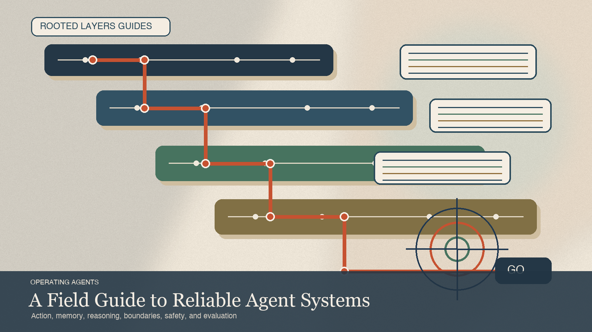

# Operating Agents Preface: A Field Guide to Building Reliable Agent Systems

Date: 2026-03-27
URL: https://lambpetros.substack.com/p/operating-agents-preface-a-field

# Operating Agents Preface: A Field Guide to Building Reliable Agent Systems

A team spent six weeks improving an operations agent by editing the surface everybody could see. First they swapped in a newer model after the old one kept mishandling edge cases. Then they lengthened the system prompt after the model swap still let bad escalations through. Neither change touched the incident that finally forced a redesign. In one afternoon the agent pushed a batch of internal tickets forward as completed even though the downstream service had only queued them for later approval.

The postmortem was uncomfortable because the model had looked strong. It read the right documents, named the right actions, and produced polished explanations. The weakness sat below the prose. The action surface was vague. The observation contract could not distinguish queued from completed state. Approval sat too late in the workflow. A person could quietly compensate for all of that in a demo. Production could not.

Reliable agents come from explicit operating layers, not capability stacking.

## Most Agent Writing Still Starts Too High

Most builders do not need to be told that models are improving. They already know. The harder lesson arrives when a workflow becomes useful enough to be tempting and brittle enough to become expensive. At that point the postmortem rarely turns on one grand capability deficit. It turns on a colder set of questions. What was the system allowed to touch. What did it think counted as success. What did it remember. What evidence survived between steps. Where did approval sit. Which channel carried trust it had not earned.

That is the center of this series. Dependable agents are not assembled by piling on more apparent capability until the output feels autonomous. They are assembled by making the operating layers explicit enough that when something fails, a serious person can still say what failed, why it failed, and what evidence would justify changing the design.

That decision rule is severe on purpose. If a workflow still relies on human compensation to look reliable, the architecture is not finished.

## What This Bundle Is Trying To Install

Each chapter makes one hard claim and pushes it until it becomes a design rule.

### Read The Field Guides

- [Operating Agents I: When Language Starts Making Commitments](https://lambpetros.substack.com/p/operating-agents-i-when-language) covers action.
- [Operating Agents II: Memory Needs Authority](https://lambpetros.substack.com/p/operating-agents-ii-memory-needs) covers memory.
- [Operating Agents III: Diagnose The Scaffold Before You Blame The Model](https://lambpetros.substack.com/p/operating-agents-iii-diagnose-the) covers reasoning.
- [Operating Agents IV: The Second Agent Is An Organizational Decision](https://lambpetros.substack.com/p/operating-agents-iv-the-second-agent) covers multi-agent design.
- [Operating Agents V: The Attack Surface Is The Architecture](https://lambpetros.substack.com/p/operating-agents-v-the-attack-surface) covers safety.
- [Operating Agents Bonus: The Workflow Becomes The Product](https://lambpetros.substack.com/p/operating-agents-bonus-the-workflow) covers optimization once a system is stable enough to deserve improvement.

### Go Deeper

For the second pass, use the GitHub companions and blueprints as the operator layer. Action: [Companion](https://github.com/petroslamb/content/blob/main/autonomous-agent-blueprint/essays/action/companion-v7.md) and [Blueprint](https://github.com/petroslamb/content/blob/main/autonomous-agent-blueprint/core/practical-chapter-blueprints/03-action-tool-use-blueprint.md). Memory: [Companion](https://github.com/petroslamb/content/blob/main/autonomous-agent-blueprint/essays/memory/companion-v7.md) and [Blueprint](https://github.com/petroslamb/content/blob/main/autonomous-agent-blueprint/core/practical-chapter-blueprints/01-memory-blueprint.md). Reasoning: [Companion](https://github.com/petroslamb/content/blob/main/autonomous-agent-blueprint/essays/reasoning/companion-v7.md) and [Blueprint](https://github.com/petroslamb/content/blob/main/autonomous-agent-blueprint/core/practical-chapter-blueprints/02-reasoning-planning-blueprint.md). Multi-agent: [Companion](https://github.com/petroslamb/content/blob/main/autonomous-agent-blueprint/essays/multi-agent/companion-v7.md) and [Blueprint](https://github.com/petroslamb/content/blob/main/autonomous-agent-blueprint/core/practical-chapter-blueprints/05-multi-agent-design-blueprint.md). Safety: [Companion](https://github.com/petroslamb/content/blob/main/autonomous-agent-blueprint/essays/safety/companion-v7.md) and [Blueprint](https://github.com/petroslamb/content/blob/main/autonomous-agent-blueprint/core/practical-chapter-blueprints/06-safety-blueprint.md). Optimization: [Companion](https://github.com/petroslamb/content/blob/main/autonomous-agent-blueprint/essays/optimization/companion-v7.md) and [Blueprint](https://github.com/petroslamb/content/blob/main/autonomous-agent-blueprint/core/practical-chapter-blueprints/04-optimization-self-improvement-blueprint.md).

Taken together, the bundle is not really about autonomy. It is about control surfaces. Where failure enters. Where trust is earned. Where authority should stop. What evidence should exist before a team widens the system. The field talks about agents as though the interesting question were how much apparent initiative the model can display. Builders usually discover that the harder question is whether the workflow still leaves behind enough structure for ordinary review.

That is the escalation rule behind the whole series. The moment a workflow touches tools, approvals, durable state, or hostile content, stop arguing about model taste and start diagnosing layers.

## Why The Public Order Starts With Action

The architecture stack begins with memory, because a long-lived system cannot reason well over time without a memory policy. The public series starts with action for a simpler reason. The mask usually drops there first. The moment language can write, submit, execute, or send, the subject stops being fluency and becomes interface design. Action creates continuity pressure immediately, which is why memory follows. Reasoning comes next because tools and memory still fail under a bad scaffold. Multi-agent design comes later because only a legible single-agent workflow can justify another role. Safety closes the core run because every capability above widens the attack surface. Optimization stays last because most teams reach for it before the system is even reconstructible.

This is not the best order for teaching the stack as a static architecture diagram. It is the best order for making the pain visible in the order many builders actually meet it.

## The Standard

The standard behind this series is severe on purpose. A good agent architecture should make ordinary review possible. A reviewer should be able to see what task the system thought it had, what evidence it used, what it did, how it checked the result, and where a human or another control boundary could still intervene. If that surface does not exist, the workflow may still look impressive. It is not yet dependable.

That is the doctrine this bundle is trying to install. Not maximum autonomy. Not model worship. Not decorative traces. Explicit layers, reviewable control, and narrower defaults than the field usually likes.

[Part I](https://lambpetros.substack.com/p/operating-agents-i-when-language) starts where language stops sounding useful and starts taking on consequence. If you already know your bottleneck, jump straight from the essay into its companion and matching blueprint.

## Selected Sources

[MemGPT](https://arxiv.org/abs/2310.08560). MemGPT matters to the doctrine because it reframed memory as a control problem rather than a context-window problem. Once memory becomes tiering, movement, and retention policy, the whole stack starts to look less like one smart model with accessories and more like a system with distinct layers that have to be governed.

[ReAct](https://arxiv.org/abs/2210.03629). ReAct matters because it forced reasoning back into contact with tools and observations. That move runs through the entire bundle. Dependable agents do not come from longer monologues. They come from loops the world can correct.

[AutoGen](https://arxiv.org/abs/2308.08155). AutoGen matters here because it made multi-agent coordination practical enough to expose both its value and its failure mode. It widened the field and also made it easier to confuse conversation with architecture. The bundle's conservative stance on role splits is partly a response to the surface AutoGen helped popularize.

[Not What You've Signed Up For](https://arxiv.org/abs/2302.12173). Greshake and colleagues matter because they changed the safety question from prompt strength to trust separation. Once external content can influence planning and action, safety stops being a style problem and becomes an architecture problem. That shift underwrites the whole series.

[OPRO](https://arxiv.org/abs/2309.03409). OPRO matters less here for prompt search itself than for the prerequisite it makes impossible to ignore. Optimization only begins once there is an objective and a repeatable evaluation loop. That is why this bundle treats optimization as late work for already legible systems rather than as an early badge of sophistication.
