# The Specification Surface Is the New Source of Truth

Date: 2026-05-01
URL: https://lambpetros.substack.com/p/the-specification-surface-is-the

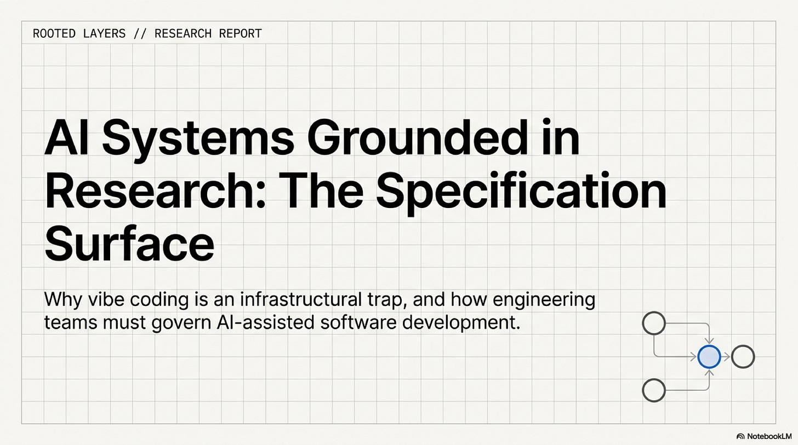

#### Video TL;DR

## The Hidden Authority Problem

The pull request looks normal until the reviewer asks the only question that matters. The agent-generated diff is plausible, the tests pass, and the summary explains which files changed and why the change is supposed to work. A schema was renamed, a retry branch disappeared, and no one can point to the maintained statement of what the feature had to preserve, which assumptions were settled, which behavior was out of scope, or what the agent was not allowed to change. At that point the code is visible while the authority behind it is not, and the team is reviewing the downstream artifact while the controlling intent stays outside the governed system.

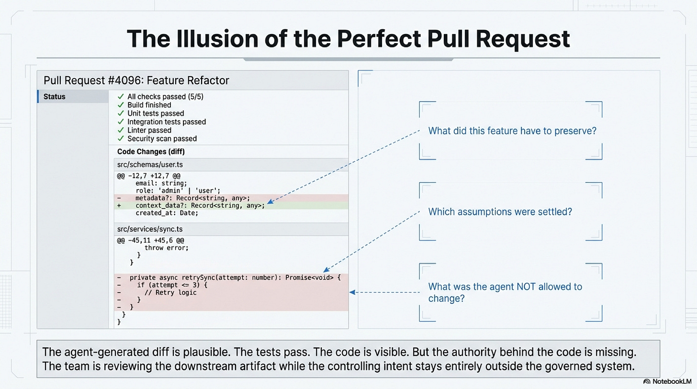

The older debugging world trained teams to expect visible failure: stack traces, red builds, tests that stop the merge. AI-assisted work creates a quieter class of failure. A bad intent boundary can produce code that compiles, passes a shallow test suite, and still violates the thing the team meant to protect.

That is the failure underneath vibe coding. The obvious risk is misplaced trust in a model, but the deeper failure is that intent remains informal until generated code becomes the only object treated as real. Once that happens, questions that should have been settled upstream return as archaeology: why the agent chose this schema, which constraint was binding, which test proves the important thing, and which instruction should survive the next model, the next run, or the next developer. A prompt transcript, a vague ticket, or a private design choice may explain the path, but none of them can govern the system unless they become durable, reviewable, and repairable.

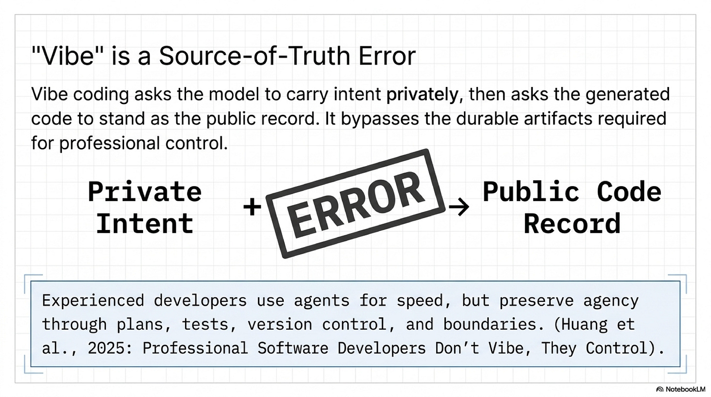

## What Makes A Surface Real

The object that repairs this failure is a specification surface: a written surface that gains operational force because it is controlled, maintained, typed, linted, validated, trace-linked, interpreted by a runtime, compiled into tests, or used as the stable artifact against which generated behavior is checked. Syntax is secondary; governance is decisive. Loose prose, README advice, and one-off chat prompts do not become source-of-truth artifacts just because they appeared before the code. The surface matters only when the system and the team can act on it.

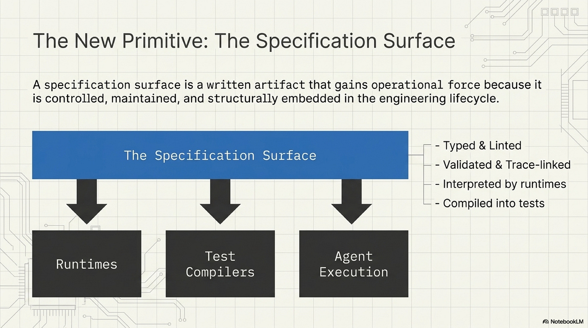

This distinction is easiest to lose when the artifact still looks like prose. The visible format can stay ordinary while the operational role changes underneath it.

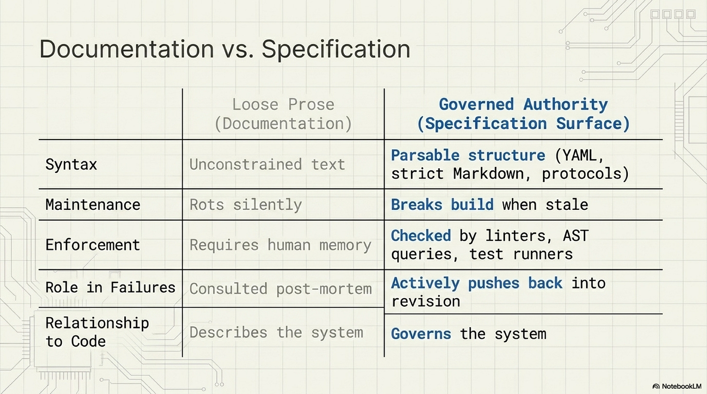

## Authority Is A Spectrum

Spec-driven development makes this larger than an agent-harness niche (Piskala, 2026). The old software problem is familiar: requirements drift, design documents rot, and the implementation becomes the only artifact everyone believes. AI coding raises the pressure because implementation can now appear faster than intent can be rediscovered. Spec-driven development inverts that hierarchy by treating specifications as contracts that code implements, verifies, or derives from (Piskala, 2026). At the lightest end, the specification guides implementation before code exists. In the stronger form, tests, contracts, and review keep the implementation anchored. At the far end, generated code becomes derivative of a human-edited specification, but only where the tooling and domain can support that burden.

That spectrum blocks the lazy version of the claim. The future is not every team throwing markdown into a repository and calling it source. Guidance consulted only up front can drift, while anchored work needs tests, contract checks, and review habits that keep the surface alive. Spec-as-source fits only where generation tooling is mature enough and the domain can tolerate the discipline. The useful rule is enough specification to remove consequential ambiguity, with enough enforcement to make drift visible. Authority comes from the maintenance loop, not from the romance of writing things down.

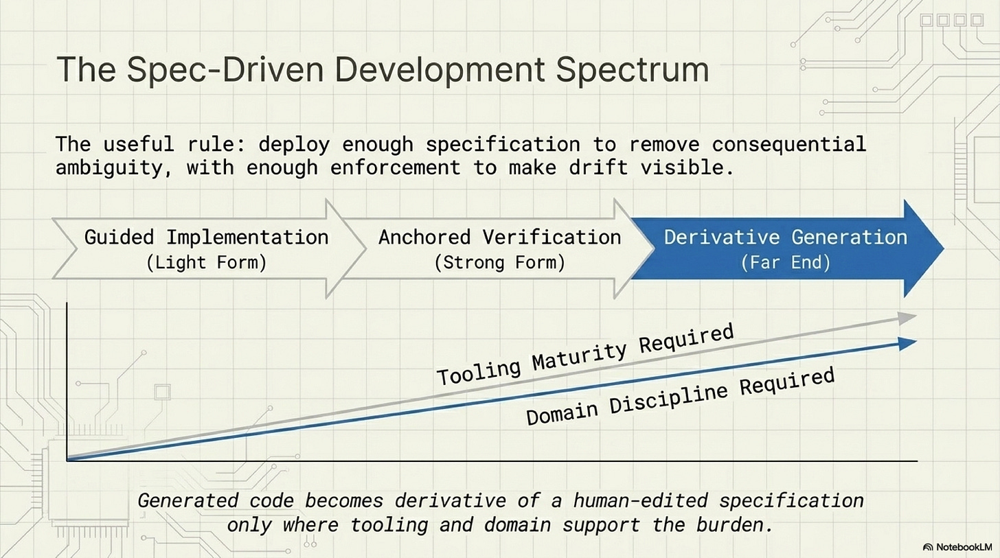

## The Specification Gap

The specification gap turns the source-of-truth claim into a coordination failure (Chacon Sartori, 2026). Chacon Sartori's study has multiple code agents independently implement parts of the same class while the shared specification loses detail. When the specification is stripped from full docstrings toward bare signatures, two-agent integration accuracy falls sharply, while a single-agent baseline degrades more gracefully (Chacon Sartori, 2026). The result matters because weak specifications remove shared decisions that separate workers cannot reliably infer from their fragments.

The recovery result is even more important. The paper's conflict detector can identify structural mismatches, especially when specifications are weakest, but conflict reports do not replace the missing shared specification in the studied recovery setting. Restoring the full specification is what recovers performance to the single-agent ceiling (Chacon Sartori, 2026). Diagnosis explains where the break appears; specification carries the shared decisions that prevent the break from becoming normal. That is the source-of-truth claim under pressure: when generated parts fail to integrate, better post-hoc inspection is not enough. The governing surface has to contain the decisions independent work must share.

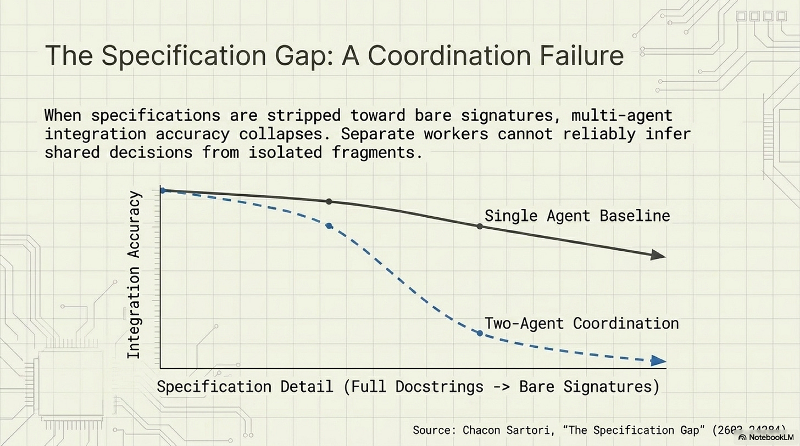

This makes the broader argument less metaphorical. Human teams already know the pattern through API contracts, BDD scenarios, acceptance criteria, architecture constraints, schemas, and interface definitions. Agents make the cost of weak surfaces easier to see because they can generate plausible work faster than organizations can reconstruct intent. The specification gap is the machine-speed version of an old software problem: separate workers do not reliably converge on unstated decisions.

## Professional Control Moves Upstream

The professional-practice evidence points in the same direction. "Professional Software Developers Don't Vibe, They Control" studies experienced developers using coding agents through field observations and surveys, and its useful contribution is the mechanism rather than the slogan (Huang et al., 2025). Experienced developers use agents for speed while preserving agency over design and implementation. They plan before implementation, supervise outputs, validate changes, use version control, limit how much work an agent does at once, and rely on domain expertise to decide where agents are suitable (Huang et al., 2025). They do not treat agent output as autonomous authority.

That finding gives `vibe` its proper role as a source-of-truth error. It asks the model to carry intent privately and then asks the generated code to stand as the public record. Professional control moves the burden back into artifacts: plans, specifications, tests, constraints, reviewable diffs, traces, and rollback points. The experienced developer's skepticism is infrastructural because control has to live somewhere the team can inspect.

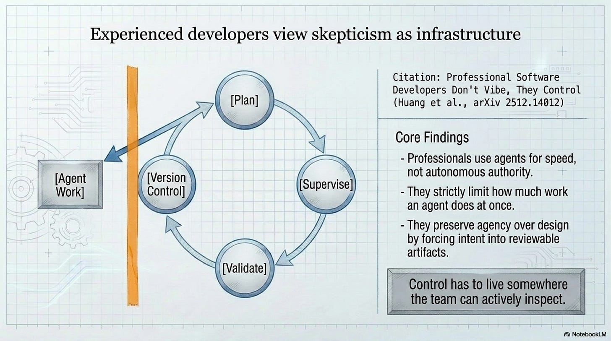

## Three Layers Of Control

The strongest agent-specific papers show how this surface becomes operational. In "Bootstrapping Coding Agents: The Specification Is the Program," the stable artifact is a compact specification that can generate an agent, which can then use the same specification to generate another implementation (Monperrus, 2026). The paper does not prove that prose should replace all code; it shows a controlled inversion in which the specification is the durable object and implementations become downstream products that can be compared against it. If they diverge, the repair target is the specification and its interpretation, not the mere fact that a file changed.

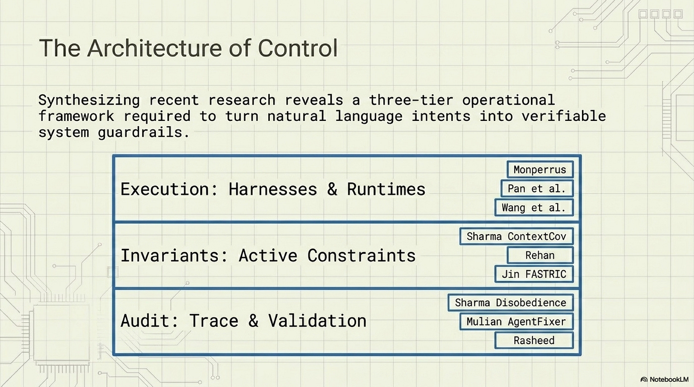

At the execution layer, a specification stops being a note beside the system when a runtime, compiler, or harness can turn it into behavior and compare the result back against it.

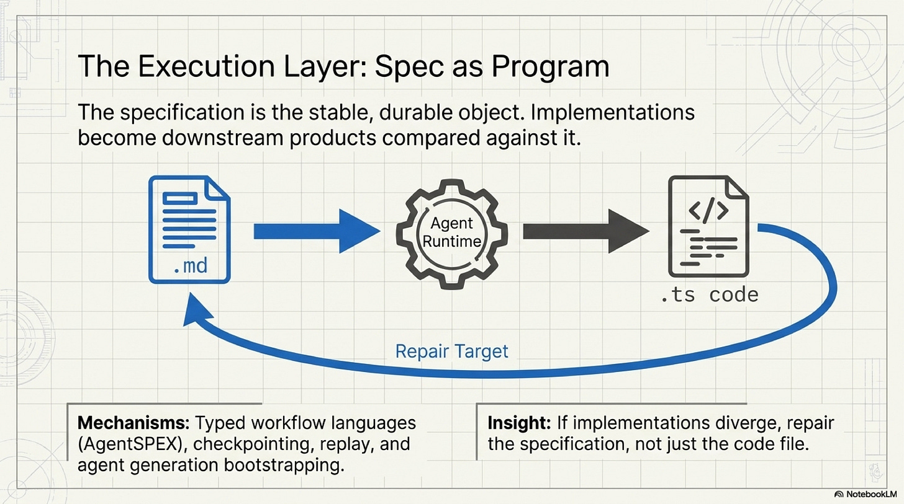

"Natural-Language Agent Harnesses" and AgentSPEX move the same logic from product intent into execution structure (Pan et al., 2026; Wang et al., 2026). The harness work puts decomposition, roles, state, adapters, contracts, verification, and durable artifacts into a form interpreted by a runtime (Pan et al., 2026). AgentSPEX adds a typed workflow language with steps, branches, loops, state management, checkpointing, tracing, replay, and verification (Wang et al., 2026). The important word remains surface: something with edges that can be read before execution, acted on during execution, audited after execution, versioned, diffed, parsed, tested, and linked to evidence. A chat prompt vanishes into a session, while a maintained workflow file can become part of the system's source.

ContextCov makes the transition from passive instruction to active invariant especially clear (Sharma, 2026). Agent instruction files such as AGENTS.md, CLAUDE.md, or copilot-instructions.md can contain real project guidance, but guidance on the page is weak unless it enters a control loop. ContextCov extracts constraints into executable checks: shell shims, AST queries, architectural validators, and LLM-based judgments where deterministic checks are not enough (Sharma, 2026). The document becomes a source of invariants. Failures reveal not only agent mistakes, but ambiguity, staleness, or drift in the instruction surface itself.

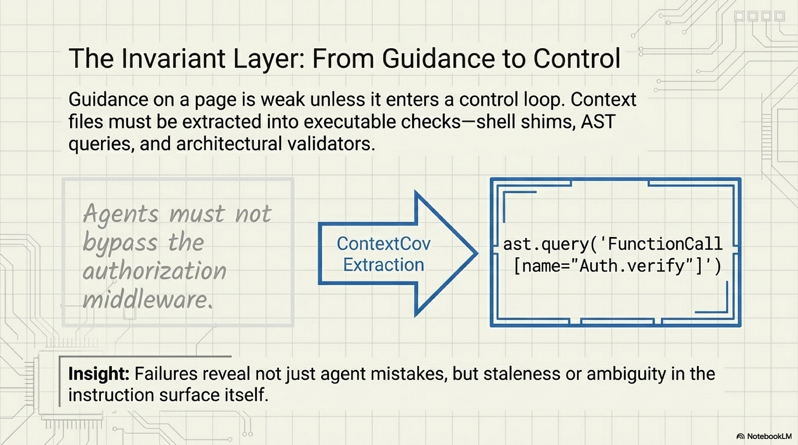

Test-Driven AI Agent Definition and FASTRIC make the same discipline visible at the prompt and interaction level (Rehan, 2026; Jin, 2025). A natural-language product specification can generate visible and hidden tests, then drive prompt and tool refinement against those tests (Rehan, 2026). A multi-turn prompt protocol can be specified enough to check roles, state transitions, tool use, and procedure (Jin, 2025). Stricter form does not automatically improve behavior; it earns its place when it makes behavior inspectable and gives a team something to test and repair.

Trace and audit papers complete the downstream side of the hierarchy. AgentPex evaluates traces for procedural violations that outcome-only scoring can miss (Sharma et al., 2026). AgentFixer uses validation checks, trace comparisons, root-cause analysis, and repair suggestions to turn failures into refinement pressure (Mulian et al., 2026). "From Fluent to Verifiable" shows why polished outputs are not enough when claim-evidence relations cannot be reconstructed (Rasheed et al., 2026). These systems are evidence surfaces: they tell the team whether execution respected the specification surface and where the surface failed to say enough.

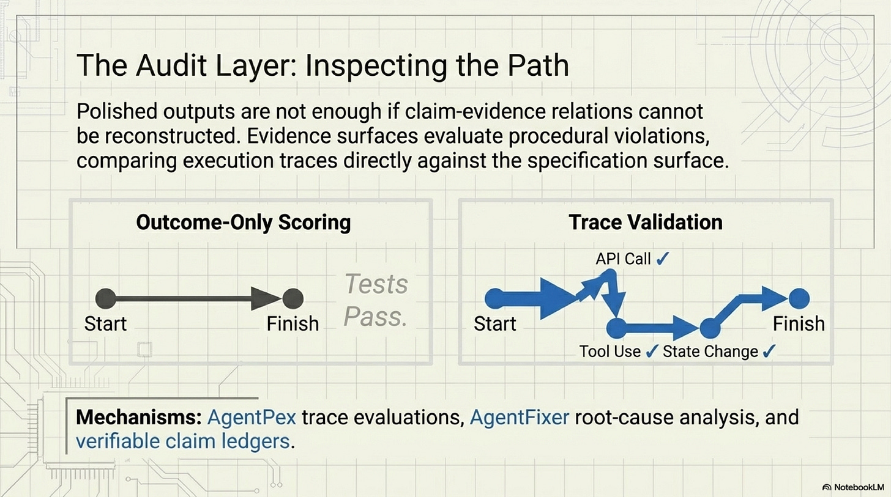

## The Context File Trap

That distinction matters most for context files. Agent READMEs and repository-level instruction files are real signals that software teams are creating machine-facing project artifacts beside source code, but they also expose the trap. More context does not automatically produce more control. A long instruction file can be stale, contradictory, ignored, or useful only for a narrow class of tasks. The evidence supports a disciplined claim: context files can become part of a specification surface when they are maintained and connected to evaluation or enforcement. They remain documentation when they merely explain the project.

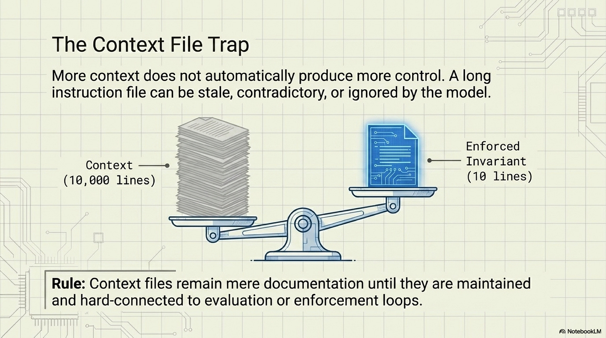

The operational test is simple. If a file can change what an agent is allowed to do, what state must persist, which tools are reachable, what outputs count as valid, what tests are generated, which trace violations matter, or what claims can be carried forward, then it belongs near the specification surface. If it only describes the project for human orientation, it may be valuable documentation, but it should not be confused with the artifact that governs AI-assisted work.

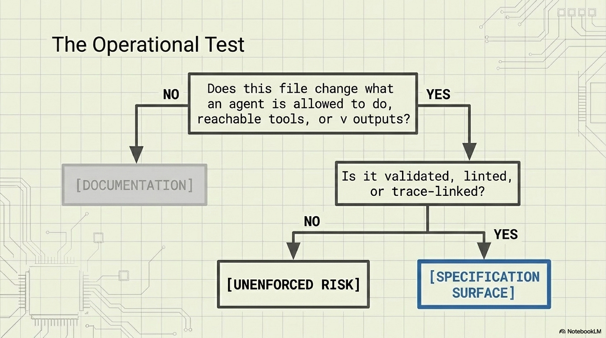

## Reviewing The Upstream Surface

Generated code still matters because it is the executable material of the system, carrying bugs, latency, security exposure, maintenance cost, and user consequences. A serious team still reviews it. In AI-assisted work, though, the generated implementation is often the most visible downstream artifact, not the most stable upstream one. A team that treats the diff as the whole truth keeps reviewing symptoms, while a team with a maintained specification surface can ask stronger questions: Was the intended behavior specified? Were the constraints checkable? Did the implementation drift from the surface, or did the surface fail to carry the needed decision?

The practical burden is plain. Teams need to decide which surfaces deserve authority and keep those surfaces short enough to audit, structured enough to parse, explicit enough to test, and close enough to execution that violations hurt. That means linting instruction files, validating workflow files, testing prompt behavior, checking traces for multi-step runs, and keeping claim ledgers when generated research or planning enters the system. This is where control lives when implementation can be generated faster than intent can be rediscovered.

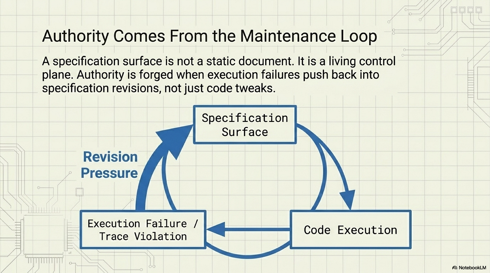

The frame is not `natural language is code`. Specification surfaces may be written in ordinary language, YAML, markdown with machine-readable conventions, tests, schemas, protocols, trace policies, or claim-evidence ledgers. Their common property is governed authority: they are maintained surfaces that systems read, tools check, humans review, and failures push back into revision.

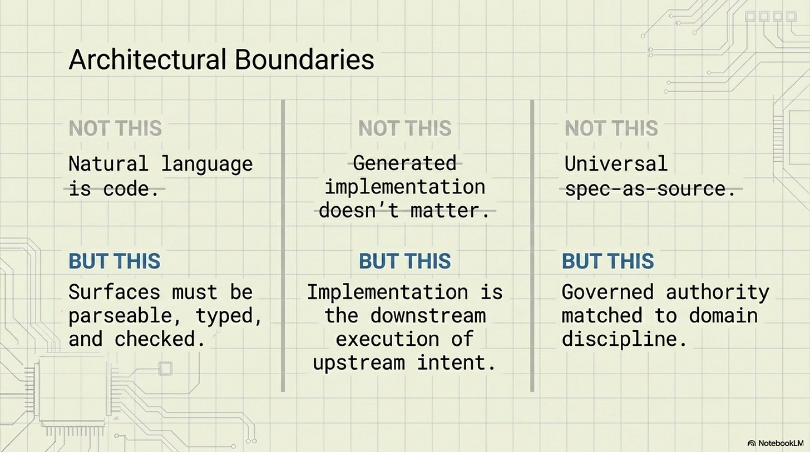

## Limits

This argument does not claim that natural language is code, that generated implementation stops mattering, that every document is a source-of-truth artifact, or that more formal specification always improves model behavior. It also does not claim that every team should adopt spec-as-source. The argument depends on controlled, maintained, validated, typed, linted, trace-linked, or runtime-interpreted surfaces that actually enter a control, review, or validation loop.

The supporting papers narrow the public claim. `2602.00180` supports specification authority as a software-practice spectrum (Piskala, 2026), not universal spec-as-source adoption. `2603.24284` supports specification-first coordination under the studied multi-agent code-generation conditions (Chacon Sartori, 2026), not a guarantee that full specifications eliminate every coordination cost. `2512.14012` supports professional-control practice among experienced developers (Huang et al., 2025), not a claim that every developer already works this way.

## The Review Question

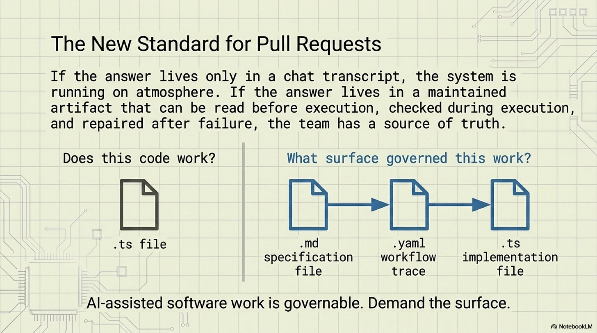

Return to the pull request. The reviewer can still inspect the code, and should, but the first serious questions now happen upstream of the diff. What surface governed the agent? What evidence shows that the work conformed to it? What missing decision should be added to the surface before the next run? If the answer lives only in a chat transcript, the system is still running on atmosphere. If the answer lives in a maintained artifact that can be read before execution, checked during execution, and repaired after failure, the team has a source of truth. That is the specification surface, and that is where AI-assisted software work becomes governable.

## References

#### [Piskala (2026), "Spec-Driven Development: From Code to Contract in the Age of AI Coding Assistants"](https://arxiv.org/abs/2602.00180)

Piskala gives the essay its software-engineering baseline. The useful contribution is the spectrum from ordinary spec-guided work toward stronger spec-as-source arrangements, where the durable artifact is no longer just a planning note but the contract from which implementation, tests, or review obligations can be derived. In this essay, that source is used to keep the claim grounded in existing engineering practice rather than in a romantic claim that prose has magically become code.

#### [Chacon Sartori (2026), "The Specification Gap: Coordination Failure Under Partial Knowledge in Code Agents"](https://arxiv.org/abs/2603.24284)

Chacon Sartori supplies the hinge evidence for the coordination claim. The paper shows that when shared specifications are stripped down, independent code agents fail to integrate their work much more sharply than a single-agent baseline, and that restoring the full specification recovers the studied system more effectively than conflict reports alone. Its contribution is to make underspecification measurable as a coordination failure, not just as a vague complaint about prompts.

#### [Huang et al. (2025), "Professional Software Developers Don't Vibe, They Control: AI Agent Use for Coding in 2025"](https://arxiv.org/abs/2512.14012)

Huang and coauthors give the essay its professional-practice counterweight. Their study matters because experienced developers are not presented as model skeptics or model believers; they are shown preserving agency through planning, supervision, validation, version control, bounded delegation, and domain judgment. The essay uses this contribution to define `vibe` as a control-surface failure, not as a personality type or a generic insult.

#### [Monperrus (2026), "Bootstrapping Coding Agents: The Specification Is the Program"](https://arxiv.org/abs/2603.17399)

Monperrus pushes the argument to its strongest architectural edge. The paper treats a compact specification as the durable object from which agents and implementations can be generated, making the implementation downstream of the maintained surface. This does not prove that every system should be built this way, but it gives the essay a concrete example of what happens when specification authority becomes operational rather than decorative.

#### [Pan et al. (2026), "Natural-Language Agent Harnesses"](https://arxiv.org/abs/2603.25723)

Pan and coauthors show how natural language can become part of a harness rather than remain a loose prompt. The contribution is the shift from one-off instruction to an environment that can organize agent behavior through maintained descriptions, tasks, and execution structure. The essay uses this source to separate ordinary prose from natural-language surfaces that participate in a governed workflow.

#### [Wang et al. (2026), "AgentSPEX: An Agent SPecification and EXecution Language"](https://arxiv.org/abs/2604.13346)

AgentSPEX contributes the language-design version of the same movement. It frames agent behavior through an explicit specification and execution language, which makes constraints, tasks, and runtime behavior less dependent on private prompting. In the essay, this source supports the claim that specification surfaces can become structured operational artifacts rather than only documents read before work begins.

#### [Sharma (2026), "ContextCov: Deriving and Enforcing Executable Constraints from Agent Instruction Files"](https://arxiv.org/abs/2603.00822)

ContextCov is important because it turns instruction files into checkable constraints. Its contribution is not merely that instructions can be written down, but that executable coverage can be derived from them and used to detect when an agent violates the stated surface. The essay uses this paper to show where a README-like artifact crosses from guidance into governance.

#### [Rehan (2026), "Test-Driven AI Agent Definition"](https://arxiv.org/abs/2603.08806)

Rehan contributes the testing analogue of specification authority. The core idea is that agent behavior should be defined and stabilized through tests, so the intended behavior has a maintained surface that can fail visibly when the agent drifts. The essay uses this source to connect specification surfaces to test-driven practice rather than treating them as a separate documentation layer.

#### [Jin (2025), "FASTRIC: Prompt Specification Language for Verifiable LLM Interactions"](https://arxiv.org/abs/2512.18940)

FASTRIC gives the essay a verification-oriented prompt-language example. Its contribution is the attempt to make LLM interactions specifiable and checkable through a dedicated language, moving prompt behavior away from informal instruction and toward verifiable interaction contracts. The essay uses it as one instance of the broader pattern: the surface matters when it can constrain or validate the interaction it describes.

#### [Sharma et al. (2026), "Willful Disobedience: Automatically Detecting Failures in Agentic Traces"](https://arxiv.org/abs/2603.23806)

Willful Disobedience supplies the trace-audit layer. The paper's contribution is automatic detection of cases where an agent's trace diverges from instructions or expectations, making compliance visible after execution rather than leaving it to impressionistic review. In the essay, this supports the audit claim: a specification surface gains authority when traces can be checked against it.

#### [Mulian et al. (2026), "AgentFixer: From Failure Detection to Fix Recommendations in LLM Agentic Systems"](https://arxiv.org/abs/2603.29848)

AgentFixer matters because it moves beyond detecting that an agent failed. Its contribution is a repair loop that connects failure diagnosis to fix recommendations, which is exactly the maintenance pressure a governing surface needs. The essay uses this paper to show that control does not end at validation; failures should push information back into the surface that governs the next run.

#### [Rasheed et al. (2026), "From Fluent to Verifiable: Claim-Level Auditability for Deep Research Agents"](https://arxiv.org/abs/2602.13855)

Rasheed and coauthors give the essay its evidence-surface endpoint. Their contribution is claim-level auditability for deep research agents: fluent generated reports become governable only when claims can be linked to supporting evidence, checked, and disputed. The essay uses this source to extend the specification-surface idea beyond coding into research workflows where the artifact under review is not only code but also a chain of claims.
