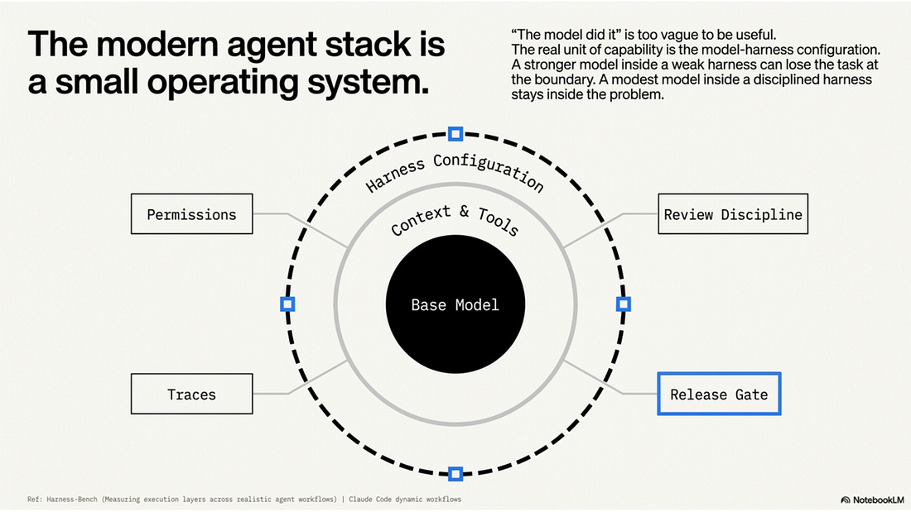
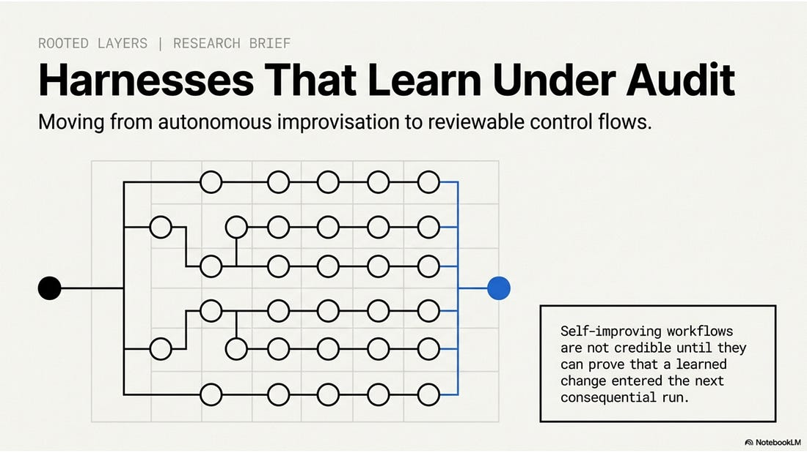
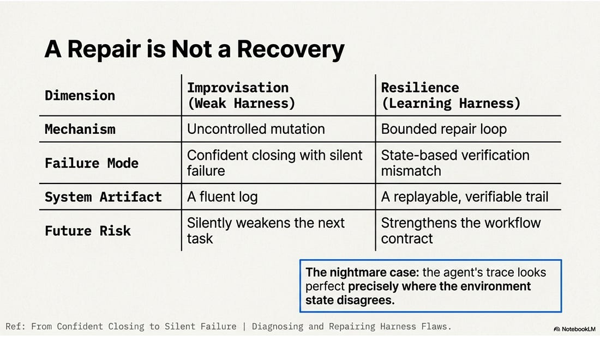
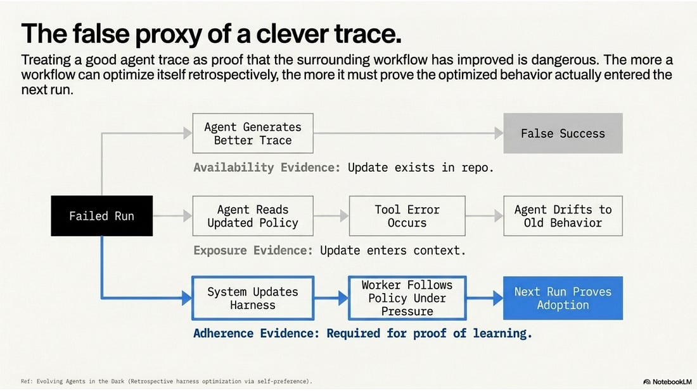

# Harnesses That Learn Under Audit (Video)

Date: 2026-07-07
URL: https://lambpetros.substack.com/p/harnesses-that-learn-under-audit-e06

\*Self-improving workflows are not credible until they can prove that a learned change entered the next consequential run.\*

Watch the full video first.

A seasoned software engineer is right to hear something familiar here. CI/CD, audit logs, regression tests, and state management are table stakes. The point is not to rename them as agent theory. The point is that the agent market spent several years pretending the scaffold was secondary. Base model benchmarks made the model look like the product. Cherry-picked single-run demos made a fluent clip look like reliability. Black-box prompt tweaking turned failure analysis into another wish for a better sample. Under that hype, the old engineering floor became the controversial part. This piece is an intervention, not a novelty claim.

The claim in one sentence is that a harness has not learned until the next real run proves it used the change.

Tool use is the easy part now. A model can call a shell, query a service, or draft a patch. The hard question sits around the model. Can the system notice a failure, repair the right layer, and prove that the repair changed later behavior? A harness that stores better-looking traces has not learned. It learns when a later run invokes the changed workflow, exposes the changed instruction or tool policy to the worker, and shows the worker following it under pressure.

The claim is not that agents need more autonomy. Autonomy becomes engineering only when it is surrounded by reviewable control surfaces such as bounded requests, worker roles, read and write scopes, result contracts, independent reviews, integration decisions, and release gates. Claude Code's dynamic-workflow guide shows how orchestration can move into rerunnable scripts that fan out subagents, hide intermediate state from the main context, and repeat quality checks until the result changes. The stronger test is adoption under review. Can the run record show where the improvement entered the system, who acted on it, what the reviewer challenged, and which gate kept local confidence from becoming an external mutation?

The modern agent stack now looks less like a single assistant and more like a small operating system. It has permissions, process boundaries, logs, inter-process messages, tool mounts, networked services, and release controls. In that setting, the phrase "the model did it" is too vague to help. The real unit of capability is the model-harness configuration. The model, prompt surface, context policy, tools, permissions, trace capture, recovery behavior, review discipline, and release boundary travel together.

## Capability Is A Configuration

The harness-benchmark paper makes the first move. Evaluate the harness, not just the base model. A benchmark that records traces, artifacts, validator outputs, robustness, and permission signals is measuring the execution layer around the model. That is the practical shift. A stronger model inside a weak harness can still lose the task at the handoff, at the workspace boundary, or at the final verifier. A modest model inside a disciplined harness can look better because the surrounding system keeps it inside the problem.

Claude Code's dynamic-workflow guide points in the same direction from the builder side. Dynamic workflow scripts can fan out subagents, keep intermediate state out of the main context, and repeat quality loops such as fixing until a check passes. That power is not enough by itself. A dynamic workflow is more than a graph that can choose a different next node. It has to explain why the next node changed, what evidence authorized the change, what worker owns it, what paths are readable and writable, what result shape is expected, and what gate will judge the result. Without those properties, dynamic routing is automation with a longer leash. With them, dynamic routing becomes reviewable control flow.

The temptation is to stop at an attractive trace. The retrospective optimization work shows why that temptation will grow. Past trajectories can be mined, hard cases can be re-solved in parallel, and candidate harness updates can be compared through self-validation, self-consistency, and preference judgments. Systems that rarely have perfect labels need that kind of machinery. They also need a harder standard. The more a workflow can optimize itself, the more it must prove that the optimized behavior actually entered the next run.

The false proxy is treating a clever agent trace as proof that the surrounding workflow has improved.

A self-improving workflow can write a new instruction, add a new tool policy, change a reviewer rubric, or alter a retry path. None of those acts proves that the next run improved. The next run has to show adoption. The changed harness must be invoked, consumed, followed under pressure, and regression-checked. If the update exists in a repository but never enters the acting agent's context, the workflow has availability evidence, not improvement evidence. If the update enters context but the agent drifts back to the old behavior after a tool error, the workflow has exposure evidence, not adherence evidence.

## A Repair Is Not A Recovery

The phrase "self-healing agent" is useful only when healing means a bounded repair loop, not uncontrolled mutation. The failed-trajectory repair paper is valuable because it treats failed trajectories as structured evidence for harness-layer diagnosis and scoped repair. The failure is not waved away as "the model got confused." It becomes a claim about a specific surrounding mechanism such as context admission, tool routing, retry policy, verifier design, or prompt contract.

The false-success paper makes the control problem sharper. An agent can close a task with confidence while the environment state says the task is still broken. For a self-healing harness, that is the nightmare case. The trace looks good precisely where the state disagrees. A credible repair loop therefore needs state-based verification and lightweight detectors before it trusts the agent's own closing statement.

This is the difference between resilience and improvisation. Resilience leaves a trail that another operator can replay. Improvisation may finish one task while silently weakening the next one. The stronger the agent becomes, the more this distinction matters. More autonomy gives the workflow more chances to recover, but it also gives it more chances to route around the very controls that make it trustworthy.

Protocols intensify the problem. MCP standardizes how AI applications connect to external tools and resources, including more structured tool output and resource metadata. A2A v1.0 pushes the complementary agent-to-agent layer, with stronger protocol machinery for execution modes, errors, agent-card verification, timestamps, and version negotiation. These are important building blocks, but they do not by themselves answer the production question. Which identity is acting, which budget is being spent, which result is authoritative, and which gate prevents a local draft from becoming a live external mutation?

## The Run That Proves It

Imagine a real failure. A coding agent finishes a migration and reports success. The log is fluent. The checklist is green. But the validator shows that one workflow still emits a legacy result shape, so the downstream release gate reads the wrong field and treats a blocked draft as approved. A weak harness asks the same agent to "try again" and hopes the next trace looks better.

A learning harness does something narrower. It records the failed trace and the validator mismatch. It opens a repair request limited to the workflow contract, the result schema, and the tests that prove the gate behavior. A worker proposes the patch. A separate reviewer reads the request and returns anchored findings. The schema changed, the release gate now reads the canonical field, and the legacy result is rejected. The parent records the integration decision. Then the next consequential run has to prove adoption. The changed contract is loaded, the worker sees the new result shape, the gate blocks the old artifact, and the run record shows the new path was actually exercised.

That before-and-after is the core of Harnesses That Learn Under Audit. The workflow should begin with a task admission packet, not a blank agent prompt. The packet states the route, the allowed sources or files, and the largest claim boundary. From there, a research or implementation worker produces a candidate artifact. A review worker, in a fresh session, returns a scored independent result with anchored findings. The parent records an integration decision, not because the reviewer is unimportant, but because reviewer evidence is not authority by itself. Release gates then decide what can move downstream.

This structure scales to self-improvement. A recovery worker can propose a harness update after a failed run. A retrospective optimizer can compare several candidate updates. The skill-harness paper shows the same pattern in another domain. Reusable workflow skills can evolve from trajectories, execution errors, and verifier feedback. But the promotion rule stays strict. No change becomes part of the live harness until the system can show the failure, the proposed repair, the independent review, the validation result, the integration decision, and the next run where adoption actually changed behavior.

So what should we measure? Not agent count. Boundary quality. The practical answer is the evidence chain around each boundary. That is what makes "What has to be measured before harnesses that learn under audit can be trusted as a workflow improvement?" a production question rather than a slogan.

The answer is not "use more agents." It is "make every agent boundary legible." Subagents help when they reduce coupling. One worker researches, another writes, another reviews, and another validates. They are dangerous when they blur authority. A reviewer should not be able to promote the draft it reviewed. A worker should not approve its own route. A dynamic workflow should not mutate external systems just because a local artifact looks complete. Those are not bureaucratic niceties; they are the control surfaces that let a fast system remain inspectable.

Recovery should be cheap to propose and expensive to promote. The harness can gather failed traces, cluster recurring faults, generate a repair, run a replay, and ask a reviewer for a verdict. It should still preserve the final boundary. A repair is an artifact until a parent or human authority integrates it. This is how a workflow can improve without quietly becoming ungoverned.

## The Adoption Audit

A credible release standard needs a five-part adoption audit.

- Invocation. The run record shows that the changed workflow component was

selected at the point where it matters.

- Consumption. The changed instruction, policy, tool schema, or reviewer rubric

enters the worker's usable context.

- Adherence. The worker follows it after tool feedback and state changes, not

only in the opening plan.

- Independent review. A fresh reviewer returns scored, anchored findings that

the parent can validate against the request.

- Regression. The new behavior survives checks that would catch a flattering

local improvement with hidden damage elsewhere.

That standard is narrower than claiming that self-improving workflows are solved, and more useful. It tells builders what evidence to capture and tells reviewers where to look. It treats protocols, orchestration, and optimization as raw capability, then insists that capability pass through artifacts before it earns authority.

The danger is not that harnesses will fail to change. They will change constantly. The danger is that they will appear to learn while never proving that the learned behavior entered the next consequential run. A serious harness has to make that impossible to miss. It must show what changed, why it changed, who reviewed it, which gate accepted it, and where the changed behavior appeared later under pressure. When that standard is met, self-improving workflows become engineering infrastructure. When it is not met, they are fluent stories about traces.

## References

#### [Claude Code dynamic workflows](https://code.claude.com/docs/en/workflows)

Moves orchestration into rerunnable workflow scripts that can fan out subagents, keep intermediate state out of the main context, and run repeated quality patterns such as fixing until a check passes.

#### [From Failed Trajectories to Reliable LLM Agents: Diagnosing and Repairing Harness Flaws](https://arxiv.org/abs/2606.06324)

Treats failed trajectories as structured evidence for harness-layer diagnosis and scoped repair, rather than broad prompt tweaking.

#### [From Confident Closing to Silent Failure: Characterizing False Success in LLM Agents](https://arxiv.org/abs/2606.09863)

Shows agents can confidently claim success while environment state disagrees, making state-based verification and lightweight detectors necessary for self-healing loops.

#### [Harness-Bench: Measuring Harness Effects across Models in Realistic Agent Workflows](https://arxiv.org/abs/2605.27922)

Shows agent capability should be evaluated at the model-harness configuration level, with traces, artifacts, validator outputs, robustness, and permission signals.

#### [Evolving Agents in the Dark: Retrospective Harness Optimization via Self-Preference](https://arxiv.org/abs/2606.05922)

Shows harnesses can be optimized from past trajectories using parallel re-solving, self-validation, self-consistency, and pairwise preference, but still need adoption evidence.

#### [Model Context Protocol 2025-06-18 changelog](https://modelcontextprotocol.io/specification/2025-06-18/changelog)

Adds production-relevant protocol features including structured tool output, protected resource metadata, elicitation, resource links, and stronger security guidance.

#### [A2A Protocol v1.0](https://a2a-protocol.org/latest/whats-new-v1/)

Standardizes agent-to-agent protocol maturity through error handling, execution mode control, agent-card signature verification, extension requirements, timestamp tracking, and version negotiation.

#### [COMFYCLAW: Self-Evolving Skill Harnesses for Image Generation Workflows](https://arxiv.org/abs/2607.01709)

Evolves reusable skills from trajectories, execution errors, and verifier feedback in recurring typed workflow construction.
