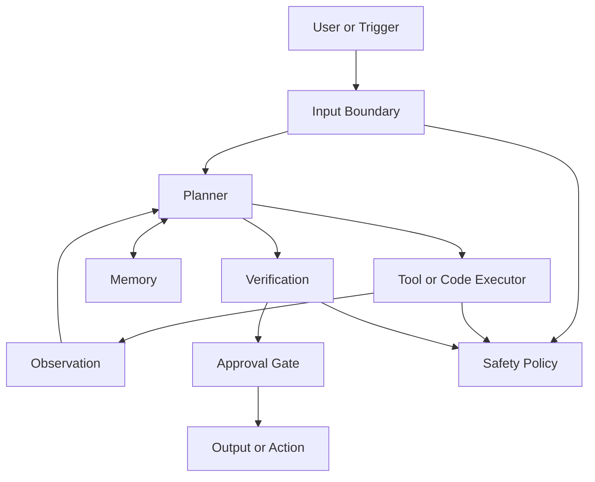

# Agentic Architectures Blueprint

This file reorganizes the material in `publications/autonomous-agents/` around the methods that dominate practical agent design. It does not follow the survey chapter order, because the chapter order is useful for coverage but not for building systems. The organizing principle here is simpler: start from the patterns that show up again and again in working agents, then treat everything else as an extension, escalation, or frontier branch.

The main claim of this blueprint is that the practical center of agentic architecture is not "human-like intelligence" in the abstract. It is a bounded system that can reason through a task, retrieve and remember the right information, use tools in a controlled way, verify important outputs, and escalate to humans when the cost of error is real. The most widely used methods are the ones that support exactly that stack, so they drive the structure of this document.

## The Practical Spine

If this entire folder had to collapse into one sentence, it would be this: most useful agents are built from a ReAct-style control loop, retrieval-backed memory, structured tool use, a verification layer, and strong safety boundaries. Multi-agent coordination and workflow self-optimization matter, but they come after that baseline, not before it.

That is why this file is organized around seven layers of maturity. First comes the default blueprint. Then come the methods that justify it. Then come the escalation paths that make the system more capable when the simpler form stops being enough.

## The Default Blueprint

### 1. Start with an input boundary, not with autonomy

The first design decision is not how smart the agent is. It is what the agent is allowed to trust. A practical agent must separate system instructions, user intent, retrieved context, external documents, tool outputs, inter-agent messages, and shared artifacts such as files or images, because those inputs do not deserve the same level of trust. This boundary is what makes later reasoning and tool use safe enough to matter. Without it, prompt injection, poisoned retrieval, tool misuse, and cross-agent contamination turn every later architectural choice into a liability.

### 2. Use a planner-executor loop as the control plane

The default reasoning architecture should be an explicit loop in which the agent decides what it is trying to do, chooses the next action, executes that action through a tool or code path, observes the result, and updates the next step. This is the most stable practical form because it makes reasoning observable, action testable, and failure modes debuggable. In other words, the system behaves less like a mysterious chatbot and more like a workflow engine with a language model in the middle.

### 3. Put tool and code execution at the center of action

An assistant becomes an agent when it can do something beyond generating text. In practice, that means APIs, search, browsers, code execution, databases, and sometimes GUI automation. Structured tool calls and executable code matter because they are replayable, inspectable, and measurable in a way plain-text "intended actions" are not. The default design should therefore treat the tool layer as a first-class system, not as a plugin attached at the edge.

### 4. Treat memory as a layered system

Long prompts are not a memory architecture. A practical agent needs at least a current-task workspace, a semantic layer for durable facts and documents, an episodic layer for prior runs and decisions, and sometimes a procedural layer for reusable routines or skills. Once the agent works across sessions or repeated tasks, memory quality becomes more important than prompt cleverness, because the system lives or dies on what it remembers, what it forgets, and how it retrieves.

### 5. Add verification before you add more complexity

Many agent failures are not failures of raw capability. They are failures of unchecked first-pass output. A lightweight verification step, a critique pass, or a structured self-check often buys more reliability than adding more agents or more elaborate planning. The practical lesson is to treat verification as part of the baseline architecture, especially when outputs become actions.

### 6. Put humans in the loop where side effects matter

The right default for enterprise or production agents is supervised autonomy, not maximum autonomy. Human approval should sit before destructive, financial, legal, compliance-sensitive, or hard-to-reverse actions. This is not a concession that the system is weak. It is the correct design response to accountability, auditability, and asymmetric risk.

### 7. Optimize only after the baseline is measurable

Once the architecture is stable, then prompts, schemas, routing rules, retrieval strategies, and workflow topology become optimization targets. But optimization only pays off when there are clean evaluation cases and useful metrics. Before that point, workflow search and self-improvement machinery are usually disguised confusion.

## Why This Blueprint Is Organized Around These Methods

### ReAct is the control plane most practical agents start from

The single most useful paper in the folder for organizing agent behavior is `ReAct: Synergizing Reasoning and Acting in Language Models` (`papers/react.md`). Its importance is not just historical. It captures the control loop that underlies most practical agents: reason about the next step, take an action, observe the result, and continue. That pattern is legible, easy to adapt to tools, and strong enough for many tasks without any model retraining.

What makes ReAct so central is that it connects reasoning to environment feedback. A chain-of-thought-only agent may think clearly and still fail because it never grounds itself in the outside world. A ReAct-style agent can ask, retrieve, browse, inspect, run code, or call an API before committing to its next step. That makes it the natural backbone for almost every architecture in this folder that touches tools or live state.

The practical extensions in this part of the literature are also worth separating by how often they should be used. `Self-Consistency Improves Chain of Thought Reasoning in Language Models` (`papers/self_consistency.md`) is useful when one answer is too brittle and you want multiple reasoning traces to vote. `SELF-REFINE: Iterative Refinement with Self-Feedback` (`papers/self_refine.md`) is the cheap and often effective pattern for draft, critique, and revision. `Chain-of-Verification Reduces Hallucination in Large Language Models` (`papers/chain_of_verification.md`) is the right escalation when the system must check claims instead of merely polishing them.

By contrast, `Tree of Thoughts: Deliberate Problem Solving with Large Language Models` (`papers/tree_of_thoughts.md`) and `Language Agent Tree Search Unifies Reasoning, Acting, and Planning in Language Models` (`papers/lats.md`) are best understood as search-heavy escalation paths, not as the normal default. They matter for difficult planning problems, but they are too expensive and too operationally complex to be the organizing center of a practical baseline.

The design conclusion from this section is straightforward. The baseline reasoning architecture should be ReAct plus a small verification layer. Self-consistency, self-refinement, or search should be added only when the task profile justifies the extra latency and cost.

### Retrieval-backed memory is the persistence layer most teams actually need

The second organizing method is not exotic long-context modeling. It is explicit memory outside the prompt. The reason this method dominates practical systems is that useful agents need persistence long before they need anything that resembles a brain model. They need to remember facts, task state, user preferences, prior failures, and successful routines. That is why the memory section is one of the strongest parts of the source material.

`MemGPT: Towards LLMs as Operating Systems` (`papers/memgpt.md`) is important because it frames memory as tiered management rather than as a bigger prompt. `MemoryBank: Enhancing Large Language Models with Long-Term Memory` (`papers/memorybank.md`) matters because it treats memory as something that should decay, refresh, and stay useful instead of becoming a transcript dump. `Generative Agents: Interactive Simulacra of Human Behavior` (`papers/generative_agents.md`) remains influential because it ties episodic traces to reflection and synthesis, which is closer to how task experience becomes higher-level behavior.

The most practical memory papers in the folder push this further toward deployable design. `Reflexion: Language Agents with Verbal Reinforcement Learning` (`papers/reflexion.md`) shows how storing self-critique across attempts can make later runs better without retraining the model. `Mem0: Building Production-Ready AI Agents with Scalable Long-Term Memory` (`papers/mem0.md`) is valuable because it is explicitly about production memory extraction, consolidation, and retrieval. `HippoRAG: Neurobiologically Inspired Long-Term Memory for Large Language Models` (`papers/hipporag.md`) matters when simple vector retrieval is too shallow for multi-hop or linked knowledge. `Voyager: An Open-Ended Embodied Agent with Large Language Models` (`papers/voyager.md`) is relevant because it treats successful code behaviors as procedural memory, which is the cleanest expression of a skill library in the folder.

The practical memory stack that emerges from these papers is not complicated in principle. Keep current task context in short-term working state. Store durable facts in semantic retrieval. Store prior actions, decisions, and failures as episodic traces. Store reusable routines as procedural artifacts such as prompts, code, or skills. Add summarization and forgetting so that the memory system remains selective instead of becoming a junk drawer.

This is why retrieval-backed memory, not long prompts, is the real persistence layer of practical agent architecture. Once the system crosses session boundaries or repeated tasks, memory design is no longer optional.

### Function calling and code execution are the dominant action interfaces

The third major method is tool-based action. This is the point where agents stop being only answer machines and become systems that can intervene in software. The practical literature makes one lesson very clear: action becomes useful when it is structured. Typed function calls, API requests, SQL queries, browser operations, and executable code are all better action surfaces than vague natural-language plans because they can be constrained, tested, logged, and replayed.

`Toolformer: Language Models Can Teach Themselves to Use Tools` (`papers/toolformer.md`) is the clean conceptual paper for the move from language-only generation to explicit tool use. `Gorilla: Large Language Model Connected with Massive APIs` (`papers/gorilla.md`) is especially practical because it treats tool use as an API selection and argument-construction problem, which is exactly how many real failures show up in production. `HuggingGPT: Solving AI Tasks with ChatGPT and its Friends in Hugging Face` (`papers/hugginggpt.md`) broadens the picture by showing the model as a controller that delegates to many specialists.

For web and digital environments, the folder has a clear progression. `A Real-World WebAgent with Planning, Long Context Understanding, and Program Synthesis` (`papers/webagent.md`) shows how planning and execution come together on websites. `Mind2Web: Towards a Generalist Agent for the Web` (`papers/mind2web.md`) matters as a general benchmark and architectural reference for web interaction. These are not just browsing papers. They are evidence that web action is one of the main near-term surfaces for real agent work.

For GUI and device action, the practical story is more constrained but still relevant. `Mobile-Agent: Autonomous Multi-Modal Mobile Device Agent with Visual Perception` (`papers/mobile_agent.md`) and `AppAgent: Multimodal Agents as Smartphone Users` (`papers/appagent.md`) show how the action problem extends into GUI-heavy environments. `OmniParser for Pure Vision Based GUI Agent` (`papers/omniparser.md`) matters because UI understanding is one of the main bottlenecks in computer-use systems. These papers are best read as targeted automation references, not as evidence that general computer use is solved.

For structured data and software engineering, the action layer becomes even more concrete. `Can LLM Already Serve as a Database Interface? A BIg Bench for Large-Scale Database Grounded Text-to-SQLs` (`papers/bird.md`) and `Spider 2.0: Evaluating Language Models on Real-World Enterprise Text-to-SQL Workflows` (`papers/spider_2_0.md`) show that a major action surface for enterprise agents is not chat or browsing but business data. `SWE-agent: Agent-Computer Interfaces Enable Automated Software Engineering` (`papers/swe_agent.md`) is one of the clearest demonstrations that code, shell actions, and test feedback can become a practical action loop.

The design conclusion here is that the action layer should be shaped around the environment that actually matters: APIs and code for software tasks, browsers for web workflows, SQL for data workflows, and GUI automation only when modern interfaces do not exist. The most widely used practical action pattern is therefore not "general autonomy." It is environment-specific tool use under strict control.

### Verification and critique are the main reliability overlay

Once an agent can reason, retrieve, and act, the next practical question is not how to make it more theatrical. It is how to make it less wrong. The most stable answer in the material is to add a reliability overlay before adding architectural sprawl. This overlay can be internal, such as self-refinement or self-consistency, or external, such as tool-based verification, consensus, or human review.

The reasoning papers already mentioned form the single-agent version of this pattern. `Self-Consistency Improves Chain of Thought Reasoning in Language Models` (`papers/self_consistency.md`) improves brittle single-pass outputs by sampling multiple traces. `SELF-REFINE: Iterative Refinement with Self-Feedback` (`papers/self_refine.md`) improves outputs through critique and revision. `Chain-of-Verification Reduces Hallucination in Large Language Models` (`papers/chain_of_verification.md`) turns fact checking into an explicit step rather than a hope.

The multi-agent reliability papers matter here more than as general multi-agent blueprints. `Encouraging Divergent Thinking in Large Language Models through Multi-Agent Debate` (`papers/mad.md`) is best read as a debate-based reliability overlay. `RECONCILE: Round-Table Conference Improves Reasoning via Consensus among Diverse LLMs` (`papers/reconcile.md`) is important because it pushes the idea toward more structured agreement and confidence handling. In practice, these are useful when accuracy matters enough to pay for multiple views. They are not the right starting point for every workflow.

The practical conclusion is that reliability should usually be layered onto a single-agent baseline first. A second look, a verification pass, or a critique loop often buys more than creating a team of agents too early.

### Human approval and safety boundaries are part of the architecture, not an appendix

The most underrated method in the folder is not a reasoning trick. It is architectural containment. As soon as an agent reads external text, stores memory, or takes actions with side effects, the safety problem becomes structural. This is why the safety material belongs in the center of the blueprint rather than in a closing section about ethics.

`Not What You've Signed Up For: Compromising Real-World LLM-Integrated Applications with Indirect Prompt Injection` (`papers/greshake_indirect_prompt_injection.md`) is one of the clearest reasons to distrust external content by default. `InjecAgent: Benchmarking Indirect Prompt Injections in Tool-Integrated Large Language Model Agents` (`papers/injecagent.md`) shows that this is not a theoretical corner case but a practical weakness in tool-using systems. `Identifying the Risks of LM Agents with an LM-Emulated Sandbox` (`papers/toolemu.md`) is useful because it treats agent risk as something that can be exercised and evaluated before deployment rather than after an incident.

The retrieval and memory attack papers complete the picture. `AGENT POISON: Red-teaming LLM Agents via Poisoning Memory or Knowledge Bases` (`papers/agentpoison.md`) shows why memory and knowledge bases cannot be treated as inherently trusted. `PoisonedRAG: Knowledge Corruption Attacks to Retrieval-Augmented Generation of Large Language Models` (`papers/poisonedrag.md`) and `BadRAG: Identifying Vulnerabilities in Retrieval Augmented Generation of Large Language Models` (`papers/badrag.md`) show that a small amount of poisoned corpus content can systematically distort behavior. `Machine Against the RAG: Jamming Retrieval-Augmented Generation with Blocker Documents` (`papers/jamming.md`) matters because it expands the threat model from misinformation to denial-of-service and retrieval interference.

The design lesson is that a production agent needs several boundaries working together. It needs source labeling so instructions and data are not mixed. It needs least privilege so tool failures are contained. It needs sandboxing so execution is reversible and inspectable. It needs approval gates so risky actions are supervised. It needs logging so incidents are reconstructable. These are not secondary controls. They are part of what the architecture is.

### Multi-agent systems are an escalation path, not the default starting point

A large part of agent discourse overstates multi-agent design because it feels more visibly "agentic" than a strong single-agent workflow. The material in this folder supports a more conservative conclusion. Multi-agent systems are useful when there is real role separation, artifact handoff, or disagreement that needs explicit resolution. They are much less useful when they are added mainly to create the appearance of sophistication.

`AutoGen: Enabling Next-Gen LLM Applications via Multi-Agent Conversation` (`papers/autogen.md`) is important because it turned multi-agent conversation into a usable framework and influenced a great deal of later practice. `MetaGPT: Meta Programming for a Multi-Agent Collaborative Framework` (`papers/metagpt.md`) matters because it emphasizes structured roles and artifact handoffs rather than open-ended chatter. `ChatDev: Communicative Agents for Software Development` (`papers/chatdev.md`) is another strong example of a role-based pipeline in which multi-agent coordination is really a staged workflow.

The right practical interpretation of these papers is narrow and useful. Start with one orchestrator when possible. Add specialists when different tools, permissions, or deliverables truly justify separation. Prefer structured messages and handoffs over free-form conversation. Use debate-oriented multi-agent methods only when reliability gains are worth the operational overhead.

This is why multi-agent design appears later in the blueprint. It is a coordination technique that becomes valuable after the single-agent control loop is clear, not a substitute for that loop.

### Workflow optimization matters after the architecture is real

Once the baseline agent exists and is measurable, the next question becomes how to improve it without replacing the whole stack. The practical literature here is stronger than it looks, but it only becomes useful after the rest of the architecture is already stable. Before then, optimization papers are easy to misuse as abstract inspiration rather than as tools.

`Large Language Models as Optimizers` (`papers/opro.md`) is useful because it frames prompt improvement as an optimization problem rather than an artisanal craft. `TextGrad: Automatic "Differentiation" via Text` (`papers/textgrad.md`) matters because it generalizes that logic from single prompts to larger textual systems through gradient-like feedback. `AFLOW: Automating Agentic Workflow Generation` (`papers/aflow.md`) and `GPTSwarm: Language Agents as Optimizable Graphs` (`papers/gptswarm.md`) push the optimization target from prompts to workflow structure itself.

The evaluation side of this layer matters just as much as the optimization side. `Judging LLM-as-a-Judge with MT-Bench and Chatbot Arena` (`papers/mt_bench_chatbot_arena.md`) is relevant here because it helped establish LLM-as-judge as a practical evaluation pattern. In agent systems, that evaluation idea extends beyond answer quality into tool-use accuracy, failure rates, latency, cost, retry behavior, and approval frequency.

The practical takeaway is that the optimization layer should focus first on output schemas, prompt clarity, routing rules, retrieval quality, and tool policies. Only after those are stable does it make sense to search over workflow graphs or allow more ambitious self-improvement loops.

## The Escalation Path

The easiest way to apply this material is to treat architecture design as a sequence of escalations. A simple assistant becomes a retrieval copilot when it needs grounded knowledge. That retrieval copilot becomes a tool-using agent when it needs to act. That tool-using agent becomes a stateful agent when it needs memory across runs. That stateful agent becomes an orchestrator-plus-specialists system only when different roles, permissions, or artifacts justify that split. Finally, that architecture becomes an optimization target only when it is stable enough to measure.

This sequence matters because many teams invert it. They start with multi-agent conversation, broad autonomy, and elaborate topologies before they have a reliable planner, a bounded tool layer, or a clean memory model. The result is not sophistication. It is a larger failure surface.

## What This Blueprint Pushes to the Edge

The source material covers many topics that are useful for orientation but should not organize a practical implementation-first blueprint. Brain-region analogies help explain the survey's ambition, but they are not a good primary design tool. Emotion and personality modeling may matter in some interactive domains, but they are not central to most agent deployments. World-model-heavy architectures are intellectually important, but the dominant practical wins in software and enterprise settings still come from better retrieval, better tools, and better workflow structure. Physical-world autonomy belongs in the picture, but it is a different engineering regime and should not distort the default design for digital agents.

In other words, this blueprint intentionally keeps the frontier material visible but peripheral. The practical center of gravity remains memory, reasoning loops, tools, verification, safety, and selective role decomposition.

## A Practical Reading Order From This Folder

If someone wanted to use this folder to get a practical foothold quickly, the right reading order would not begin with the full survey. It would begin with `foundation-agents-practical-distillation.md`, then this blueprint, and then the core method papers. The first wave should be `ReAct: Synergizing Reasoning and Acting in Language Models` (`papers/react.md`), `Toolformer: Language Models Can Teach Themselves to Use Tools` (`papers/toolformer.md`), `Gorilla: Large Language Model Connected with Massive APIs` (`papers/gorilla.md`), `MemGPT: Towards LLMs as Operating Systems` (`papers/memgpt.md`), `Reflexion: Language Agents with Verbal Reinforcement Learning` (`papers/reflexion.md`), and `Chain-of-Verification Reduces Hallucination in Large Language Models` (`papers/chain_of_verification.md`).

After that baseline, the second wave should depend on the kind of agent you care about. For web action, read `A Real-World WebAgent with Planning, Long Context Understanding, and Program Synthesis` (`papers/webagent.md`) and `Mind2Web: Towards a Generalist Agent for the Web` (`papers/mind2web.md`). For software agents, read `SWE-agent: Agent-Computer Interfaces Enable Automated Software Engineering` (`papers/swe_agent.md`). For long-term memory, read `Mem0: Building Production-Ready AI Agents with Scalable Long-Term Memory` (`papers/mem0.md`) and `HippoRAG: Neurobiologically Inspired Long-Term Memory for Large Language Models` (`papers/hipporag.md`). For multi-agent coordination, read `AutoGen: Enabling Next-Gen LLM Applications via Multi-Agent Conversation` (`papers/autogen.md`) and `MetaGPT: Meta Programming for a Multi-Agent Collaborative Framework` (`papers/metagpt.md`). For safety, read `Not What You've Signed Up For: Compromising Real-World LLM-Integrated Applications with Indirect Prompt Injection` (`papers/greshake_indirect_prompt_injection.md`), `InjecAgent: Benchmarking Indirect Prompt Injections in Tool-Integrated Large Language Model Agents` (`papers/injecagent.md`), and `Identifying the Risks of LM Agents with an LM-Emulated Sandbox` (`papers/toolemu.md`).

## The Bottom Line

The cleanest way to organize the material is around the methods that actually recur in useful systems. ReAct gives the control loop. Retrieval-backed memory gives persistence. Function calling and code execution give action. Verification gives reliability. Safety boundaries and approval gates make the system deployable. Multi-agent coordination and workflow optimization become valuable only after that baseline exists.

That is the blueprint this folder most strongly supports.
