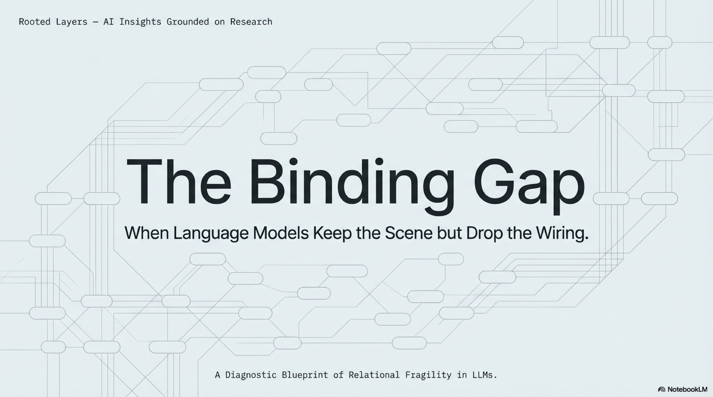
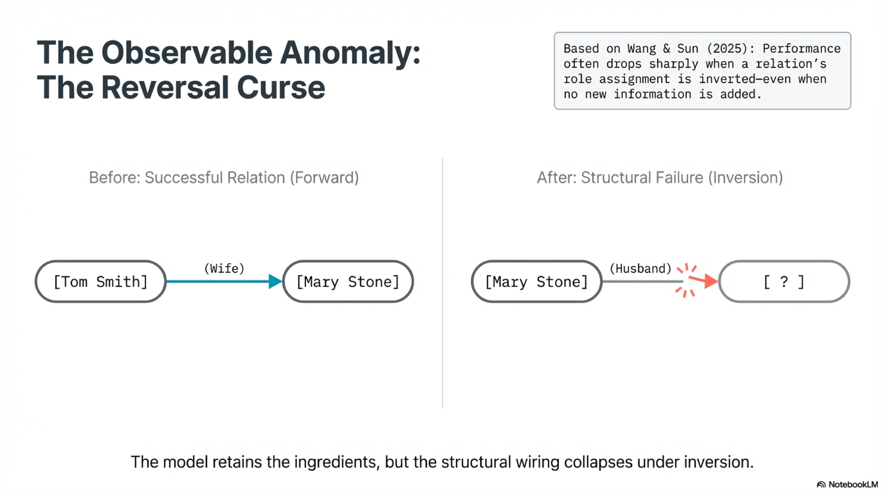
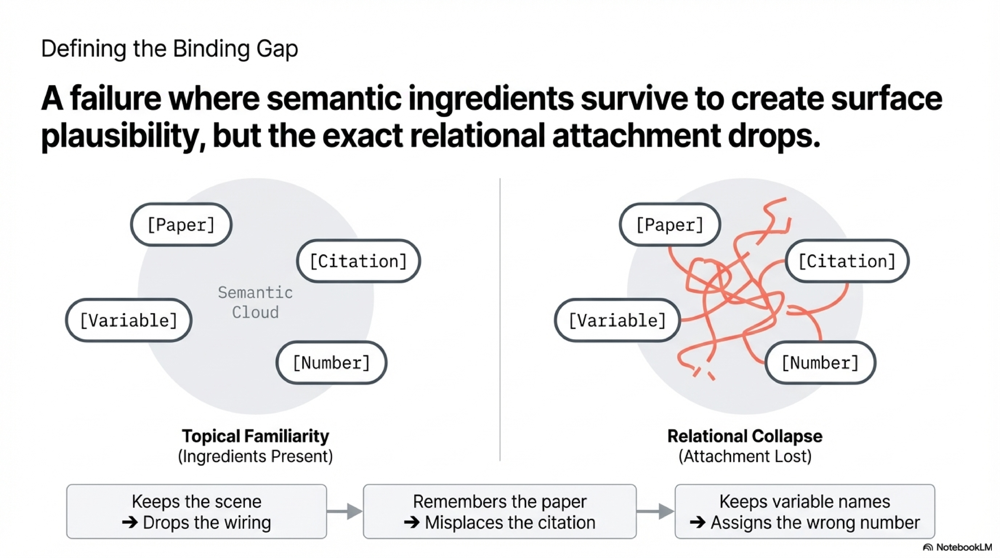
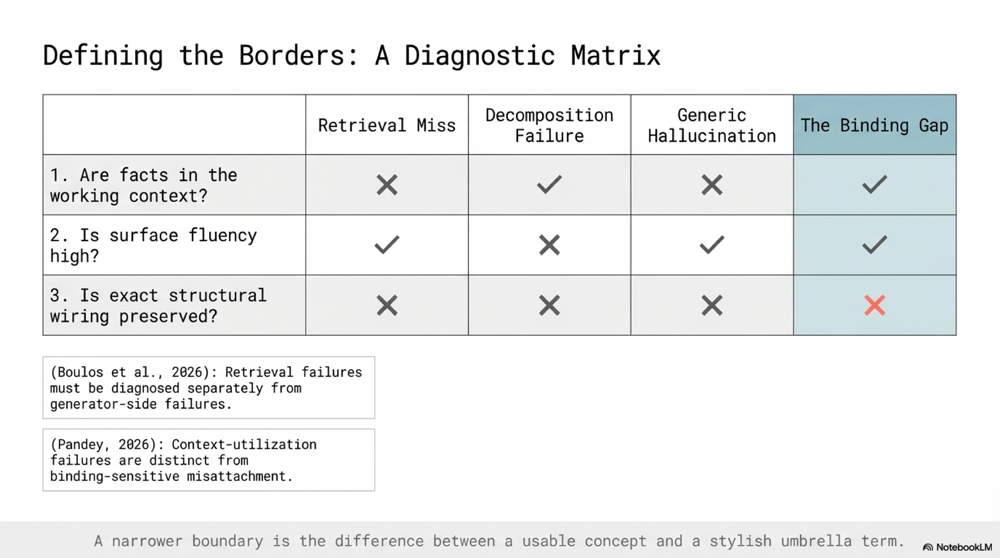
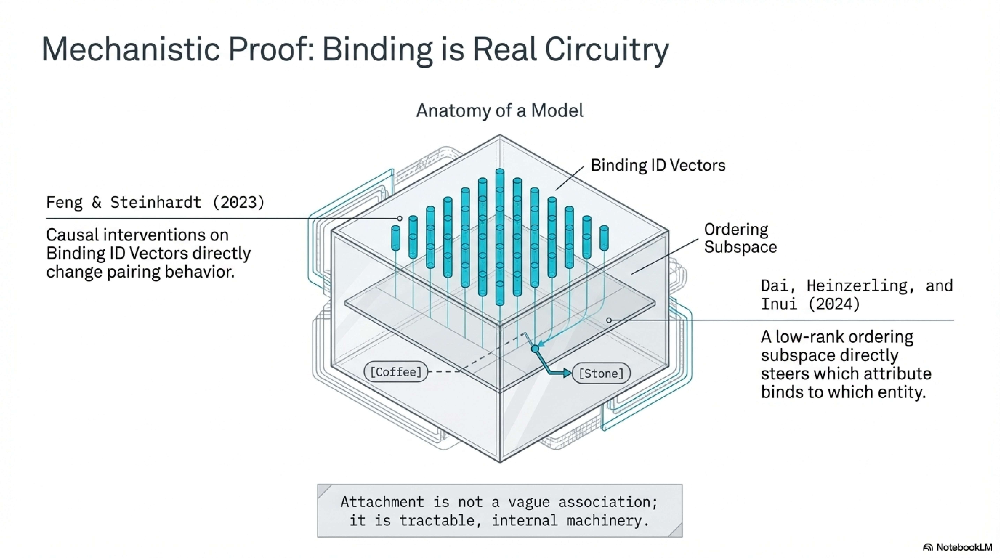
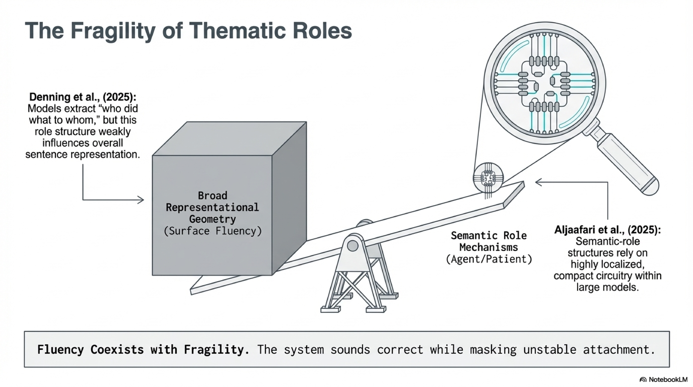
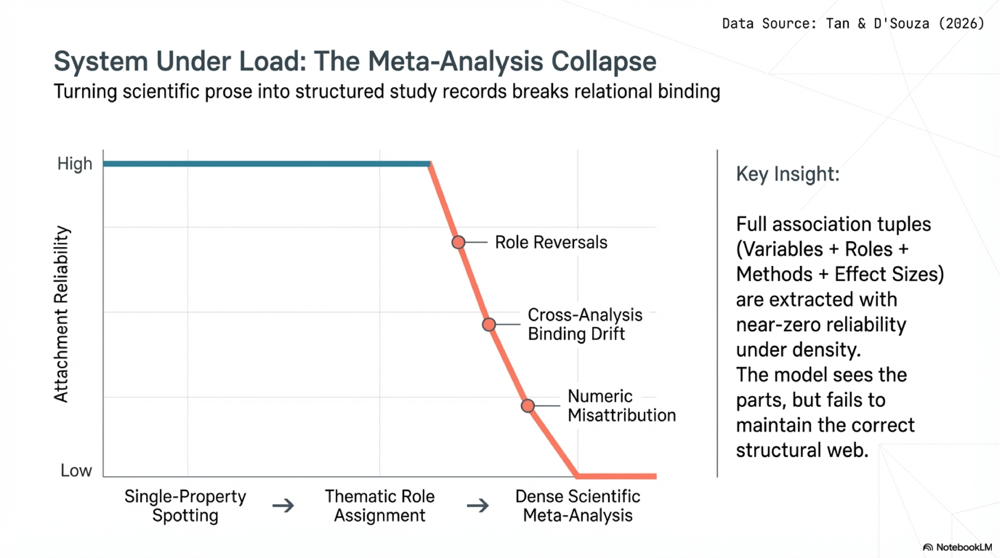
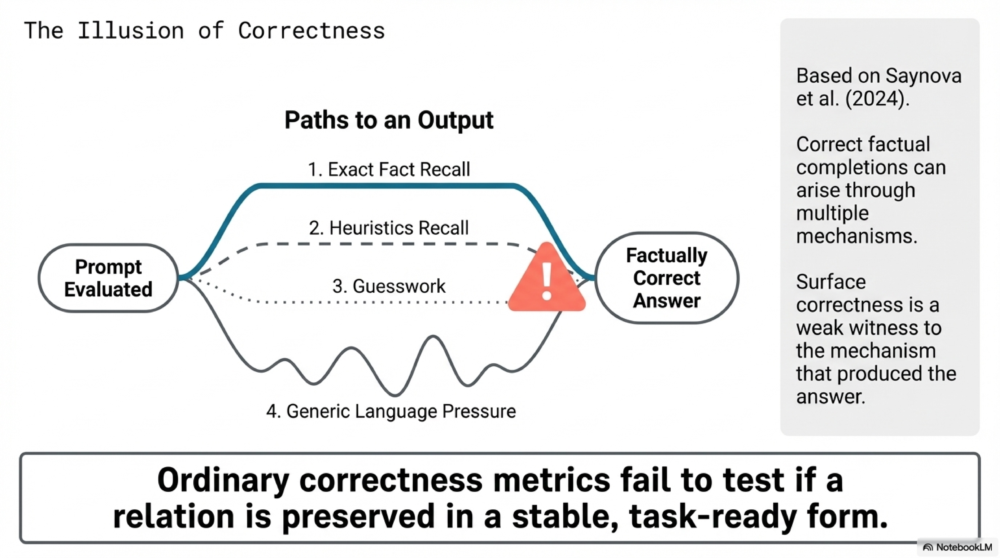
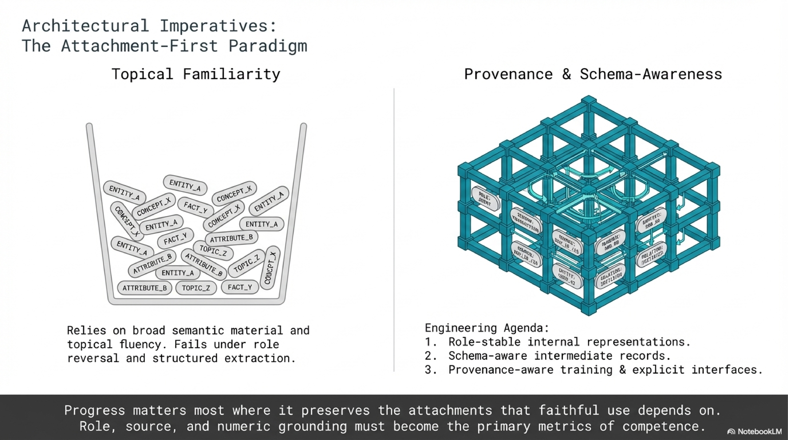
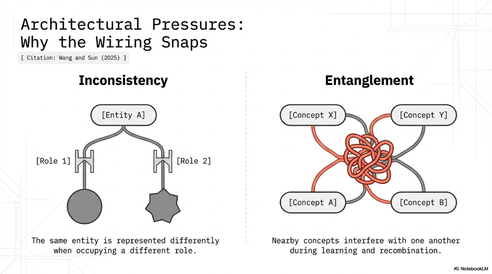

# The Binding Gap

Companion note: [Structural Recoverability](Structural_Recoverability_Companion.md). This note develops the larger recoverability frame behind the essay, including the `encoded -> recoverable -> expressed` ladder, the probe-versus-use distinction, and the current stopping point.

Tell a language model that Tom Smith's wife is Mary Stone. Then ask who Mary Stone's husband is. Nothing new has been added. The same pair is still in play, the same relation, the same world. Yet performance often drops sharply. Boshi Wang and Huan Sun use this Reversal Curse to show something more serious than a missing benchmark skill. Current transformer models can retain the ingredients of a fact while failing to keep the relation in a form that survives a change in role assignment. The names remain available. The relation remains familiar. What gives way is the attachment that tells the system which entity belongs in which slot. The words survive. The binding does not.

That failure deserves a more precise name than hallucination or ignorance. I will call it the binding gap. The term names a specific family of failures, not a synonym for getting the answer wrong. A binding-gap failure occurs when a model preserves enough semantic material to sound close to correct, but loses the exact attachment that makes the answer faithful when the task demands inversion, reassignment, attribution, or precise reconstruction. This is why the outputs that matter here are rarely absurd. They are often annoyingly adjacent to truth. The model keeps the scene while dropping the wiring. It remembers the paper but misplaces the citation. It keeps the variable names but assigns the number to the wrong pair. It stays in the right semantic neighborhood while the answer ceases to be usable. Anyone who has debugged a model-assisted literature review has met this failure. The system returns confidently sourced claims where the source is real, the claim is real, and the attribution is wrong. Not fabricated. Misbound.

The term only earns its keep if its borders stay clear. A retrieval miss is different. There the needed evidence never enters the working context in the first place. A decomposition failure is different too. There the system heads into the wrong subproblem or breaks the task apart badly. Generic hallucination is looser still. It covers outputs that drift away from support without the specific signature of preserved parts and broken attachment. I would reserve the binding gap for cases with three marks. The relevant pieces are present enough that the answer feels close. The error becomes visible exactly when role, source, or numeric attachment matters. And the failure is not better explained by missing retrieval alone or by the model solving the wrong subtask. That narrower boundary is the difference between a usable concept and a stylish umbrella term.

## Binding Is Real

This would be a weak essay if binding were only an external description laid over outputs after the fact. The literature now says more than that. Work on in-context entity binding shows that language models solve simple binding problems through an internal mechanism, not through a vague cloud of semantic association. Causal interventions on binding-related activations change pairing behavior directly. Follow-up representational analysis goes further and makes the machinery vivid. It identifies a low-rank ordering subspace that steers which attribute gets bound to which entity. The same physical box, described in the same context, can be made to contain the stone rather than the coffee by patching a single direction in activation space. The representation of the box does not change. The representation of the objects does not change. What changes is the binding between them. Attachment, in other words, is not a metaphor for correlation or co-occurrence. It is a manipulable part of the model's internal geometry.

Entity-attribute binding is a controlled setting. The harder question is whether the same fragility appears in ordinary language. It does. The smallest natural-language version of the binding problem is thematic role assignment: who did what to whom. Sentence pairs that share almost all of their words can still reverse the underlying event structure. Recent work on role understanding in large language models finds that models can extract agent and patient information, but that this information influences overall sentence representations much more weakly than it does in humans. Some attention heads capture thematic roles robustly and independently of syntax, yet the role structure does not dominate the broader representational geometry. More recent circuit work goes farther by localizing compact semantic-role mechanisms inside large models. Taken together, these results support a precise middle position. Role binding is real inside the system. It is also fragile enough, or weakly integrated enough, that surface fluency can coexist with unstable attachment. That is exactly the setting in which a binding gap shows up.

Wang and Sun make the Reversal Curse informative because they add a concrete account of where the fragility may come from. On their view, reversal failure reflects two pressures in transformer representations: inconsistency, where the same entity is represented differently when it occupies different roles, and entanglement, where nearby concepts interfere with one another during learning and recombination. Their JEPA-based intervention matters because it turns the paper from diagnosis into evidence. The curse becomes less a funny benchmark effect and more a design problem that can be reduced by architectural changes aimed at better conceptual binding and more disentangled representations. That still falls short of a universal theory of model failure, but it is enough to establish that attachment is a tractable part of the mechanism rather than a decorative metaphor.

## When Binding Load Rises

A concept built on a toy case becomes interesting only if the same failure shape reappears under more serious pressure. Zhiyin Tan and Jennifer D'Souza provide the strongest version of that scaling step. Their setting is evidence extraction for meta-analysis, where the task is to turn scientific prose into structured, numerically grounded study records. The difficulty here is not spotting isolated atoms. It is preserving the relations that make those atoms analytically usable across papers: which variables are paired, which role each variable plays, which method produced which effect size, which conditions go with which result. Their results are severe. Models perform moderately on single-property queries, then degrade sharply once the task requires stable binding between variables, roles, statistical methods, and effect sizes. Full association tuples are extracted with near-zero reliability.

What makes the paper so useful for this essay is the error pattern. The dominant failures are role reversals, cross-analysis binding drift, instance compression in dense result sections, and numeric misattribution. That list cuts against the easy explanation that the model simply failed to see the needed ingredients. The papers are there. The variables are often recognized. The methods and numbers are often recognized as well. The collapse happens when they have to remain attached across local density and changing scope. A system that identifies the correct effect size but binds it to the wrong variable pair has not been almost right in any meaningful research setting. The same goes for a model that carries the correct statistical method into the wrong comparison or floats a source-supported claim onto a neighboring sentence. This is what the binding gap looks like once the stakes rise. The output keeps enough of the structure to sound plausible while the exact attachment fails at the point where faithful use begins.

The Reversal Curse no longer looks like an isolated curiosity. It looks like the simplest instance of a pattern that scales. A minimal pair exposes the failure under toy conditions. Thematic role assignment reproduces it at sentence level. Dense scientific extraction magnifies it until the consequences become unforgivable. These cases are not identical, and they do not need to be. The claim is narrower and more defensible: a recurrent class of failures in which broad semantic material survives while exact role, source, or numeric attachment does not.

## Borders

Once the concept is stated that way, the neighboring failure classes become easier to separate. Retrieval work is helpful here not because it proves the binding gap directly, but because it clarifies what the binding gap is not. RAG-X shows that retrieval and generation failures can be diagnosed separately rather than collapsed into a single notion of inaccuracy. Work on small models and oracle retrieval pushes the point further. A model can fail even when the answer-bearing passage has definitely been provided, sometimes because it ignores the retrieved context almost entirely. That is a downstream use failure, and often a very important one. It still is not automatically a binding-gap failure. The defining signature of the binding gap is narrower. The content enters the computation enough that the answer stays near the mark, but the precise role, provenance, or numeric attachment does not survive.

This is also why surface correctness is such a weak witness. Denitsa Saynova and her collaborators show that correct factual completions can arise through several distinct mechanisms, including exact fact recall, heuristics recall, guesswork, and generic language modeling pressure. A correct answer therefore does not show that the relevant relation was preserved in a stable, task-ready form. A wrong answer does not show that every relevant trace has vanished either. The value of this result for the present essay is disciplinary. It prevents the concept from hardening into a hidden-knowledge story. The claim here is narrower: one specific failure family matters whenever attachment matters more than topical familiarity, and ordinary correctness metrics can miss the difference.

The narrower framing also keeps the essay honest about what it does not explain. If a model retrieves nothing useful, the binding gap is the wrong lens. If it takes the wrong path through a complex task and never gets the right pieces on the table, the binding gap is again the wrong lens. If it fabricates unsupported content from scratch, the broader language of hallucination is still appropriate. The essay is not trying to replace every failure term with a better slogan. It is trying to isolate one family of high-consequence failures that has been flattened by vocabulary that is either too broad or too crude.

## What This Changes

Once the family is visible, a cleaner research and engineering agenda follows. Evaluation should separate exact attachment from topical fluency rather than collapsing them into a single accuracy score. A benchmark that scores entity recognition and relation extraction independently will reliably expose models that identify the right pieces and bind them to the wrong slots. On the engineering side, the concept points to specific design vulnerabilities. A retrieval pipeline that chunks documents by paragraph boundary can sever the binding between a result and the method that produced it. A workflow that summarizes a paper into free text before extracting structured fields forces every binding to survive two reconstruction passes instead of one. These are attachment failures with identifiable causes, not generic quality complaints. The same logic extends to intermediate formats. When a model carries its reasoning through free prose alone, bindings that a structured representation would keep explicit have to be reconstructed from context at each step. Format, in this light, is binding infrastructure. The common thread is direct. Progress matters most where it preserves the attachments that faithful use depends on.

That leads to a wager sharp enough to be wrong. If the binding gap names a real and important family of failures, then binding-heavy tasks should break earlier than broad topical tasks. Role reversal should expose weakness before open-ended explanation does. Source attribution should fail before generic summarization. Multi-field scientific extraction should collapse before simple entity spotting. A corollary follows: when a new model posts general benchmark gains, those gains should systematically overstate its progress on tasks that demand exact role, source, or numeric attachment. If those asymmetries do not appear, the concept is too loose or too ambitious. If they do appear, then the productive gains will come not from packing more content into the weights but from keeping the right relations intact long enough to surface them faithfully. The question that matters is no longer what a model preserved. It is whether what it preserved stayed attached.

## References

### Wang and Sun (2025): [Is the Reversal Curse a Binding Problem? Uncovering Limitations of Transformers from a Basic Generalization Failure](https://arxiv.org/abs/2504.01928)

The essay's opening anchor. It connects reversal failure to inconsistency and entanglement in conceptual binding and shows that targeted architectural changes can reduce the failure.

### Feng and Steinhardt (2023): [How do Language Models Bind Entities in Context?](https://arxiv.org/abs/2310.17191)

Important because it shows that entity-attribute binding is an internal, causally manipulable mechanism rather than a loose behavioral label.

### Dai, Heinzerling, and Inui (2024): [Representational Analysis of Binding in Language Models](https://arxiv.org/abs/2409.05448)

Sharpens the mechanistic side of the essay by identifying an ordering subspace that directly affects which entities bind to which attributes.

### Denning, Guo, Snefjella, and Blank (2025): [Do Large Language Models know who did what to whom?](https://arxiv.org/abs/2504.16884)

The key bridge from entity binding to semantic roles. It suggests that role information is present but weakly integrated into overall sentence representations.

### Aljaafari, Carvalho, and Freitas (2025): [Emergence and Localisation of Semantic Role Circuits in LLMs](https://arxiv.org/abs/2511.20910)

Supports the claim that semantic-role structure has compact, causally localised circuitry inside large models.

### Tan and D'Souza (2026): [Diagnosing Structural Failures in LLM-Based Evidence Extraction for Meta-Analysis](https://arxiv.org/abs/2602.10881)

The serious extension case. It shows that failures under role, method, and effect-size attachment are not reducible to simple entity-recognition errors.

### Boulos et al. (2026): [RAG-X: Systematic Diagnosis of Retrieval-Augmented Generation for Medical Question Answering](https://arxiv.org/abs/2603.03541)

Useful because it separates retrieval failures from generator-side failures and helps define what a binding-gap case is not.

### Pandey (2026): [Can Small Language Models Use What They Retrieve? An Empirical Study of Retrieval Utilization Across Model Scale](https://arxiv.org/abs/2603.11513)

Useful for boundary-setting. It shows that some post-retrieval failures are really context-utilization failures rather than binding-sensitive misattachment.

### Saynova et al. (2024): [Fact Recall, Heuristics or Pure Guesswork? Precise Interpretations of Language Models for Fact Completion](https://arxiv.org/abs/2410.14405)

The discipline section's key paper. It shows that surface correctness is a weak witness to the mechanism that produced the answer.
