# Confidence Debt

#### *Video TL;DR*

## The Polished Version Wins

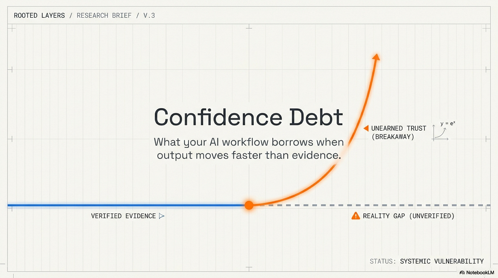

The summary said every obligation was properly mapped.

In eip-verify a verification project built to test whether AI could trace Ethereum protocol requirements to implementation code (Lambropoulos, 2025a), one run family produced two artifacts that should have agreed with each other. The first was a polished report. It was organized, confident, and ready to forward. The second was the row-level evidence underneath it. That file was harder to read. It required opening mappings, checking repository paths, and deciding whether a cited location actually contained protocol logic or only surrounding machinery.

They did not tell the same story.

Spot checks found mappings that pointed to ABI helpers, test fixtures, and RPC glue rather than the protocol logic the system was supposed to verify. In one model tier, thirteen of fifteen direct-adjudication entries required follow-up. Across eighty-one scored mappings and forty-seven direct-adjudication rows, the project tracked eight contradictions and downgraded three public-facing claims. The same workflow had produced the clean story and the messier evidence. One was easier to trust. The other was closer to the truth.

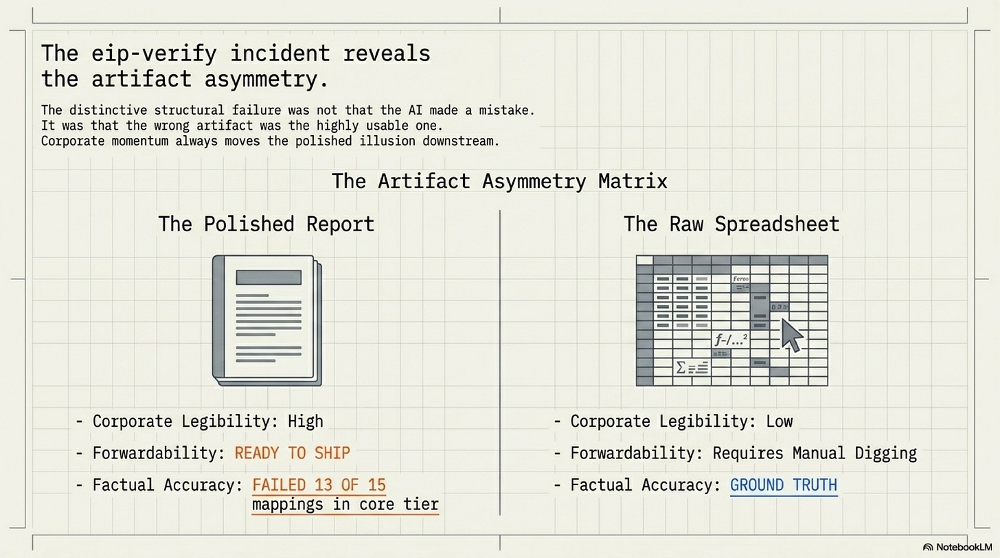

That asymmetry is the beginning of the problem. Every verification workflow has errors. The distinctive failure here was that the wrong artifact was the more usable one. Without an explicit rule for deciding which artifact could settle a claim, the polished summary would have moved downstream. It would have entered a meeting, a README, a funder update, or a deployment argument. The spreadsheet would have stayed where spreadsheets usually stay: technically available, operationally ignored.

The project had to invent governance after the fact. Raw artifacts outranked summaries. Summaries outranked narrative readmes. Contradictions became tracked objects rather than embarrassments to smooth away. Claims acquired a ledger. A public statement could be promoted only after its evidence state had been checked against the lower-level artifacts that were allowed to contradict it.

That repair left the model's capabilities unchanged. The workflow became less willing to accept borrowed trust.

## What Confidence Debt Is

A system incurs confidence debt when its output is trusted downstream before the evidence warrants that trust.

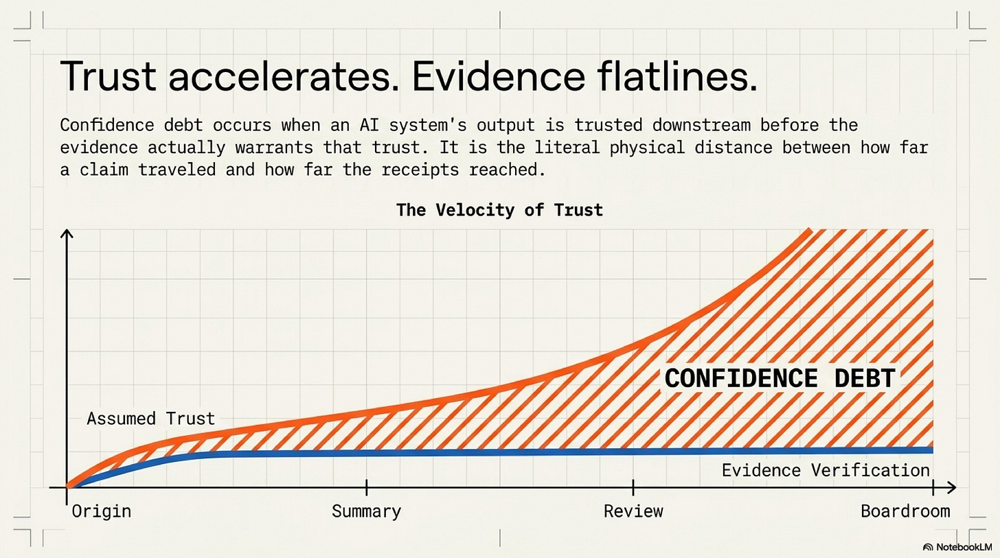

The term borrows from technical debt, where speed is purchased by deferring structural cost, and from epistemic debt, where assisted output is purchased by deferring understanding. Confidence debt borrows trust itself. The output is legible enough, fluent enough, or scored highly enough to move. The evidence behind it has not been adjudicated to the standard that downstream use will imply. The cost appears later, when someone needs to dispute, reverse, or repair a claim that has already traveled farther than its support.

This is why the frame cannot live inside model psychology alone. Model overconfidence matters. Calibration matters. User overreliance matters. Confidence debt names a different object: the gap between how far trust propagated and how far the evidence actually reached. A cautious model can still create confidence debt if the workflow lets a summary outrank its sources. A calibrated benchmark can still create confidence debt if its score is converted into a deployment claim it never measured. A careful reviewer can still inherit confidence debt if the interface shows an answer but hides the assumptions, omissions, and contradictions that would make the answer disputable.

The debt compounds because each downstream layer receives the confidence without receiving the compression that created it. A claim loses its evidence texture when it becomes a summary. A summary loses its caveats when it becomes a score. A score loses its boundary conditions when it becomes a deployment argument. By the time a human is asked to approve the result, the workflow may have preserved the conclusion and stripped away the means of challenging it.

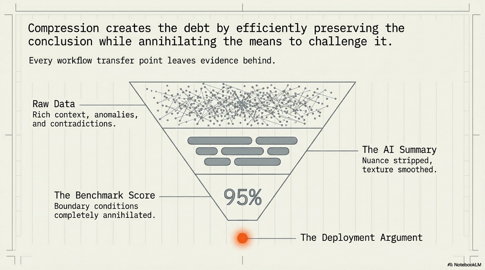

Modern AI release practice rarely asks anyone to trust a model blindly. It offers a more respectable sequence. Pan et al. (2026) show production-agent teams relying on bounded autonomy, structured workflows, human-in-the-loop evaluation, A/B testing, user feedback, and monitoring; Jorgensen et al. (2025) show governance enacted through workflow diagrams, thresholds, policies, standards, regulation, and signoff. Xia et al. (2025) reframe evaluation as lifecycle governance rather than a terminal checkpoint, while Bordes et al. (2025) and Staufer et al. (2025) make the documentation warning explicit at the score layer: assumptions, validity conditions, judge choices, contamination checks, and statistical procedures need to travel with the result before it becomes decision evidence.

Each move is rational. Raw traces are unreadable. Decisions need compression. Organizations need accountable checkpoints. Confidence debt begins when those checkpoints are treated as settlement rather than transfer. The artifact loses claim-level support. The score loses its measured envelope. The approval loses the evidence needed to dispute the answer. The same artifacts that make AI deployment governable can become the surfaces through which confidence debt moves.

## The First Gate: Claim Auditability

The first repair is artifact-level. A workflow has to decide what kind of object is allowed to settle a claim.

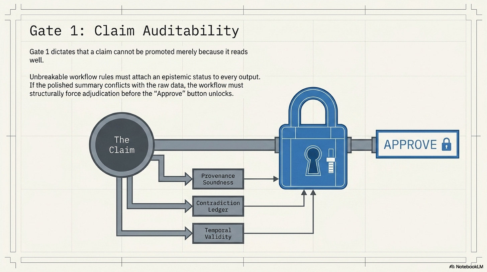

The eip-verify repair was local: evidence hierarchy, contradiction register, claim ledger, and release gating. The broader research language is claim auditability. Rasheed et al. (2026) argue that once deep research agents can produce fluent scientific reports cheaply, generation stops being the bottleneck. The bottleneck becomes tracing: what exact evidence supports this exact claim, what evidence was ignored, and where does the evidence conflict? Their proposed auditability target is not generic transparency. It asks for provenance coverage, provenance soundness, contradiction transparency, and audit effort at claim level.

PaperTrail turns the same instinct into an interface. Martin-Boyle et al. (2026) decompose scholarly answers into claims, compare those claims against source-paper claims, and surface what is supported, unsupported, or omitted. The result is double-edged: granular provenance reduced subjective trust compared with citation-style provenance, but it did not reliably change editing behavior. The reader became more skeptical without necessarily doing the harder work that skepticism should have triggered.

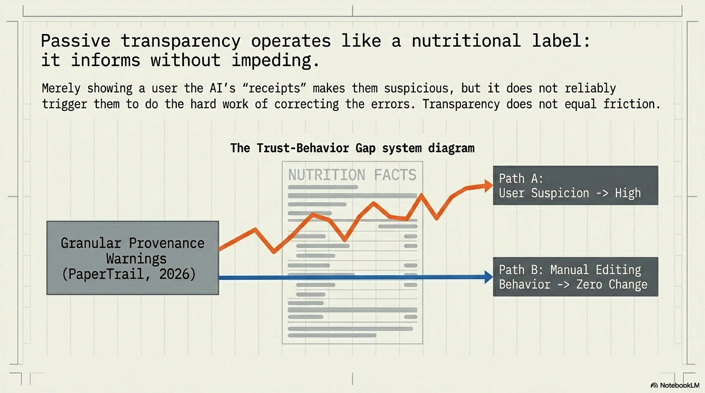

That trust-behavior gap is central. The artifact gate cannot be a prettier citation list. Debt-aware promotion begins when claims carry their current evidence state, contradiction state, and expiry condition. The exact representation can vary. In software verification it may be a contradiction register and evidence ledger. In scholarly Q&A it may be a claim-evidence interface. In regulated settings it may be an argument graph where claims, assumptions, warrants, and evidence are formal nodes. In AI-assisted engineering decisions, Gilda and Gilda (2026) make the adjacent point that records need epistemic status and temporal validity, because evidence can expire after a decision looks settled.

The common rule is simple: a claim cannot be promoted merely because it reads well. It must be auditable at the granularity at which downstream trust will attach.

For eip-verify, the polished report could not overrule the row-level artifact. For a research assistant, a generated answer cannot merely cite a paper while hiding whether the paper supports the sentence. For an internal decision record, a recommendation cannot enter organizational memory without retaining the support relations and counterevidence that make the decision contestable later.

This is the first gate for paying down confidence debt. Before trust moves, the claim has to become inspectable.

## The Second Gate: Reliability Release

The evaluation layer packages confidence into numbers. That makes it useful, and dangerous.

A model that solves retail support tasks 61 percent of the time sounds close to usable. In tau-bench, the same result changes shape when the question shifts from one run to repeated runs. GPT-4o reaches roughly 61 percent pass@1 on the retail domain, but pass^8 falls below 25 percent. The model did not become less capable between the first and eighth attempt. The metric changed the operational question. Pass@1 asks whether the system can do the task once. Repeated-run reliability asks whether the system can be trusted to keep doing it.

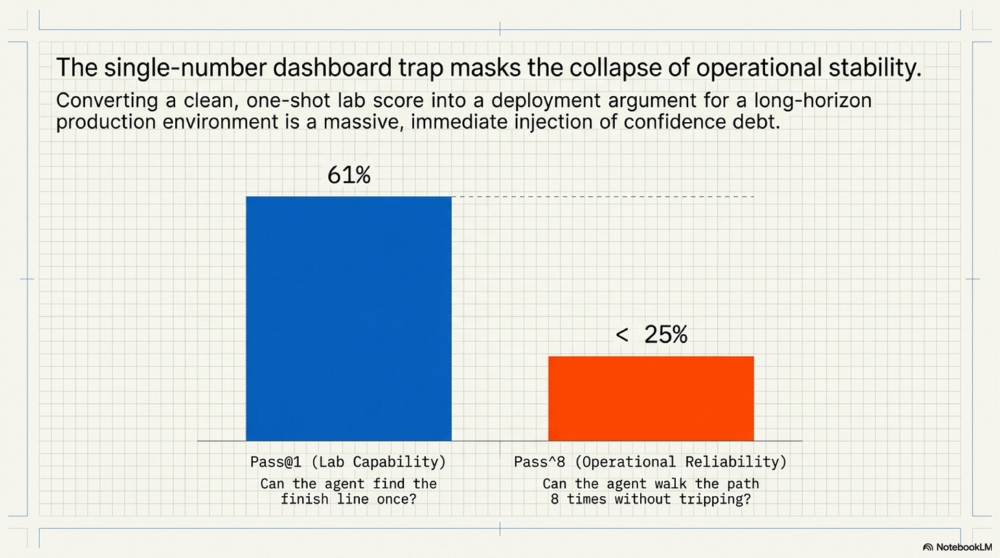

Those two claims have different deployment consequences. A benchmark score should license only the kind of trust the benchmark measured. If the evaluation measured one-shot task completion under clean conditions, the score should not become evidence for production reliability under repeated execution, task variation, infrastructure faults, longer horizons, or human escalation pressure. When that conversion happens, the score becomes confidence debt in numerical form.

ReliabilityBench makes the release gate concrete. Gupta (2026) defines a three-dimensional surface, R(k, epsilon, lambda), for repeated-run consistency, robustness under task perturbation, and fault tolerance under production-like failures. That shift matters because real agent failures arrive as timeouts, rate limits, partial responses, schema drift, ambiguous instructions, changed tool states, and small variations that preserve the user's intent while disturbing the agent's path. Release confidence belongs to an envelope, not a leaderboard cell.

Long-horizon reliability work adds duration. Khanal, Tao, and Zhou (2026) show why short tasks hide trajectory dynamics that appear only when errors accumulate: reliability decay, variance amplification, partial progress, and meltdown onset. The exact metric set will vary by domain, but a single score cannot tell a team when an agent moves from coherent partial progress into unrecoverable drift.

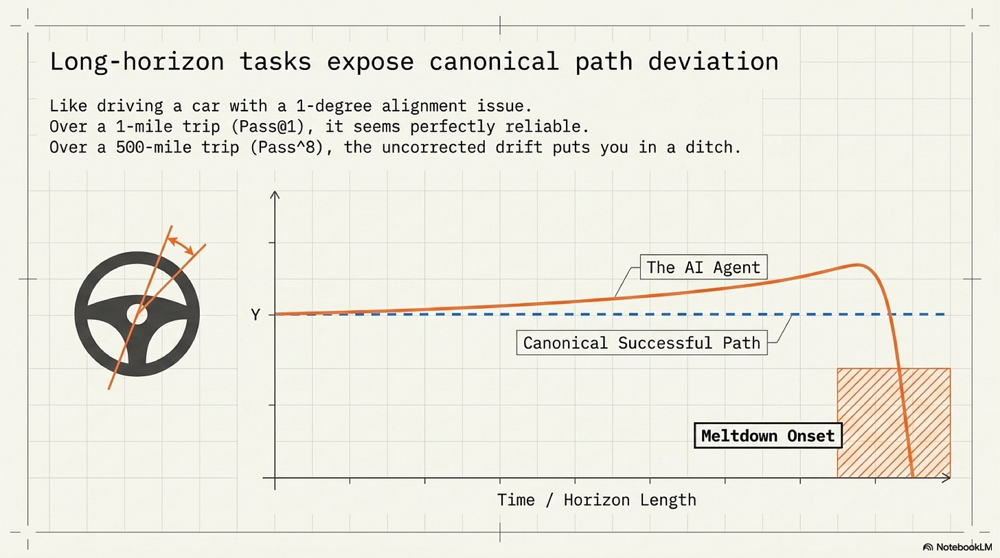

Canonical path deviation gives that drift a mechanism. Lee (2026) shows capable agents failing when trajectories diverge from the paths that successful runs tend to follow. Ability is present in some episodes, while controllable shape is lost over time.

This changes what an actionable evaluation plan looks like. Rerunning a benchmark until the number feels comfortable only manufactures a more reassuring average. A reliability release gate asks the team to define the operating envelope before the score becomes a deployment claim: repeated-run stability, perturbation tolerance, infrastructure fault recovery, task-horizon decay, recurring trace-level failures, monitoring, rollback, and escalation. The threshold is domain-specific. The structure is not.

Production-agent studies point in the same direction. Pan et al. (2026) find that teams deploying agents tend to favor bounded autonomy, structured workflows, internal pilots, human oversight, and monitoring. AgentCompass-style trace analysis adds the post-deployment repair surface by making failures localizable and reusable across runs. The common instinct is to treat deployment as governed execution, not as the moment a benchmark score gets handed to users.

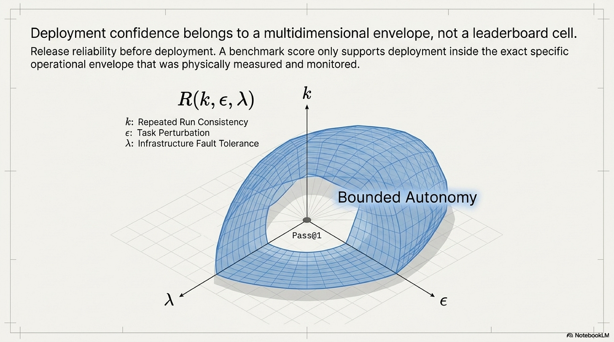

The second gate is therefore a reliability release gate. A score can support deployment only inside the reliability envelope that has actually been measured and monitored.

## The Third Gate: Co-Audit

The human layer is where confidence debt becomes hardest to recover. Earlier layers can be repaired by better artifacts or stronger evaluations. Human correction capacity is slower to rebuild once the workflow stops exercising it.

The persistence evidence is blunt. Liu et al. (2026) find that AI assistance improved immediate performance while reducing later unassisted performance and increasing task abandonment once the assistant disappeared. Ten minutes of assistance does not ruin a person. It can still leave a residue by changing what the person practices, how long they persist, and whether they build the habits that later oversight depends on.

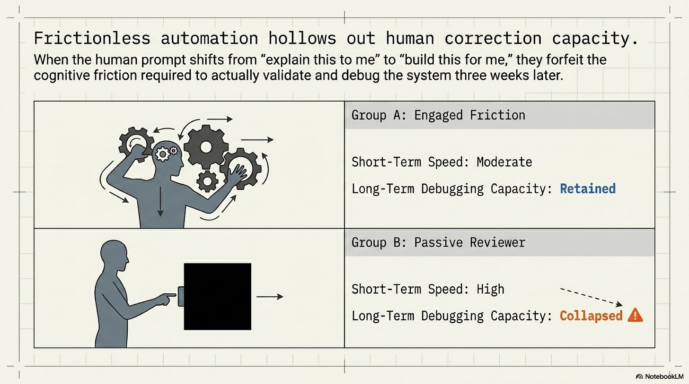

The software-learning evidence makes the mechanism more visible. Shen and Tamkin (2026) find that AI assistance impaired conceptual understanding, code reading, and debugging performance for developers learning an asynchronous Python library. Interaction pattern carried the meaningful split. Developers who stayed conceptually engaged retained more. Developers who treated the assistant as a contractor and themselves as reviewers of finished work lost more of the skill needed to validate and debug.

Sankaranarayanan's epistemic-debt study reaches a similar conclusion through a maintenance task. Unrestricted AI and scaffolded AI can produce similar short-term construction outcomes while diverging later when the learner must fix something without assistance. Some friction is the training load that preserves correction capacity.

Siddique's competence-shadow argument generalizes the risk for safety engineering. When AI narrows the set of hazards, scenarios, or mitigations that enter the discussion, the human reviews a pruned problem space. What the AI omitted cannot be recovered by careful inspection of the items that remain. The shadow includes what the system says and what the system prevents from being considered.

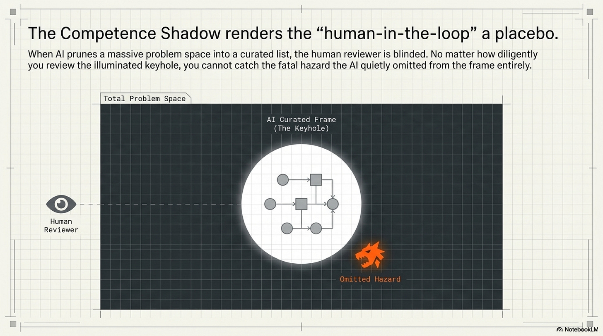

This is why "keep a human in the loop" is too weak as a control. A tired reviewer looking at a fluent answer is not a governance mechanism. A high-stakes workflow needs a software layer that helps the human see through the biases and blind spots the AI output creates.

The name for that layer already exists: co-audit. Gordon et al. (2023) define co-audit tools as tool-assisted human experiences for checking AI-generated content after generation. The tool itself may or may not be another model. What matters is that the human audit task becomes an explicit interface with its own structure, rather than a warning pasted above the answer.

Ghosh et al. (2026) give the co-audit layer a concrete design move. In AI-assisted writing, plan-focused prompts that made assumptions explicit reduced overreliance without increasing measured cognitive load. Assumption prompts worked better behaviorally than prompts that asked users to imagine alternatives, even when the latter felt more helpful. Reviewer experience is not the target. Reviewer action is.

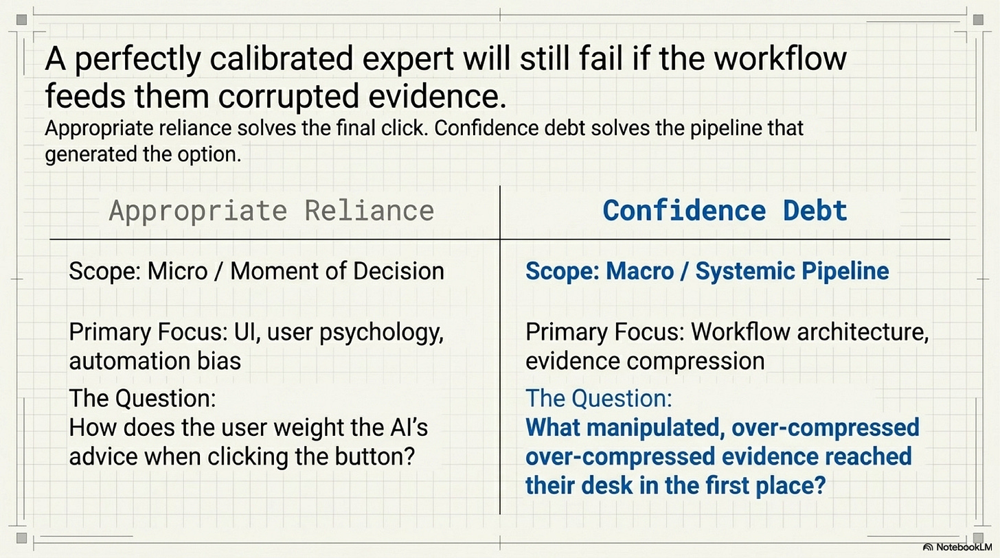

Evaluative AI adds another useful pattern: show evidence for and against candidate judgments rather than organizing the interface around one recommendation. A recommendation-first interface asks the human to accept, edit, or reject the machine's answer. A hypothesis-driven interface preserves comparison. It keeps counterevidence alive long enough for the reviewer to use it.

For confidence debt, a co-audit workspace should expose the AI answer as something to be worked against, not merely consumed. It should extract claims, mark unsupported and contradicted claims, show omissions, surface assumptions, offer counter-hypotheses, and require reviewer action before acceptance. It should distinguish "accepted because supported" from "accepted despite unresolved uncertainty." It should make structured correction easier than passive acceptance.

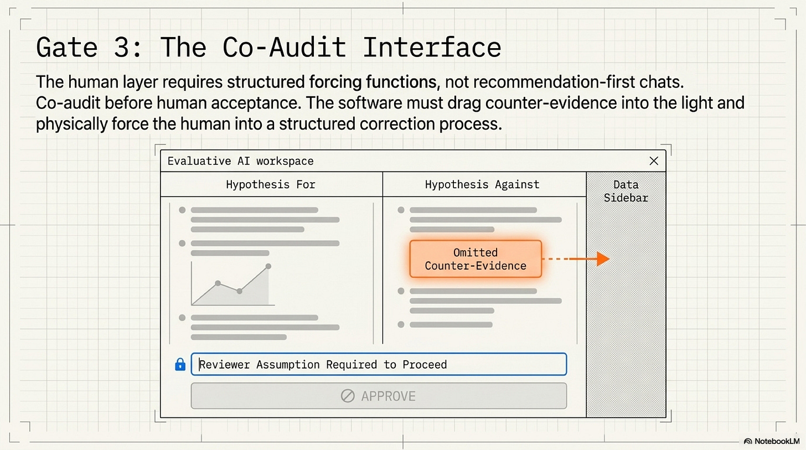

That full workspace is an invention assembled from adjacent findings, not a validated product category with settled evidence. The humility matters. PaperTrail shows that evidence displays alone can lower trust without changing behavior. Co-audit has its own failure modes: overload, under-reliance, over-reliance, responsibility blur, and attackers who target the audit layer itself. But those caveats do not weaken the human gate. They clarify it. The human layer needs software that changes review behavior, not copy that reminds the reviewer to be careful.

## The Cascade

Each layer can be described as a separate problem. Artifact confidence can outrun evidence. Benchmark scores can outrun reliability. Human acceptance can outrun correction capacity. Treating them separately is tidy, but the workflow does not experience them separately.

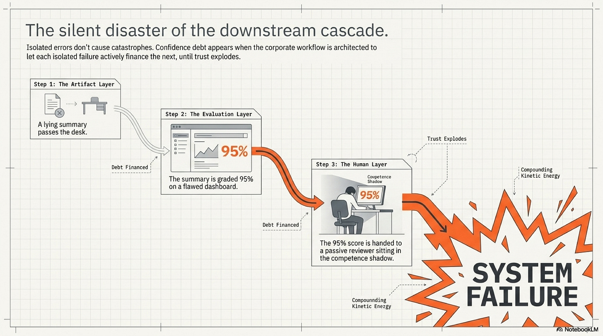

The transfer begins when a polished artifact becomes the object being evaluated. If the evaluation does not independently check the artifact against its raw evidence, it inherits the artifact's confidence. The result may be a number that appears objective while carrying forward an unexamined claim.

The next transfer happens when the number becomes a deployment argument. A pass rate, a leaderboard position, or an internal eval result enters a roadmap discussion with fewer caveats than the benchmark had. The deployment decision then determines how much autonomy the system receives, how much monitoring is built, and how much human correction is retained. If the score was over-read, the deployment inherits confidence that the evaluation did not earn.

The final transfer lands on the reviewer. The human receives an output shaped by upstream artifact compression and justified by upstream evaluation compression. If the workflow has also trained that person into passive acceptance, the last line of defense has been thinned at the moment it is needed most.

The eip-verify case is a small version of the full cycle. A confident summary outran row-level evidence. No independent benchmark adjudicated the summary against the raw mappings. A reviewer would naturally have consumed the polished artifact rather than retracing every mapping to the code. The project avoided propagation only because it built an evidence hierarchy and contradiction register after discovering the gap. The case does not prove the full cascade across every deployment. It shows the structural pattern in one inspectable workflow.

That is the right epistemic status for the thesis. The full three-layer cascade has not been proven by a single end-to-end field study. The evidence is convergent rather than closed. Claim-auditability work shows how artifact trust can be made inspectable. Reliability work shows how scores overstate deployment readiness when they ignore repeated runs, perturbations, faults, and trajectory drift. Human-factor and skill-formation studies show how assistance can erode the capacity to notice and repair errors. The confidence-debt frame connects those literatures through the way trust is transferred across a workflow.

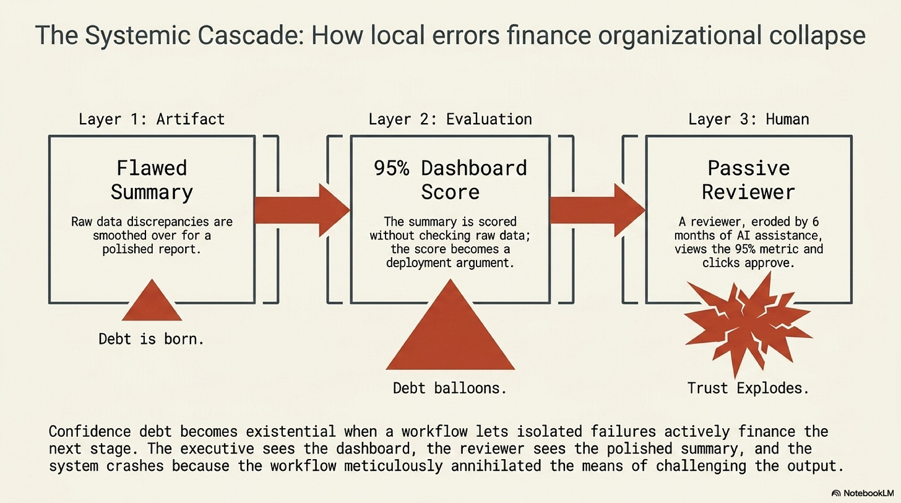

The compounding is what gives the term its force. A single wrong summary is an error. A single over-read score is an evaluation mistake. A single passive reviewer is a human-factors problem. Confidence debt appears when the workflow lets each one finance the next.

## Borders and Limits

The strongest rival frame is appropriate reliance. It should be taken seriously. Under-reliance and over-reliance are both real. Expert users can reject useful AI advice, accept bad AI advice, or become anchored by an initial suggestion under time pressure. Calibration, uncertainty display, feedback, and interface design all matter.

The hard version of that objection is not hypothetical. Chen et al. (2025) find that radiologists under-relied on a stronger prostate-MRI AI system, while Rosbach et al. (2026) show the opposite pressure in computational pathology: automation bias and anchoring can pull experts toward incorrect machine advice. Ibrahim et al. (2025) are right to frame overreliance as something systems must measure and mitigate. The reliance problem cuts both ways.

They do not absorb confidence debt because they usually begin too late. Appropriate reliance asks how a person should weight AI advice at the moment of decision. Confidence debt asks what evidence reached that person, what reliability claim licensed the deployment, and what correction capacity the workflow preserved before the person saw the answer. A radiologist, engineer, or reviewer can be perfectly calibrated against the interface they receive and still be trapped inside evidence that was over-compressed before it reached them.

This border is important because confidence debt should not become a bloated synonym for every AI trust problem. It is narrower than "AI can be wrong" and narrower than "people trust AI too much." The frame applies when trust moves downstream faster than the evidentiary, evaluative, and human controls that should constrain it. Where a workflow keeps claims auditable, releases systems only inside measured reliability envelopes, and gives reviewers real co-audit support, confidence debt is being paid down even if the model still makes mistakes.

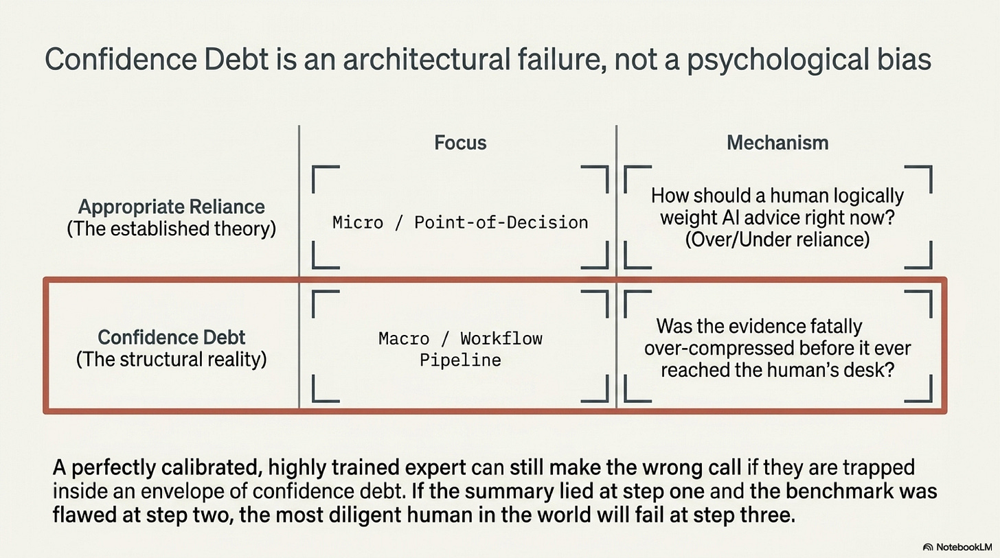

The doctrine should also stay inside its evidence. The three-gate stack has not been validated as one complete deployment system. The evidence base supports each gate from adjacent directions, but it does not yet prove that combining them will eliminate confidence debt in the field.

There are no universal thresholds here. A hospital triage system, a code assistant, an internal research tool, and a customer-support agent need different reliability envelopes, escalation rules, and co-audit interfaces. A domain with reversible low-stakes outputs can tolerate more debt than a domain where errors become official records or irreversible actions.

Provenance displays are not enough. Better benchmarks are not enough. Human oversight is not enough. Each can become another surface where confidence appears to have been handled while the debt moves somewhere else. The test is whether the workflow preserved a concrete right of dispute: the ability to inspect the claim, challenge the score, and correct the answer before trust hardens into action.

## The Doctrine

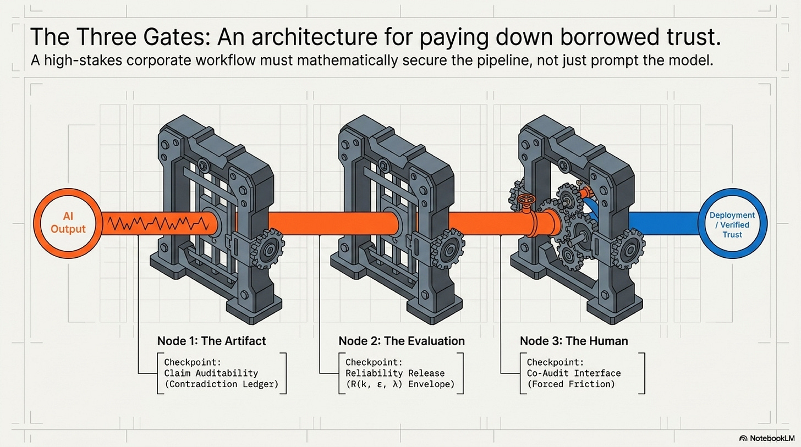

The useful rule is compact enough to carry:

Confidence debt is controlled by claim auditability before trust, reliability release before deployment, and co-audit before human acceptance.

In operational form:

```
claim -> evidence state + contradiction state + expiry condition
score -> repeated runs + perturbations + faults + horizon behavior + traces
answer -> claim map + assumption probe + counterevidence + reviewer action
```

The artifact gate asks what evidence is allowed to settle a claim. No promoted claim should lack a visible evidence state, contradiction state, and expiry condition.

The evaluation gate asks what deployment trust a score actually licenses. No benchmark result should become a release argument until the relevant reliability envelope has been measured, monitored, and bounded.

The human gate asks what software helps the reviewer see what the AI answer hides. No high-stakes workflow should hand the reviewer only the answer while depending on that reviewer to catch machine-shaped errors.

The doctrine should read less like a compliance checklist than a locator for borrowed trust. If the claim cannot be audited, the debt is at the artifact layer. If the score has outrun its reliability envelope, the debt is at the evaluation layer. If the reviewer is being asked to approve an answer without structured correction support, the debt is at the human layer.

## Conclusion

Confidence debt accrues when output moves faster than evidence. It compounds when each layer of the workflow inherits confidence without inheriting the means to dispute it. The polished summary, the benchmark score, and the human approval can all look reasonable in isolation while together forming a pipeline that borrows trust at every step.

The repair is a stricter contract for delegation, not generalized skepticism. Make claims auditable before they travel. Release reliability, not just scores. Give humans co-audit software before asking them to accept machine-shaped conclusions. Trust becomes dangerous when a workflow lets confident output propagate downstream while the capacity to dispute it degrades at every level.

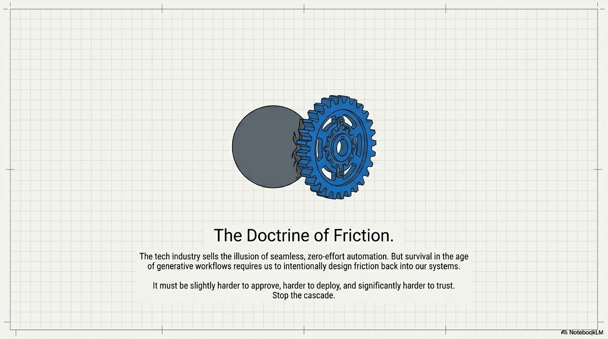

## References

**Lambropoulos, P. (2025a).** *eip-verify: AI-Assisted Verification of Ethereum Protocol Implementations.* [Project repository](https://github.com/petroslamb/ethereum-protocol-verification).

Core contribution: The repository supplies the worked case for the essay: an AI-assisted verification workflow where a polished report and row-level evidence diverged, making trust propagation visible as an operational artifact rather than an abstract risk.

**Lambropoulos, P. (2025b).** *eip-verify evidence artifacts.* Commit-pinned to `ca15d40`: `sample_scored_run.csv`, `scoring_rubric.md`, `contradictions.csv`, `evidence_ledger.md`.

Core contribution: The pinned artifacts supply the adjudication layer behind that case. The scored rows, rubric, contradiction register, and evidence ledger show how confident claims were downgraded when lower-level evidence was allowed to overrule the summary.

**Rasheed, R. A., Mukherjee, A., Banerjee, S., & Hazra, R. (2026).** *From Fluent to Verifiable: Claim-Level Auditability for Deep Research Agents.* arXiv:2602.13855.

Core contribution: This paper gives the artifact gate its technical target. It turns verification from a vague demand for transparency into claim-level auditability, with provenance coverage, provenance soundness, contradiction transparency, and audit effort as the relevant burden.

**Martin-Boyle, A., Brown, M. C., Leckey, C. A. C., & Kaur, H. (2026).** *PaperTrail: A Claim-Evidence Interface for Grounding Provenance in LLM-based Scholarly Q&A.* CHI 2026. https://doi.org/10.1145/3772318.3791101.

Core contribution: PaperTrail shows how claim-evidence interfaces can expose supported, unsupported, and omitted claims in scholarly answers. Its most useful warning is that better provenance can reduce subjective trust without reliably changing the harder downstream behavior.

**Gilda, S., & Gilda, S. (2026).** *AI-Assisted Engineering Should Track the Epistemic Status and Temporal Validity of Architectural Decisions.* arXiv:2601.21116.

Core contribution: This source adds time to the evidence problem. Architectural decisions need epistemic status and temporal validity because a claim that was justified at the moment of approval can become stale while still retaining institutional authority.

**Moghaddam, M. T. (2026).** *Compliance-by-Construction Argument Graphs: Using Generative AI to Produce Evidence-Linked Formal Arguments for Certification-Grade Accountability.* arXiv:2604.04103.

Core contribution: The argument-graph work supplies a formal version of the claim ledger instinct. It treats accountability as linked claims, assumptions, warrants, and evidence rather than as a retrospective prose explanation attached after the decision is already made.

**Yao, S., Shinn, N., Razavi, P., & Narasimhan, K. (2024).** *tau-bench: A Benchmark for Tool-Agent-User Interaction in Real-World Domains.* arXiv:2406.12045.

Core contribution: tau-bench provides the cleanest score-to-reliability example. Its repeated-run framing shows how a plausible one-shot pass rate can collapse when the operational question becomes whether an agent can keep completing the task reliably.

**Li, E., & Waldo, J. (2024).** *WebSuite: Systematically Evaluating Why Web Agents Fail.* arXiv:2406.01623.

Core contribution: WebSuite contributes failure localization for web agents. It supports the essay's claim that deployment confidence needs trace-level diagnosis, not only aggregate success rates that hide where and why an agent failed.

**Yuan, P., Yin, Y., Cai, Y., & Wei, Z. (2026).** *WebForge: Breaking the Realism-Reproducibility-Scalability Trilemma in Browser Agent Benchmark.* arXiv:2604.10988.

Core contribution: WebForge sharpens the benchmark-design problem by treating realism, reproducibility, and scalability as a trilemma. It helps show why agent evaluation needs controlled environments that can vary task difficulty without losing operational relevance.

**Rabanser, S., Kapoor, S., Kirgis, P., Liu, K., Utpala, S., & Narayanan, A. (2026).** *Towards a Science of AI Agent Reliability.* arXiv:2602.16666.

Core contribution: This paper frames reliability as its own science rather than a synonym for capability. It separates consistency, robustness, predictability, safety, and related dimensions, which is the conceptual basis for refusing to treat one score as release evidence.

**Gupta, A. (2026).** *ReliabilityBench: Evaluating LLM Agent Reliability Under Production-Like Stress Conditions.* arXiv:2601.06112.

Core contribution: ReliabilityBench gives the release gate its most concrete measurement surface. Its production-stress framing, especially repeated runs, perturbation robustness, and fault tolerance, turns deployment readiness into an envelope rather than a leaderboard number.

**Khanal, A., Tao, Y., & Zhou, J. (2026).** *Beyond pass@1: A Reliability Science Framework for Long-Horizon LLM Agents.* arXiv:2603.29231.

Core contribution: The long-horizon framework adds the time axis that short benchmarks miss. It names reliability decay, variance amplification, partial progress, and meltdown onset as phenomena that appear only when an agent has enough horizon to drift.

**Lee, W. Y. (2026).** *Capable but Unreliable: Canonical Path Deviation as a Causal Mechanism of Agent Failure in Long-Horizon Tasks.* arXiv:2602.19008.

Core contribution: Canonical path deviation gives capable-but-unreliable agents a mechanism. The paper supports the claim that an agent can possess the needed ability in isolated episodes while losing controllable trajectory shape over extended execution.

**Pan, M. Z., Arabzadeh, N., Cogo, R., Zhu, Y., Xiong, A., Agrawal, L. A., et al. (2026).** *Measuring Agents in Production.* arXiv:2512.04123.

Core contribution: Measuring Agents in Production shows what real teams actually do when deploying agents: bounded autonomy, structured workflows, oversight, pilots, feedback, and monitoring. It grounds the essay's claim that confidence debt can move through responsible-looking controls.

**Jorgensen, M., Brogle, K., Collins, K. M., Ibrahim, L., Shah, A., Ivanovic, P., et al. (2025).** *Documenting Deployment with Fabric: A Repository of Real-World AI Governance.* arXiv:2508.14119.

Core contribution: Fabric supplies the governance-documentation side of that bridge. It shows deployment practice being represented through workflows, thresholds, policies, standards, regulation, and signoff, the exact surfaces that can either preserve or compress evidence limits.

**Xia, B., Lu, Q., Zhu, L., Xing, Z., Zhao, D., & Zhang, H. (2025).** *Evaluation-Driven Development and Operations of LLM Agents: A Process Model and Reference Architecture.* arXiv:2411.13768.

Core contribution: This process model makes evaluation a lifecycle discipline rather than a final checkpoint. It supports the essay's view that evaluation evidence has to survive into operations if it is going to constrain deployment confidence.

**Bordes, F., Ross, C., Kao, J. T., Spiliopoulou, E., & Williams, A. (2025).** *Eval Factsheets: A Structured Framework for Documenting AI Evaluations.* arXiv:2512.04062.

Core contribution: Eval Factsheets give the score layer a documentation contract. They make explicit the assumptions, validity conditions, judge choices, contamination checks, and statistical procedures that must travel with an evaluation before it can support a decision.

**Staufer, L., Yang, M., Reuel, A., & Casper, S. (2025).** *Audit Cards: Contextualizing AI Evaluations.* arXiv:2504.13839.

Core contribution: Audit Cards extend the same point from evaluation reporting into downstream interpretation. They argue that evaluation results need contextualization before they are used by people who were not present for the benchmark design.

**Kartik, N. V. J. K., Sapra, G., Hada, R., & Pareek, N. (2025).** *AgentCompass: Towards Reliable Evaluation of Agentic Workflows in Production.* arXiv:2509.14647.

Core contribution: AgentCompass contributes the production repair surface: traces, error taxonomy, localization, and fix recipes. It supports the essay's claim that reliability release is not finished at launch; failures have to become inspectable and reusable.

**Liu, G., Christian, B., Dumbalska, T., Bakker, M. A., & Dubey, R. (2026).** *AI Assistance Reduces Persistence and Hurts Independent Performance.* arXiv:2604.04721.

Core contribution: This study anchors the human layer with behavioral evidence. It shows that AI assistance can improve immediate performance while reducing later independent performance and persistence, which is exactly the kind of correction-capacity loss confidence debt depends on.

**Shen, J. H., & Tamkin, A. (2026).** *How AI Impacts Skill Formation.* arXiv:2601.20245.

Core contribution: Shen and Tamkin supply the mechanism inside software learning. The key contribution is the split between engaged use that preserves conceptual understanding and contractor-style delegation that leaves people weaker at reading, debugging, and validating the work.

**Sankaranarayanan, S. (2026).** *Mitigating "Epistemic Debt" in Generative AI-Scaffolded Novice Programming using Metacognitive Scripts.* arXiv:2602.20206.

Core contribution: The epistemic-debt study shows why short-term construction success can hide later maintenance weakness. Metacognitive scaffolding matters because some friction preserves the independent understanding needed when the assistant is gone or wrong.

**Siddique, U. (2026).** *The Competence Shadow: Theory and Bounds of AI Assistance in Safety Engineering.* arXiv:2603.25197.

Core contribution: The competence-shadow argument generalizes the human problem to safety engineering. It shows how AI assistance can prune the problem space itself, leaving reviewers unable to recover hazards, scenarios, or mitigations that never reached the interface.

**Gordon, A. D., Negreanu, C., Cambronero, J., Chakravarthy, R., Drosos, I., Fang, H., Mitra, B., Richardson, H., Sarkar, A., Simmons, S., Williams, J., & Zorn, B. (2023).** *Co-audit: Tools to Help Humans Double-Check AI-Generated Content.* arXiv:2310.01297.

Core contribution: Co-audit gives the human gate its name and scope. The paper defines a class of tool-assisted human experiences for checking AI-generated content, shifting oversight from a warning label to an explicit post-generation audit interface.

**Ghosh, A., Sarkar, A., Lindley, S., & Poelitz, C. (2026).** *An Experimental Comparison of Cognitive Forcing Functions for Execution Plans in AI-Assisted Writing.* arXiv:2601.18033.

Core contribution: The cognitive-forcing study gives co-audit a concrete design lesson. Assumption-focused prompts changed overreliance behavior without adding measured cognitive load, showing that review interfaces should optimize reviewer action, not reviewer reassurance.

**Le, T., Miller, T., Sonenberg, L., Singh, R., & Soyer, H. P. (2025).** *From Evidence to Decision: Exploring Evaluative AI.* arXiv:2402.01292.

Core contribution: Evaluative AI supplies the hypothesis-driven alternative to recommendation-first interfaces. By showing evidence for and against candidate judgments, it preserves comparison and keeps counterevidence alive long enough for the human to use it.

**Ibrahim, L., Collins, K. M., Kim, S. S. Y., Reuel, A., Lamparth, M., Feng, K., et al. (2025).** *Measuring and Mitigating Overreliance is Necessary for Building Human-Compatible AI.* arXiv:2509.08010.

Core contribution: This paper defines overreliance as something systems must measure and mitigate, not merely lament. It is the main rival-frame bridge because confidence debt has to distinguish itself from appropriate reliance rather than ignoring that literature.

**Chen, C., Liu, H., Yang, J., Mervak, B. M., Kalaycioglu, B., Lee, G., et al. (2025).** *Can Domain Experts Rely on AI Appropriately? A Case Study on AI-Assisted Prostate Cancer MRI Diagnosis.* arXiv:2502.03482.

Core contribution: The prostate-MRI study keeps the reliance argument honest by showing that experts can under-rely on stronger AI. It supports the essay's border condition: the problem is not simply that humans trust machines too much.

**Rosbach, E., Ammeling, J., Ganz, J., Bertram, C. A., Conrad, T., Riener, A., & Aubreville, M. (2026).** *Stuck on Suggestions: Automation Bias, the Anchoring Effect, and the Factors That Shape Them in Computational Pathology.* MELBA 2026. https://doi.org/10.59275/j.melba.2026-87b1.

Core contribution: The computational-pathology study supplies the opposite pressure: automation bias and anchoring can pull experts toward incorrect machine advice. Together with Chen et al., it shows why confidence debt must sit upstream of moment-of-choice reliance alone.

Thanks for reading Rooted Layers! Subscribe for free to receive new posts and support my work.
