# Neural Architecture Design as a Reusable Scaffold

*How the field moved from bespoke stacks to trainable blocks, portable recipes, and controlled non-uniformity*

Draft Date: 2026-04-09  
Status: Polished live draft

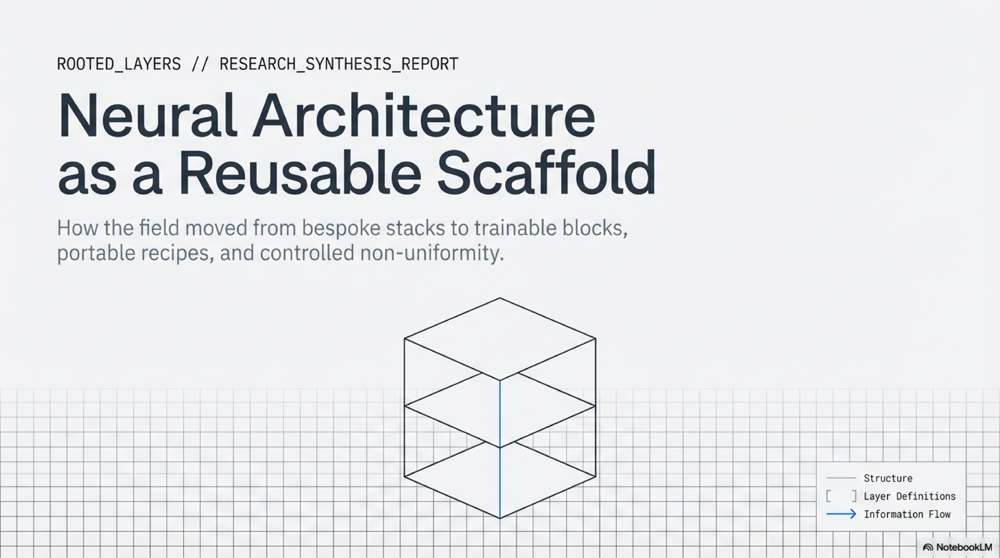

For a long stretch of deep learning history, architecture design meant deciding what each part of a network should do. That older picture was not a misunderstanding. It fit the technical reality of the time. When AlexNet appeared, its large early filters, staged reductions in kernel size, pooling pattern, and fully connected head all expressed a concrete view about how visual abstraction should be assembled under the combined pressures of ImageNet-scale data and GPU-bound training. The achievement was not only that the model was deep enough and trained hard enough. It was also that the diagram itself still carried a large share of the designer's judgment about the order in which the representation should become more invariant, more selective, and more task-ready. Early deep learning systems were still close enough to feature-engineering culture that one could point to a stage and say what kind of operation it was supposed to specialize in. Architecture still looked like the construction of a specific machine, not the definition of a reusable regime (Krizhevsky et al., 2012).

That picture became steadily less accurate over the next decade. The strongest line of progress did not come from ever more intricate local diagrams. It came from learning how to build architectures whose power depended less on bespoke variation at each stage and more on the reliability of a repeated scaffold. In that newer regime, the pressure falls elsewhere: on whether the block can be repeated, whether the paths through the network remain trainable, whether the same design can scale across budgets, and whether later special cases can be added without destabilizing the whole.

The argument of the essay is simplest when held as a shift in the object being designed:

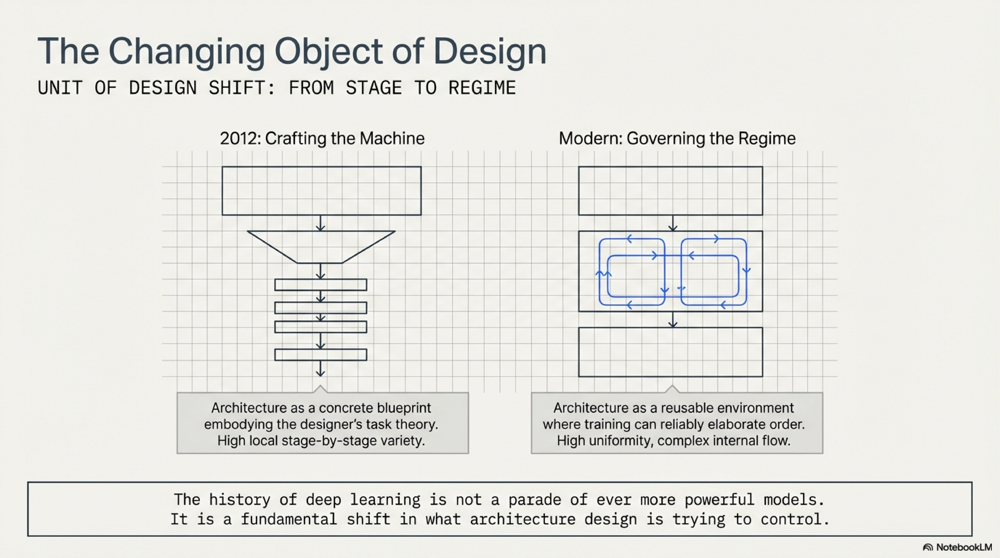

In this essay, a scaffold does not mean a vague platform or a loose label for "structure." It means a design that can preserve its governing logic under repetition, under depth, under scale, and under selective modification. It is something one can trust to keep working while the surrounding ambitions change. That is the historical correction the essay needs to make precise. Neural architecture design moved away from local stage-by-stage judgment and toward reusable scaffolds whose blocks, paths, families, and recipes could be governed with far more confidence than the custom stacks that came before.

## The Bespoke Age (2012-2014)

AlexNet is the right place to begin because it still belongs to the older world in a strong sense. Its success depended on more than architecture, but the architecture itself remains highly particular. The first convolution uses an 11x11 receptive field and a stride large enough to cut spatial resolution quickly. Later stages move to smaller filters, then the network transitions into wide fully connected layers before classification. Nothing about that pattern yet reads like a general law of good design. It reads like a competent wager about how to distribute computation across a limited training setup: what kind of early feature extraction was feasible, how fast spatial compression should happen, and where it still made sense to spend dense parameters. AlexNet was historically decisive because it proved deep convolutional networks could win under realistic scale. Yet it did not leave behind a reusable discipline the field could simply keep extending. It left behind a successful object, rich in local choices and tied closely to the conditions under which it was built (Krizhevsky et al., 2012).

The older design picture is easiest to see as a staged script in which each zone of the network is expected to play a distinct role:

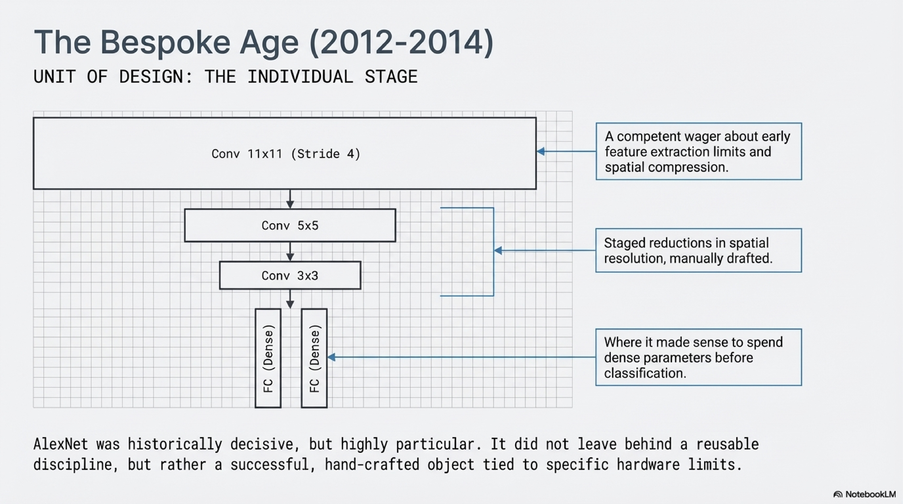

The next two landmarks matter because they show that the field had not yet converged on what should replace that bespoke style. VGG and Inception respond to the same pressure, but they respond in different directions. VGG shows that a network built from repeated 3x3 convolutions can outperform more decorated local designs. That was a serious simplification, and it changed what counted as architectural sophistication. Repetition no longer looked naive. It looked competitive. Inception took the opposite path. Instead of committing to one operator and repeating it, the model offers several transformations in parallel and lets training sort out their relative value inside each module. That branch is historically important because it keeps alive the idea that architectural intelligence might still reside in carefully composed local heterogeneity. Both papers are signs of transition rather than final settlement. VGG raises the credibility of repeated motifs. Inception preserves local heterogeneity as a live answer rather than a straw man. The historical point is not that one was smart and the other was confused. It is that the field was still deciding whether architecture should become more regular or more locally heterogeneous, and both answers still looked plausible in 2014 (Simonyan and Zisserman, 2014; Szegedy et al., 2014).

This is the fork where the field has not yet decided whether to double down on repetition or keep designing locally heterogeneous modules:

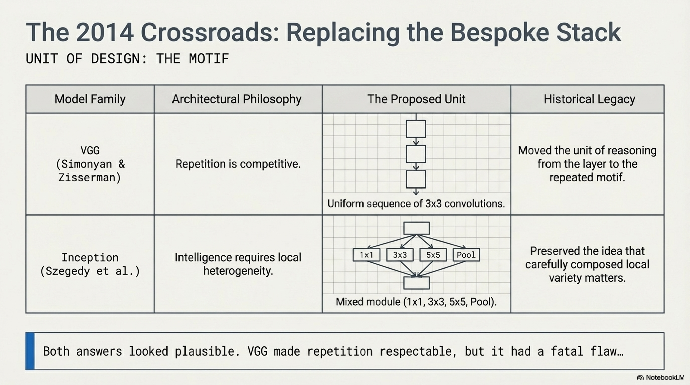

## Repetition Before Trainability (2014-2015)

VGG's contribution is easy to flatten into a slogan about simplicity, but that misses the narrower and more important shift it introduced. VGG did not yet turn repeated blocks into the master key to modern scale. It made them respectable. By showing that small convolutions stacked repeatedly could beat more visibly hand-shaped hierarchies, VGG moved the unit of reasoning upward from the individual layer to the repeated motif. That is already a major change. A model family can now differ by depth while preserving most of its design logic. A designer can ask what one simple pattern does when reiterated, rather than reinventing each stage from scratch. Just as importantly, VGG suggests that local architectural expressivity need not come from operator variety alone. Several small filters in sequence can substitute for larger bespoke kernels while preserving a cleaner external form. Still, the paper does not yet make repeated depth a fully stable strategy. Its deeper variants are harder to optimize, and the design remains closer to a disciplined stack than to a scaffold whose growth laws are genuinely understood. Repetition became attractive in this period because it reduced ornamental variation, not because the field had solved the problem of training very deep uniform networks (Simonyan and Zisserman, 2014).

That unresolved problem matters because it kept the field from turning architectural regularity into a reliable scaling method. The obstacle was not expressive power in the abstract. It was optimization. The ResNet paper states the issue in its most useful form: deeper plain networks can show *higher training error* than shallower ones, even though a deeper model should contain the shallower solution by construction if the added layers can learn identity mappings. That result cuts against the comforting idea that one can simply keep stacking repeated modules and wait for gradient descent to sort things out. It also matters because it rules out an easy story in which depth failed only because the models overfit or because the training budget was too small. The deeper models were harder to fit in the first place. Once that degradation pattern becomes the central fact, the historical question changes. The problem is no longer whether repetition can be elegant. The problem is whether repeated depth can remain traversable enough for training to exploit it at all. Until the field had a real answer to that, the move away from bespoke stacks remained suggestive but incomplete (He et al., 2015).

The historical bottleneck before ResNet is easier to remember as an optimization wall rather than a vague limit on ambition:

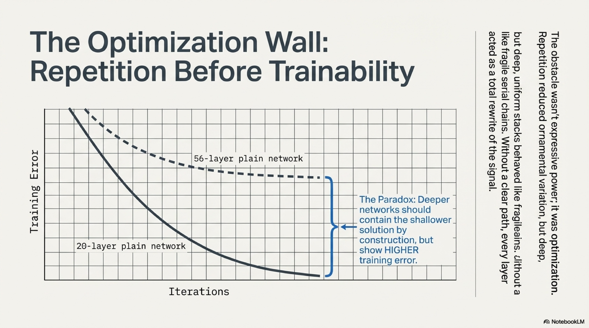

## Residual Path Discipline (2015-2018)

ResNet changed the argument because it changed what a new layer was being asked to do. Its governing update can be written in one line:

```text
x_{l+1} = x_l + F(x_l)
```

That expression is small enough to be underestimated. A plain deep stack treats each layer as a replacement step. The representation arriving at layer `l` is transformed into a new representation that must be good enough to hand off downstream. Residual learning makes a more modest and more trainable demand. The layer need only supply a correction relative to an input that remains available on a direct path. The model can preserve what is already useful and add what is newly necessary. That sounds like a local reformulation, but its consequence is global. Very deep models no longer need every block to be a successful stand-alone rewrite. They need each block to make a bounded improvement while preserving a route along which earlier useful structure can survive. Depth therefore stops behaving like a fragile serial chain of rewrites and starts behaving like accumulated refinement. This is the hinge of the whole history. Once repeated blocks can contribute deltas rather than total rewrites, uniformity stops being just a clean design aesthetic. It becomes an optimization strategy that can support scale (He et al., 2015).

The residual turn is easiest to hold as a change in what a layer is being asked to preserve:

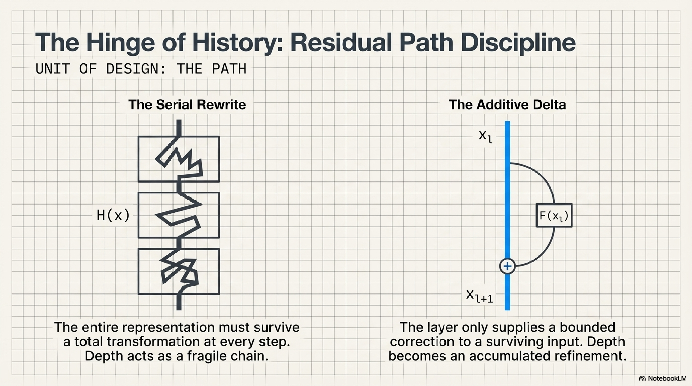

The later identity-mappings paper is where that strategy becomes mechanistically sharp instead of rhetorically attractive. The authors do not merely say that skip connections help. They show that the help depends on how little the shortcut path is disturbed. Scaling, gating, or projecting the shortcut degrades optimization relative to a clean identity path, and the pre-activation redesign pushes the network closer to a regime in which forward signal and backward gradient can propagate directly across many blocks. This is why it is not enough to say that residual networks have an extra branch. The important feature is the discipline of the path. A deep residual stack is easier to train when the architecture preserves a route that is as close as possible to unchanged transmission, while relegating the learned transformation to a bounded residual contribution. That is a much stronger claim than "skip connections are useful." It says that the object of design has already started to move from local computation alone toward the geometry of information flow through the whole scaffold (He et al., 2016).

Veit and colleagues make that point legible from another angle. Their famous "ensemble" framing is often quoted too loosely, as if ResNet had been explained away into a bag of shallow subnetworks. The better reading is pathwise rather than sloganistic. Once the residual network is unraveled into many routes of different lengths, the surprising fact is not just that many such paths exist. It is that the gradients doing useful training work concentrate disproportionately on relatively short paths, even inside a very deep model. A 110-layer network can receive most of its gradient through paths much shallower than its nominal depth. Full nominal depth still matters as capacity and representational room. What changes is how residual design makes that depth usable by embedding short effective routes inside a deep scaffold. Training no longer has to push every signal through one uninterrupted tower. The scaffold is deep, while the usable routes through it remain manageable (Veit et al., 2016).

The path view is useful precisely because it makes deep residual capacity compatible with short effective routes during training:

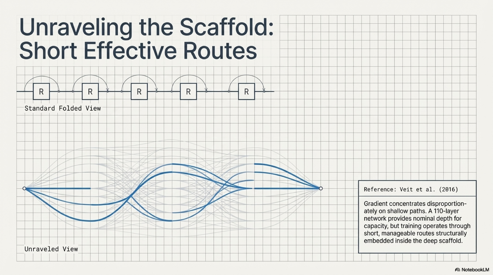

Li and colleagues connect the same story back to optimization geometry. Their loss-landscape visualizations are not a complete theory of trainability, but they supply an important missing bridge between architectural form and optimization behavior. As networks deepen, the loss surface can become increasingly chaotic and hard to traverse. Skip connections do not abolish non-convexity, but they do delay the transition into that more chaotic regime and are associated with flatter, better behaved landscapes. That result matters historically because it shows that the residual turn was not only a conceptual reframing of what layers compute. It also changed the numerical environment in which depth could be optimized. Put the ResNet paper, the identity-mapping analysis, the path view, and the loss-landscape evidence together, and a clearer statement becomes possible: the field learned how to build a trainable scaffold for repeated depth. That is the moment when repeated blocks stop being merely simpler than bespoke ones and start being more governable (Li et al., 2018).

## The Transformer as a Portable Block (2017-2020)

The transformer inherits that residual lesson even as it abandons convolution and recurrence at the core of sequence modeling. Its real historical scale comes from more than attention alone. Vaswani and colleagues produce a block whose external shape is stable, repeatable, and highly parallelizable:

```text
x = x + Attention(LayerNorm(x))
x = x + MLP(LayerNorm(x))
```

Inside that block, self-attention gives every position access to content-dependent interactions across the sequence, but the larger architectural point is that those interactions now live inside a residual scaffold that can be stacked without redesigning the computation at each depth. The dominant sequence models before this point had to carry their long-range reasoning through recurrent time or through convolutional approximations to it. The transformer instead packages self-attention and feed-forward computation into a portable block with a clean interface to the next layer. That makes two things simultaneously true. The model is more parallel in hardware terms, and its basic unit is easier to repeat as a design object. It also shortens the architectural distance between domains. Once the core unit is "residual block plus content-dependent mixing plus pointwise expansion," the same diagram can plausibly be redeployed wherever tokens or token-like units can be defined. The transformer therefore does not merely replace one primitive with another. It carries residual path discipline into a block recipe that can travel beyond the problem on which it was born (Vaswani et al., 2017).

The important architectural gain is not just attention. It is that attention now lives inside a block whose external interface is stable enough to travel:

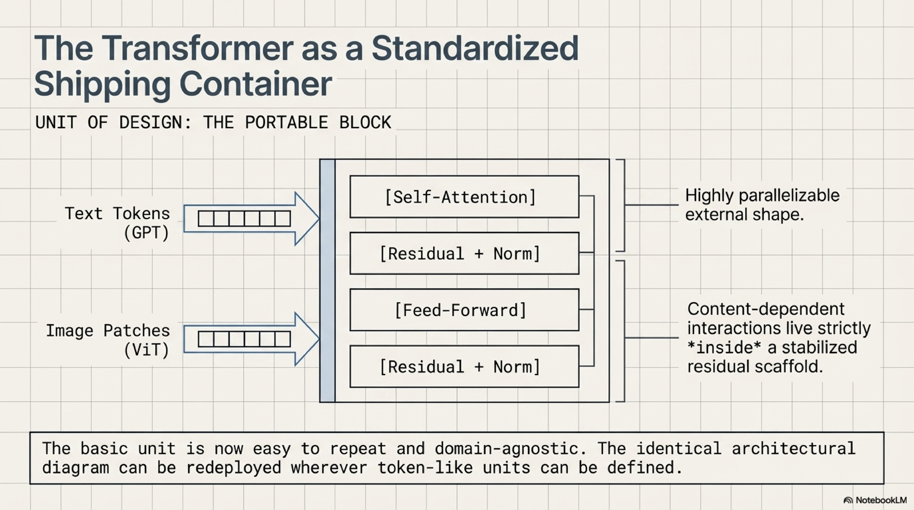

The BERT analyses matter because they show what can happen *inside* such a repeated scaffold once training has enough room to differentiate roles. Clark and colleagues find attention heads that specialize in recognizable behaviors such as positional offsets, delimiter handling, syntactic relations, and some coreference-linked patterns. Tenney and colleagues, working at the level of probing tasks across layers, find a broad ordering in which lower-level linguistic information becomes legible earlier and higher-level signals later, in a sequence reminiscent of the classical NLP pipeline. Used carelessly, those results invite a mythology in which transformers secretly contain a neat modular hierarchy waiting to be named. Used properly, they support a narrower conclusion that matters more. A stack built from uniform blocks need not remain functionally uniform after training. Differentiation can emerge inside a repeated scaffold without being hard-coded into separate architectural compartments. That matters because it changes where the designer has to spend architectural creativity. Instead of drafting one module for syntax and another for semantics, the designer can create a repeated environment in which such role separation is likely to emerge. Functional order survives, but it no longer has to be drawn directly into the diagram from the start (Clark et al., 2019; Tenney et al., 2019).

One reason these papers mattered is that they made the internal differentiation of a uniform scaffold easier to picture without reverting to a hand-drawn modular blueprint:

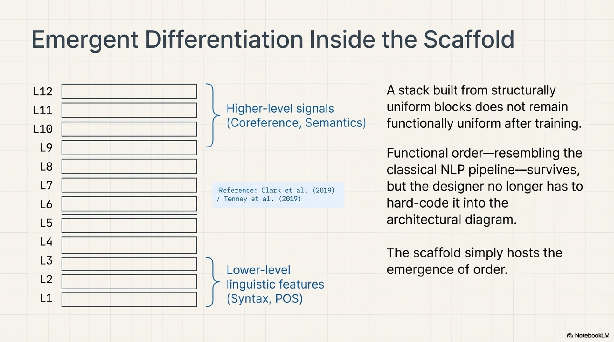

GPT-2 and ViT then push the argument along two different axes. GPT-2 shows that capability can keep rising when one scales a stable transformer family rather than redesigning its architecture for every increment. More significant than the banal fact that larger models often do better is that the repeated block itself has become a viable scaling unit. The model improves by more width, more depth, more data, and longer training, while the architectural core stays recognizably the same. By the time that lesson becomes visible, architectural novelty has ceased to be the default route to better results in language modeling. Stability becomes an asset because it makes scale cumulative rather than disruptive (Radford et al., 2019). ViT extends that result across domain, but only under a condition that the essay has to keep visible. Transformers did not prove convolutional inductive bias obsolete in one stroke. The paper says the opposite in effect: when data and pretraining scale are modest, transformers lag comparable CNNs because they lack those biases; when scale becomes large enough, the vanilla transformer applied to image patches can compete or win. That is exactly why ViT belongs here. It shows that the reusable block is portable, but its portability is regime-dependent rather than magical (Dosovitskiy et al., 2020).

ViT matters not because it proves universal portability, but because it shows the portable block becoming viable only once the surrounding data regime is large enough:

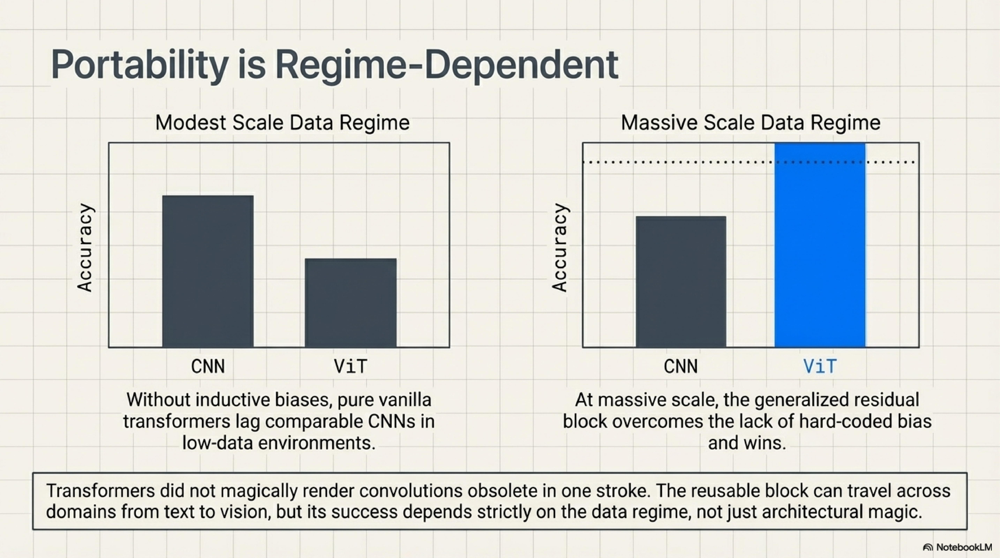

## Families, Recipes, and Controlled Non-Uniformity (2017-2024)

Once the field has a reliable block, the natural design question rises above the individual model instance. Neural architecture search made that shift explicit by treating the search space itself as a designed object. In the original NAS work, what is specified is no longer only a single architecture but a controlled population of admissible operations and compositions over which a search procedure can operate. DARTS sharpens the move by relaxing discrete architectural choices into a differentiable surface. Neither paper should be exaggerated into the literal driver of frontier large-model practice. Their value is historical and conceptual. They make it obvious that the object of design can be the space of possible models rather than one fixed diagram. RegNet states that turn even more cleanly. Radosavovic and colleagues explicitly design a network design space whose good models are governed by simple regularities and quantized linear rules, and they treat the quality of a design space as something to analyze distributionally rather than instance by instance. That distributional move matters because it changes what architectural understanding looks like. The goal is no longer only to explain why one network won. It is to define a regime in which many nearby networks behave well for reasons that can be stated simply. At that point architecture is no longer just a blueprint. It is a family discipline: a population of architectures sharing one structural rule set (Zoph and Le, 2017; Liu et al., 2019; Radosavovic et al., 2020).

This is the point where the essay stops talking about one diagram and starts talking about rules for a population:

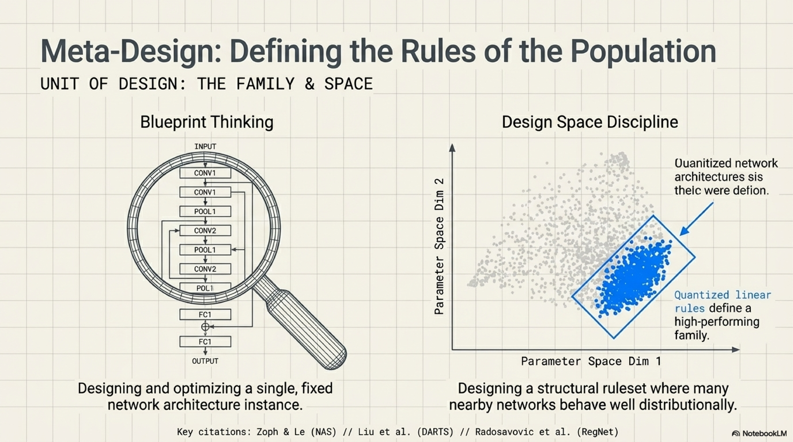

The scaling-law literature moves the target upward again by forcing the field to care about how a family behaves under enlargement and training, not merely whether one representative model looks elegant. Kaplan and colleagues show smooth power-law relationships between performance and scale factors such as parameters, data, and compute, with relatively weak dependence on many other shape choices within a broad transformer regime. That result does not make architecture irrelevant. It makes stable architectural families more valuable, because their scaling behavior becomes part of what is being designed. Once performance varies smoothly with scale, a family can be judged not only by what it does at one size but by whether it remains a good bet across many budgets. The winning architecture is increasingly the one that stays predictable while scale changes, not the one that dazzles at one carefully tuned operating point (Kaplan et al., 2020). The distinction from the previous paragraph matters here. RegNet is about what kind of model family should exist. Kaplan begins to show what kind of scaling behavior makes such a family attractive. Hoffmann and colleagues then push that second question into a genuine recipe claim by arguing that many large models were significantly undertrained. Compute-optimal scaling requires model size and training tokens to grow far more evenly than the field had recently assumed. Chinchilla matters because it turns training allocation into a design variable rather than a downstream implementation detail. A model family is not just a block stacked many times. It is a block plus a recipe for how parameter count, data, and compute should be spent together, and that recipe can materially change which family looks best in practice (Hoffmann et al., 2022).

At that point the design target is no longer only the family topology. It is also the compute recipe that decides how the family should be trained and budgeted:

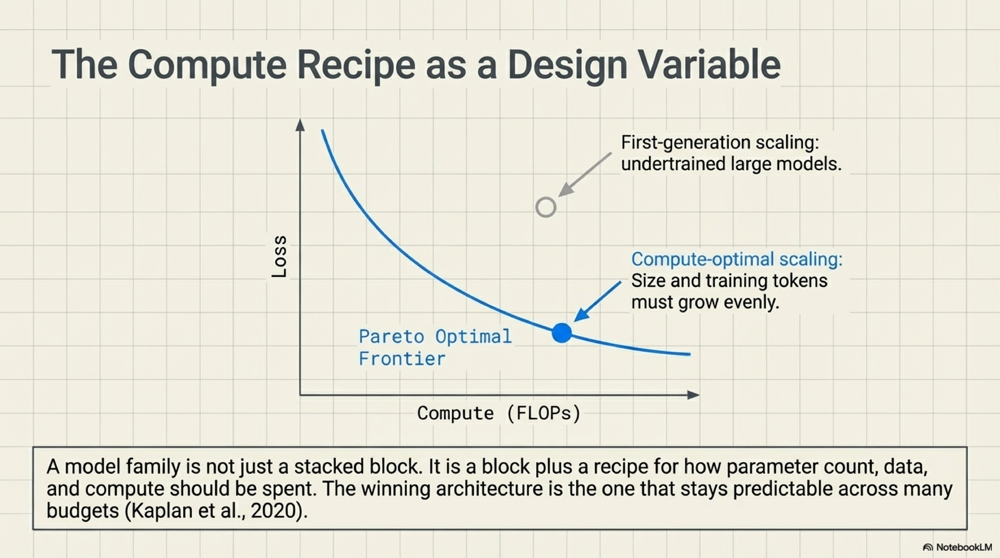

This is also the context in which smaller operator-level changes become historically meaningful without being inflated into grand theories. Once the transformer scaffold stabilizes, improvements often arrive not by replacing the backbone but by refining the operators that live inside it. RMSNorm argues that full recentering is not always necessary for effective normalization, offering a cheaper and often competitive alternative inside deep architectures (Zhang and Sennrich, 2019). GLU variants show that gated feed-forward layers can improve transformer quality under matched budgets, making the feed-forward sub-block itself a live target of refinement rather than a solved detail (Shazeer, 2020). This is the inward side of the new design regime. When the external scaffold is stable, the pressure to innovate shifts toward sub-block choices whose effects can propagate across an entire family without changing its identity. These papers belong to the stabilized-scaffold regime. Progress now comes from disciplined edits inside a standard block recipe rather than from wholesale replacement of the backbone. Local operator choices matter, but they matter as refinements of a trusted external form.

That inward turn is easier to read as sub-block editing inside a stable external recipe:

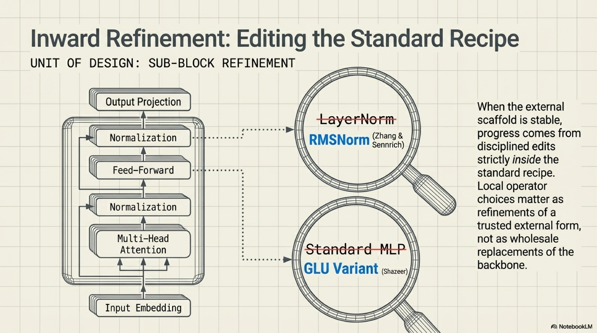

Mixture-of-experts models are where non-uniformity returns, and the history only makes sense if that return is described carefully. Shazeer and colleagues did not reintroduce old-style handcrafted heterogeneity. They made sparse conditional computation operational inside a larger learned system by letting a router activate only a small subset of experts per example while explicitly managing balance across them (Shazeer et al., 2017). The important point is that specialization reappears as a routing problem, not as a hand-authored module inventory. Switch Transformers make the recipe simpler and more adoptable by routing each token to just one expert, cutting some of the communication and training complexity that had limited broader uptake while preserving the core advantage of sparse specialization (Fedus et al., 2021). Mixtral then shows the same pattern in a contemporary open-weight setting: the model keeps an otherwise familiar transformer architecture and swaps the dense feed-forward block for routed experts selected per token (Jiang et al., 2024). That is why MoE belongs in this essay. It is not a repudiation of the scaffold story. It is the controlled return of heterogeneity *inside* a scaffold stable enough to host it without collapsing back into bespoke design.

The visual point is that specialization returns through routing inside a stable scaffold, not through a relapse into handcrafted module inventories:

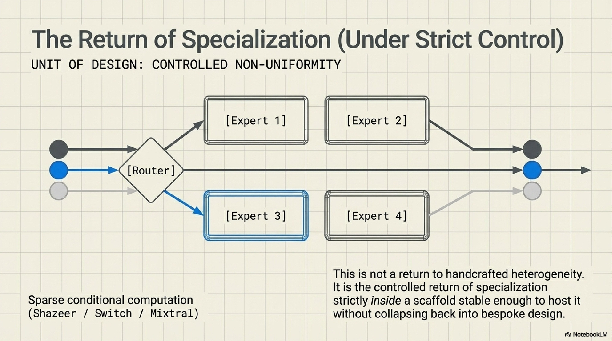

## Conclusion

The line from AlexNet to contemporary large models is not best understood as a parade of ever more powerful architectures. It is better understood as a change in what architecture design is trying to control. Early systems still looked like hand-built stacks whose local stages embodied much of the designer's theory about the task. VGG made repetition respectable. ResNet and the identity-mapping work made repeated depth truly viable by turning path discipline into a first-class design concern. The transformer then packaged that discipline into a portable block that could scale within language and, under the right data regime, travel into vision. Once those blocks stabilized, the design target moved upward toward families and compute-aware recipes, while operator refinements and MoE models showed how local departures from uniformity could be introduced without abandoning the scaffold.

The deeper change is that architecture ceased to be the place where one scripts competence layer by layer and became the place where one specifies which kinds of order training can reliably elaborate. That is why modern architectural progress can look oddly conservative on the surface. The diagram changes less because the real object under refinement is no longer the individual model but the regime that can survive repetition, scale, and controlled exception. Older criteria for architectural cleverness therefore lost prestige. A model no longer matters because it presents a novel internal diagram. It matters when its governing scaffold can absorb depth, transfer, and local specialization without becoming opaque or brittle. The architect's job is no longer to hand-author the machine in detail. It is to define a scaffold sturdy enough that training can specialize within it without tearing it apart.

The whole trajectory is easier to keep in view as nested layers of control rather than as one last competing section diagram:

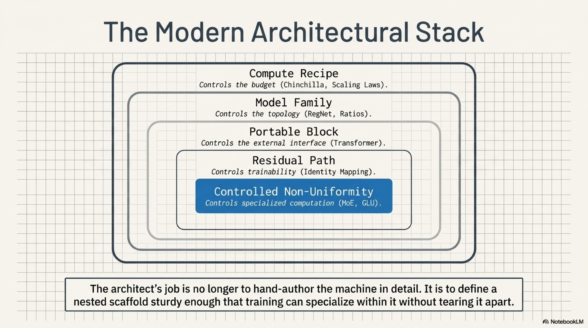

## References

### Krizhevsky et al. (2012)

*ImageNet Classification with Deep Convolutional Neural Networks*  
<https://papers.nips.cc/paper/4824-imagenet-classification-with-deep-convolutional-neural-networks>

AlexNet is the baseline for the older design picture. The paper matters here because it shows a historically successful network whose architecture is still strongly shaped by local judgment about stage order, receptive fields, and dense heads.

### Simonyan and Zisserman (2014)

*Very Deep Convolutional Networks for Large-Scale Image Recognition*  
<https://arxiv.org/abs/1409.1556>

VGG is the first clean demonstration that repeated small convolutions can outperform more decorated local design. Its role in the essay is to make repetition historically credible before repetition becomes fully trainable at scale.

### Szegedy et al. (2014)

*Going Deeper with Convolutions*  
<https://arxiv.org/abs/1409.4842>

Inception keeps local heterogeneity alive as a serious alternative at exactly the moment VGG is making regularity look attractive. The paper prevents the history from being flattened into an inevitability story in which uniform repetition was the only available path.

### He et al. (2015)

*Deep Residual Learning for Image Recognition*  
<https://arxiv.org/abs/1512.03385>

This is the essay's central hinge. ResNet reframes depth as additive refinement and turns repeated blocks from a stylistic simplification into a scalable optimization strategy.

### He et al. (2016)

*Identity Mappings in Deep Residual Networks*  
<https://arxiv.org/abs/1603.05027>

The identity-mappings paper sharpens the residual argument by showing that clean shortcut paths matter materially. It licenses the stronger claim that path discipline, not just extra branching, is what changed the trainability of depth.

### Veit et al. (2016)

*Residual Networks Behave Like Ensembles of Relatively Shallow Networks*  
<https://arxiv.org/abs/1605.06431>

This paper is used here for its path argument, not for the shallow "ResNets are ensembles" slogan. It helps explain why very deep residual networks remain trainable by embedding short effective routes inside a much deeper scaffold.

### Li et al. (2018)

*Visualizing the Loss Landscape of Neural Nets*  
<https://arxiv.org/abs/1712.09913>

Li et al. connect architecture to optimization geometry. Their results support the claim that skip connections help delay the onset of chaotic loss landscapes, making them an important bridge between structural design and practical trainability.

### Vaswani et al. (2017)

*Attention Is All You Need*  
<https://arxiv.org/abs/1706.03762>

The transformer matters here because it turns residual discipline into a repeatable, parallel block recipe. The essay relies on this paper as the point where reusable-block design becomes portable beyond convolutional vision history.

### Clark et al. (2019)

*What Does BERT Look At? An Analysis of BERT's Attention*  
<https://arxiv.org/abs/1906.04341>

Clark et al. provide evidence that repeated transformer blocks can differentiate internally after training. The paper is useful precisely because its claim is local and restrained, not because it offers a full reverse engineering of BERT.

### Tenney et al. (2019)

*BERT Rediscovers the Classical NLP Pipeline*  
<https://arxiv.org/abs/1905.05950>

Tenney et al. support a carefully limited claim about ordered layerwise stratification inside pretrained transformers. The paper matters because it shows how a repeated scaffold can recover staged functionality without needing bespoke architectural compartments.

### Radford et al. (2019)

*Language Models are Unsupervised Multitask Learners*  
<https://cdn.openai.com/better-language-models/language_models_are_unsupervised_multitask_learners.pdf>

GPT-2 is used here to show that a stable transformer block can serve as a scaling unit. The paper's argumentative job is not to prove all later scaling-law claims, but to show that capability can rise without architectural redesign.

### Dosovitskiy et al. (2020)

*An Image is Worth 16x16 Words*  
<https://arxiv.org/abs/2010.11929>

ViT strengthens the portability claim while preserving an important limit. The paper shows that a vanilla transformer can travel into vision under sufficient data and pretraining scale, while also making clear that inductive bias still matters in smaller-data regimes.

### Zoph and Le (2017)

*Neural Architecture Search with Reinforcement Learning*  
<https://arxiv.org/abs/1611.01578>

NAS matters because it makes the search space itself into a designed object. In this essay it marks the early upward move from designing one model instance to designing a controlled space of admissible models.

### Liu et al. (2019)

*DARTS: Differentiable Architecture Search*  
<https://arxiv.org/abs/1806.09055>

DARTS pushes architectural choice into the language of continuous optimization. Its value here is conceptual rather than literal frontier relevance: it makes architecture legible as something that can itself be optimized.

### Radosavovic et al. (2020)

*Designing Network Design Spaces*  
<https://arxiv.org/abs/2003.13678>

RegNet is the clearest single paper in the local source set for the claim that the design target can be a family rather than one network. The essay depends on it to justify the shift from blueprint thinking to design-space discipline.

### Kaplan et al. (2020)

*Scaling Laws for Neural Language Models*  
<https://arxiv.org/abs/2001.08361>

Kaplan et al. matter because they make scaling behavior part of the architectural conversation. The paper is used here to show that stable families increasingly win not only because they work, but because their behavior under enlargement becomes predictable.

### Hoffmann et al. (2022)

*Training Compute-Optimal Large Language Models*  
<https://arxiv.org/abs/2203.15556>

Chinchilla corrects the first-generation scaling recipe by showing that many large models were undertrained. Its role in the essay is to make compute-aware training allocation part of the design target itself.

### Zhang and Sennrich (2019)

*Root Mean Square Layer Normalization*  
<https://arxiv.org/abs/1910.07467>

RMSNorm supports a narrow but important point about local operator refinement inside a stable block. It helps show how architectural progress continues after scaffold stabilization without requiring wholesale redesign.

### Shazeer (2020)

*GLU Variants Improve Transformer*  
<https://arxiv.org/abs/2002.05202>

This paper gives the feed-forward refinement story a concrete footing. It shows how gated MLP variants improve transformer blocks under controlled comparisons, which is exactly the kind of inward refinement the essay needs.

### Shazeer et al. (2017)

*Outrageously Large Neural Networks: The Sparsely-Gated Mixture-of-Experts Layer*  
<https://arxiv.org/abs/1701.06538>

Shazeer et al. are the historical anchor for the return of specialization. The paper matters because it makes sparse conditional computation operational without returning to dense handcrafted heterogeneity.

### Fedus et al. (2021)

*Switch Transformers: Scaling to Trillion Parameter Models with Simple and Efficient Sparsity*  
<https://arxiv.org/abs/2101.03961>

Switch Transformers belong here because they simplify MoE routing enough to make sparse specialization more adoptable at large scale. Their role is to show controlled non-uniformity becoming a workable recipe inside a stable transformer scaffold.

### Jiang et al. (2024)

*Mixtral of Experts*  
<https://arxiv.org/abs/2401.04088>

Mixtral serves as a late exemplar rather than an origin story. It shows that routed expert structure remains active in current practice while preserving the familiar transformer scaffold around it.
